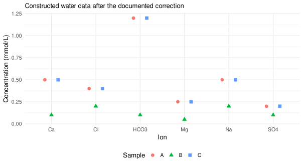

Use the [notes](notes.qmd). All numerical inputs below are constructed
teaching examples; use the stated assumptions rather than looking up extra
constants. Predict the direction of change before calculating.

## 1. Charge and mass units

A sample contains 40.08 mg/L calcium. Use molar mass 40.08 g/mol. Convert to mmol/L and meq/L.

::: {.callout-tip collapse="true" title="Hint"}
A molar mass in g/mol has the same numerical value in mg/mmol.
:::

::: {.callout-note collapse="true" title="Worked solution"}
Calcium is **1.000 mmol/L** and contributes **2.000 meq/L**. Milligrams cannot be added directly to milliequivalents.
:::

## 2. A weak acid

For a fictitious HA with pKa 5.00 and total HA + A⁻ = 0.200 mmol/L, calculate the two concentrations at prescribed pH 6.00.

::: {.callout-tip collapse="true" title="Hint"}
Calculate r = 10, then split the total in the proportion 1:10.
:::

::: {.callout-note collapse="true" title="Worked solution"}
HA = **0.01818 mmol/L**; A⁻ = **0.1818 mmol/L**. Their sum is 0.200 mmol/L. These are equilibrium concentrations at supplied pH.
:::

## 3. Ionic strength

A dilute solution contains 1.00 mmol/L Ca²⁺ and 2.00 mmol/L Cl⁻, with other ions negligible. Calculate ionic strength in mol/L.

::: {.callout-tip collapse="true" title="Hint"}
Square the charge number in each contribution.
:::

::: {.callout-note collapse="true" title="Worked solution"}
I = ½[(0.00100)(4) + (0.00200)(1)] = **0.00300 mol/L**. This is not the total molar concentration or total dissolved mass.
:::

## 4. A charge mismatch

An analysis has 2.00 meq/L cations and 1.64 meq/L anions. Calculate the signed imbalance. Should you change raw measurements until the table balances?

::: {.callout-tip collapse="true" title="Hint"}
Use the stated denominator: sum of both charge totals.
:::

::: {.callout-note collapse="true" title="Worked solution"}
The imbalance is **+9.89%**. Investigate units, omitted ions, methods, and uncertainty. Do not invent a correction or treat this teaching value as a universal acceptance threshold. Preserve original observations and document evidence for any correction.
:::


## Activity A: water table in R

Download these files into one project folder:

- [water-ions.csv](water-ions.csv), the constructed original table.
- [corrections.csv](corrections.csv), the evidence for one correction.
- [water-analysis.R](water-analysis.R), the supplied calculation.
- [water-report.Rmd](water-report.Rmd), the report template.
- [Data dictionary](data-dictionary.qmd), which defines the quantities.

Before running R, calculate the calcium contribution for sample A by hand.
20.04 mg/L divided by 40.08 mg/mmol gives 0.500 mmol/L; its divalent charge
contributes 1.00 meq/L. Predict whether sample C balances if its sulfate value
is only one tenth of sample A's while its other entries match A.

Read the script in the editor. Then run from the activity folder:

```r
source("water-analysis.R")
raw_balance
corrections
corrected_balance
water_plot
```

The script reuses `read_csv()`, `mutate()`, `group_by()`, `summarise()`, and
`ggplot()`. Its new chemical operation is multiplying molar concentration by
charge magnitude. [`if_else()`](https://dplyr.tidyverse.org/reference/if_else.html)
separates positive and negative contributions without changing the raw table.
The narrowly specified row replacement applies the supplied fictional lab record;
you do not need to write a general data-cleaning program.

Explain the original charge discrepancy, inspect the correction evidence,
and compare the waters after correction. Complete the report prompts. Restart R
and Knit `water-report.Rmd`, or use
`rmarkdown::render("water-report.Rmd")` from the same folder.

::: {.callout-note collapse="true" title="Expected checks and interpretation"}
Raw A has 2.00 meq/L cations and 2.00 meq/L anions; raw B has 0.500 of each.
Raw C has 2.00 and 1.64, giving **+9.89%** imbalance. The supplied lab record
corrects C sulfate from 1.9212 to 19.212 mg/L. After that documented correction,
C matches A and all signed imbalances are zero to numerical precision.

The plot compares **mmol/L**, while the balance uses **meq/L**. Valence changes
the conversion. The balance flags a mismatch; it does not identify the sulfate
error without the extra record, nor prove all analyses correct after closure.
There is no statistical treatment-group comparison here: A, B, and C are
constructed sample identities, not replicate experiments.
:::


