## About this lecture

:::: {.columns}
::: {.column width="55%"}
In August 2022, **hundreds of tonnes of dead fish** washed up along the Oder, the river between Poland and Germany. Investigators had to work out what was in the water. Their answer combined several factors: unusually **salty** water from industrial discharges, low flow, heat, and a bloom of a toxic alga that thrives in salty water.

Every step of that investigation started from a **water analysis**: a table of numbers.

Today you will learn to:

- read what each number **means** (total, species, filtered);
- check a table with **charge balance**;
- decide when **activity** matters, and split a **weak acid** at a given pH.
:::
::: {.column width="45%"}
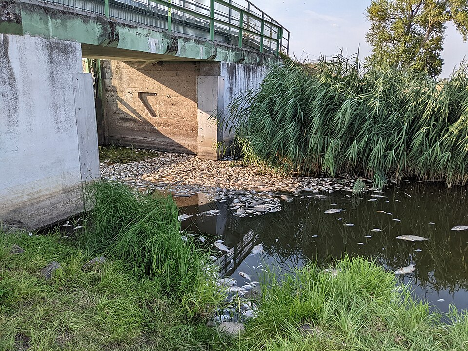{width="100%"}
[Dead fish on the Oder, August 2022. Photo: Hanno Böck, CC0, Wikimedia Commons.]{.credit}
:::
::::

::: notes
Open with the Oder disaster because it shows that water chemistry is not abstract. In the summer of 2022 a very large fish kill spread along the Oder. The official investigations pointed to a combination of causes rather than one poison: high salt content from discharges, low water levels, high temperatures, and a bloom of the golden alga Prymnesium parvum, which produces toxins and grows well in brackish water. So far in the course we have followed chemicals through the air and the climate system. From today we move into water. This first water lecture gives the tools for reading any water analysis. The next two lectures apply them to carbonate chemistry.
:::

## Water is a reaction medium

:::: {.columns}
::: {.column width="55%"}
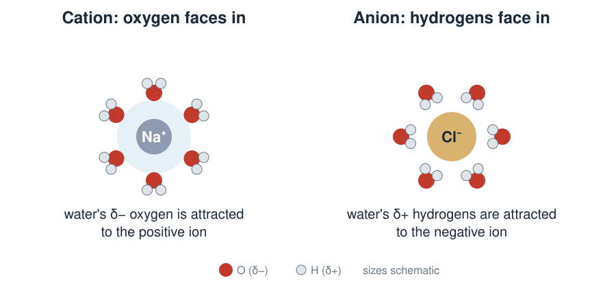{width="100%"}
:::
::: {.column width="45%"}
Water molecules are **polar**: the oxygen end is slightly negative, the hydrogen ends slightly positive. That is why salts dissolve: each ion is wrapped in a **hydration shell** of oriented water molecules.

A dissolved ion is therefore not alone. It interacts with water, with other ions and with any molecule that can bind it.

So a water sample is a **mixture of reacting species**. Before we calculate anything, we need to know which of those species a laboratory number actually describes.
:::
::::

::: notes
Start from the molecular picture. Sodium chloride dissolves because water's partial charges stabilise the separated ions. Around a cation the water oxygens point inward; around an anion the hydrogens point inward. The sizes in the sketch are schematic. The important consequence for us is that dissolved substances react and interact. Calcium can pair with sulfate, iron can bind to organic molecules, carbon dioxide can react with water to form bicarbonate. A laboratory measurement rarely captures one of these forms on its own. That leads to the first practical question of the lecture: when a report says "iron, 0.3 milligrams per litre", what exactly has been measured?
:::

## What does one number in a water table mean?

:::: {.columns}
::: {.column width="60%"}
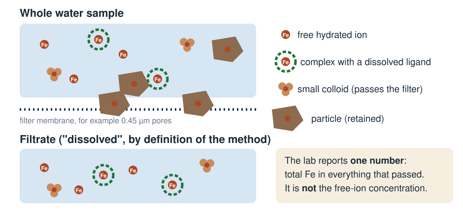{width="100%"}
:::
::: {.column width="40%"}
Ask three questions of every entry:

1. Is it an **element total** or one **species**?
2. **Whole water** or a **filtered** fraction? "Dissolved" usually means "passed a 0.45 µm filter".
3. Is the mass reported **as the element** (mg Fe/L) or **as a compound** (mg CaCO₃/L)?

A filtered total can include complexes and small colloids, not only free ions.
:::
::::

::: notes
Walk through the diagram from top to bottom. The whole sample contains free hydrated ions, ions bound to dissolved ligands, small colloids and larger particles. A filter is a method decision, not a law of nature: the particles stay behind, everything else passes and is analysed together. The laboratory then reports one number, usually the total of the element in the filtrate. That number is not the concentration of the free ion, which is often the form that matters for toxicity. The third question catches a frequent error: hardness and alkalinity are often reported as milligrams of calcium carbonate per litre, which is a different number from milligrams of calcium.
:::

## Mass, moles and charge

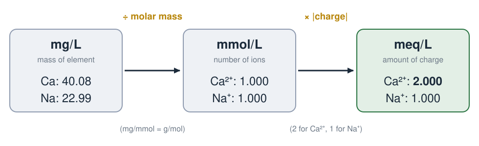{width="80%" fig-align="center"}

Laboratories report **mg/L**, but chemistry counts **particles** and **charges**. Divide by molar mass to get mmol/L. Multiply by the size of the charge to get **milliequivalents (meq/L)**.

A calcium result of 40.08 mg/L is 1.000 mmol/L, but **2.000 meq/L**, because each Ca²⁺ carries two charges.

::: notes
This conversion is the first calculation on any ion table, and it is where many mistakes happen. A molar mass in grams per mole has the same number as milligrams per millimole, so dividing milligrams per litre by molar mass gives millimoles per litre directly. Milligrams of different ions cannot be added in any meaningful way, because a milligram of sodium contains far more ions than a milligram of sulfate. Equivalents count charge, so they can be added and compared across ions. Exercise one is exactly this calculation. Ask students to convert 22.99 milligrams per litre of sodium in their heads before showing the right-hand box.
:::

## Charge must balance

:::: {.columns}
::: {.column width="45%"}
Bulk water is **electrically neutral**. For each ion, multiply its concentration by the size of its charge. Then add up the cations and, separately, the anions. The two totals must be equal.

**Worked example** (mmol/L): Ca²⁺ 0.500, Mg²⁺ 0.250, Na⁺ 0.500; HCO₃⁻ 1.200, Cl⁻ 0.400, SO₄²⁻ 0.200.

Cations: 1.000 + 0.500 + 0.500 = **2.000 meq/L**. Anions: 1.200 + 0.400 + 0.400 = **2.000 meq/L**.
:::
::: {.column width="55%"}
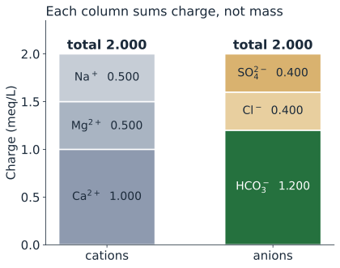{width="100%"}
:::
::::

::: notes
Electroneutrality is one of the most reliable constraints in water chemistry. A litre of water cannot carry a measurable net charge: the electrostatic energy would be enormous. So every positive charge in the table must be matched by a negative charge. The worked example is the simplified ion set from the notes. Notice that the divalent ions count twice: 0.500 millimoles per litre of calcium supplies a full milliequivalent. Hydrogen and hydroxide ions are left out because at near-neutral pH they are tiny compared with the major ions. Ask students what the right-hand column would look like if somebody had forgotten to double the sulfate.
:::

## When the balance does not close

:::: {.columns}
::: {.column width="55%"}
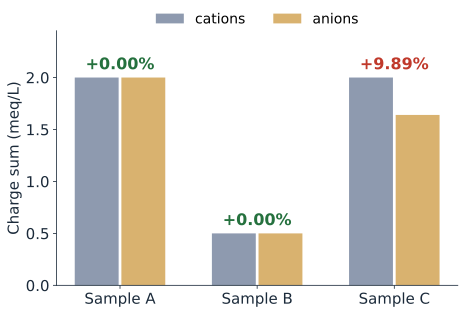{width="100%"}
:::
::: {.column width="45%"}
Three constructed samples from the R activity. A and B balance. Sample C does not:

$$\text{imbalance}=\frac{\text{cations}-\text{anions}}{\text{cations}+\text{anions}}\times100$$

$$=\frac{2.00-1.64}{3.64}\times100=+9.89\%$$

A positive sign means anions are **missing**. The water itself is not charged. Something in the analysis or the table is wrong or incomplete.
:::
::::

::: notes
Use a consistent sign convention; ours is cations minus anions, divided by the sum. A gap tells us that the table does not describe the water correctly. Possible reasons include an ion that was not measured, a unit or transcription error, a species assigned the wrong charge, or ordinary analytical uncertainty. Many laboratories have an acceptance range for this imbalance, but there is no universal threshold, and we do not use one here. Ask the class: sample C has positive imbalance, so is something too large among the cations or too small among the anions? Either is possible. The balance tells us that something is wrong, not what.
:::

## Find the cause; never fudge the data

:::: {.columns}
::: {.column width="45%"}
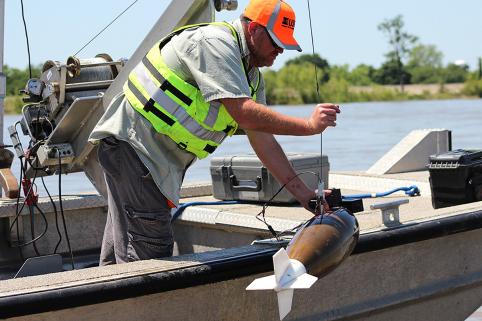{width="100%"}
[USGS hydrologist collecting a water-quality sample, Mississippi River at Baton Rouge. Photo: Scott Dennis/USGS, public domain, Wikimedia Commons.]{.credit}
:::
::: {.column width="55%"}
In sample C, sulfate was entered as **1.9212 mg/L**. The laboratory record shows the decimal point was misplaced: the true value is **19.212 mg/L**.

- 1.9212 mg/L → 0.040 meq/L
- 19.212 mg/L → 0.400 meq/L

The missing 0.36 meq/L is exactly the gap. After the **documented** correction all three samples balance.

**Never adjust raw numbers until a table balances.** Keep the original, record the evidence, then correct.
:::
::::

::: notes
This is a constructed laboratory record, used in the R activity. The point is professional practice. A charge balance can flag a problem but it cannot tell you which number is wrong. Here a separate record identifies a transcription error, and the corrected value closes the gap exactly. Without that record, you would report the imbalance and investigate, not invent a value. The R script keeps the original table and applies the correction as a separate, documented step, which is how real data handling should work. Closure after correction is a consistency check. It does not prove every number in the table is right, because two errors could cancel.
:::

## Same ions, different waters

:::: {.columns}
::: {.column width="58%"}
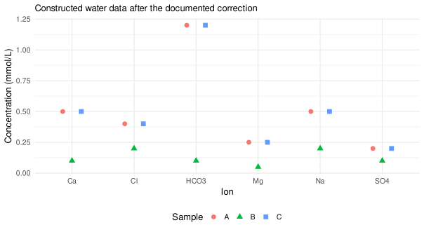{width="100%"}
:::
::: {.column width="42%"}
After the correction, sample C coincides with A. Sample B is a much more dilute water: every ion is lower.

The plot shows **mmol/L**, the number of ions. The charge balance used **meq/L**. For divalent Ca²⁺, Mg²⁺ and SO₄²⁻ the two differ by a factor of two.

Comparing waters is easier once the table has been checked. A salty river like the Oder in 2022 would stand out immediately in Na⁺ and Cl⁻.
:::
::::

::: notes
This is the plot from the R activity. Students should recognise that the visual comparison is only trustworthy after the table has passed its checks: before the correction, sample C appeared to have almost no sulfate. Remind them which unit is on the axis. When they write the report, they need to state whether they are comparing amounts of ions or amounts of charge. The link back to the Oder is qualitative. In a salt-polluted river the sodium and chloride entries would be many times higher than in an ordinary river. That leads to the next question: when water becomes salty, do our simple concentration calculations still hold?
:::

## Ions feel each other

:::: {.columns}
::: {.column width="56%"}
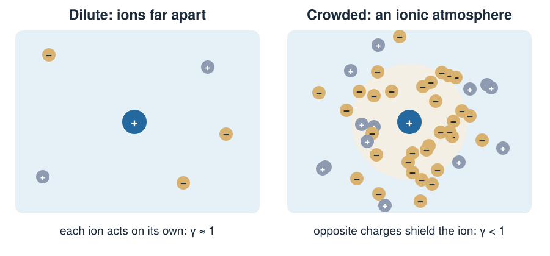{width="100%"}
:::
::: {.column width="44%"}
In dilute water each ion acts almost on its own. In salty water, each ion is surrounded by a slight excess of **opposite charge**, an **ionic atmosphere**. That shielding makes the ion behave as if it were **less concentrated**.

Equilibrium constants are therefore written with **activities**:

$$a_i=\gamma_i\,c_i/c^\circ$$

γ is the activity coefficient; c° = 1 mol/L. When γ ≈ 1, activity ≈ concentration.
:::
::::

::: notes
Give the physical picture before the formula. An ion surrounded by other ions is partly screened from its surroundings, so it is less able to react or to escape than its concentration suggests. The activity coefficient measures this effect. Thermodynamic equilibrium constants, such as acid constants and solubility products, are strictly defined with activities. In our dilute teaching examples we use concentrations, which amounts to assuming gamma is one. That is an approximation, and students need to know when it is acceptable. The positions of the ions in the sketch are schematic: the real atmosphere is a small statistical excess of opposite charge, not a fixed shell.
:::

## Ionic strength measures how crowded the water is

:::: {.columns}
::: {.column width="48%"}
$$I=\tfrac12\left(c_1z_1^2+c_2z_2^2+c_3z_3^2+\dots\right)$$

one term for every ion in the water.

The charge is **squared**, so divalent ions count four times as much per mole.

**Worked example:** 1.00 mmol/L Ca²⁺ and 2.00 mmol/L Cl⁻:

I = ½ (1.00 × 4 + 2.00 × 1) = **3.00 mmol/L** = 0.00300 mol/L.

This is **not** the total concentration (3.00 mmol/L of ions is a coincidence here) and not the mass of salt.
:::
::: {.column width="52%"}
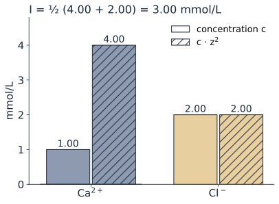{width="100%"}
:::
::::

::: notes
Ionic strength is the single number that summarises how strongly the ions in a solution interact. Squaring the charge reflects that electrostatic effects grow strongly with charge. Work the example from exercise three slowly. The calcium contributes four millimoles per litre to the sum, the chloride two, and half of six is three. Point out the coincidence: here the ionic strength happens to equal the total ion concentration in number, but that is not true in general. For a sulfate salt it would not be. The worked ion table from earlier in the lecture has an ionic strength close to 0.003 mol per litre as well, which is typical for a moderately hard freshwater.
:::

## How big is the activity correction?

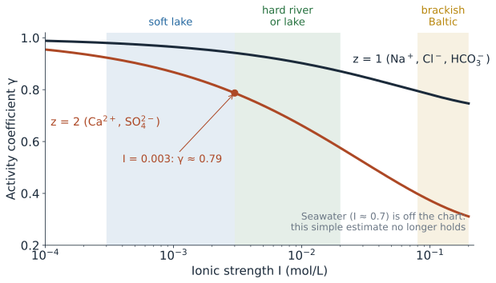{width="80%" fig-align="center"}

Estimated with the Davies equation. At I = 0.003 a **monovalent** ion has γ ≈ 0.94 and a **divalent** ion γ ≈ 0.79. In brackish water such as the central Baltic, divalent ions fall to roughly γ ≈ 0.35. **Freshwater calculations tolerate γ ≈ 1; salty water does not.**

::: notes
The curves come from the Davies equation, a standard estimate for dilute to moderately salty water. Its details are not examinable; the message is. In a soft lake the correction for single-charged ions is a few percent, small compared with other uncertainties in a teaching model. Divalent ions are already about twenty percent off in a moderately hard water. In brackish or salt-polluted water the correction becomes large, and seawater needs dedicated models and constants. That is why this course states the dilute-freshwater approximation every time we use it, and why constants from freshwater must never be carried unexamined into seawater or into a salt-polluted river like the Oder in 2022.
:::

## A simple acid: the ratio rule

:::: {.columns}
::: {.column width="48%"}
For a weak acid $\mathrm{HA\rightleftharpoons H^++A^-}$:

$$\frac{[\mathrm{A^-}]}{[\mathrm{HA}]}=10^{\,\mathrm{pH}-pK_a}$$

- pH = pK~a~: ratio 1, half each
- pH = pK~a~ + 1: ratio 10, A⁻ fraction **10/11 = 0.909**
- pH = pK~a~ − 1: ratio 0.1, A⁻ fraction 0.091

The fraction of A⁻ is $r/(1+r)$, with $r$ the ratio.
:::
::: {.column width="52%"}
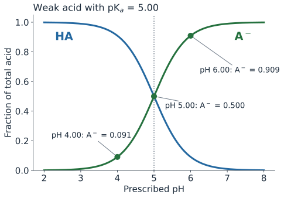{width="100%"}
:::
::::

::: notes
This is the second tool of the lecture and it returns in almost every later unit. Taking the logarithm of the acid equilibrium expression gives the ratio rule: every pH unit above the pKa multiplies the ratio of base to acid form by ten. A ratio is not a fraction. At one unit above the pKa, the ratio is ten to one, so the fraction of A-minus is ten parts out of eleven, or 0.909, not 0.9 and not ten. The curve is the same calculation repeated at many prescribed pH values. The horizontal axis is a pH that we choose. Nothing in this formula predicts what the pH of a water will be.
:::

## Worked example: splitting a total

:::: {.columns}
::: {.column width="52%"}
A fictitious acid HA has pK~a~ = 5.00. The total HA + A⁻ is 0.200 mmol/L. The pH is measured as 6.00.

1. Ratio: $r=10^{6.00-5.00}=10$
2. Split the total 1 : 10, that is into 11 parts
3. HA = 0.200/11 = **0.01818 mmol/L**
4. A⁻ = 0.200 × 10/11 = **0.1818 mmol/L**

Check: 0.01818 + 0.1818 = 0.200.

The **pH was given**. A distribution formula does not produce a pH; that needs a measurement or another balance.
:::
::: {.column width="48%"}
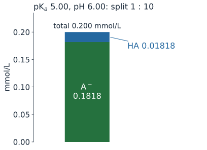{width="100%"}
:::
::::

::: notes
This is exercise two. Take students through the steps in order and insist on the check that the parts add back to the total. Common slips are to use the ratio as if it were the fraction, or to give A-minus as 0.18 and HA as 0.02 without noticing that the total is then wrong in the third figure. Stress the final sentence. A student who is asked "what is the pH of this water" cannot answer from the pKa and total alone. In the next lecture, alkalinity provides the extra balance that does determine pH in carbonate waters.
:::

## Why the split matters: ammonia and fish

:::: {.columns}
::: {.column width="52%"}
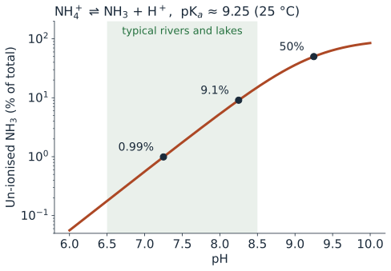{width="100%"}
:::
::: {.column width="48%"}
Ammonium is a weak acid:

$$\mathrm{NH_4^+\rightleftharpoons NH_3+H^+},\quad pK_a\approx9.25\ (25\ ^\circ\mathrm{C})$$

The **uncharged NH₃** passes easily through fish gills and is the main toxic form. The ion NH₄⁺ is far less harmful.

Same total ammonia, but NH₃ rises **tenfold per pH unit**: about 1% at pH 7.25, 9% at pH 8.25. Water-quality limits for ammonia therefore depend on pH and temperature.
:::
::::

::: notes
This is the reason environmental chemists care about weak-acid splits. The total ammonia in a river comes from wastewater, agriculture and decay. Its toxicity depends on how much is in the neutral form, which can cross biological membranes. The ratio rule tells us directly that each pH unit changes the toxic fraction tenfold. In productive, warm rivers, daytime photosynthesis removes carbon dioxide and can raise pH, increasing the neutral fraction at the warmest time of day. Temperature also shifts the pKa. The same total ammonia result can therefore be harmless in one water and toxic in another, which is why guidelines are tabulated against pH and temperature.
:::

## Check yourself

::: {.checkbox}
1. Convert 24.31 mg/L Mg²⁺ (molar mass 24.31 g/mol) to mmol/L and meq/L.
2. A table gives 1.50 meq/L cations and 1.50 meq/L anions. Does that prove every value is correct?
3. Which has the larger ionic strength: 1 mmol/L NaCl or 1 mmol/L MgSO₄?
4. An acid has pK~a~ 4.00. At pH 6.00, what fraction is in the A⁻ form?
5. "Dissolved iron is 0.30 mg/L, so the free Fe³⁺ is 0.30 mg/L." What is wrong?
:::

::: notes
Answers. One: 1.000 millimoles per litre and 2.000 milliequivalents per litre. Two: no. Closure is a consistency check; compensating errors or a missing pair of ions could still be hidden. Three: magnesium sulfate. Sodium chloride gives one millimole per litre, magnesium sulfate gives one half of four plus four, which is four millimoles per litre. Four: the ratio is one hundred, so the fraction is one hundred out of one hundred and one, about 0.990. Five: the filtered result is an element total that includes complexes and colloids, and free ferric iron is extremely low at natural pH. Give students two minutes before revealing answers.
:::

## A different kind of change: redox

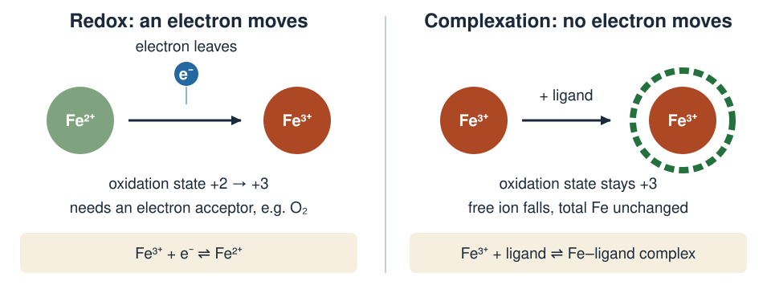{width="80%" fig-align="center"}

In a **redox** reaction an electron moves and an **oxidation state** changes: Fe²⁺ → Fe³⁺. In **complexation** a ligand binds but no electron moves: Fe³⁺ stays +3. Both change the free-ion concentration, for different reasons. Both pH and redox conditions control metal speciation.

::: notes
Up to now everything was acid–base or simple counting. A short bridge to redox, which is developed fully in week four. Make the distinction sharp. Oxidation is loss of electrons, reduction is gain. Iron(II) becoming iron(III) is oxidation, and it needs an electron acceptor such as dissolved oxygen. Binding to a ligand changes how the iron exists in solution, but the iron keeps its oxidation state. Students often call any change in a metal's form "oxidation". Ask them to classify three examples: copper binding to organic matter, ferrous iron meeting oxygen, and calcium pairing with sulfate. Only the second is redox.
:::

## Redox you can see: iron in a stream

:::: {.columns}
::: {.column width="50%"}
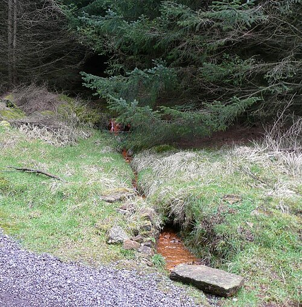{width="72%"}
[Ochre stream, Wooldale, West Yorkshire, England. Photo: Humphrey Bolton, CC BY-SA 2.0, Wikimedia Commons.]{.credit}
:::
::: {.column width="50%"}
Groundwater without oxygen can carry dissolved **Fe²⁺**, which is colourless. When it emerges and meets air:

$$\mathrm{4Fe^{2+}+O_2+10H_2O\rightarrow4Fe(OH)_3(s)+8H^+}$$

Iron(III) is almost insoluble near neutral pH, so an **orange-brown oxide** coats the stream bed.

The reaction also releases H⁺: oxidising iron is an **acid source**, which matters for mine drainage in week 3.
:::
::::

::: notes
This is a very common sight in old mining areas and in wetlands. The groundwater feeding such streams has lost its oxygen underground, so iron is present in the soluble ferrous form. At the surface oxygen arrives, iron is oxidised, and ferric hydroxide precipitates as the orange deposit called ochre. Balance the equation with the class if time allows: four irons each lose one electron, one oxygen molecule accepts four. The hydrogen ions on the right show that iron oxidation and precipitation acidify the water. We will meet this reaction again in acid mine drainage and in water treatment, where it is used deliberately to remove iron.
:::

## Favoured is not the same as fast

:::: {.columns}
::: {.column width="55%"}
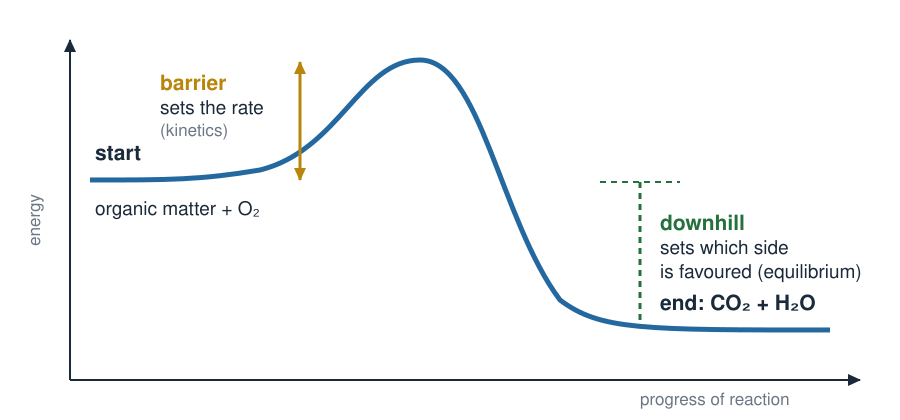{width="100%"}
:::
::: {.column width="45%"}
**Equilibrium** tells you which state is favoured under given conditions. **Kinetics** tells you how fast it is reached.

- Organic matter and O₂ react strongly downhill, yet leaves survive in a lake for months: the barrier is high without microbes.
- Fe²⁺ oxidation by O₂ is fast near neutral pH but very slow in acidic water.

An equilibrium model predicts the **destination**, not the **travel time**.
:::
::::

::: notes
This is one of the most important habits of mind in environmental chemistry. A thermodynamic calculation, including every equilibrium calculation in this course, tells us which direction a reaction can go and where it would end. It does not tell us how long it takes. Many environmentally important systems are far from equilibrium because the reactions are slow or need a catalyst, often microbes. The iron example is well known: at pH around seven, ferrous iron exposed to air oxidises within minutes to hours, but in strongly acidic water it can persist for a long time. When a field observation disagrees with an equilibrium prediction, ask first whether there was enough time.
:::

## Back to the Oder: reading the analysis

:::: {.columns}
::: {.column width="55%"}
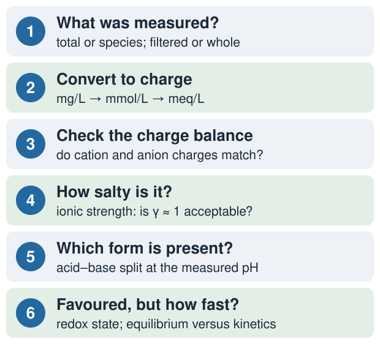{width="88%"}
:::
::: {.column width="45%"}
Investigators worked through questions like these:

- **What was measured?** Conductivity, major ions, oxygen, pH, nutrients, algae.
- **Charge and salt:** high Na⁺ and Cl⁻ meant high ionic strength. Freshwater constants and γ ≈ 1 no longer apply.
- **Speciation:** pH and temperature control toxic forms such as NH₃.
- **Rates:** a bloom developed over weeks of low, warm flow.

No single number explained the fish kill. A **checked, interpreted** analysis did.
:::
::::

::: notes
Return to the opening case and show that each tool of the lecture had a role. The six steps on the left are a checklist students can use on any water analysis, including in the exercises. We do not quote specific measured values from the Oder because they varied along the river and in time; the qualitative chain is well established. The salt, the alga and the hot, low-flow conditions acted together. This is a good example of why environmental chemistry rarely finds one cause. The chemistry tells you which explanations are consistent with the data and which measurements would separate them.
:::

## Common mistakes to avoid

- **Adding mg/L of different ions.** Convert to meq/L before comparing charge.
- **Forgetting the charge.** 1 mmol/L Ca²⁺ is 2 meq/L, and its charge counts four times in ionic strength.
- **"Dissolved" means free ion.** A filtered total includes complexes and colloids.
- **Forcing a balance.** Investigate an imbalance; correct only with evidence.
- **Ratio equals fraction.** A ratio of 10 is a fraction of 10/11.
- **A distribution formula gives pH.** The pH must be measured or found from another balance.
- **Equilibrium means it happens.** It tells you the direction, not the speed.

::: notes
Go through the list and ask students to give a one-sentence reason for each. The first two are calculation errors that cost marks in every exam. The third and fourth are interpretation errors that also happen in professional work: reporting filtered metal as if it were the bioavailable free ion, and "cleaning" data until it looks right. The last three are conceptual. Students will meet the sixth one again in the carbonate lecture, where alkalinity provides the missing balance. Encourage students to use this list as a self-check while working through the exercises and the R activity.
:::

## Summary {.smaller}

:::: {.columns}
::: {.column width="70%"}
| Concept | Key fact |
| --- | --- |
| A water-table entry | element total or species; filtered or whole; reported as element or compound |
| Units | mg/L ÷ molar mass = mmol/L; × \|charge\| = meq/L |
| Charge balance | total cation charge = total anion charge (meq/L); an imbalance flags errors or missing ions |
| Data practice | keep raw values; correct only with documented evidence |
| Ionic strength | I = ½ (c₁z₁² + c₂z₂² + …); divalent ions weigh four times |
| Activity | a = γc; γ ≈ 1 only in dilute water; salty water needs a correction |
| Weak acid | [A⁻]/[HA] = 10^(pH − pK~a~); fraction = r/(1 + r) |
| Ammonia | NH₃ (toxic form) rises tenfold per pH unit below pK~a~ ≈ 9.25 |
| Redox | electron transfer changes oxidation state; binding does not |
| Equilibrium vs kinetics | direction and end point versus speed |

**Next:** [Carbonate species and alkalinity](../carbonate-gases/lec.qmd). Why did acid rain kill fish in some Swedish lakes but not others? Then the [exercises](exercise.qmd) and the [notes](notes.qmd).
:::
::: {.column width="30%"}
{width="100%"}
[Forest damaged by acid deposition, Jizera Mountains, Czech Republic. Photo: Lovecz, public domain, Wikimedia Commons.]{.credit}
:::
::::

::: notes
Recap with the chain of questions. What was measured. Convert to charge. Check the balance. Decide whether activity matters. Split weak acids at the measured pH. Ask whether a predicted state is reached fast enough to matter. The next lecture applies charge balance and the acid ratio rule to the most important acid–base system in natural water, dissolved carbon dioxide, bicarbonate and carbonate. The teaser photo is from the acid rain period in central Europe. The next lecture explains why lakes receiving the same acid rain could respond so differently, and alkalinity, a quantity built directly on today's charge balance, is the answer.
:::
