## About this lecture

:::: {.columns}
::: {.column width="56%"}
Over recent decades, **many lakes and rivers in Sweden and the rest of northern Europe have become browner**. Researchers call it *brownification*. Water utilities notice it first: browner raw water needs more treatment before it can be drunk.

The colour comes from **dissolved organic matter** washed in from forest soils and peat.

Today you will learn to:

- read what **DOC** measures, and what it does not;
- explain how organic acids **bind protons and metals**;
- connect **colour** to light in the water;
- calculate an idealised **oxygen demand** and say when water runs out of oxygen.
:::
::: {.column width="44%"}
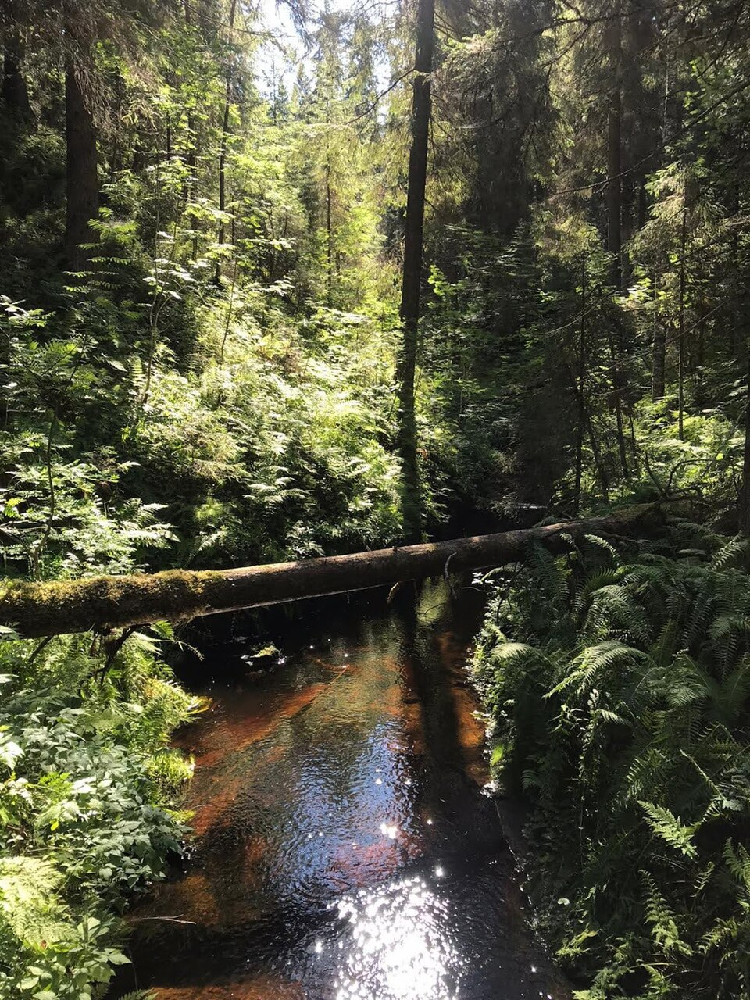{width="70%"}
[Brown, humic river water, Korkeakoskenjoki, Finland. Photo: Anna Reponen, CC BY 4.0, Wikimedia Commons.]{.credit}
:::
::::

::: notes
Open with brownification because it is happening in the students' own landscape. Long-term monitoring across Scandinavia, Finland and the UK has shown rising water colour and dissolved organic carbon in many lakes and rivers since the 1980s and 1990s. Several causes have been proposed, and we return to them at the end. Last lecture we followed inorganic carbon between air, water and calcite. Organic carbon is the other large pool of carbon in fresh water, and in boreal lakes it is often larger than the inorganic pool. It also explains a fact from last time: many northern lakes are supersaturated with carbon dioxide, partly because organic matter from land is decomposed in the water.
:::

## Where the organic matter comes from

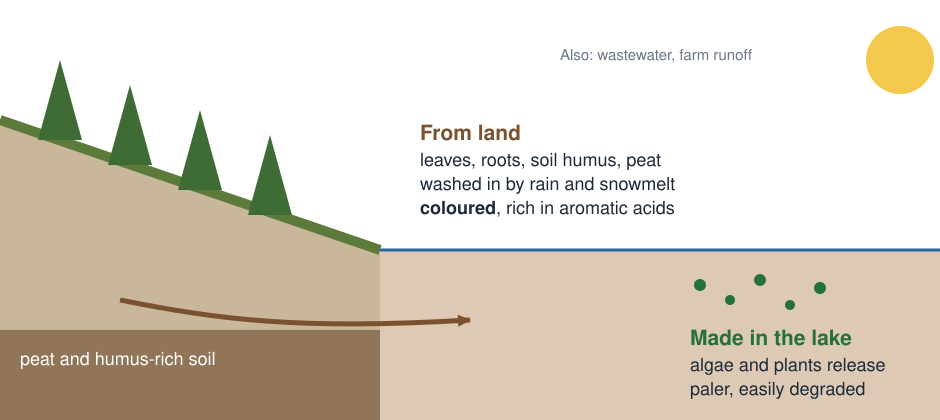{width="80%" fig-align="center"}

Most dissolved organic matter in a **boreal lake** comes **from land**: decaying leaves, roots, soil humus and peat. It is coloured and rich in organic acids. A smaller part is **made in the lake** by algae and plants. That part is paler and is eaten quickly by bacteria.

::: notes
Two broad sources. Material from the catchment is called terrestrial or allochthonous; material produced in the lake is aquatic or autochthonous. You do not need the Greek words, but students may meet them in reading. Catchments with a lot of peat and coniferous forest deliver the most coloured water, especially during snowmelt and autumn rain, when water flows through the upper, organic-rich soil layers. Algal organic matter matters more in nutrient-rich lakes and in the sea. Wastewater and farm runoff add organic matter too, often easily degradable. The point for today is that "organic matter" is a mixture whose properties depend on where it came from.
:::

## Not one molecule: a size continuum

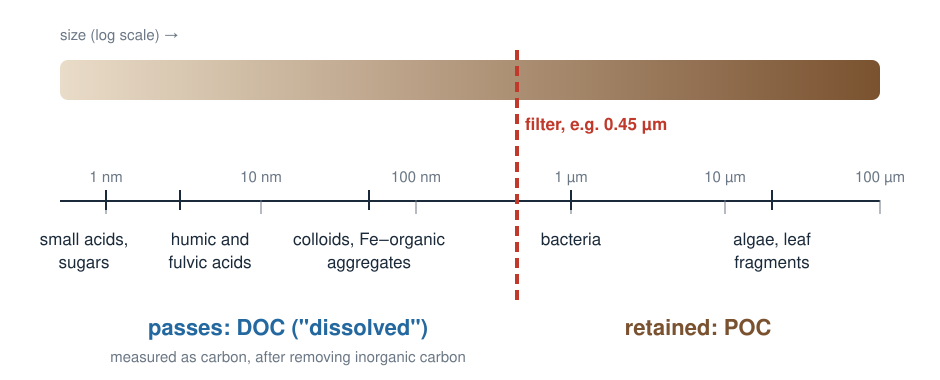{width="82%" fig-align="center"}

Natural organic matter ranges from small acids to large particles. **DOC** (dissolved organic carbon) is the carbon in whatever passes the chosen filter; **POC** is what stays behind. DOC gives an **amount of carbon**, in mg C/L. It does not give a structure, a charge or a degradation rate.

::: notes
This is the same lesson as the filter slide in the first water lecture, applied to carbon. Organic matter spans many orders of magnitude in size, from small acids such as acetate through humic and fulvic acids to colloids, cells and fragments. The boundary between dissolved and particulate is the filter we choose, often around 0.45 micrometres. To measure DOC, the filtered sample is acidified to remove inorganic carbon, then the organic carbon is oxidised and measured as carbon dioxide. The result counts carbon atoms only. Two waters with the same DOC can differ in colour, acidity, metal binding and how fast bacteria consume them. Always report the filter and method with a DOC value.
:::

## Organic acids carry charge

:::: {.columns}
::: {.column width="48%"}
Humic substances carry **carboxyl** (–COOH) and **phenolic** (–OH) groups. Both are weak acids, so the ratio rule from the first water lecture applies:

$$\frac{[\mathrm{R\text{-}COO^-}]}{[\mathrm{R\text{-}COOH}]}=10^{\,\mathrm{pH}-pK_a}$$

At natural pH most **carboxyl** groups have lost H⁺; most **phenolic** groups have not.

So brown water contains many **organic anions**. They supply H⁺, which is why many humic lakes are **naturally acidic**, and they count in the charge balance.
:::
::: {.column width="52%"}
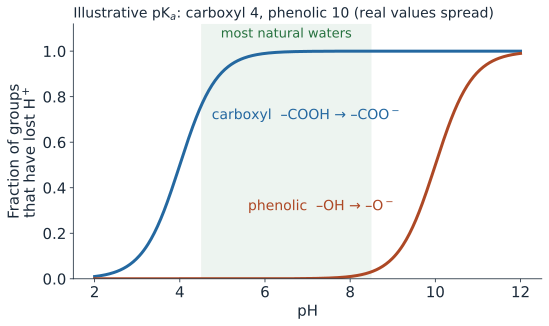{width="100%"}
:::
::::

::: notes
Link straight back to the weak-acid split. The pKa values are illustrative: real humic material has a broad spread of sites, roughly from three to five for carboxyl and nine to ten or more for phenolic groups. Above about pH 5 most carboxyl groups are negatively charged. This has two consequences. First, these organic acids release hydrogen ions, and many brown lakes in Sweden have a natural pH between about 5 and 6 even without acid rain. Distinguishing natural organic acidity from anthropogenic acidification was a real practical problem during the acid rain period. Second, organic anions appear in the charge balance and can make a carbonate-only alkalinity calculation misleading.
:::

## Negative sites bind metals

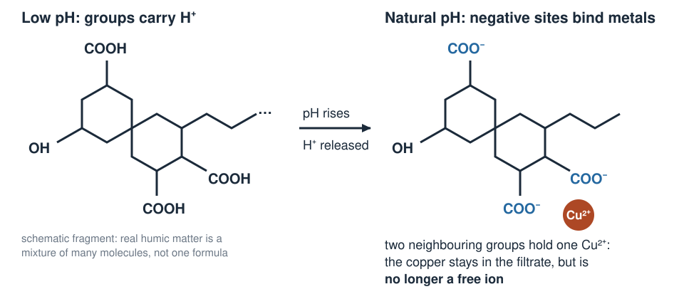{width="80%" fig-align="center"}

Neighbouring negative groups can hold a metal ion such as **Cu²⁺**, Pb²⁺ or Al³⁺ in a **complex**. The metal stays in the filtered, "dissolved" fraction, but it is **no longer a free ion**. No electron moves: this is binding, not redox.

::: notes
The fragment is schematic. Real humic matter is a mixture, not a single molecule, and you should never present a structural formula for it as if it were known. What matters is the arrangement of acid groups. Two or more groups on the same molecule can grip a metal ion from several sides, which makes the complex strong. Copper, lead, mercury and aluminium bind particularly strongly. The connection to the first water lecture is the filter diagram: complexes pass the filter and are counted in dissolved metal. They are not counted in the free-ion concentration. And remember the redox slide: binding changes the metal's form without changing its oxidation state.
:::

## Same total, different free metal

:::: {.columns}
::: {.column width="50%"}
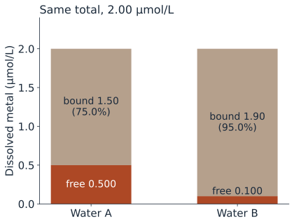{width="100%"}
:::
::: {.column width="50%"}
Waters A and B both contain **2.00 µmol/L** dissolved metal. Free metal is 0.500 in A and 0.100 µmol/L in B.

- Bound in A: (2.00 − 0.500)/2.00 = **75.0%**
- Bound in B: (2.00 − 0.100)/2.00 = **95.0%**

The free ion differs **fivefold** with identical totals. The free ion is often the best single guide to what organisms take up, so several regulators, including in the EU, adjust metal limits for DOC and pH.
:::
::::

::: notes
This is exercise one. The arithmetic is trivial; the interpretation is the point. A total dissolved metal measurement would rank these two waters as identical. The free metal ion, which interacts most directly with uptake sites on gills and cell surfaces, is five times higher in A. That is why environmental quality standards for metals such as copper, nickel and lead are increasingly expressed in terms of bioavailability, adjusted for dissolved organic carbon, pH and hardness. Keep the claim modest: binding to organic matter generally lowers free-ion exposure, but organic matter can also carry metals further downstream as complexes. The metals lecture next week builds on this.
:::

## Colour: brown water absorbs blue light

:::: {.columns}
::: {.column width="52%"}
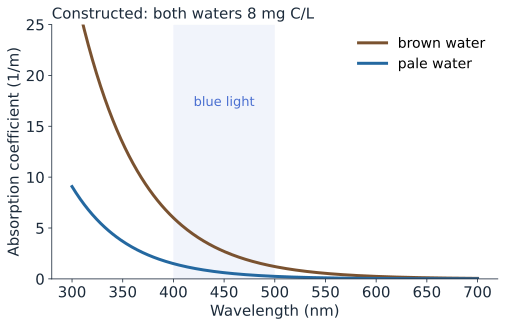{width="100%"}
:::
::: {.column width="48%"}
Coloured organic matter absorbs strongly in the **ultraviolet** and **blue**, and less towards red. Water that removes blue and passes yellow-red looks **brown**.

Absorption falls roughly **exponentially** with wavelength. How steeply, and how much absorption per gram of carbon, depends on the source of the material.

The two constructed waters have **the same DOC** but differ fourfold in colour. Colour is a **property**, not a direct measure of carbon.
:::
::::

::: notes
The curves are constructed, with round parameters of typical size. Point out the shape: very high absorption in the ultraviolet, falling steadily into the visible. Ultraviolet absorption at 254 nanometres or absorption at 420 nanometres are common routine measures of colour. Organic matter from peat and forest soils is rich in aromatic structures and absorbs strongly per unit carbon; algal material absorbs much less. So an absorbance measurement and a DOC measurement answer different questions. They are often correlated within one water body, but the ratio varies between waters and over time. Students should not convert colour into DOC with a universal factor.
:::

## Less light, shallower life

:::: {.columns}
::: {.column width="52%"}
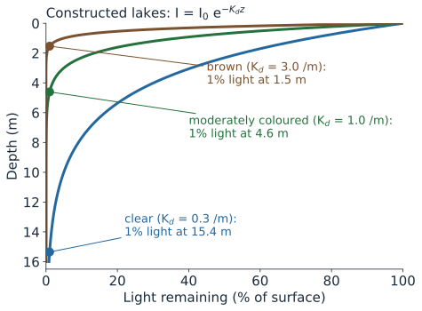{width="100%"}
:::
::: {.column width="48%"}
Light decreases exponentially with depth:

$$I(z)=I_0\,e^{-K_d z}$$

The attenuation coefficient K~d~ grows with colour. Plants and algae need roughly **1%** of surface light.

- clear lake, K~d~ = 0.3 /m: 1% at **15 m**
- brown lake, K~d~ = 3 /m: 1% at **1.5 m**

Browning squeezes photosynthesis into a thin surface layer and lets less UV reach the water below.
:::
::::

::: notes
The three lakes are constructed with round values, but the range is realistic between clear and very humic waters. The depth of one percent light is the logarithm of one hundred divided by Kd, about 4.6 divided by Kd. A tenfold increase in attenuation makes the lit layer ten times thinner. Consequences follow. Bottom plants and algae lose their light. The surface layer warms faster and the lake stratifies more strongly. Less ultraviolet penetrates, which protects some organisms but also reduces the natural disinfection of pathogens by sunlight. In a browning lake all these change together, which is why limnologists treat colour as a master variable.
:::

## Measuring colour in the field

:::: {.columns}
::: {.column width="48%"}
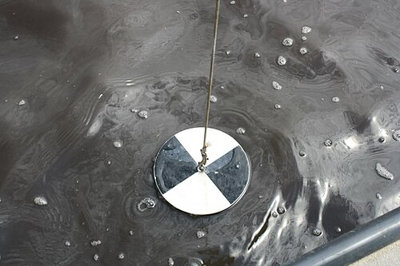{width="100%"}
[Secchi disk, Cochiti Lake, New Mexico, USA. Photo: U.S. Army Corps of Engineers, public domain, Wikimedia Commons.]{.credit}
:::
::: {.column width="52%"}
A **Secchi disk** is lowered until it disappears. The depth is a simple measure of clarity, used in lake monitoring for over a century.

But clarity mixes several causes. Water can darken while DOC stays nearly constant, if:

- the organic matter changes **composition** (more aromatic, more coloured);
- **iron** increases: Fe(III) adds colour of its own and binds to organic matter;
- **particles** increase.

Measure absorbance, DOC, iron and particles **separately** before choosing an explanation.
:::
::::

::: notes
This connects to exercise four. A darkening water is an observation, not an explanation. In southern Sweden, studies of rivers have found that rising iron concentrations explain a substantial part of the colour increase, alongside the increase in organic matter itself. Whether iron or organic matter dominates differs between catchments. The practical lesson is to measure the candidate causes independently: absorbance spectra, DOC, total and filtered iron, and turbidity or suspended solids. Do not infer a source, a degradation rate or a toxicity from colour alone. The Secchi disk is cheap and robust, and long Secchi records are among the data that first revealed brownification.
:::

## Sunlight changes organic matter

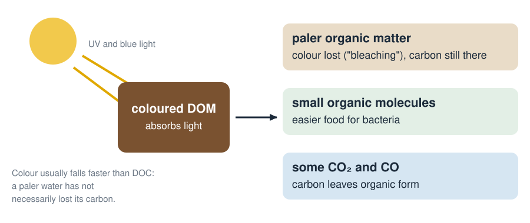{width="78%" fig-align="center"}

Light absorbed by coloured organic matter breaks its light-absorbing groups. The water becomes **paler**, small molecules form that bacteria use readily, and **some** carbon is released as CO₂. A loss of colour therefore **does not prove** a loss of carbon.

::: notes
Photochemistry is the flip side of colour: whatever absorbs light can be changed by it. Bleaching removes colour faster than it removes carbon, so in a sunlit surface layer colour can fall while DOC hardly changes. Part of the organic matter is broken into small molecules such as low molecular weight acids, which bacteria then consume, and a smaller part is converted directly to carbon dioxide and carbon monoxide. Rates depend on sunlight, depth and the type of organic matter. Keep this qualitative. The take-home is the inverse of the previous slide: a change in colour and a change in carbon are separate observations and need separate measurements.
:::

## Organic matter consumes oxygen

:::: {.columns}
::: {.column width="50%"}
Use CH₂O as a stand-in for simple organic matter:

$$\mathrm{CH_2O+O_2\rightarrow CO_2+H_2O}$$

**1 mol C uses 1 mol O₂**, so 12.0 g C uses 32.0 g O₂.

**Worked example:** complete aerobic oxidation of 3.00 mg C/L:

3.00 × 32.0/12.0 = **8.00 mg O₂/L**

That is close to **all** the oxygen water holds: about 9 mg/L at 20 °C.
:::
::: {.column width="50%"}
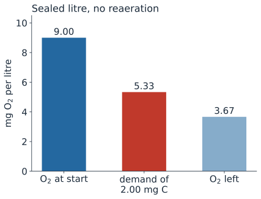{width="100%"}
:::
::::

::: notes
The reaction is the reverse of photosynthesis and is how bacteria get energy from organic matter. CH2O is a stoichiometric teaching formula, not the formula of humic substances, which are more reduced or more oxidised depending on their origin. With it, one carbon needs one oxygen molecule, and the mass ratio is thirty-two over twelve, about 2.67. The worked example from the notes shows the scale of the problem: a few milligrams of organic carbon per litre can in principle consume nearly all the dissolved oxygen. The chart is exercise two: a sealed litre at 9 milligrams per litre, with two milligrams of carbon, ends with 3.67.
:::

## Ultimate demand versus what you measure

:::: {.columns}
::: {.column width="55%"}
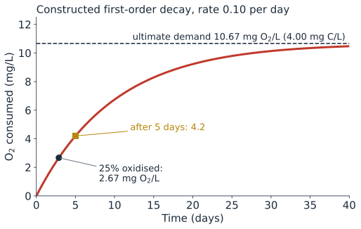{width="100%"}
:::
::: {.column width="45%"}
The 8.00 mg/L is an **ultimate, stoichiometric** demand. It assumes complete oxidation.

Real organic matter degrades at different speeds. If only 25% of 4.00 mg C/L is oxidised during an observation period:

- consumed: 1.00 mg C → **2.67 mg O₂/L**
- complete oxidation would need **10.67 mg O₂/L**

A 5-day test (BOD₅) measures the **early** part of the curve, not the ultimate demand.
:::
::::

::: notes
This is exercise three. The curve is a constructed first-order decay with a round rate constant, chosen to make the shape visible. The difference between what has happened so far and what could happen eventually is important in practice. The standard biochemical oxygen demand test runs for five days in the dark at twenty degrees, and it measures only the readily degradable part. Humic organic matter from peat degrades much more slowly than algal material or sewage. So a brown lake can carry a large ultimate demand that a five-day test hardly sees. Also remember other oxygen consumers, such as nitrification of ammonium, which add to the demand.
:::

## When demand outruns supply

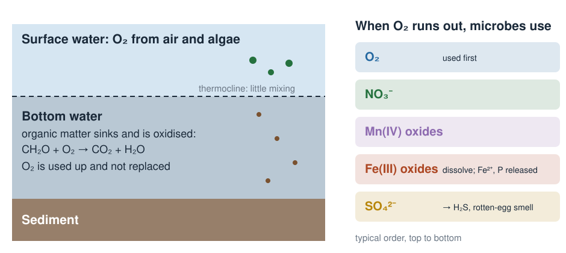{width="80%" fig-align="center"}

In summer many lakes **stratify**: warm surface water floats on cold bottom water. The bottom water is cut off from the air, but organic matter keeps sinking into it. Oxygen falls, and microbes then use **other electron acceptors**: nitrate, manganese and iron oxides, and finally sulfate.

::: notes
An oxygen budget needs sources as well as sinks. In the surface layer oxygen is resupplied from the air and by photosynthesis. Below the thermocline, neither works well, while sinking organic matter and the sediment keep consuming oxygen. When oxygen is gone, microbes use the next available electron acceptor, in the order shown, which is the order of decreasing energy yield; week four covers it in detail. Two consequences matter here. Iron(III) oxides dissolve, releasing iron and the phosphate that was attached to them. Sulfate reduction produces hydrogen sulfide, which is toxic. Browning can strengthen stratification and add organic matter, both of which favour low oxygen.
:::

## A large-scale case: the Baltic Sea

:::: {.columns}
::: {.column width="55%"}
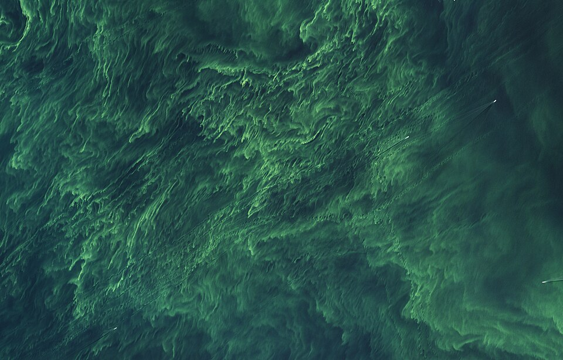{width="100%"}
[Cyanobacteria bloom in the Baltic Sea, July 2025 (Landsat). NASA Earth Observatory, public domain, Wikimedia Commons.]{.credit}
:::
::: {.column width="45%"}
The Baltic has some of the **largest low-oxygen bottom areas** of any sea. Salty, dense water at depth is renewed only occasionally.

Nutrients feed algal and cyanobacterial **blooms**. When the organic matter sinks and decays it consumes oxygen. Without oxygen, iron oxides in the sediment dissolve and **release phosphate**, which feeds the next bloom.

The same chemistry as a stratified lake, on a regional scale.
:::
::::

::: notes
The satellite image shows a summer cyanobacteria bloom swirling in the Baltic. The Baltic Sea is permanently stratified by salinity, with brackish water above and saltier water below, and the deep water is renewed only when occasional inflows of North Sea water arrive. Decades of nutrient input from agriculture and wastewater increased the production of organic matter, and its decay consumes oxygen in the deep basins. The release of phosphate from anoxic sediments, often called internal loading, is a feedback that keeps blooms going even after external inputs fall. Keep the numbers out of it; the mechanism is the point, and it is exactly the mechanism on the previous slide.
:::

## Check yourself

::: {.checkbox}
1. Two waters both have 6 mg/L DOC. Name three properties that could still differ.
2. Why can a humic lake have pH 5.5 without any acid rain?
3. Total dissolved copper is unchanged, but DOC doubles. What would you expect for free Cu²⁺?
4. Complete oxidation of 1.50 mg C/L of CH₂O-like substrate needs how much O₂?
5. Water becomes paler over a sunny summer. Has its DOC necessarily fallen?
:::

::: notes
Answers. One: colour or absorbance, acidity and charge, metal binding capacity, degradation rate, molecular size. Any three. Two: the organic matter itself contains carboxylic acids that release hydrogen ions. Three: more binding sites usually means more copper bound and less free copper, but the size of the effect depends on the binding chemistry and on pH, and some binding sites may already be occupied by other metals. Four: 1.50 times 32 over 12 gives 4.00 milligrams per litre. Five: no. Photobleaching removes colour faster than carbon. Measure DOC directly before concluding anything about carbon loss.
:::

## Back to browning: why, and so what?

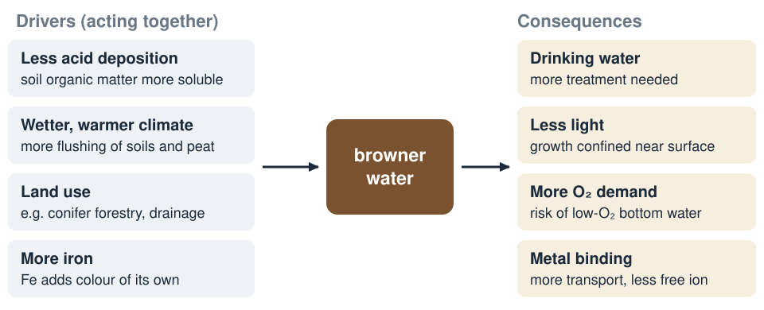{width="80%" fig-align="center"}

Several drivers act **together**, and their importance differs between catchments. Recovery from acid rain is one of the best supported: as sulfate deposition fell, soil organic matter became **more soluble**. Each consequence on the right uses a chemical idea from today.

::: notes
Return to the opening case. Research in Europe and North America has linked rising DOC to falling sulfate deposition: with less strong acid and less ionic strength in soil water, organic matter is more soluble and is washed out more easily. Climate also matters, through wetter autumns, milder winters and longer growing seasons, as do land use, including the expansion of spruce forests and ditching of peatlands, and rising iron. Read the consequences with the class and name the chemistry each uses: light absorption, oxygen stoichiometry, metal binding. This is an example of an environmental change produced by recovery from an earlier problem, a theme that returns later in the course.
:::

## Browning and drinking water

:::: {.columns}
::: {.column width="50%"}
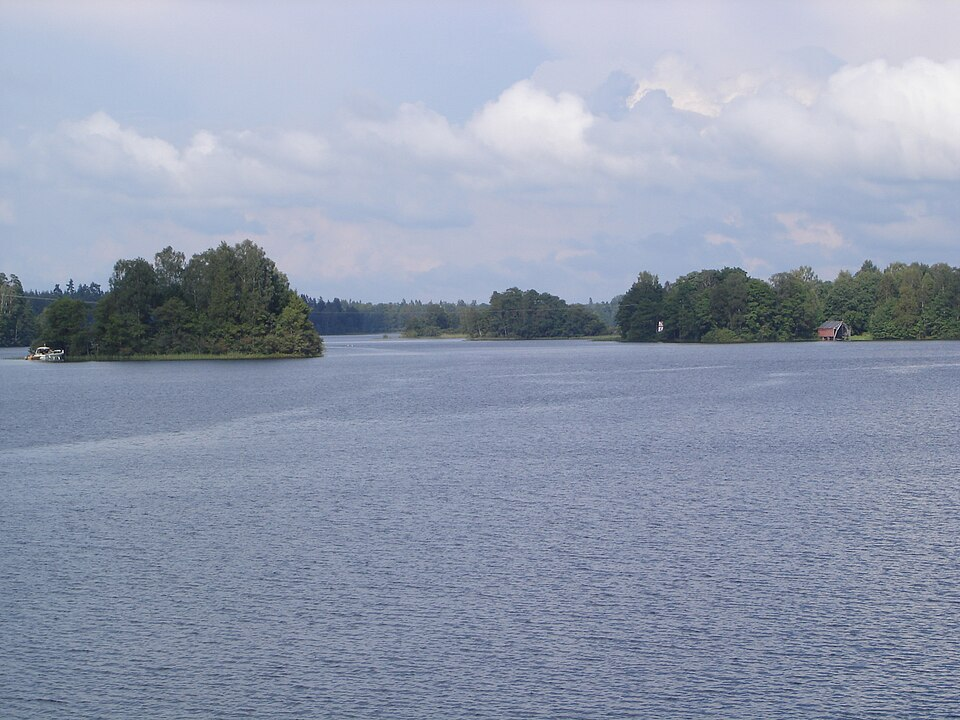{width="100%"}
[Lake Bolmen at Piksborg, Småland. Photo: Eddie001, public domain, Wikimedia Commons.]{.credit}
:::
::: {.column width="50%"}
**Bolmen** in Småland supplies drinking water to a large part of Skåne. Lakes like it are watched closely for colour and DOC.

More organic matter means:

- more **coagulant** to remove colour and DOC;
- organic matter that reacts with **chlorine** to form unwanted **disinfection by-products**;
- organic matter left in pipes feeds **bacterial regrowth**.

So browning is a chemistry problem for **water treatment**, the topic of a later unit.
:::
::::

::: notes
Bolmen, in southern Småland, is the raw-water source for a regional supplier that serves many municipalities in Skåne through a long tunnel. Treatment plants that take water from brown lakes have had to adapt their processes as colour has risen. The chemistry links directly to today: coagulation removes humic material partly through its charged acid groups; chlorine reacts with aromatic structures to form trihalomethanes and other by-products, which are regulated; and easily degradable DOC left after treatment can support bacterial growth in the distribution network. The water treatment unit later in the course develops these processes. The photo is an ordinary view of the lake.
:::

## Common mistakes to avoid

- **"DOC is a substance."** It is the carbon in an operationally filtered fraction.
- **"Brown means more carbon."** Colour per unit carbon varies; iron adds colour.
- **"Dissolved metal is free metal."** Organic complexes pass the filter.
- **"More DOC means less dissolved metal."** It often means **more** dissolved but less **free** metal.
- **"CH₂O is the formula of humus."** It is a stoichiometric stand-in.
- **"BOD₅ is the total demand."** It measures the early, fast part.
- **"Paler water has lost carbon."** Photobleaching removes colour first.

::: notes
These are the interpretation errors that come up most often, in exams and in real reports. Ask students to explain the fourth one. Organic matter can keep metals in solution as complexes and carry them downstream, so total dissolved metal can increase with DOC, while the free ion decreases. That is not a contradiction: it is the difference between total and species from the first water lecture. Remind students that every number in this lecture is either a constructed teaching example or a round illustrative value, and that the exercises state their assumptions explicitly. They should do the same in their own answers.
:::

## Explore: oxygen demand in a sealed bottle {#explore}

```{=html}
<link rel="stylesheet" href="../demos/demo.css">
<div data-demo="oxygen" role="group" aria-label="Oxygen demand of organic carbon in a sealed bottle">
<p>4.00 mg C/L has an ultimate demand of 10.67 mg O₂/L; at 0.10 per day, 4.20 mg O₂/L is used in 5 days.</p>
</div>
<script src="../demos/core.js"></script>
<script src="../demos/oxygen.js"></script>
```

[Compare the ultimate demand with what a 5-day test sees.](exercise.qmd#explore)

::: notes
Start with the exercise 3 preset: the curve is the constructed first-order decay from the "ultimate demand versus what you measure" slide. Point out that this pool needs more oxygen than a sealed bottle at 9 mg/L holds, so the oxygen runs out on day 18.6. Then compare the slow humic preset: same carbon, same ultimate demand, but a 5-day test sees almost nothing. Use the exercise 2 and worked example presets to check the stoichiometry. Ask students what a real lake has that the bottle lacks: reaeration and photosynthesis. The exercise page has the assumptions and a hand check.
:::

## Summary {.smaller}

:::: {.columns}
::: {.column width="70%"}
| Concept | Key fact |
| --- | --- |
| Sources | boreal lakes: mostly from land (coloured); some from algae (pale) |
| DOC | carbon passing a stated filter; amount, not structure or reactivity |
| Acid groups | carboxyl mostly ionised at natural pH; humic lakes can be naturally acidic |
| Metal binding | complexes stay "dissolved"; free ion falls; total is not free |
| Colour | absorbs UV and blue; colour per unit C varies; iron adds colour |
| Light | I = I₀ e^(−K~d~z); 1% light at about 4.6/K~d~ |
| Photochemistry | bleaching removes colour faster than carbon |
| Oxygen demand | CH₂O + O₂: 1 mol O₂ per mol C; 2.67 g O₂ per g C |
| Ultimate vs measured | complete oxidation versus what happens in the test period |
| Anoxia | stratification + organic matter → low O₂ → Fe, P and H₂S released |

**Next:** Week 3, [Metal speciation and mobility](../metals/lec.qmd). Why does a Spanish river run red? Then the [exercises](exercise.qmd) and the [notes](notes.qmd).
:::
::: {.column width="30%"}
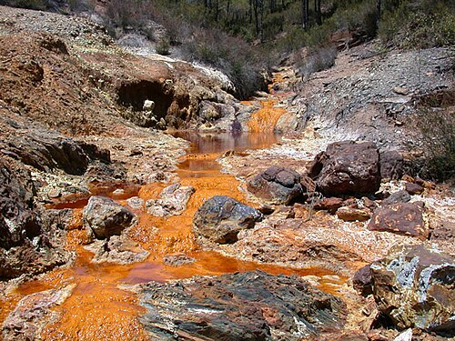{width="100%"}
[Iron-rich, acidic water of the Río Tinto, Spain. Photo: Carol Stoker, NASA, public domain, Wikimedia Commons.]{.credit}
:::
::::

::: notes
Recap the three roles of organic matter. As an acid it carries charge and binds metals. As a pigment it controls light. As a fuel it consumes oxygen and can drive water to anoxia, with consequences for iron, phosphorus and sulfide. All three are behind the browning of northern waters. Week three starts with metals, and builds directly on today's distinction between total, complexed and free metal, and on the redox chemistry of iron. The teaser photo is the Río Tinto in southern Spain, coloured by iron from centuries of mining and very acidic. Next week explains how acidity, redox and binding control which metals stay dissolved and which precipitate.
:::
