## About this lecture

:::: {.columns}
::: {.column width="58%"}
In 1985 scientists of the British Antarctic Survey reported that springtime ozone over Antarctica had fallen dramatically. Satellites soon mapped an **ozone hole** larger than the continent. Two years later, the **Montreal Protocol** began phasing out the chemicals behind it.

Yet on hot summer days, health agencies across Europe warn of **too much ozone** at ground level.

**Same molecule. Protective high up, harmful near the ground.** Why?

Today you will learn to:

- see how **light selects** which reactions can happen;
- combine steps into a **catalytic cycle** and cancel intermediates;
- explain why **NO₂ and sunlight alone** do not build up ozone;
- turn a rate constant into a **lifetime**.
:::
::: {.column width="42%"}
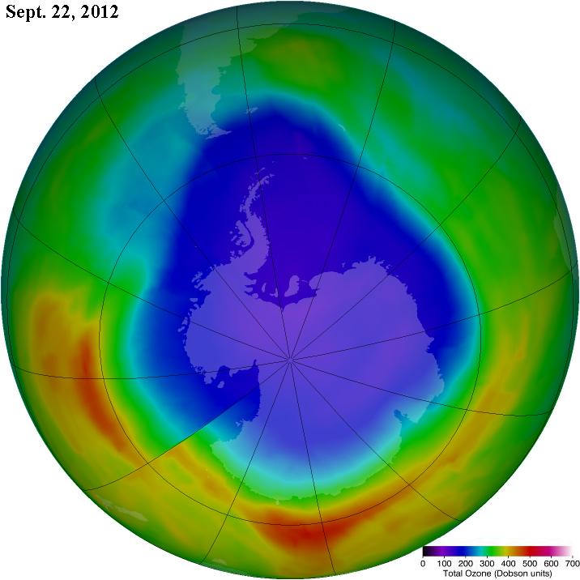{width="100%"}
[Antarctic ozone hole, 22 September 2012; blue and purple mark the lowest ozone. Image: NASA, public domain, Wikimedia Commons.]{.credit}
:::
::::

::: notes
Last lecture we treated a lake or river as a compartment with inputs, outputs and reactions. Today the compartment is the atmosphere, and the reactions are driven by sunlight. Start with the ozone story. The discovery of the Antarctic ozone hole in 1985 surprised even the scientists who had predicted chlorine-driven ozone loss, because the loss was so large and so concentrated. Contrast it with summer smog, when ground-level ozone irritates lungs and damages crops. By the end of the lecture students should be able to explain both with a few reaction steps and one idea: which reactions can happen depends on where you are, because light and reaction partners change with altitude.
:::

## Same molecule, two places

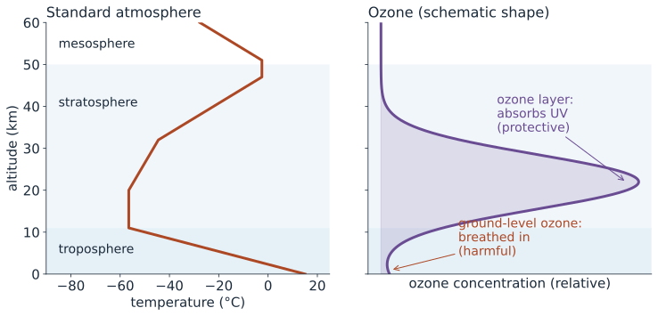{width="82%" fig-align="center"}

Temperature falls with height through the **troposphere**, then rises again in the **stratosphere**, because ozone absorbs ultraviolet light there and warms the air. Most ozone sits at about 15–35 km. A small amount near the ground is the ozone we breathe.

::: notes
The left panel uses the standard atmosphere, a reference profile of temperature with altitude. The temperature turns around at about 11 kilometres: that is the tropopause. Above it, the stratosphere warms with height. That warming is itself a chemical signature: ozone absorbs solar ultraviolet light and converts it to heat. The right panel is a schematic of the ozone profile. Most of the ozone is in the stratosphere. The amount near the ground is small, but it is in contact with lungs and leaves. The two regions have different light, different temperatures and different reaction partners, so the chemistry differs as well.
:::

## Light selects which reactions can happen

:::: {.columns}
::: {.column width="58%"}
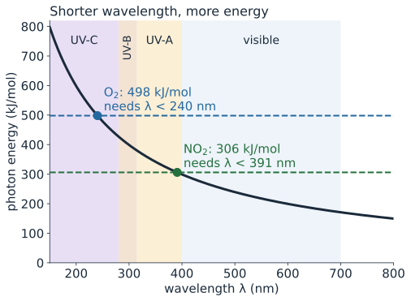{width="100%"}
:::
::: {.column width="42%"}
A photon's energy is

$$E = \frac{hc}{\lambda}$$

Shorter wavelength, more energy. Per mole of photons, E ≈ 119 600 / λ(nm) kJ/mol.

To split O₂ (bond 498 kJ/mol) a photon needs **λ < 240 nm**: hard ultraviolet, available only high in the atmosphere.

NO₂ can be split by near-UV light below about 400 nm, which **reaches the ground**.
:::
::::

::: notes
Photolysis means using absorbed light to break a molecule. The energy per photon is Planck's constant times the speed of light divided by the wavelength. Multiplying by Avogadro's number gives energy per mole of photons, which we can compare with bond energies. The oxygen double bond needs about 498 kilojoules per mole, so only photons shorter than about 240 nanometres can split it. Those photons are absorbed high in the atmosphere and never reach the ground. The bond holding the extra oxygen atom in nitrogen dioxide is much weaker, so near-ultraviolet sunlight at ground level can break it. That single difference explains why ozone is made in different ways in the stratosphere and near the ground.
:::

## Energy is not enough: the molecule must absorb

:::: {.columns}
::: {.column width="60%"}
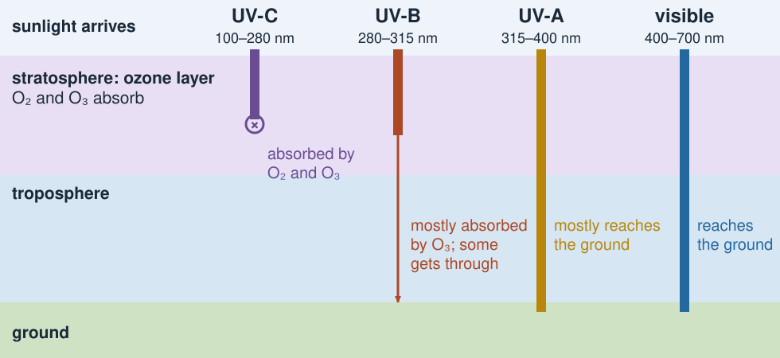{width="100%"}
:::
::: {.column width="40%"}
A photon can only drive a reaction if the molecule **absorbs** it. Energy above the bond energy is necessary but not sufficient.

O₂ absorbs the shortest UV. **O₃ absorbs strongly between about 200 and 310 nm**, the range that damages DNA.

So the ozone layer is a **filter**: it removes almost all UV-C and most UV-B before sunlight reaches the ground.
:::
::::

::: notes
Photon energy only tells us what is possible. A reaction also requires that the molecule absorbs at that wavelength. Oxygen absorbs the hardest ultraviolet. Ozone has a strong absorption band in the ultraviolet, from about 200 to about 310 nanometres. That is why it matters so much: those wavelengths damage DNA and proteins. UV-C is removed completely, UV-B mostly, and UV-A mostly reaches the ground. When ozone thins, it is the UV-B that increases at the surface. Keep the idea of absorption bands in mind: it returns in the climate lecture, where infrared absorption decides which gases are greenhouse gases.
:::

## How ozone is made

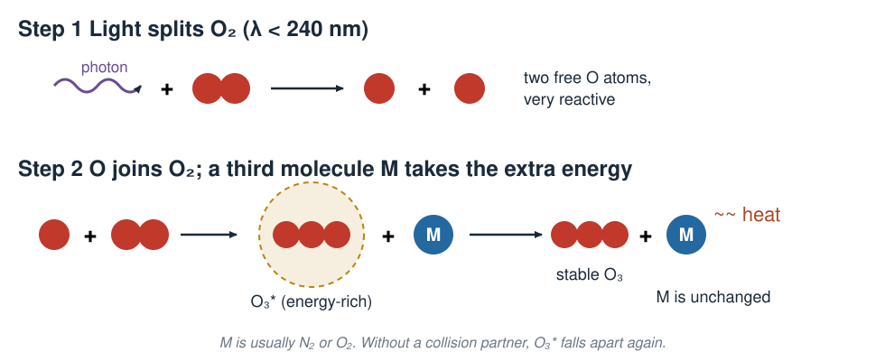{width="84%" fig-align="center"}

$$\mathrm{O_2}+h\nu\rightarrow 2\,\mathrm{O}\qquad\qquad \mathrm{O+O_2+M\rightarrow O_3+M}$$

M is any **collision partner**, usually N₂ or O₂. It carries away the extra energy and is **not consumed**. This is the first half of the Chapman mechanism (1930).

::: notes
This is the simplified formation sequence. In the first step, a hard ultraviolet photon splits an oxygen molecule into two oxygen atoms. In the second step, an oxygen atom combines with an oxygen molecule. The new ozone molecule is formed with too much energy and would fall apart, unless it collides with another molecule that takes the excess energy away as heat. That third body is written M. It appears on both sides of the equation, so it is not consumed: it only enables the reaction. Because the second step needs collisions, it depends on air density. The sequence is named after Sydney Chapman, who proposed it in 1930.
:::

## Ozone is made and destroyed all the time

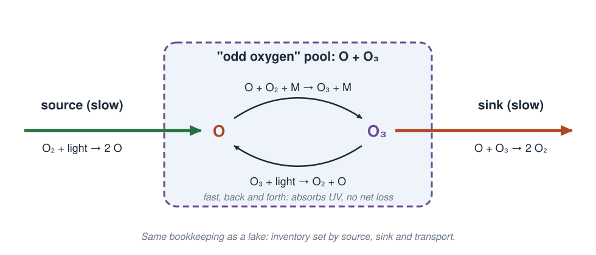{width="80%" fig-align="center"}

O and O₃ convert into each other quickly: each round absorbs a UV photon and turns it into heat. Real **loss** happens only when O meets O₃. The ozone amount is a **balance** of production, loss and transport, just like the lake balance in the last lecture.

::: notes
Once ozone is made, it is split again by ultraviolet light, giving an oxygen atom, which quickly forms ozone again. This fast back-and-forth is how the ozone layer absorbs ultraviolet and warms the stratosphere. It does not change the total of O plus O3, which chemists call odd oxygen. The total changes only through the slow source, oxygen photolysis, and the slow sink, oxygen atom plus ozone. This is the balance equation from the last lecture in a new setting. Fast turnover does not mean a small inventory: the amount of ozone is set by the ratio of production to loss, plus transport by winds.
:::

## How we measure the ozone layer

:::: {.columns}
::: {.column width="50%"}
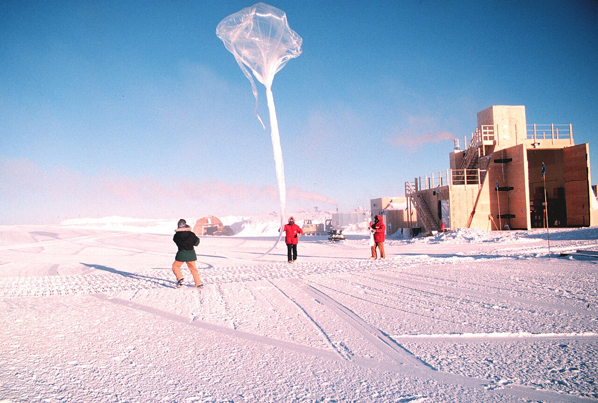{width="100%"}
[Launching an ozonesonde at the South Pole Station. Photo: NOAA Photo Library, public domain, Wikimedia Commons.]{.credit}
:::
::: {.column width="50%"}
An **ozonesonde** is a small balloon-borne instrument that measures ozone as it rises to about 30 km. It gives the profile in the previous figure.

Ground spectrometers and satellites measure the **total column**: all the ozone above a point. It is reported in **Dobson units**. A typical column is about 300 DU, equal to a layer of pure ozone only about **3 mm** thick at ground pressure.

The "ozone hole" is defined as columns below **220 DU**.
:::
::::

::: notes
Measurements anchor the chemistry. Ozonesondes are launched on weather balloons and report ozone concentration every few metres of altitude. Spectrometers on the ground and on satellites measure how much ultraviolet light is absorbed and convert that to a total column. One Dobson unit corresponds to a layer of pure ozone one hundredth of a millimetre thick at standard temperature and pressure. So the entire ozone layer, compressed to the pressure at sea level, would be about three millimetres thick. That thin a layer protects all life at the surface from the most damaging ultraviolet. The Antarctic ozone hole is the area where the column falls below 220 Dobson units.
:::

## A shortcut for ozone loss: catalysis

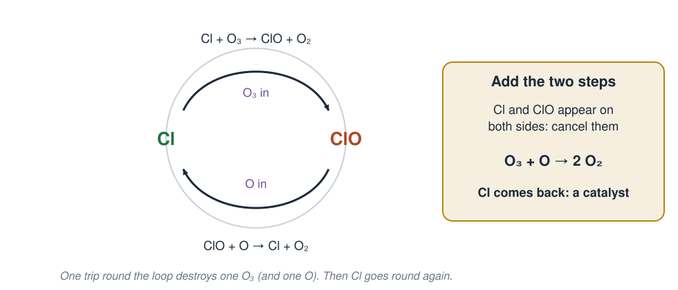{width="82%" fig-align="center"}

A chlorine atom attacks O₃; the ClO formed meets an O atom and **gives Cl back**. Chlorine is a **catalyst**: it is regenerated and can repeat the cycle many times until another reaction stops it.

::: notes
The Chapman sink alone predicts more ozone than is observed. Additional loss comes from catalytic cycles involving nitrogen oxides, hydrogen radicals and halogens. Here is the chlorine cycle. In the first step chlorine reacts with ozone and forms chlorine monoxide. In the second, chlorine monoxide reacts with an oxygen atom and releases the chlorine atom again. Follow the chlorine: it goes round the loop and comes back unchanged. That is what makes it a catalyst. Each trip destroys one ozone molecule and one oxygen atom. A single chlorine atom can go round many times before it is captured into a less reactive form. That is why small amounts of chlorine can matter.
:::

## Bookkeeping: cancel the intermediates

:::: {.columns}
::: {.column width="50%"}
Write the steps and add them:

$$\mathrm{Cl+O_3\rightarrow ClO+O_2}$$
$$\mathrm{ClO+O\rightarrow Cl+O_2}$$

Sum: Cl + O₃ + ClO + O → ClO + O₂ + Cl + O₂

Cancel what appears on both sides:

$$\mathrm{O_3+O\rightarrow 2\,O_2}$$
:::
::: {.column width="50%"}
- **Catalyst**: Cl. Consumed in step 1, regenerated in step 2.
- **Intermediate**: ClO. Formed in step 1, consumed in step 2.
- Neither appears in the **net reaction**.

The net reaction says what one cycle does. It does **not** say how fast the cycle runs or how many times one Cl atom goes round. That needs **kinetics**.
:::
::::

::: notes
This is exercise 1, done together. Add the two steps as if they were algebraic equations. Species that appear on both sides cancel. The catalyst is the species that is used first and returned later; the intermediate is the one that is made first and used later. Both cancel, which is why neither shows up in the net reaction. A frequent mistake is to read the net equation as a complete description. It tells us the stoichiometry of one cycle only. To estimate ozone loss you would need the rates of each step, the concentrations of chlorine and of the oxygen atoms, and the competing reactions that remove chlorine.
:::

## Where the chlorine came from

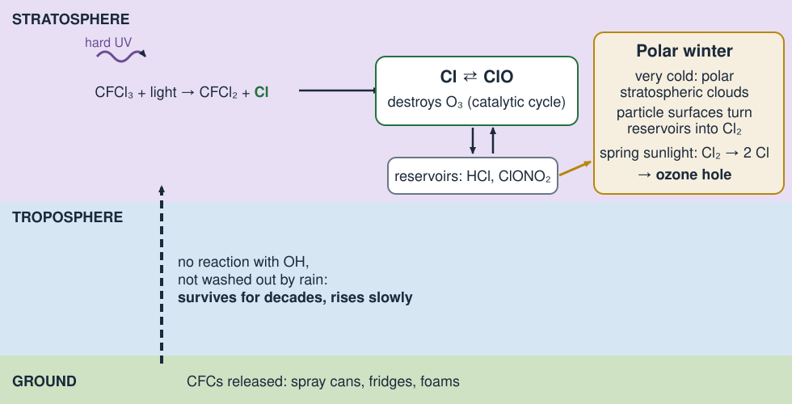{width="86%" fig-align="center"}

**CFCs** are so unreactive that they survive for decades in the lower atmosphere. They slowly reach the stratosphere, where hard UV splits off Cl. Most chlorine is then stored in **reservoirs** (HCl, ClONO₂), until the polar winter releases it.

::: notes
Chlorofluorocarbons were valued precisely because they are unreactive: non-toxic, non-flammable propellants and refrigerants. That same stability means nothing removes them in the troposphere. OH does not attack them and they are not washed out by rain. Over years they mix up into the stratosphere. Only there is the ultraviolet hard enough to break a carbon–chlorine bond and release a chlorine atom. In 1974 Molina and Rowland pointed out this pathway; with Paul Crutzen, who studied nitrogen oxide catalysis and did his doctorate at Stockholm University, they received the 1995 Nobel Prize in Chemistry. Most stratospheric chlorine is stored in reservoirs that do not destroy ozone, so the cycle runs slowly. The polar winter changes that.
:::

## Why a hole over Antarctica?

:::: {.columns}
::: {.column width="52%"}
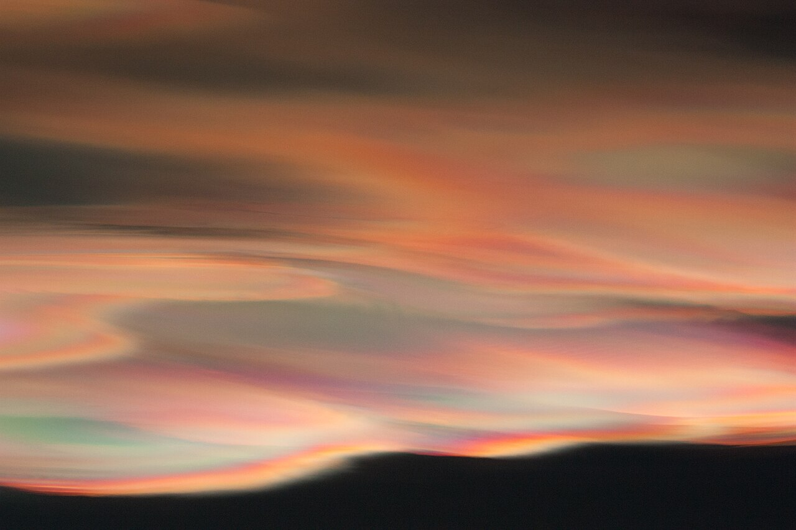{width="100%"}
[Polar stratospheric clouds over Oslo, Norway. Photo: Havardtl, CC BY 4.0, Wikimedia Commons.]{.credit}
:::
::: {.column width="48%"}
In the dark polar winter the stratosphere becomes cold enough for **polar stratospheric clouds**.

On their particle surfaces, the reservoirs HCl and ClONO₂ react to form **Cl₂**. When the **sun returns in spring**, light splits Cl₂ into Cl atoms and catalytic loss runs fast.

This is a different mechanism from the simple cycle: it needs **surfaces** and different ClO cycles. Gas-phase chemistry alone did not predict it.
:::
::::

::: notes
The photo shows polar stratospheric clouds, also called nacreous or mother-of-pearl clouds, occasionally seen in Scandinavia in winter. They form only at very low temperatures, which are common in the Antarctic winter stratosphere and less common in the Arctic. Reactions on these cloud particles convert chlorine from the safe reservoirs into chlorine gas. Nothing happens during the polar night. When sunlight returns in September and October, chlorine gas is photolysed and chlorine atoms destroy ozone quickly. The main polar cycles involve the ClO dimer rather than oxygen atoms, which are scarce. That is why our simple cycle is representative, not the full polar mechanism. The Montreal Protocol has reduced stratospheric chlorine, and recovery is expected over the coming decades.
:::

## Check yourself

::: {.checkbox}
1. Why can ozone be made from O₂ in the stratosphere but not directly from O₂ at ground level?
2. In the cycle NO + O₃ → NO₂ + O₂, then NO₂ + O → NO + O₂: what is the catalyst, what is the intermediate, and what is the net reaction?
3. M appears on both sides of O + O₂ + M → O₃ + M. Why is it written at all?
4. True or false: "A catalyst lasts forever."
:::

::: notes
Answers. One: splitting oxygen needs photons shorter than about 240 nanometres, which are absorbed high up and do not reach the ground. Two: nitric oxide is the catalyst, nitrogen dioxide is the intermediate, and the net reaction is again O3 plus O gives two O2. This is the nitrogen oxide cycle that Crutzen described. Three: M removes the excess energy; without the collision the new ozone falls apart, so the rate depends on air density. Four: false. A catalyst is regenerated in each cycle, but other reactions can capture it, as when chlorine is stored in HCl. It is not present in unlimited amount.
:::

## Down to the ground: summer smog

:::: {.columns}
::: {.column width="55%"}
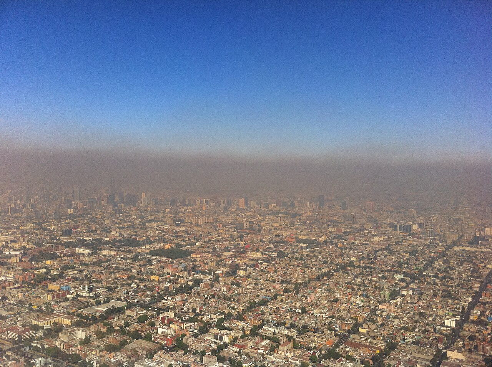{width="100%"}
[Photochemical smog over Mexico City, seen from the air. Photo: Fidel Gonzalez, CC BY-SA 3.0, Wikimedia Commons.]{.credit}
:::
::: {.column width="45%"}
Near the ground there is no hard UV, so O₂ is not split. Ground-level ozone must be made another way.

Its ingredients are **nitrogen oxides** (NO + NO₂ = NOₓ, mainly from combustion), **volatile organic compounds** (VOCs) or CO, and **sunlight**.

Ozone then irritates airways and damages crops and forests. Episodes are worst in **hot, sunny, still weather**, as in many European heatwaves.
:::
::::

::: notes
Ground-level ozone is a secondary pollutant: it is not emitted, it is made in the air. The ingredients are nitrogen oxides from traffic and combustion, reactive organic compounds from fuels, solvents and vegetation, or carbon monoxide, and sunlight. The photo shows the brown haze of photochemical smog over a large city, where all three ingredients meet. In Europe, high ozone episodes occur during hot, sunny summers with weak winds. Ozone also travels: much of the ozone measured in Scandinavia is formed elsewhere and transported. The next two slides show which reactions link NOx and ozone, and why the organic compounds are needed.
:::

## NO₂ and light alone: a null cycle

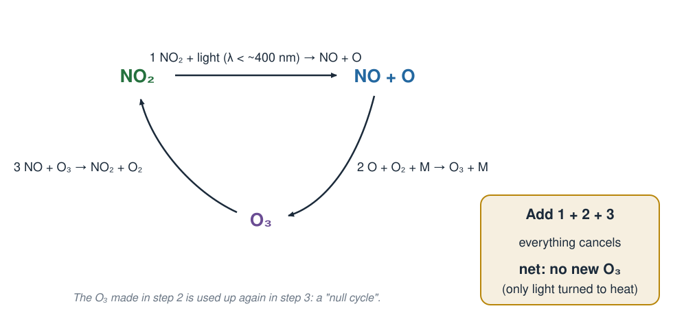{width="80%" fig-align="center"}

Sunlight splits NO₂; the O atom makes O₃. But NO then **uses up** that O₃ again. Add the three steps and everything cancels: **no net ozone**. In sunlight the three species reach a balance set by light and concentrations.

::: notes
This is exercise 3. Write the three reactions and add them. Nitrogen dioxide is split by near-ultraviolet sunlight into nitric oxide and an oxygen atom. The oxygen atom forms ozone, exactly as in the stratosphere. But nitric oxide reacts quickly with ozone and makes nitrogen dioxide again. Every species cancels, so the cycle redistributes nitrogen between NO and NO2 and holds some ozone at a steady level, without building it up over time. This is why freshly emitted NO near a busy road actually lowers ozone locally: it titrates it. To get net ozone production, something else must turn NO into NO2 without consuming ozone.
:::

## Peroxy radicals break the null cycle

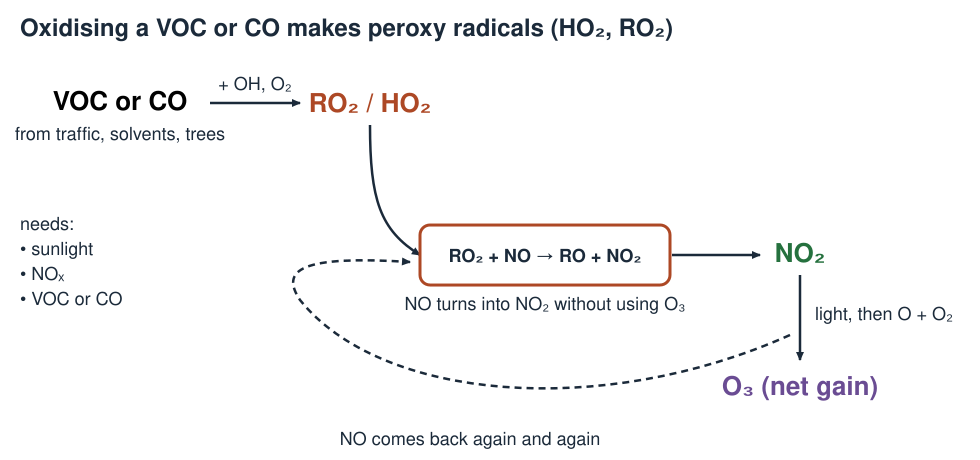{width="80%" fig-align="center"}

When OH attacks a VOC or CO, peroxy radicals (**HO₂, RO₂**) form. They convert NO to NO₂ **without using O₃**. Light then splits that NO₂, and the O atom becomes a **new** ozone molecule. Each NO can go round many times.

::: notes
Here is the key extra step. The hydroxyl radical attacks an organic compound or carbon monoxide, and with oxygen this produces peroxy radicals: HO2 in the case of carbon monoxide, RO2 for organic compounds. A peroxy radical oxidises nitric oxide to nitrogen dioxide. Unlike the null cycle, no ozone was used to do that. When the nitrogen dioxide is photolysed, the oxygen atom forms ozone that is not consumed again. The nitrogen oxides act almost like a catalyst: NO goes round many times, and each round adds ozone. That is why controlling ground-level ozone needs control of both NOx and VOCs, and why it peaks in sunny weather.
:::

## OH sets the pace: rate and lifetime

:::: {.columns}
::: {.column width="50%"}
For a loss reaction X + OH → products, the rate is

$$R = k[\mathrm{X}][\mathrm{OH}]$$

Hold OH constant: $k' = k[\mathrm{OH}]$, lifetime $\tau = 1/k'$.

**Worked example.** k = 1.0 × 10⁻¹² cm³ molecule⁻¹ s⁻¹, OH = 1.0 × 10⁶ molecules/cm³:

- k′ = **1.0 × 10⁻⁶ s⁻¹**
- τ = 1.0 × 10⁶ s ≈ **11.6 days**
- half-life = 0.693 τ ≈ 8.0 days
:::
::: {.column width="50%"}
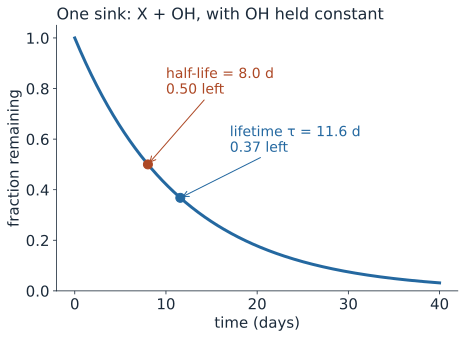{width="100%"}
:::
::::

::: notes
OH, the hydroxyl radical, is the main oxidant of the lower atmosphere, often called its detergent. It reacts with most organic compounds, CO, methane and many pollutants. This is exercise 2. If the OH concentration is treated as constant, the second-order rate law becomes pseudo-first order with rate constant k-prime. Its inverse is the lifetime, the time for the amount to fall to about 37 percent. Point out the units: cubic centimetres per molecule per second, times molecules per cubic centimetre, gives per second. The lifetime is an e-folding time, not a half-life. It includes only this one sink. Deposition, photolysis or transport would make the real persistence shorter.
:::

## Lifetime decides how far a gas travels

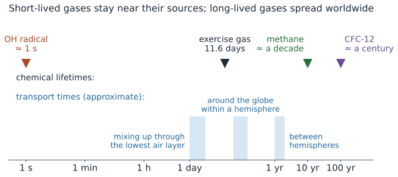{width="92%" fig-align="center"}

Compare a gas's lifetime with **transport times**. OH lasts about a second and never leaves the air parcel where it formed. A gas lasting days to weeks is a **regional** problem. Methane and CFCs live long enough to spread over the **whole globe**.

::: notes
This connects chemistry with transport. Mixing through the lowest kilometre or two of air takes about a day. Wind carries air around the globe in a hemisphere in a few weeks. Exchange between the hemispheres takes about a year. Compare these with chemical lifetimes. OH is so reactive that it is destroyed within about a second, so its concentration reflects only local production. The exercise gas, with a lifetime of about twelve days, will spread across a region but not evenly around the world. Methane, with a lifetime of about a decade, and CFCs, around a century, become well mixed globally. That is why CFCs from the Northern Hemisphere could destroy ozone over Antarctica.
:::

## Back to a surface station

:::: {.columns}
::: {.column width="45%"}
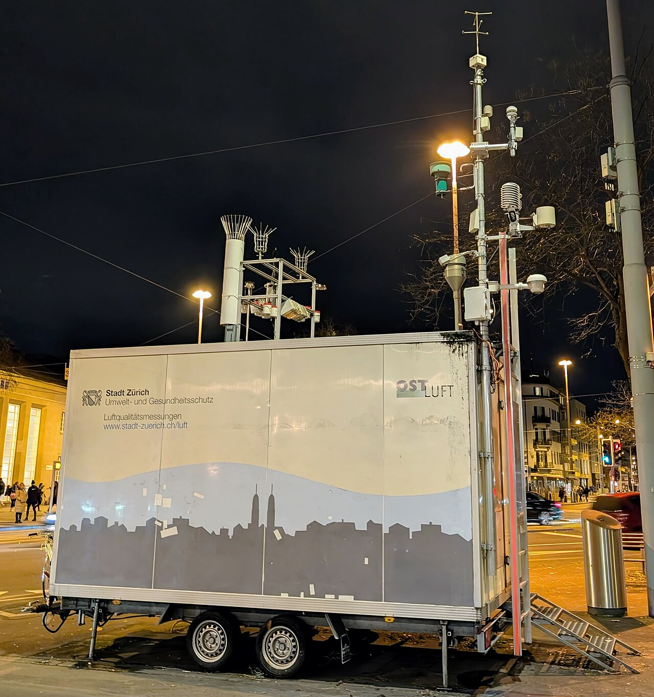{width="78%"}
[Mobile air quality monitoring station in Zürich, Switzerland. Photo: Balise42, CC BY 4.0, Wikimedia Commons.]{.credit}
:::
::: {.column width="55%"}
Ozone measured at a ground station rises. Can you conclude that stratospheric ozone increased, or name the source?

**No.** Surface ozone reflects:

- local **production** from NOₓ + VOC + sunlight;
- local **loss** by NO and by deposition to surfaces;
- **transport** of ozone formed elsewhere, and mixing from above.

You would need precursor measurements, weather data and altitude-resolved ozone.
:::
::::

::: notes
This is exercise 4 and it closes the story. A rise in ground-level ozone is a local measurement with several possible causes. Sunny weather speeds production. Lower NO emissions nearby can actually raise ozone, because less ozone is titrated. Air masses can bring ozone formed hundreds of kilometres away, and occasionally air from the upper troposphere or stratosphere mixes down. The molecular formula is identical whatever its origin, so the measurement alone cannot name a source. This is the same lesson as the river last week: a concentration at one point needs a balance of production, loss and transport before you interpret it.
:::

## Common mistakes to avoid

- **"Ozone is good" or "ozone is bad."** It depends on where it is.
- **"Enough photon energy means the reaction happens."** The molecule must also absorb that wavelength.
- **"M is a reactant."** It is a collision partner; it is not consumed.
- **"The net equation shows the mechanism and the rate."** It shows stoichiometry only.
- **"NO₂ + sunlight makes ozone pile up."** Alone, it is a null cycle; peroxy radicals are needed.
- **"The lifetime is the half-life."** τ = 1/k′; the half-life is 0.693 τ.
- **"A catalyst works forever."** Reservoir species capture it.

::: notes
These are the errors that appear most often for this topic. Go through them and ask students to give the correct statement in their own words. The first one is the theme of the whole lecture. The second and third concern the meaning of photolysis and of the third body. The fourth is about what an overall equation does and does not tell you; this matters for every mechanism in the course. The fifth is the tropospheric ozone point. The sixth is a units and definitions issue: lifetime and half-life differ by a factor of about 0.69. The last one explains why chlorine does not destroy all ozone.
:::

## Explore: OH and the lifetime of a gas {#explore}

```{=html}
<link rel="stylesheet" href="../demos/demo.css">
<div data-demo="lifetime" role="group" aria-label="OH-controlled lifetime of a gas">
<p>Worked example: k = 1.0 × 10⁻¹², OH = 1.0 × 10⁶ molecules/cm³, lifetime 11.6 days, half-life 8.0 days.</p>
</div>
<script src="../demos/core.js"></script>
<script src="../demos/lifetime.js"></script>
```

[Change OH, the rate constant and an extra sink, and see how far the gas can travel.](exercise.qmd#explore)

::: notes
Start with the worked example and confirm the numbers from the "OH sets the pace" slide: k-prime one times ten to the minus six per second, lifetime 11.6 days, half-life 8.0 days. Ask students to predict before each click. Twice as much OH halves the lifetime, because only the product k times OH matters. Making the reaction a hundred times slower gives about three years, long enough to mix between the hemispheres, like the long-lived gases on the transport slide. Adding deposition shows that parallel sinks add their rate constants, so the lifetime becomes shorter than either sink alone would give. The exercise page has the model conditions and a hand check.
:::

## Summary {.smaller}

:::: {.columns}
::: {.column width="70%"}
| Concept | Key fact |
| --- | --- |
| Photon energy | E = hc/λ; splitting O₂ needs λ < 240 nm |
| Absorption | needed as well as energy; O₃ absorbs about 200–310 nm |
| Ozone formation | O₂ + light → 2 O; O + O₂ + M → O₃ + M; M not consumed |
| Ozone amount | balance of production, loss and transport |
| Catalytic cycle | Cl + O₃ → ClO + O₂; ClO + O → Cl + O₂; net O₃ + O → 2 O₂ |
| Polar ozone hole | cloud surfaces release Cl₂; spring sunlight starts fast loss |
| Ground-level ozone | NOₓ + VOC/CO + sunlight; NO₂/NO/O₃ alone is a null cycle |
| Lifetime | k′ = k[OH], τ = 1/k′; half-life 0.693 τ |
| Transport | short-lived: local; long-lived: global |

**Next:** [atmospheric deposition and acidity](../deposition/lec.qmd). OH also turns SO₂ and NO₂ into acids, and rain brings them down. Then the [exercises](exercise.qmd) and [notes](notes.qmd).
:::
::: {.column width="30%"}
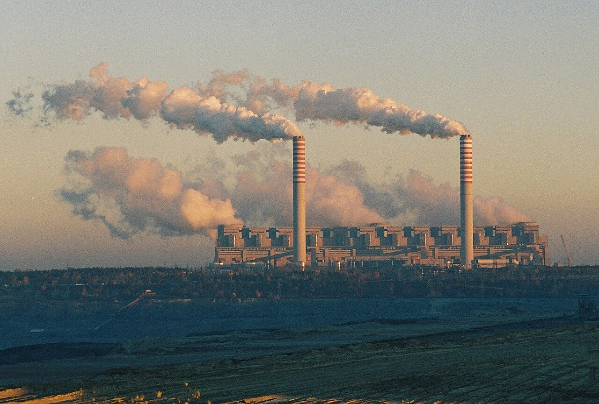{width="100%"}
[Bełchatów coal power station, Poland. Photo: Petr Štefek, CC BY 2.5, Wikimedia Commons.]{.credit}
:::
::::

::: notes
The summary table is the revision sheet. Recite the chain once. Light selects reactions, through both energy and absorption. In the stratosphere, oxygen photolysis makes ozone, and catalysts such as chlorine destroy it; the polar hole needs cold cloud surfaces and returning sunlight. Near the ground, nitrogen dioxide photolysis makes ozone, but net production needs peroxy radicals from organic compounds or carbon monoxide. OH controls lifetimes, and lifetime controls how far a gas travels. The photo is the teaser for the next lecture. The same OH radical that sets lifetimes also oxidises sulfur dioxide and nitrogen dioxide from power stations and traffic into sulfuric and nitric acid.
:::
