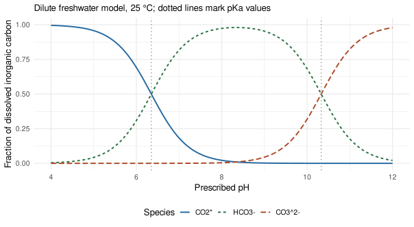

Use the [model sheet](reference.qmd) throughout: 25 °C, dilute freshwater,
$pK_1=6.35$, $pK_2=10.33$, and the supplied Henry and calcite constants.

## 1. Predict, then calculate a species distribution

A water has pH 8.35 and $C_T=1.00$ mmol/L.

1. Predict which of the three carbonate pools is largest.
2. Calculate $r_1$ and $r_2$, then the fractions of all three pools.
3. Calculate their concentrations in mmol/L and check the carbon balance.
4. Repeat only the concentration step for $C_T=0.100$ mmol/L at the same pH.
   Explain what changed and what did not.

::: {.callout-tip collapse="true" title="Hint"}
The proportions are $1:r_1:r_1r_2$, so divide each by their sum. The ratio
$r_2$ compares carbonate with bicarbonate; it is not the carbonate fraction.
:::

::: {.callout-note collapse="true" title="Worked solution"}
At pH 8.35, $r_1=100$ and $r_2=10^{-1.98}=0.0104713$.
The sum of the proportions is $102.0471$.

| Pool | Fraction | Concentration for 1.00 mmol/L total |
| --- | ---: | ---: |
| CO₂* | 0.009799 | 0.009799 mmol/L |
| HCO₃⁻ | 0.979939 | 0.979939 mmol/L |
| CO₃²⁻ | 0.010261 | 0.010261 mmol/L |

The concentrations sum to 1.00 mmol/L within rounding. Bicarbonate dominates.
For 0.100 mmol/L total, each concentration is one tenth as large; the fractions
are unchanged. This result uses the same pH and dilute-solution constants.
:::

## 2. Same pH, different acid response

Two constructed waters start at pH 7.50. Water A has $C_T=1.00$ mmol/L;
water B has $C_T=0.100$ mmol/L. At this pH the fractions are
$\alpha_0=0.066023$, $\alpha_1=0.932598$, $\alpha_2=0.001379$.

1. Calculate initial alkalinity from the carbonate-only expression. Include
   water ions: $[\mathrm{H^+}]=3.1623\times10^{-8}$ mol/L and
   $[\mathrm{OH^-}]=3.1623\times10^{-7}$ mol/L.
2. Add 0.0500 mmol/L of a strong monoprotic acid to each, with negligible dilution.
   Calculate each new alkalinity. No gas exchange, mineral reaction, or biological
   transformation occurs. What happens to $C_T$?
3. A calculation satisfying both balances gives final pH values 7.235 for A and
   6.252 for B. Explain the difference without assuming initial pH measures the
   acid-neutralising inventory.
4. Can you obtain the final pH by subtracting 0.0500 from 7.50? Explain the units.

::: {.callout-tip collapse="true" title="Hint"}
First put all concentrations in mol/L. Multiply the carbonate concentration by
two in the alkalinity expression. A mole of monoprotic strong acid supplies one
equivalent. To express eq/L as meq/L, multiply by 1000.
:::

::: {.callout-note collapse="true" title="Worked solution"}
For A, the bicarbonate and carbonate contribution is
$(0.932598+2\times0.001379)\times10^{-3}$ eq/L.
The water-ion term is $2.8461\times10^{-7}$ eq/L.
The resulting initial alkalinities are approximately **0.9356 meq/L** for A
and **0.09382 meq/L** for B.

The acid supplies **0.0500 meq/L**. Final alkalinities are therefore
**0.8856** and **0.04382 meq/L**. Carbon stays dissolved in this closed model,
so each $C_T$ is conserved; a larger fraction becomes CO₂*.

B loses about 53% of its initial alkalinity, compared with about 5.3% for A.
Its larger pH fall is consistent with its smaller carbonate inventory.
Alkalinity is not identical to local buffer capacity, but here the two waters
have the same initial species fractions and different carbon amounts.

A pH difference is logarithmic and dimensionless; an acid dose has amount-per-volume
units. Direct subtraction cannot satisfy the chemical balances. A numerical solver
is not required for this exercise.
:::

## 3. Use Henry's law for the correct pool

A separate water equilibrates with a large gas reservoir having a supplied
$p_{\mathrm{CO_2}}=4.00\times10^{-4}$ atm.
Use $K_H=0.034$ mol L$^{-1}$ atm$^{-1}$.

1. Calculate $[\mathrm{CO_2^*}]$ and show the unit cancellation.
2. Is that enough information to calculate pH or $C_T$?
3. If the equilibrated water is also specified to have pH 8.35, calculate $C_T$.
4. In another water, CO₂ enters while no acid, mineral, or biological process acts.
   Explain why the alkalinity stays constant even though pH can decrease.

::: {.callout-note collapse="true" title="Worked solution"}
$[\mathrm{CO_2^*}]=0.034\times4.00\times10^{-4}=1.36\times10^{-5}$ mol/L
= **13.6 µmol/L**. The atm units cancel. This specifies the gas pool only.
Another independent carbonate constraint is needed to calculate pH and total carbon.

With pH 8.35 supplied, $C_T=13.6(1+100+1.04713)$ µmol/L,
or approximately **1.388 mmol/L**. Henry's law alone did not give that total.

Dissociation of the added CO₂ produces hydrogen ion and bicarbonate together;
their contributions cancel in alkalinity. Gas transfer adds carbon rather than
strong-acid equivalents. At fixed alkalinity the pH generally falls as CO₂ enters.
An imposed pH of 8.35 is a specified state, not the predicted endpoint of every
water exposed to this gas.
:::

## 4. Check calcite saturation

Two separate water states each have free calcium $5.00\times10^{-4}$ mol/L.
Free carbonate is $1.00\times10^{-6}$ mol/L in state X and
$1.00\times10^{-5}$ mol/L in state Y. Use $K_{sp}=3.3\times10^{-9}$.

Calculate $\Omega$ for each. Identify which could dissolve available calcite and
which could precipitate it. Can you infer a precipitation rate or final mass?
Explain why replacing free calcium with dissolved total calcium might matter.

::: {.callout-note collapse="true" title="Worked solution"}
The products are $5.00\times10^{-10}$ and $5.00\times10^{-9}$.
Thus **$\Omega_X=0.152$** and **$\Omega_Y=1.52$**.
X is undersaturated and could dissolve calcite if it is present. Y is
supersaturated, so precipitation is thermodynamically favoured, but may be delayed
by kinetics or nucleation. Neither ratio gives a rate or final mass. Ion pairs
and complexes can make free calcium smaller than total dissolved calcium.
:::

## 5. Plot the chemical prediction in R

This task reuses objects, arithmetic, tables, and labelled plots from introductory
computing. The small addition is a regular pH grid. No statistical fit is needed:
these are predictions from equilibrium expressions.

Download [speciation.R](speciation.R) and [report.Rmd](report.Rmd) into the same
folder. Open that folder as your working project. The script needs `ggplot2`;
rendering the report also needs `rmarkdown`, as in introductory computing.
Open the script in the editor before running it.

### Predict and inspect

Before running the script, sketch the expected dominance near pH 4, 8, and 12.
The script starts with these calculations:

```r
pH <- seq(4, 12, by = 0.05)
r1 <- 10^(pH - 6.35)
r2 <- 10^(pH - 10.33)
denominator <- 1 + r1 + r1 * r2
```

[`seq()`](https://stat.ethz.ch/R-manual/R-devel/library/base/html/seq.html)
creates regularly spaced values. Each vector operation evaluates the chemical
expression at every pH value. `^` means a power. The script divides the three
proportions by `denominator` and puts them in a table. Its remaining code arranges
that table for the familiar `ggplot()` and `geom_line()` functions.

Run from the folder holding both files:

```r
source("speciation.R")
head(speciation)
speciation_plot
```

Compare the plot with the prediction and with the hand calculation in question 1.



### Check and explain

1. In the report template, select the pH 8.35 row and compare its fractions with
   your hand calculation. Explain any difference due to rounding.
2. Check that fractions stay between zero and one and sum to one.
3. Explain what happens to concentrations if $C_T$ doubles at each prescribed pH.
4. Explain why moving along the horizontal axis does not simulate adding a
   specified dose of acid to a closed sample.
5. Replace the template prompts with your prediction, calculation, chemical
   interpretation, and assumptions. Restart R, then Knit the saved report, or run
   `rmarkdown::render("report.Rmd")` from its folder.

::: {.callout-note collapse="true" title="Worked interpretation"}
CO₂* dominates at low pH, bicarbonate in the middle, and carbonate at high pH.
At pH 8.35, the model fractions agree with question 1. The sum is one to numerical
precision, and every fraction lies between zero and one. Doubling $C_T$ at fixed
pH doubles the concentrations, while leaving these model fractions unchanged.

The horizontal axis supplies pH independently at each point. An acid-dose
experiment must instead conserve carbon and satisfy the changed alkalinity.
The curve alone does not supply that second constraint or predict a final pH.
The model assumes equilibrium, 25 °C, and dilute freshwater; it omits ion pairing
and other acid–base systems.
:::

## 6. Explain a catchment observation

A lake's pH decreases after a disturbance. Suggest two chemically distinct
processes from this unit that could cause a decrease, and identify additional
measurements that would help distinguish them. State one limitation of interpreting
only pH. Do not claim a cause from a single observation.

::: {.callout-note collapse="true" title="Worked explanation"}
Strong-acid input and net CO₂ uptake can both lower pH. In the isolated model,
strong acid lowers alkalinity while CO₂ uptake conserves it and increases dissolved
inorganic carbon. Paired pH, alkalinity, and inorganic-carbon or dissolved-CO₂
measurements would help assess these possibilities. Calcium and mineral context
could reveal additional reactions. A real catchment can have several processes
acting together; pH alone does not identify the cause or neutralising inventory.
:::

## Explore: carbonate response to acid {#explore}

Predict which of the two waters from exercise 2 has the larger pH decrease.
Use the presets, then change only the carbon total or acid dose. Read the
species fractions alongside the carbon and alkalinity balances.

```{=html}
<link rel="stylesheet" href="../demos/demo.css">
<div data-demo="carbonate" role="group" aria-label="Closed-water carbonate response to strong acid">
<p>Reference case: Water A finishes at model pH 7.235 and Water B at 6.252 after the same 0.050 meq/L acid input.</p>
</div>
<script src="../demos/core.js"></script>
<script src="../demos/carbonate.js"></script>
```

**E1.** Compare **Water A: more carbon** with **Water B: less carbon**. Check
that alkalinity falls by the same acid-equivalent dose in both. Explain why
the pH changes differ.

**E2.** Choose **No acid added** and vary only the carbon total. At fixed pH,
which changes: species fractions, species concentrations, or alkalinity?

**E3.** Choose **Check pH 8.35 fractions**. Compare the bicarbonate fraction
with your hand calculation in exercise 1. Explain why the distribution curve
alone does not specify the final pH after an acid dose.

### Model conditions and hand check

| Constructed water | Initial pH | Fixed inorganic carbon | Acid dose | Final model pH |
| --- | ---: | ---: | ---: | ---: |
| A | 7.50 | 1.00 mmol/L | 0.050 meq/L | 7.235 |
| B | 7.50 | 0.100 mmol/L | 0.050 meq/L | 6.252 |

At 25 °C, use pK₁ = 6.35, pK₂ = 10.33, and Kw = 10⁻¹⁴ in dilute freshwater.
Activities are approximated by concentrations. Each acid addition holds the
selected inorganic-carbon total fixed and lowers alkalinity by the dose.
There is no gas exchange, mineral reaction, biological change, other buffer,
or dilution. The curves use prescribed pH; the final-state marker also satisfies
the changed alkalinity balance. Negative alkalinity is possible while every
species concentration remains nonnegative.

[More guided comparisons for week 2](../interactives/week2.qmd).
