## About this lecture

:::: {.columns}
::: {.column width="56%"}
In parts of Skåne and on Gotland, where the bedrock contains limestone, tap water is **hard**. Kettles there grow a white crust within weeks. In much of northern Sweden, on granite, they hardly scale at all.

The crust is **calcite**, CaCO₃: the same mineral that liming adds to lakes. Why does it come **out** of the water when you boil it?

Today you will learn to:

- use **Henry's law** to connect dissolved CO₂ to the air;
- explain why **CO₂ uptake** raises C~T~ but **not alkalinity**, unlike strong acid;
- judge mineral stability with the **saturation state Ω**;
- separate what is **favoured** from what is **fast**.
:::
::: {.column width="44%"}
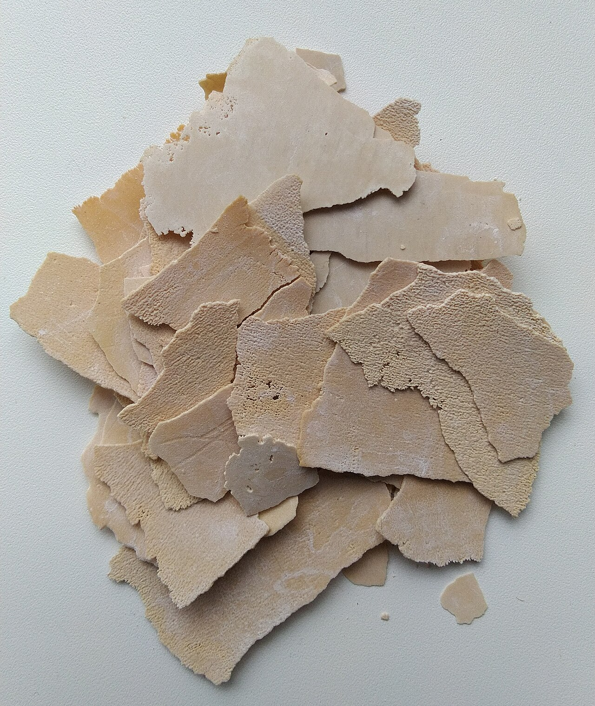{width="72%"}
[Limescale (CaCO₃) from a kettle. Photo: Alexander Davronov, CC BY-SA 4.0, Wikimedia Commons.]{.credit}
:::
::::

::: notes
Pick up exactly where the last lecture stopped. We ended with two open questions: what happens when the water meets the air, and why does a kettle scale up? We also saw that carbon dioxide uptake by the ocean is not the same as adding strong acid. Today we answer all three. The kettle is a good hook because every student has seen limescale, and the same chemistry builds stalactites, tufa waterfalls and the shells of marine plankton. Point out that the regional difference in Sweden is the same bedrock story as the lakes last time: limestone supplies calcium and alkalinity, granite does not.
:::

## Opening the box

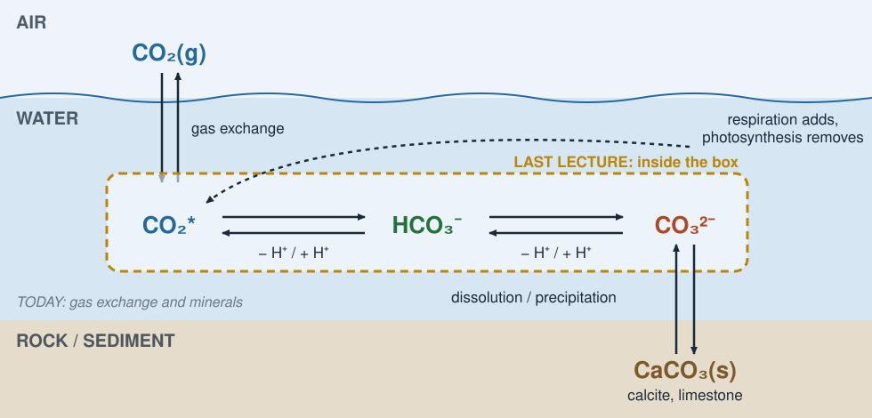{width="76%" fig-align="center"}

Last lecture we worked **inside the dashed box**: C~T~ was fixed and carbon only changed form. Today we open two of the doors: **gas exchange** with the air and **dissolution and precipitation** of calcite. Each changes C~T~, alkalinity, or both, in a definite way.

::: notes
Show the familiar diagram from the previous lecture. Inside the box we had a closed water, and strong acid only redistributed carbon among the three species. Real waters are open. Carbon dioxide can enter from the air or from respiration and leave again by degassing or photosynthesis. Calcite can dissolve from rocks and soils, or precipitate. The aim of today is bookkeeping: for each process, say what happens to total dissolved carbon and what happens to alkalinity. Once that is clear, pH follows from the tools of last lecture. By the end we will put all processes on one map.
:::

## Water meets air: Henry's law

:::: {.columns}
::: {.column width="58%"}
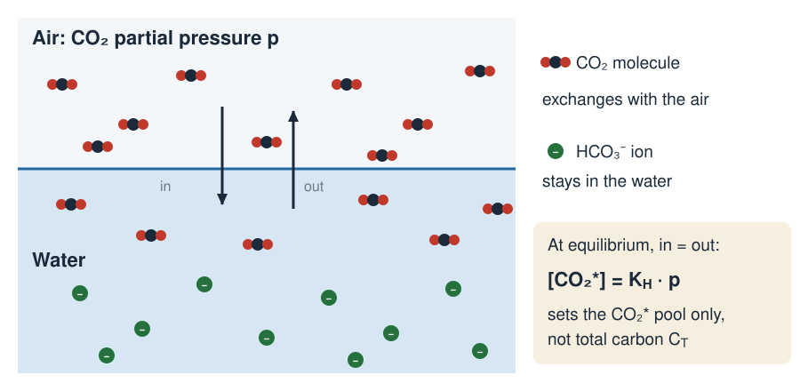{width="100%"}
:::
::: {.column width="42%"}
CO₂ molecules cross the water surface in both directions. At equilibrium the two fluxes are equal and

$$[\mathrm{CO_2^*}]=K_H\,p_{\mathrm{CO_2}}$$

with $K_H=0.034$ mol L⁻¹ atm⁻¹ at 25 °C and $p$ in atm.

Henry's law fixes **only the CO₂\* pool**. Bicarbonate and carbonate ions cannot leave the water; they follow through the acid–base equilibria.
:::
::::

::: notes
Henry's law is a simple proportionality: the more carbon dioxide in the gas, the more dissolves. Check units with students: mol per litre per atmosphere times atmospheres gives mol per litre. Warn them that Henry coefficients are published in several conventions, some as pressure divided by concentration, so the number and the equation must come from the same source. We use the convention from the reference sheet. The most important sentence is the last one. Only the neutral dissolved carbon dioxide exchanges with the air. Bicarbonate is an ion; it stays in the water and is connected to carbon dioxide only through the equilibria we studied last time.
:::

## A worked Henry calculation

:::: {.columns}
::: {.column width="45%"}
Take $p_{\mathrm{CO_2}}=4.00\times10^{-4}$ atm (the exercise value):

$$[\mathrm{CO_2^*}]=0.034\times4.00\times10^{-4}=1.36\times10^{-5}\ \mathrm{mol/L}$$

That is **13.6 µmol/L**. The atm units cancel.

The relation is linear: ten times more CO₂ in the gas gives ten times more CO₂\*. Soil air often holds around 1% CO₂, so soil water can carry far more CO₂\* than water at the surface.
:::
::: {.column width="55%"}
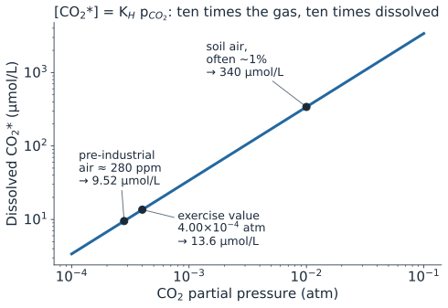{width="100%"}
:::
::::

::: notes
This is exercise three, part one. Today's atmosphere is a little above four times ten to the minus four atmospheres, about 420 parts per million, but the exercise uses a round supplied value so that everyone gets the same answer. Point to the three markers on the line. Pre-industrial air gave about 9.5 micromoles per litre. Soil air, enriched by root and microbial respiration, is typically ten to a hundred times richer in carbon dioxide than the atmosphere; one percent is a common round figure. Water that percolates through soil therefore picks up a lot of carbon dioxide. Keep that in mind: it is the start of the cave and kettle story.
:::

## Henry gives CO₂\*, not total carbon

:::: {.columns}
::: {.column width="52%"}
If the same water is **also specified** to have pH 8.35, the ratio rule from last lecture gives the rest:

$$C_T=[\mathrm{CO_2^*}](1+r_1+r_1r_2)$$

With $r_1=100$ and $r_2\approx0.0105$:

$C_T\approx13.6\times102.05\approx$ **1388 µmol/L**

The gas pool is only **1%** of the dissolved carbon. Applying Henry's law to C~T~ would be off by a factor of 100.
:::
::: {.column width="48%"}
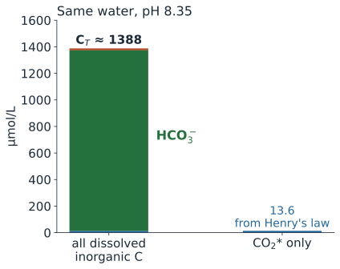{width="100%"}
:::
::::

::: notes
This is exercise three, part three. Students must notice the word "specified". Henry's law alone does not tell us the pH; we supplied it as an extra piece of information. With the pH given, the proportions 1 to r1 to r1 r2 from last lecture convert the CO2-star pool into the total. At pH 8.35 almost all carbon is bicarbonate, so the total is about a hundred times the gas-controlled pool. The bar chart makes that visible: the slim blue sliver is all that Henry's law describes. If you fix gas pressure, pH and total carbon independently, you will usually overconstrain the system and get a contradiction.
:::

## Why clean rain is acidic

:::: {.columns}
::: {.column width="55%"}
Pure water in contact with air has no alkalinity. The only source of H⁺ is dissolved CO₂:

$$\mathrm{CO_2^*+H_2O\rightleftharpoons H^++HCO_3^-}$$

With no other ions, [H⁺] ≈ [HCO₃⁻], so

$$[\mathrm{H^+}]^2\approx K_1[\mathrm{CO_2^*}]=10^{-6.35}\times1.36\times10^{-5}$$

[H⁺] ≈ 2.5 × 10⁻⁶ mol/L, **pH ≈ 5.6**.

This is why "acid rain" means rain **below** about 5.6.
:::
::: {.column width="45%"}
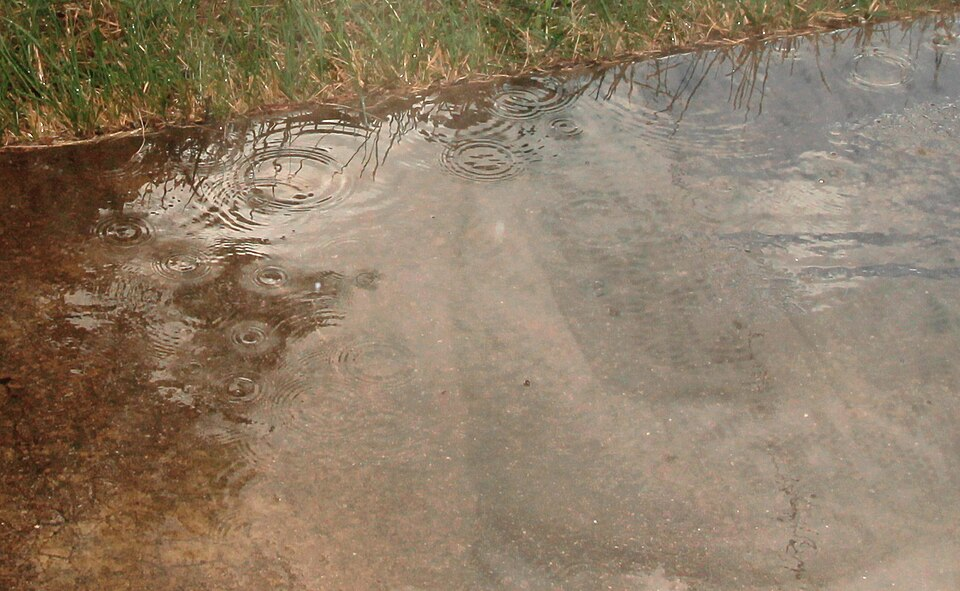{width="100%"}
[Raindrops on a puddle. Photo: Jean-Marie Vugnon, CC BY-SA 4.0, Wikimedia Commons.]{.credit}
:::
::::

::: notes
This short calculation explains a number students met in the pilot lecture and in the deposition unit. In pure water the charge balance is simply hydrogen ion equals bicarbonate, because there are no other ions and carbonate is negligible at this pH. Substituting into the first acid equilibrium gives hydrogen ion squared equals K1 times the dissolved carbon dioxide. With our constants and the exercise gas pressure the answer is pH 5.61; with today's 420 parts per million it is 5.60. Natural rain varies around this value. Sulfuric and nitric acids from pollution push it lower, which is the acid deposition that damaged lakes and forests in the opening story of the last lecture.
:::

## CO₂ uptake versus strong acid

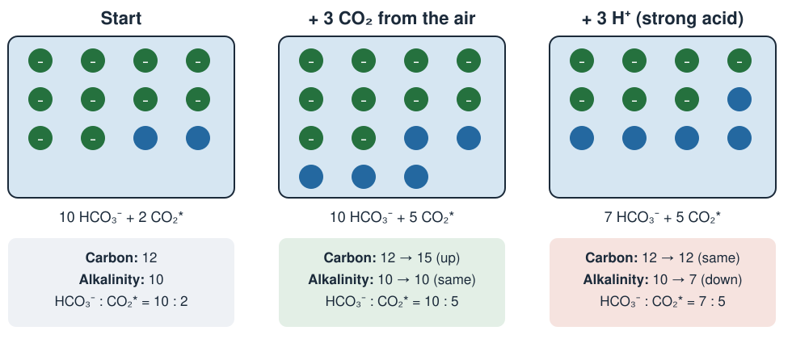{width="80%" fig-align="center"}

Both inputs lower the HCO₃⁻ : CO₂\* ratio, so **both lower pH**. But CO₂ **adds carbon** and leaves alkalinity unchanged, while strong acid **removes alkalinity** and leaves carbon unchanged.

::: notes
Use the token picture the same way as last time. Start: ten bicarbonate and two CO2-star, so carbon twelve, alkalinity ten. Add three carbon dioxide molecules: carbon becomes fifteen, alkalinity is still ten, the ratio drops from five to two. Add three hydrogen ions instead: three bicarbonates become CO2-star, carbon stays twelve, alkalinity falls to seven, the ratio drops to 1.4. Both waters become more acidic, but by different bookkeeping. This is the key distinction for ocean acidification, for respiration in lakes, and for acid deposition. Ask students why the acid case has the lower ratio even though the same number of particles was added.
:::

## Why alkalinity ignores CO₂

:::: {.columns}
::: {.column width="45%"}
Dissolved CO₂ that reacts makes **one H⁺ and one HCO₃⁻ together**:

$$\mathrm{CO_2+H_2O\rightarrow H^++HCO_3^-}$$

In $A_T=[\mathrm{HCO_3^-}]+2[\mathrm{CO_3^{2-}}]+[\mathrm{OH^-}]-[\mathrm{H^+}]$ they cancel: +1 − 1 = 0.

So added CO₂ can push pH down, but it **never removes the reserve**. The blue curve has no cliff; the red one does.
:::
::: {.column width="55%"}
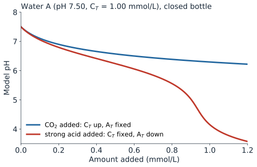{width="100%"}
:::
::::

::: notes
This is exercise three, part four, and the reason for the contrast in the last lecture's ocean slide. Carbon dioxide is an acid only in a limited sense: every hydrogen ion it releases arrives together with a bicarbonate ion, which can take the hydrogen ion back. The alkalinity sum therefore does not change. The model curves start from Water A of last lecture. Adding one millimole per litre of strong acid uses up all its alkalinity and pH collapses to about four. Adding one millimole per litre of carbon dioxide doubles total carbon but only brings pH down to about 6.3. These are closed-bottle model results, not field data.
:::

## Which way does CO₂ move?

:::: {.columns}
::: {.column width="55%"}
Compare the water's own CO₂\* with $K_H\,p_{\mathrm{CO_2}}$ of the air above it:

- **Water higher:** CO₂ escapes (**degassing**). C~T~ falls, A~T~ stays, pH **rises**.
- **Water lower:** CO₂ enters (**uptake**). C~T~ rises, pH falls.

Many lakes and streams, especially in the boreal zone, are **supersaturated** with CO₂. They receive CO₂-rich soil water and respiring organic matter, and release CO₂ to the air.
:::
::: {.column width="45%"}
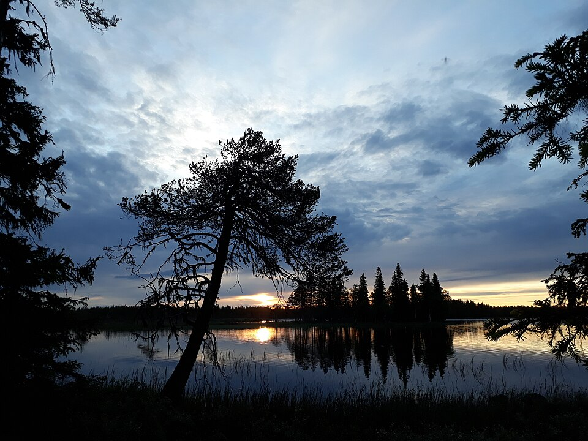{width="100%"}
[Forest lake, Reivo nature reserve, Norrbotten. Photo: GeorgeInsjon, CC BY-SA 4.0, Wikimedia Commons.]{.credit}
:::
::::

::: notes
Gas exchange always runs towards equilibrium with the air. Most water bodies are not at equilibrium, because the water was charged with carbon dioxide somewhere else, in soil or groundwater, or by respiration in the water itself. Northern lakes and streams are commonly net sources of carbon dioxide to the atmosphere, fed by soil water and by decomposition of organic matter from their catchments; this is part of the next lecture. Photosynthesis works in the opposite direction: it removes carbon dioxide during the day and can raise pH. The key observation for the rest of today: when carbon dioxide leaves at constant alkalinity, pH rises, and so does carbonate ion.
:::

## Minerals: calcite dissolves and precipitates

:::: {.columns}
::: {.column width="55%"}
$$\mathrm{CaCO_3(s)\rightleftharpoons Ca^{2+}+CO_3^{2-}}$$

In natural water, with dissolved CO₂:

$$\mathrm{CaCO_3+CO_2+H_2O\rightleftharpoons Ca^{2+}+2HCO_3^-}$$

Each mole dissolved adds **1 mol C~T~** and **2 eq alkalinity**. Precipitation removes the same.

Read **forward**: CO₂-rich soil water dissolves limestone. Read **backward**: water that **loses CO₂** deposits calcite.
:::
::: {.column width="45%"}
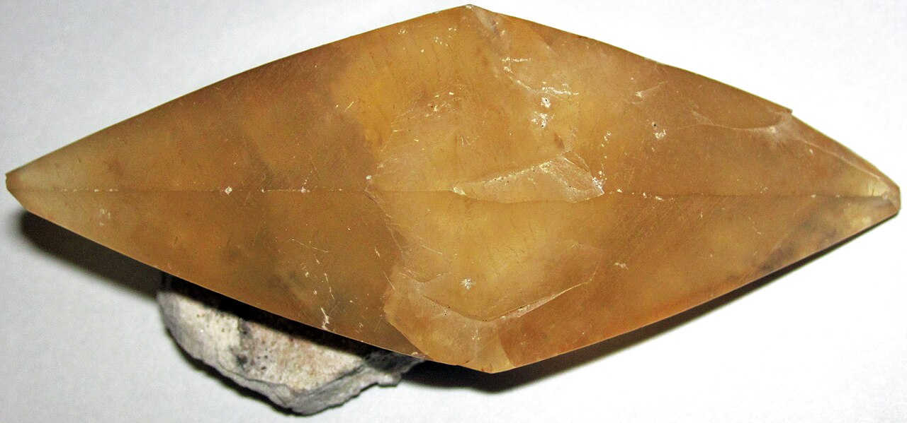{width="100%"}
[Calcite (CaCO₃) crystal, about 6 cm. Photo: James St. John, CC BY 2.0, Wikimedia Commons.]{.credit}
:::
::::

::: notes
This is the mineral door of the box. Write the simple dissolution first, then the version that includes carbon dioxide, which is how limestone weathering really happens. Count the bookkeeping: one calcium, two bicarbonates, so alkalinity rises by two equivalents and total carbon by one mole per mole of calcite. The second equation is reversible, and that is the whole story of today in one line. Forward, carbon dioxide-rich soil water attacks limestone and becomes hard. Backward, when that hard water loses carbon dioxide, the equilibrium shifts left and calcite comes out. Liming, from last lecture, is the forward reaction used deliberately.
:::

## Is calcite stable here? The saturation state

:::: {.columns}
::: {.column width="45%"}
$$\Omega=\frac{[\mathrm{Ca^{2+}}][\mathrm{CO_3^{2-}}]}{K_{sp}},\quad K_{sp}=3.3\times10^{-9}$$

- **Ω < 1:** undersaturated, calcite can dissolve
- **Ω = 1:** saturated, at equilibrium
- **Ω > 1:** supersaturated, calcite can form

Use **free** ion concentrations. At fixed Ca²⁺ and C~T~, Ω rises about **tenfold per pH unit** in this range, because carbonate ion does.
:::
::: {.column width="55%"}
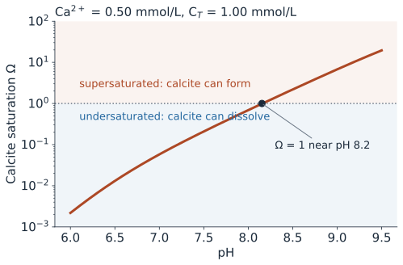{width="100%"}
:::
::::

::: notes
The saturation state compares the actual ion product with the product at equilibrium. It is the mineral version of asking which direction a reaction can go. Use the free ion concentrations: ion pairs such as calcium sulfate reduce free calcium below the dissolved total. The plot fixes calcium at 0.5 millimoles per litre and total carbon at 1 millimole per litre and varies pH. Because carbonate is a small fraction that grows tenfold per pH unit below pK2, Omega does too. This water crosses saturation near pH 8.2. So anything that raises pH, such as losing carbon dioxide, can tip a water from dissolving calcite to depositing it. The strict expression uses activities; we use concentrations.
:::

## A worked saturation comparison

Two water states, each with free Ca²⁺ = 5.00 × 10⁻⁴ mol/L:

| State | Free CO₃²⁻ (mol/L) | Product | Ω |
| --- | --- | --- | ---: |
| X | 1.00 × 10⁻⁶ | 5.00 × 10⁻¹⁰ | **0.152** |
| Y | 1.00 × 10⁻⁵ | 5.00 × 10⁻⁹ | **1.52** |

X could **dissolve** calcite if calcite is present. In Y precipitation is **favoured**.

Ω does **not** give a rate or a final mass of calcite. Precipitation itself removes Ca²⁺ and CO₃²⁻, so Ω falls back towards 1 as calcite forms; the amount needs a mass balance.

::: notes
This is exercise four. Multiply, divide by the solubility product, compare with one. A tenfold change in carbonate ion moves the water across saturation. Then discuss what the number cannot tell us. It cannot say how fast calcite forms, because precipitation needs nucleation sites and can be slow. It cannot say how much forms, because precipitation itself removes calcium and carbonate, lowers Omega and stops at saturation; a mass balance is needed for that. And it says nothing about dissolution if no calcite is present. Students also need to remember that replacing free calcium by total dissolved calcium overestimates Omega when ion pairs are important.
:::

## The kettle, explained

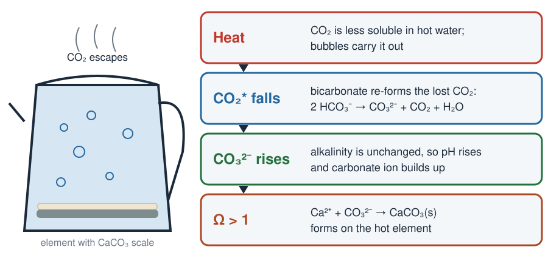{width="72%" fig-align="center"}

Hard water starts near saturation. Heating drives CO₂ out, the carbonate equilibria shift, CO₃²⁻ rises and Ω passes 1. Calcite also becomes **less** soluble as temperature rises. The hot element provides the surface where crystals start.

::: notes
Now the opening question has an answer. Follow the chain. Gases are less soluble in hot water, so heating drives carbon dioxide out as bubbles. With carbon dioxide leaving, the second equation on the minerals slide runs backward: bicarbonate re-forms carbon dioxide and carbonate ion. Alkalinity stays the same, but carbon falls, so pH and carbonate ion rise until the water is supersaturated. Calcite is unusual in being less soluble when hot, which adds to the effect. Crystals start on the heating element, where temperature is highest and a surface is available. Soft water from granite areas contains too little calcium and alkalinity to get far.
:::

## A model: groundwater meets the air

:::: {.columns}
::: {.column width="58%"}
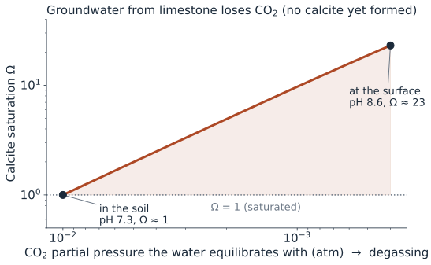{width="100%"}
:::
::: {.column width="42%"}
**Constructed water:** dissolves calcite to saturation under soil air at 0.01 atm CO₂. It ends up with A~T~ ≈ 2.8 meq/L and Ca²⁺ ≈ 1.4 mmol/L, pH ≈ 7.3.

It then emerges and loses CO₂ towards the atmosphere (4.0 × 10⁻⁴ atm) at constant alkalinity:

- pH rises to about **8.6**
- Ω rises to about **23**

Nature's kettle needs **no heating**, only degassing.
:::
::::

::: notes
This model is generated by the figure script for this lecture, with our 25 degree constants and no temperature effect. It is constructed, but the numbers are realistic for limestone groundwater. In the soil, water is in contact with air that is rich in carbon dioxide, so it can dissolve a lot of calcite before reaching saturation. When the water emerges at a spring, in a cave or in a waterfall, it equilibrates towards the much lower carbon dioxide of the atmosphere. Alkalinity stays constant, carbon falls, pH rises by more than a unit, and Omega rises from one to over twenty. Turbulence speeds the degassing. The curve stops before any calcite forms; precipitation would then pull Omega back down.
:::

## Nature's kettle: tufa at Plitvice

:::: {.columns}
::: {.column width="55%"}
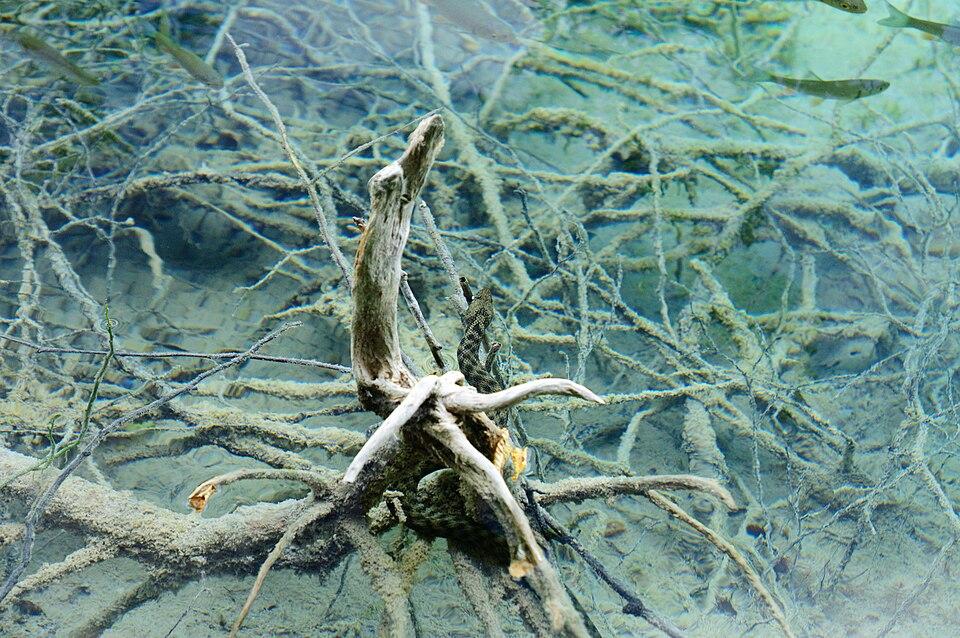{width="100%"}
[Tufa coating submerged branches, Plitvice Lakes, Croatia. Photo: Alessandro Caproni, CC BY 2.0, Wikimedia Commons.]{.credit}
:::
::: {.column width="45%"}
At the **Plitvice Lakes** in Croatia, water from limestone springs flows over a staircase of lakes and waterfalls.

Turbulent water loses CO₂, becomes **supersaturated with calcite**, and deposits it as **tufa**, a porous limestone. Mosses, algae and sunken branches provide surfaces; plants also take up CO₂.

Over thousands of years the tufa has built natural dams that hold the lakes in place.
:::
::::

::: notes
Plitvice is a UNESCO World Heritage site and a spectacular example of exactly the model on the previous slide. Karst springs deliver hard water with high carbon dioxide. As it tumbles over falls and cascades, carbon dioxide escapes, pH and Omega rise, and calcite precipitates on surfaces. Mosses and algae help in two ways: they offer surfaces for crystals to start on, and their photosynthesis removes carbon dioxide. The barriers grow and the lakes are held behind them. Students can contrast this with the kettle: same chemistry, but degassing at constant temperature instead of heating. Similar deposits occur at many karst springs across Europe.
:::

## Underground: stalactites

:::: {.columns}
::: {.column width="45%"}
Rainwater passes through soil, picks up CO₂ and dissolves limestone on its way down. When a drop reaches the open cave, it meets cave air with **less CO₂** than the soil.

The drop degasses, Ω rises above 1, and a thin ring of calcite is left behind. Drop by drop this builds **stalactites**, and the water that falls builds **stalagmites**.

Growth is slow, often fractions of a millimetre per year, so speleothems are used as **climate archives**.
:::
::: {.column width="55%"}
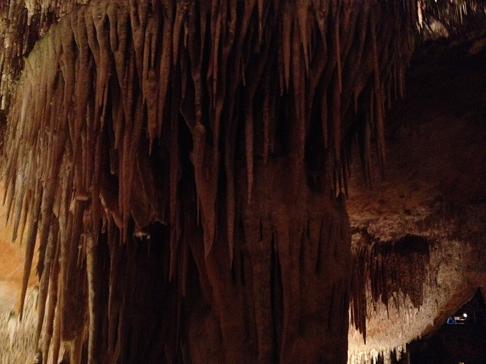{width="100%"}
[Stalactites in a limestone cave, Mallorca, Spain. Photo: Killarnee, CC BY-SA 4.0, Wikimedia Commons.]{.credit}
:::
::::

::: notes
The cave is the same chemistry once more, with a nice extra lesson. The dissolving part happens in the soil and rock above the cave, under high carbon dioxide; the depositing part happens where the drip water meets cave air. Growth rates vary widely, which is why I give only an order of magnitude. Because they grow slowly and in layers, and because their chemistry records conditions at the time of growth, cave formations are dated and used to reconstruct past climate. On Gotland, Lummelunda is a limestone cave students can visit. The general point: dissolution and precipitation of calcite are controlled by carbon dioxide as much as by calcium.
:::

## Supersaturated is not the same as precipitating

:::: {.columns}
::: {.column width="55%"}
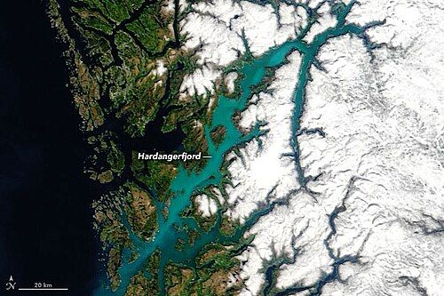{width="100%"}
[Coccolithophore bloom colouring Hardangerfjord, Norway, 2020 (NASA Terra MODIS). Public domain, Wikimedia Commons.]{.credit}
:::
::: {.column width="45%"}
Surface seawater is **several times supersaturated** with calcite, yet calcite does not simply fall out of the sea. Forming a new crystal needs a **nucleation** step, and ions such as Mg²⁺ slow crystal growth.

Organisms do it instead: plankton such as **coccolithophores** build calcite plates. Their blooms turn the sea milky blue.

CO₂ uptake lowers CO₃²⁻ and so **lowers Ω**, making shell building harder.
:::
::::

::: notes
This slide connects the thermodynamic idea to kinetics and to the ocean. Omega above one says precipitation is favoured, but a crystal has to start somewhere, and in the open ocean spontaneous nucleation is very slow. Magnesium ions in seawater also inhibit calcite growth. Marine organisms overcome these barriers biologically, and most calcium carbonate in the ocean is made by organisms. The satellite image shows a coccolithophore bloom: the calcite plates scatter light and colour the water. This links back to the pteropod image of the last lecture. Ocean uptake of carbon dioxide keeps alkalinity but converts carbonate to bicarbonate, so Omega falls. Do not quantify seawater with our freshwater constants.
:::

## All the processes on one map

:::: {.columns}
::: {.column width="58%"}
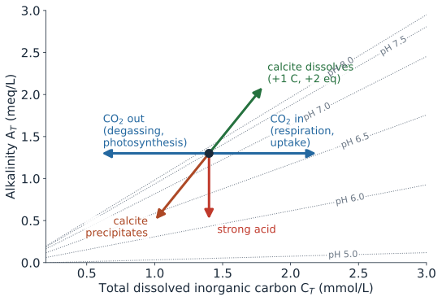{width="100%"}
:::
::: {.column width="42%"}
| Process | C~T~ | A~T~ |
| --- | :---: | :---: |
| CO₂ uptake, respiration | up | same |
| Degassing, photosynthesis | down | same |
| Strong acid | same | down |
| Calcite dissolves | +1 | +2 |
| Calcite forms | −1 | −2 |

Dotted lines show pH. **Know which arrow you are on before you calculate.**
:::
::::

::: notes
This map summarises the bookkeeping of the week. Each process moves the water in a fixed direction in the space of total carbon and alkalinity, and the background contours show where pH ends up. Carbon dioxide processes move horizontally. Strong acid moves straight down. Calcite moves along a slope of two. Photosynthesis and respiration are shown as pure carbon dioxide processes, which ignores small alkalinity changes from nutrient uptake. A field explanation must first decide which processes act and what is held fixed. Never fix total carbon in a calculation that also allows unlimited gas exchange; the reference sheet table lists what each example holds fixed. Real waters often move along several arrows at once.
:::

## Check yourself

::: {.checkbox}
1. A water's CO₂\* is 50 µmol/L. Air above it gives $K_Hp=13.6$ µmol/L. Which way does CO₂ move, and what happens to pH?
2. A lake takes up CO₂ from the air. What happens to C~T~, to A~T~, to pH?
3. Calcite dissolves into a closed bottle of water. By how much do C~T~ and A~T~ change per mole?
4. Ω = 0.4 in a stream with no calcite in its bed. Will the stream dissolve calcite?
5. Why is Henry's law not enough to give pH on its own?
:::

::: notes
Answers. One: the water is supersaturated, so carbon dioxide escapes; at constant alkalinity pH rises. Two: total carbon rises, alkalinity is unchanged, pH falls. Three: plus one mole of carbon and plus two equivalents of alkalinity. Four: no; undersaturation means dissolution would be favoured if calcite were available, but there is none to dissolve. A thermodynamic driving force needs a reactant. Five: Henry's law fixes only the carbon dioxide pool. To find pH you need one more piece of information, such as alkalinity or total carbon. Let students discuss question four in pairs; it catches many people.
:::

## Common mistakes to avoid

- **Applying Henry's law to C~T~.** It gives CO₂\* only.
- **"CO₂ is an acid, so it lowers alkalinity."** H⁺ and HCO₃⁻ form together; A~T~ is unchanged.
- **Fixing p~CO₂~, pH and C~T~ independently.** Usually two fix the third.
- **"Ω > 1, so calcite forms now."** Ω gives direction, not rate or amount.
- **Using total Ca for free Ca²⁺.** Ion pairs lower the free ion.
- **Forgetting temperature.** Gases and calcite are both less soluble in hot water.
- **Using freshwater constants for seawater.**

::: notes
Run through these quickly and ask for the reason behind each one. The second is the most important conceptual point of the lecture and is examined every year in some form. The third is the source of many contradictory calculations: in an open carbonate system, choosing two of gas pressure, pH, total carbon and alkalinity fixes the rest. The sixth reminds students that our constants are for 25 degrees; real waters are colder or hotter, and the direction of the temperature effect matters for kettles and for cold northern lakes. Ask students to add one more mistake from their own exercise work.
:::

## Explore: degassing and calcite saturation {#explore-gases}

```{=html}
<link rel="stylesheet" href="../demos/demo.css">
<div data-demo="gases" role="group" aria-label="CO₂ exchange and calcite saturation at fixed alkalinity">
<p>Groundwater from soil air (0.010 atm) degasses to the air: pH rises from 7.26 to 8.65 and Ω from about 1 to about 23.</p>
</div>
<script src="../demos/core.js"></script>
<script src="../demos/gases.js"></script>
```

[Follow groundwater from soil air to the open air at fixed alkalinity.](exercise.qmd#explore-gases)

::: notes
Start with the groundwater preset, which reproduces the "groundwater meets the air" model slide: saturated with calcite under soil air. Then press the degassed preset and ask students what changed. CO2-star falls by a factor of 25, total carbon falls, alkalinity and calcium stay fixed, and pH and Omega rise. Then try the exercise 3 preset to check the Henry calculation, and the rain preset to recover pH 5.6. Ask what would happen to Omega in a soft granite water with low alkalinity and calcium. The exercise page has the assumptions and a hand check.
:::

## Summary {.smaller}

:::: {.columns}
::: {.column width="70%"}
| Concept | Key fact |
| --- | --- |
| Henry's law | [CO₂\*] = K~H~ p~CO₂~; K~H~ = 0.034 mol L⁻¹ atm⁻¹ at 25 °C |
| Gas versus total | Henry fixes CO₂\* only; C~T~ needs pH or A~T~ too |
| Clean rain | pure water + air CO₂ → pH ≈ 5.6 |
| CO₂ uptake | C~T~ up, A~T~ unchanged, pH down, no alkalinity cliff |
| Strong acid | C~T~ unchanged, A~T~ down by the dose |
| Degassing | C~T~ down, pH and CO₃²⁻ up |
| Calcite | dissolving adds 1 mol C~T~ and 2 eq A~T~ per mol |
| Saturation | Ω = [Ca²⁺][CO₃²⁻]/K~sp~; above 1 favours calcite forming |
| Kinetics | supersaturation can persist; surfaces and organisms help |
| Kettle, cave, tufa | CO₂ loss raises Ω until calcite precipitates |

**Next:** [Organic matter in water](../aquatic-organic-matter/lec.qmd). Why are many Swedish lakes turning brown? Then the [exercises](exercise.qmd) and the [reference sheet](reference.qmd).
:::
::: {.column width="30%"}
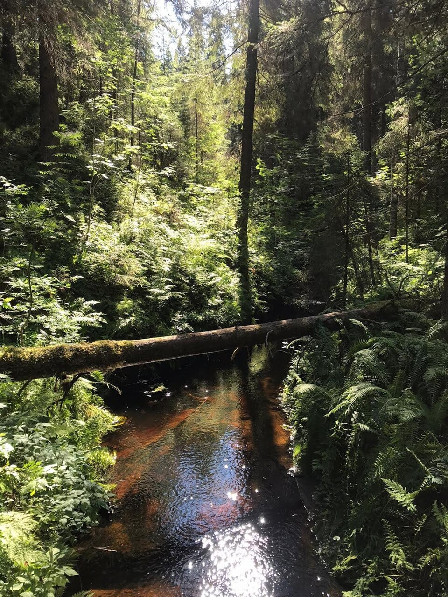{width="100%"}
[Brown, humic river water, Korkeakoskenjoki, Finland. Photo: Anna Reponen, CC BY 4.0, Wikimedia Commons.]{.credit}
:::
::::

::: notes
Recite the bookkeeping once more. Gas exchange moves carbon but not alkalinity. Strong acid moves alkalinity but not carbon. Calcite moves both, one to two. Omega tells us whether calcite can dissolve or form, not how fast. The kettle, the cave and the tufa waterfall are one mechanism: carbon dioxide loss raises carbonate ion. The next lecture leaves carbonate chemistry and turns to the other big pool of carbon in natural water, dissolved organic matter. It also gives the reason many boreal lakes are supersaturated with carbon dioxide. The teaser photo shows a brown, humic forest river in Finland; its colour comes from organic matter washed in from soils and peat.
:::
