## About this lecture

:::: {.columns}
::: {.column width="56%"}
In the 1970s and 1980s, acid rain from European industry fell on southern Scandinavia. **Thousands of lakes lost their fish.** Yet other lakes that received the same rain hardly changed.

The difference was not the rain. It was the **chemistry already dissolved in the water**, above all its dissolved inorganic carbon.

Today you will learn to:

- name the **three dissolved carbon species** and predict which dominates at a given pH;
- tell a **fraction** apart from an **amount**;
- use **alkalinity**, the water's acid-neutralising reserve, to predict how pH responds to acid.

Last lecture you met charge balance and a simple acid distribution. Today you apply both to the most important acid–base system in natural water.
:::
::: {.column width="44%"}
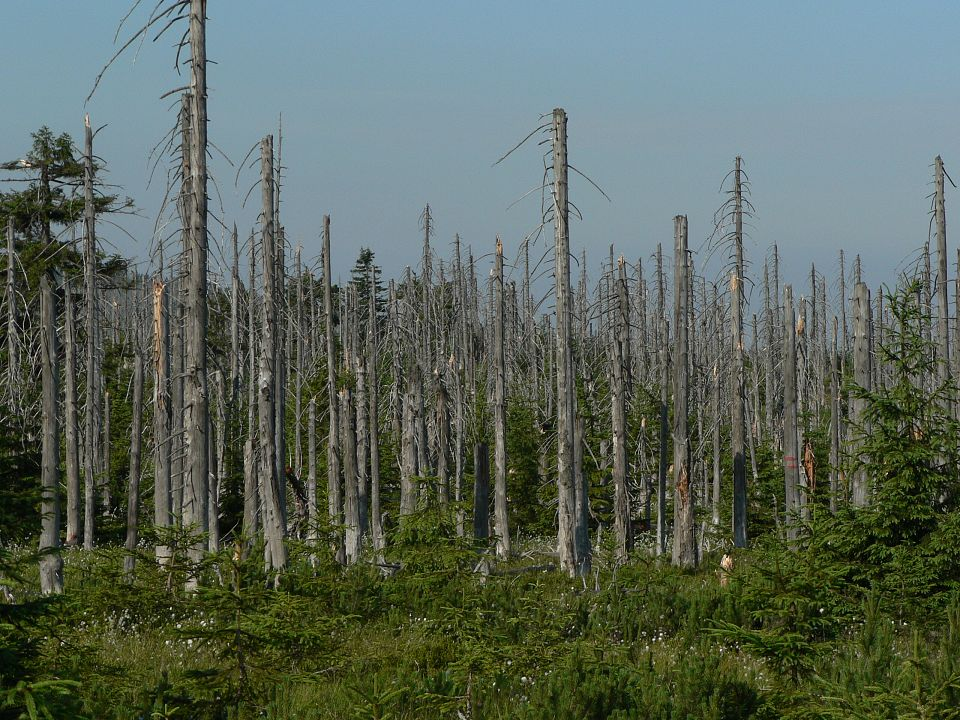{width="100%"}
[Forest damaged by acid deposition, Jizera Mountains, Czech Republic. Photo: Lovecz, public domain, Wikimedia Commons.]{.credit}
:::
::::

::: notes
Open with the story, not the equations. Acid deposition damaged forests across central Europe and acidified lakes across southern Norway and Sweden. The striking fact is the patchiness: two lakes a few kilometres apart could receive the same acidic rain, and one lost its fish while the other barely changed. By the end of the lecture students should be able to explain that difference with one quantity, alkalinity, and to understand why it is not the same thing as pH. Mention that this lecture is the first of a pair. The second deck adds gas exchange and minerals. Everything today is a closed-water model at 25 °C.
:::

## A puzzle from the Swedish forests

:::: {.columns}
::: {.column width="50%"}
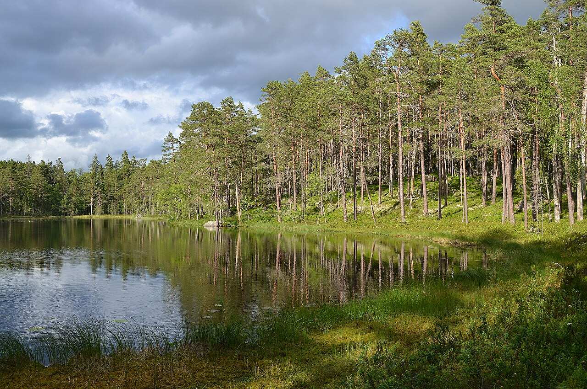{width="100%"}
[Forest lake, Norra Kvill National Park, Småland. Photo: Pudelek, CC BY-SA 4.0, Wikimedia Commons.]{.credit}
:::
::: {.column width="50%"}
Much of Sweden sits on **granite and gneiss**. These rocks weather slowly and release few dissolved ions. Lakes on them are clear and **soft**: they contain little dissolved material.

Where the bedrock or soil contains **limestone** (calcium carbonate), the water carries much more dissolved calcium and carbonate species.

Both kinds of lake received similar acid deposition. The soft-water lakes acidified. The limestone lakes did not.

**Question for this lecture:** what is it about dissolved carbonate that lets a lake absorb acid?
:::
::::

::: notes
Ask students to look at the photo: a beautiful, clear forest lake. Clarity here is partly a sign of low dissolved content. Explain that the bedrock sets the starting composition of the water. Granite is mostly silicate minerals that weather slowly; limestone dissolves comparatively quickly and supplies calcium and carbonate species. Do not explain the mechanism yet. Pose the question and leave it open: the rest of the lecture builds the tools to answer it. If students already say "buffering", ask them what is doing the buffering and how much of it there is. That is exactly the distinction between pH and alkalinity we will make.
:::

## Two lakes, two ion signatures

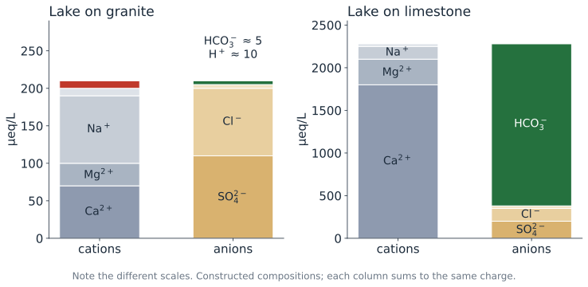{width="88%" fig-align="center"}

Each column adds up charge (µeq/L). Cations and anions must balance, as in the last lecture. In the **limestone lake**, most negative charge is carried by **bicarbonate (HCO₃⁻)**. In the **granite lake**, bicarbonate is almost absent and sulfate from acid rain dominates.

::: notes
These are constructed compositions, but in the typical range for a soft-water lake and a hard-water lake. Point out three things. First, the scales differ by about a factor of ten: the limestone lake simply contains much more dissolved material. Second, in the limestone lake bicarbonate is the dominant anion. Third, in the granite lake sulfate, largely from deposition, takes the place of bicarbonate, and a little free hydrogen ion appears among the cations. Remind students of the charge balance from the previous lecture: every column pair must sum to the same charge. We will return to this figure when we define alkalinity, because alkalinity can be read from exactly this kind of balance.
:::

## Sweden's response: add limestone

:::: {.columns}
::: {.column width="45%"}
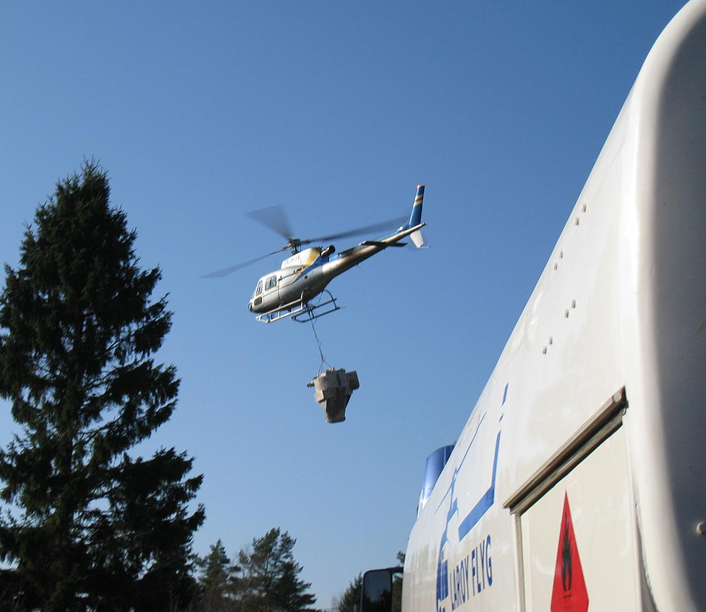{width="100%"}
[Forest liming by helicopter, Kungsbacka, Sweden. Photo: Bulver, CC BY-SA 3.0, Wikimedia Commons.]{.credit}
:::
::: {.column width="55%"}
Since the late 1970s, Sweden has spread finely ground **limestone (CaCO₃)** on thousands of lakes, streams, wetlands and forest soils. Sweden has run one of the largest liming programmes in the world.

Liming does not remove the acid rain. It adds something to the water that **takes up hydrogen ions**.

To understand why it works and how much is needed, we need to know:

1. what forms carbon takes when it is dissolved;
2. how those forms trade hydrogen ions;
3. how to count the water's capacity to neutralise acid.
:::
::::

::: notes
Liming is a large and long-running chemical intervention, and a good example of chemistry used for management. Lime is spread from boats, from helicopters as in this photo, or on wetlands upstream so that it dissolves gradually. Ask the class: why would adding a rock help? Some will say "it is basic". Push further: what does basic mean in terms of species, and how much rock is enough? Those questions motivate the three numbered steps. We answer the dosing question near the end of the lecture with a back-of-the-envelope calculation.
:::

## A laboratory version of the puzzle

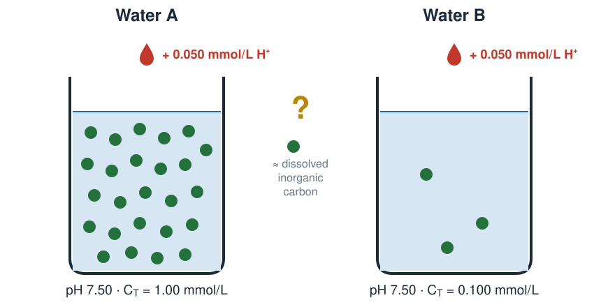{width="62%" fig-align="center"}

Two **constructed** waters both start at **pH 7.50**. Water A contains ten times more dissolved inorganic carbon than Water B. Each receives the same small dose of strong acid, with negligible dilution.

**Predict before we calculate:** which pH falls more? What does a pH reading alone leave out?

::: notes
This is the lake puzzle stripped down to its chemistry: same starting pH, different carbon inventory, same acid input. Give students thirty seconds to commit to a prediction, and ask for a show of hands. Many will say they change equally, because they have learned that pH describes acidity. The model assumptions: closed water, so no gas exchange; no minerals, organic acids or other buffers; 25 °C; background counter-ions keep the solution electrically neutral. This is not a recipe for preparing either water. We return to these two beakers with numbers about two thirds of the way through the lecture.
:::

## Where dissolved carbon comes from

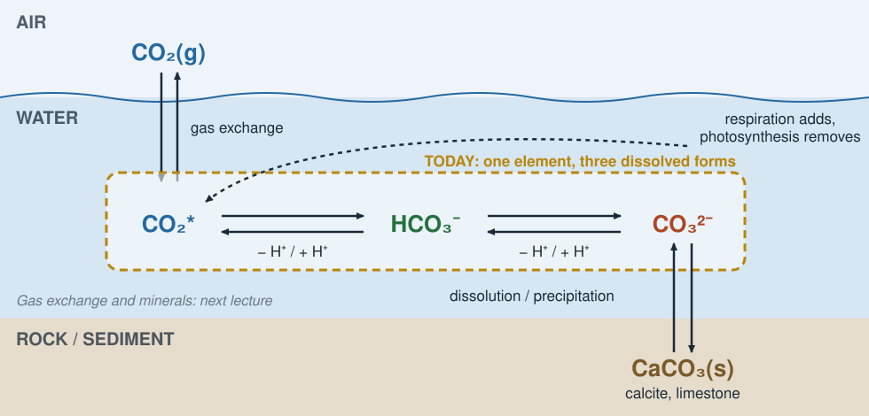{width="82%" fig-align="center"}

Carbon enters water from the **air** (carbon dioxide), from **rocks** (carbonate minerals) and from **organisms** (respiration). Once dissolved, it is shared between three forms that convert into each other by gaining or losing H⁺. **Today we work inside the dashed box.**

::: notes
Give the big picture once so that later details have a place. Carbon dioxide from the air dissolves. Carbonate minerals dissolve or precipitate. Organisms respire carbon dioxide into the water or remove it by photosynthesis. Inside the water, three forms interconvert very quickly by proton exchange. In this lecture we hold the total amount of dissolved carbon fixed, a closed system, and study only the exchange inside the box. The next deck opens the box: gas exchange with the atmosphere and the calcite mineral. Separating these processes is a key skill. Many wrong environmental explanations mix up "carbon changed form" with "carbon was added or lost".
:::

## One element, three dissolved forms

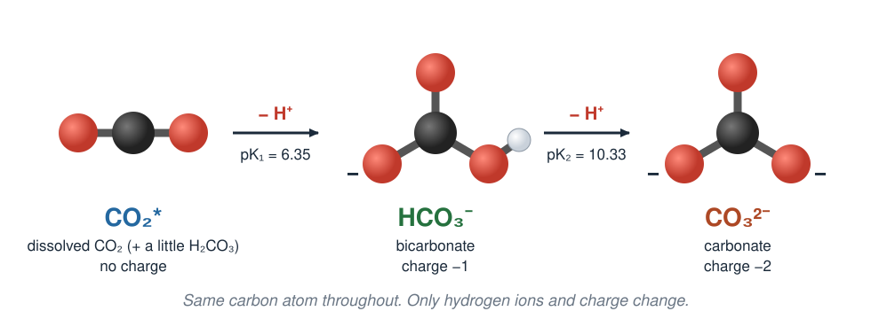{width="78%" fig-align="center"}

$$C_T=[\mathrm{CO_2^*}]+[\mathrm{HCO_3^-}]+[\mathrm{CO_3^{2-}}]$$

**C~T~** is the total dissolved inorganic carbon. CO₂\* groups dissolved CO₂ with the small amount of carbonic acid (H₂CO₃). When one species converts to another, carbon is **redistributed**, not removed.

::: notes
Show the structures so the formulas become molecules. CO2 is neutral and linear. Bicarbonate carries one negative charge and still has one hydrogen it can lose. Carbonate carries two negative charges. The star in CO2-star is a bookkeeping convention: true carbonic acid is a small fraction of the dissolved pool, so we group it with dissolved CO2 and treat the sum as one species. C_T is the conserved quantity in a closed water. Stress the sentence at the bottom. When acid converts bicarbonate to CO2-star, the carbon is still in the bottle. That will matter when we explain why the two waters behave differently.
:::

## Each step trades a hydrogen ion

$$\mathrm{CO_2^*+H_2O\rightleftharpoons H^++HCO_3^-}\qquad pK_1=6.35$$
$$\mathrm{HCO_3^-\rightleftharpoons H^++CO_3^{2-}}\qquad pK_2=10.33$$

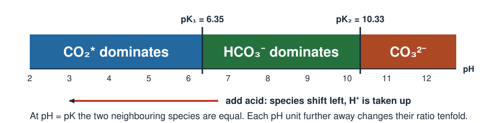{width="85%" fig-align="center"}

Low pH (many H⁺) pushes both equilibria to the left; high pH pushes them to the right. Natural freshwaters (pH ≈ 6–8.5) sit mostly in the **bicarbonate** region.

::: notes
These are effective constants for 25 °C dilute freshwater, taken from the reference sheet. The first reaction is shorthand: it combines dissolution, hydration and acid dissociation. It is not an elementary step. The predominance bar is the one picture to remember. Below pK1 the neutral CO2 pool dominates. Between the two pK values bicarbonate dominates. Above pK2 carbonate dominates. Adding acid pushes species left: hydrogen ions are bound into bicarbonate and CO2-star instead of staying free. That binding is the molecular meaning of buffering. Point out that ordinary lakes and rivers sit in the green region, so bicarbonate is the workhorse species of freshwater chemistry.
:::

## From an equilibrium expression to a ratio

:::: {.columns}
::: {.column width="50%"}
$$K_1=\frac{[\mathrm{H^+}][\mathrm{HCO_3^-}]}{[\mathrm{CO_2^*}]}$$

Rearrange, and use $[\mathrm{H^+}]\approx10^{-\mathrm{pH}}$ mol/L:

$$\frac{[\mathrm{HCO_3^-}]}{[\mathrm{CO_2^*}]}=\frac{K_1}{[\mathrm{H^+}]}=10^{\,\mathrm{pH}-6.35}$$

- pH 6.35: ratio **1** (equal amounts)
- pH 7.35: ratio **10**
- pH 8.35: ratio **100**

The ratio depends only on pH, not on how much carbon there is.
:::
::: {.column width="50%"}
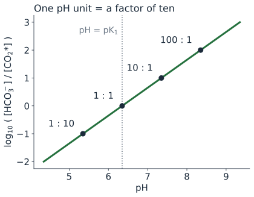{width="100%"}
:::
::::

::: notes
This is the most useful single calculation in the lecture, and it can be done in your head. Dividing K1 by the hydrogen-ion concentration gives the ratio of the two neighbouring species. In logarithmic form it is a straight line of slope one: every pH unit multiplies the ratio by ten. Have students say the ratios aloud for pH 5.35 and 8.35. Emphasise the last line. The ratio contains no information about the total amount of carbon, which is the seed of today's main point. We use the approximation that hydrogen-ion activity equals its concentration, appropriate for dilute freshwater. The reference sheet states it explicitly.
:::

## Add the second step and normalise

:::: {.columns}
::: {.column width="50%"}
$$r_1=10^{\mathrm{pH}-6.35},\qquad r_2=10^{\mathrm{pH}-10.33}$$

The three species stand in proportion

$$[\mathrm{CO_2^*}]:[\mathrm{HCO_3^-}]:[\mathrm{CO_3^{2-}}]=1:r_1:r_1r_2$$

**Worked example, pH 8.35:** $r_1=100$, $r_2=0.01047$, so 1 : 100 : 1.047.

Divide each by the sum, 102.047, to get **fractions α**:

α₀ = 0.0098 · α₁ = 0.9799 · α₂ = 0.0103

Check: they sum to 1.
:::
::: {.column width="50%"}
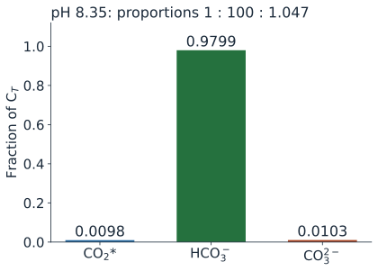{width="100%"}
:::
::::

::: notes
Chain the two ratios. Bicarbonate relative to CO2-star is r1. Carbonate relative to bicarbonate is r2. So carbonate relative to CO2-star is r1 times r2. Dividing by the sum converts the proportions to fractions that add to one. These are written alpha-zero, alpha-one and alpha-two after the number of protons lost. At pH 8.35, almost all carbon is bicarbonate and the other two are about one percent each. This pH is near the bicarbonate maximum, halfway between the two pK values on the log scale. Students will repeat this exact calculation in exercise 1. Encourage them to always check that the fractions sum to one.
:::

## The distribution diagram

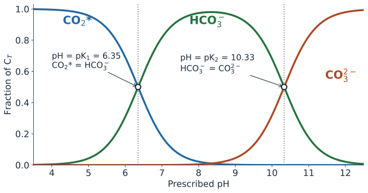{width="88%" fig-align="center"}

Repeat the calculation at every pH and you get this diagram. **Where curves cross, pH = pK.** Each species dominates across about four pH units. The x-axis is a *prescribed* pH, not an amount of acid added and not time.

::: notes
This is the same calculation as the previous slide, repeated across the pH axis by the R script in the activity. Read it with the students. Find pH 8.35 and confirm the green curve is near 0.98. Find the crossing points: at pH 6.35 CO2-star equals bicarbonate, and at 10.33 bicarbonate equals carbonate. At each crossing the two species are equal, but neither is exactly one half, because the third species is still present in a small amount. A common misreading treats the x-axis as acid added or as time. It is neither: each vertical slice is a separate water with that pH. To find what pH a water reaches after acid, we need alkalinity.
:::

## Where real waters sit

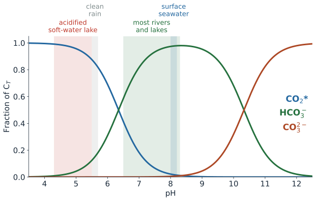{width="88%" fig-align="center"}

Clean rain (about 5.6) is acidic just from dissolved CO₂. Most lakes and rivers lie between 6.5 and 8.3, where **bicarbonate dominates**. Surface seawater is near 8.1. An acidified soft-water lake can fall below pH 5, where nearly all carbon is CO₂\*.

::: notes
Anchor the abstract diagram in real waters; the ranges are approximate. Rain in equilibrium with atmospheric carbon dioxide is around pH 5.6 even without pollution, so acid rain means rain well below that. Most freshwaters and the surface ocean sit in the bicarbonate region. An acidified lake at pH 4.5 to 5 has almost no bicarbonate left. Students should notice that this is the same situation as the granite lake's ion bar, where bicarbonate had nearly vanished. The diagram explains which species is present. It does not yet explain why one water reaches pH 5 and another stays at 7.5. For that we need amounts.
:::

## Check yourself

::: {.checkbox}
Use the distribution diagram and the ratio rule. No calculator needed.

1. At pH 5.35, what is [HCO₃⁻] / [CO₂\*]?
2. At pH 10.33, which two species are equal? Is either exactly half of C~T~?
3. A lake is at pH 7.35 with C~T~ = 0.50 mmol/L. Roughly how much of the carbon is bicarbonate?
4. True or false: "At pH 8 a water has a lot of bicarbonate."
:::

::: notes
Answers. One: 0.1, so one bicarbonate for every ten CO2-star. Two: bicarbonate and carbonate are equal at pK2. Neither is exactly one half, because a small CO2-star fraction remains, though at this pH it is tiny. Three: the ratio is ten, so about ten elevenths, roughly 0.45 mmol/L of bicarbonate. Four is the trap. At pH 8 a large fraction of the carbon is bicarbonate, but whether that is a lot depends on how much carbon there is. Use the trap to move to the next slide: fractions are not amounts.
:::

## Fractions do not give the amount

:::: {.columns}
::: {.column width="50%"}
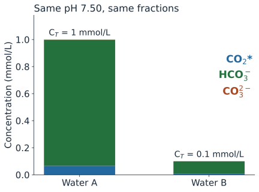{width="100%"}
:::
::: {.column width="50%"}
Both waters are at pH 7.50, so they have **identical fractions**: about 93% bicarbonate and 7% CO₂\*.

But the amount of bicarbonate is

- Water A: 0.93 mmol/L
- Water B: 0.093 mmol/L

**pH sets the shape of the column; C~T~ sets its height.** Each bicarbonate ion can take up one H⁺. Water A has ten times as many to offer.
:::
::::

::: notes
This is the turning point of the lecture. A pH measurement fixes the proportions but not the amount. Only the amount of bicarbonate and carbonate determines how much acid can be absorbed before the species run out. Make the physical picture concrete: each bicarbonate ion is a site that can bind one incoming hydrogen ion. Water A has ten times as many of those sites per litre. In the lake story, the granite lake is Water B, or worse, and the limestone lake is Water A. We now need a quantity that counts these sites properly, including the fact that carbonate can take up two hydrogen ions. That quantity is alkalinity.
:::

## Alkalinity counts the acid-neutralising capacity

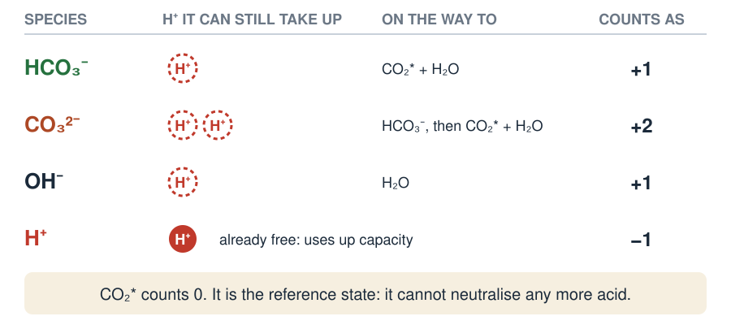{width="62%" fig-align="center"}

$$A_T=[\mathrm{HCO_3^-}]+2[\mathrm{CO_3^{2-}}]+[\mathrm{OH^-}]-[\mathrm{H^+}]$$

Units: equivalents per litre (eq/L). Water A at pH 7.50: A~T~ = 0.9356 meq/L. Water B: 0.0938 meq/L.

::: notes
Alkalinity counts how many hydrogen ions the water can take up before its carbonate species are pushed all the way to CO2-star. Bicarbonate takes up one, carbonate two, hydroxide one. Free hydrogen ions are already there and count negatively. CO2-star is the reference state and counts zero. That is why the units are equivalents, not moles. The two waters' values follow directly from their fractions and C_T; check the numbers with the class. This carbonate-only definition ignores borate, organic acids, phosphate and other contributors. It is appropriate for our dilute freshwater model but needs checking for real samples, as the reference sheet notes.
:::

## Alkalinity is the charge-balance gap

:::: {.columns}
::: {.column width="55%"}
{width="100%"}
:::
::: {.column width="45%"}
Charge balance forces

$$A_T\approx(\text{total base cations})-(\text{total strong-acid anions})$$

Base cations: Ca²⁺, Mg²⁺, Na⁺, K⁺. Strong-acid anions: SO₄²⁻, Cl⁻, NO₃⁻.

- **Weathering of limestone** adds Ca²⁺ with HCO₃⁻: alkalinity rises.
- **Acid deposition** adds SO₄²⁻ with H⁺: alkalinity falls.

The lake's acid reserve is set by its catchment.
:::
::::

::: notes
Return to the two lakes from the start. Because cations and anions balance, whatever positive charge from calcium, magnesium, sodium and potassium is not matched by sulfate, chloride and nitrate must be matched by bicarbonate and carbonate, minus free hydrogen ion. That excess is alkalinity. This view links today to last lecture's charge balance. It also explains the catchment story chemically. Limestone weathering supplies calcium balanced by bicarbonate. Sulfuric acid deposition supplies sulfate balanced by hydrogen ion, which consumes bicarbonate. In the granite lake the base cations barely exceed the strong-acid anions, so alkalinity is near zero or negative. The deposition unit develops this budget further.
:::

## Three quantities, three questions

:::: {.columns}
::: {.column width="48%"}
| Quantity | Answers the question |
| --- | --- |
| **pH** | How acidic is the water *now*? |
| **Alkalinity A~T~** | How much strong acid can it neutralise? |
| **Buffer capacity β** | How much acid moves pH by one unit, *here*? |

At pH 7.50, Water A's buffer capacity is about **ten times** Water B's.
:::
::: {.column width="52%"}
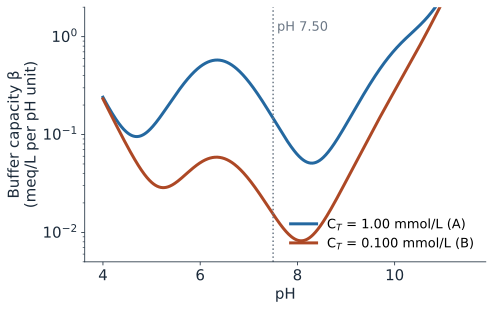{width="100%"}
:::
::::

::: notes
Students often merge these three ideas into the word "buffering". Separate them clearly. pH is a state: the current hydrogen-ion level. Alkalinity is an inventory: the total acid-neutralising capacity. Buffer capacity is a local slope: how much acid is needed per unit pH change at the current state. The plot shows buffer capacity across pH for both waters. It peaks near the pK values and has a minimum near pH 8.3. Water A's curve lies about ten times above Water B's in the freshwater range, because buffer capacity scales with C_T. We will not ask students to calculate beta by hand; the figure is for interpretation.
:::

## Acid consumes alkalinity, not carbon

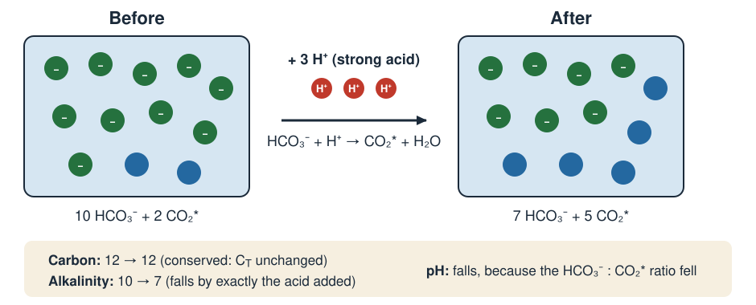{width="72%" fig-align="center"}

For a strong-acid dose $q$ (eq/L) in our closed water: $\;A_{T,\text{after}}=A_{T,\text{before}}-q\;$ and $C_T$ is unchanged.

**Do not subtract an acid dose from a pH value.** pH must be recalculated from the new A~T~ and C~T~.

::: notes
Walk through the cartoon. Three hydrogen ions arrive. Three bicarbonate ions become CO2-star. Carbon is conserved, twelve before and twelve after. Alkalinity falls by exactly three. The pH falls because the bicarbonate-to-CO2-star ratio fell, and we know from the ratio rule how to turn a ratio into a pH. The key bookkeeping statement is the equation: strong acid lowers alkalinity one-for-one and leaves C_T unchanged in a closed water. The typical error is to treat pH as additive: pH is a logarithm of a concentration that is itself set by equilibria, so a dose cannot simply be subtracted from it.
:::

## Finding the new pH

:::: {.columns}
::: {.column width="52%"}
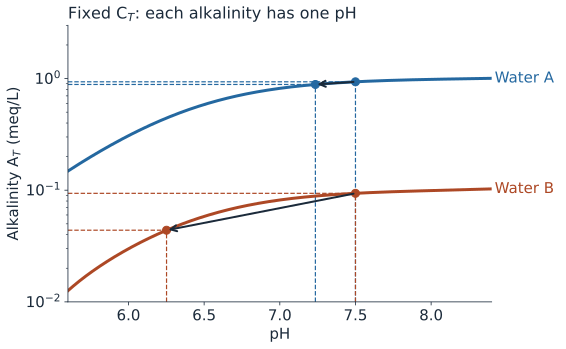{width="100%"}
:::
::: {.column width="48%"}
At fixed C~T~, alkalinity rises steadily with pH. **Each alkalinity value has exactly one pH.**

1. Start at pH 7.50 on the curve.
2. Lower A~T~ by 0.050 meq/L.
3. Read off the new pH.

The same step down is a **small** fraction of Water A's alkalinity and a **large** fraction of Water B's (note the log axis).
:::
::::

::: notes
This is the graphical solution to the problem. For a fixed C_T, alkalinity is a monotonic function of pH, so we can invert it: given the new alkalinity, there is one pH. The arrows show the move for each water. On a logarithmic axis, an equal absolute step down looks tiny near the top of Water A's curve and large on Water B's. You do not need to implement a numerical solver; the supplied final pH values were found exactly this way by the instructor script. The exam-relevant skill is the bookkeeping, alkalinity minus dose with C_T fixed, plus the ability to explain why the pH outcome differs.
:::

## Return to the two waters

| Constructed water | C~T~ (mmol/L) | A~T~ before (meq/L) | A~T~ after (meq/L) | Final pH |
| --- | ---: | ---: | ---: | ---: |
| A | 1.00 | 0.9356 | 0.8856 | **7.235** |
| B | 0.100 | 0.09382 | 0.04382 | **6.252** |

- Water A lost about **5%** of its alkalinity and dropped **0.27** pH units.
- Water B lost about **53%** and dropped **1.25** pH units: over ten times more H⁺.

Same starting pH, same dose, very different outcome. **The difference is the carbon inventory, which a pH reading cannot show.**

::: notes
Go back to the predictions students made with the two beakers. The numbers resolve the puzzle. The dose consumed a small part of A's alkalinity and more than half of B's. A pH drop of 1.25 means the free hydrogen-ion concentration rose by a factor of about eighteen. These are model results from the stated assumptions, not field data. In exercise 2 students reproduce the alkalinity changes by hand and interpret the supplied final pH values. If time allows, ask: what single measurement would have warned you that Water B was vulnerable? The answer is alkalinity, or C_T, not pH.
:::

## The whole acid response

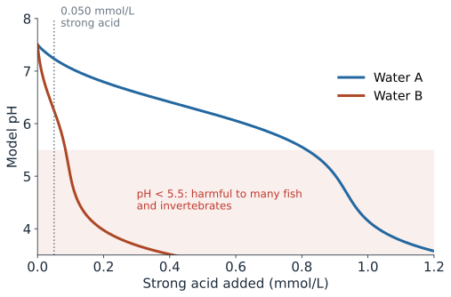{width="70%" fig-align="center"}

Keep adding acid. Water B's pH collapses once its small alkalinity is used up (about 0.09 mmol/L). Water A holds above pH 6 until roughly 0.6 mmol/L, then also falls once **its** reserve runs out near 0.94.

::: notes
This curve extends the single dose to a whole titration, model pH against cumulative strong acid. Both curves show the same shape: a gentle slope while bicarbonate remains, then a cliff when alkalinity reaches zero. The position of the cliff equals the starting alkalinity. Translate back to the lakes. Years of acid deposition act like a slow titration. A soft-water lake with a small reserve reaches its cliff quickly and drops into the pH range harmful to fish and invertebrates. Low pH also releases toxic aluminium from soils, covered in the metals unit. A limestone lake has a reserve large enough that it never gets there.
:::

## Why liming works

:::: {.columns}
::: {.column width="55%"}
$$\mathrm{CaCO_3(s)+2H^+\rightarrow Ca^{2+}+CO_2^*+H_2O}$$

Each mole of dissolved calcite neutralises **2 equivalents** of acid, adding 2 eq of alkalinity.

**Back of the envelope:** raise a 1.0 × 10⁶ m³ lake from A~T~ = 0.044 to 0.20 meq/L.

- Needed: 0.156 meq/L = 0.078 mmol/L CaCO₃
- = 7.8 g CaCO₃ per m³ → **≈ 8 tonnes**, if all dissolves

Real liming uses more, because not all the lime dissolves and the lake water is gradually replaced: hydraulic residence time, as in unit 1.
:::
::: {.column width="45%"}
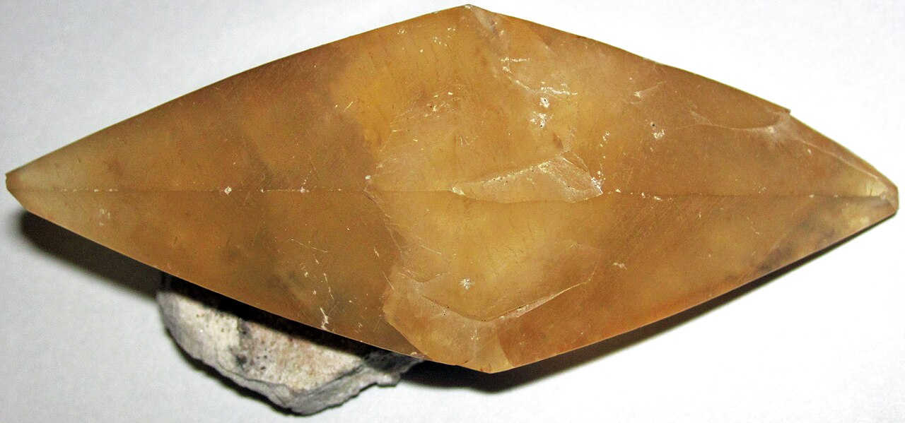{width="100%"}
[Calcite (CaCO₃) crystal, about 6 cm. Photo: James St. John, CC BY 2.0, Wikimedia Commons.]{.credit}
:::
::::

::: notes
Now we can answer the question from the start. Calcite dissolves by taking up two hydrogen ions per formula unit, so it adds two equivalents of alkalinity per mole. The calculation uses Water B's post-acid alkalinity as the starting point and a target of 0.2 meq/L, a typical liming goal for restoring sensitive species, chosen here as round numbers. Molar mass of calcium carbonate is about 100 g/mol, so 0.078 mmol/L is about 7.8 mg/L, or 7.8 grams per cubic metre. In practice more is needed. Dissolution is incomplete, and the lake is flushed by inflowing acidic water. That is why liming has to be repeated, and it ties back to residence time from the first lecture.
:::

## The same chemistry, on a bigger stage

:::: {.columns}
::: {.column width="58%"}
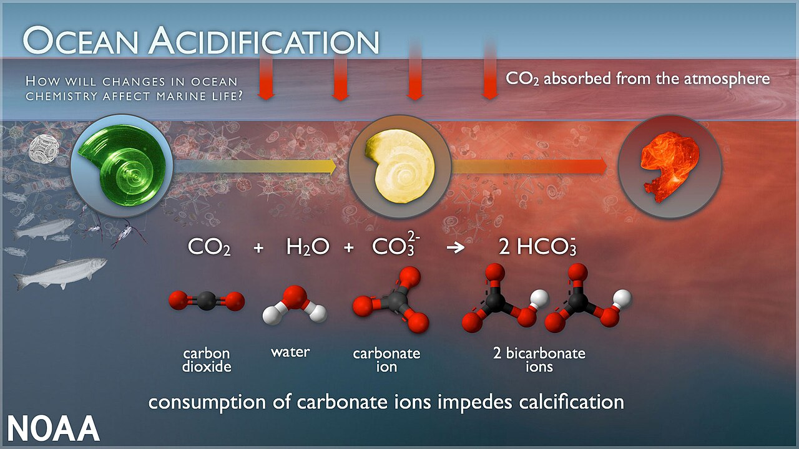{width="100%"}
[NOAA illustration, public domain, Wikimedia Commons.]{.credit}
:::
::: {.column width="42%"}
The ocean absorbs about a quarter of human CO₂ emissions.

Adding CO₂ **raises C~T~ but not alkalinity**:

$$\mathrm{CO_2+H_2O+CO_3^{2-}\rightarrow 2HCO_3^-}$$

pH falls (by about 0.1 since pre-industrial times) and **carbonate ion is consumed**. Shell-building organisms such as pteropods find it harder to build and keep calcium carbonate.

This is **not** the same as adding strong acid. Next lecture shows why.
:::
::::

::: notes
Show that the tools from today apply directly to a global problem. Ocean uptake of carbon dioxide adds carbon without adding or removing alkalinity, which is different from our strong-acid case where alkalinity fell and C_T stayed fixed. The result is still a lower pH and less carbonate ion, which matters for organisms that build calcium carbonate shells and skeletons. The pteropod image is a widely used NOAA illustration of shell dissolution under lower pH. The numbers quoted are rounded, well-established figures. Do not develop ocean chemistry further here: seawater needs other constants and includes borate. The contrast between CO2 uptake and strong-acid addition is the opening of the next deck.
:::

## Common mistakes to avoid

- **"Same pH means same water."** pH fixes the fractions, not the amounts.
- **"Acid destroys carbonate carbon."** In a closed water it only converts HCO₃⁻ to CO₂\*. C~T~ is unchanged.
- **"Subtract the dose from the pH."** Subtract the dose from alkalinity, then find the pH.
- **"At pH = pK each species is 50%."** The two neighbours are equal; the third species is still present.
- **"Alkalinity is how basic the water is."** It is a capacity in eq/L, not a pH. Acidic waters can have positive alkalinity.
- **"The distribution diagram shows a titration."** Its x-axis is prescribed pH, not acid added.

::: notes
These are the errors that appear most often in exercises and exams for this topic. Go through them quickly and ask students to say why each is wrong in their own words. The fifth one is subtle: a water at pH 6.5 can still have positive alkalinity, because bicarbonate is present in substantial amounts. Alkalinity becomes zero only around pH 4.5 for typical freshwater carbon contents, when nearly all carbon is CO2-star. This is why alkalinity titrations end near that pH. Encourage students to use this list as a self-check while doing the exercises.
:::

## Explore: carbonate response to acid {#explore}

```{=html}
<link rel="stylesheet" href="../demos/demo.css">
<div data-demo="carbonate" role="group" aria-label="Carbonate response to acid">
<p>Compare Water A and Water B: same initial pH and acid dose, different carbon inventories.</p>
</div>
<script src="../demos/core.js"></script>
<script src="../demos/carbonate.js"></script>
```

[Compare Water A and Water B: same initial pH and acid dose, different carbon inventories.](exercise.qmd#explore)

::: notes
Use the reference presets first and confirm the table values from the "Return to the two waters" slide. Then change one variable at a time. Raise C_T in Water B until it behaves like Water A. Increase the dose until Water A's alkalinity is exhausted and watch the pH cliff. Ask students to explain each change in words before reading the plot. The exercise page has the model assumptions, a hand-check result and a static reference for printing.
:::

## Summary {.smaller}

:::: {.columns}
::: {.column width="70%"}
| Concept | Key fact |
| --- | --- |
| C~T~ | CO₂\* + HCO₃⁻ + CO₃²⁻; conserved when species interconvert |
| Ratio rule | $[\mathrm{HCO_3^-}]/[\mathrm{CO_2^*}]=10^{\mathrm{pH}-6.35}$; one pH unit = factor 10 |
| Fractions α | from pH alone; sum to 1; curves cross at pH = pK |
| Freshwater | pH 6.5–8.3: bicarbonate dominates |
| Amount | concentration = α × C~T~; pH does not give C~T~ |
| Alkalinity A~T~ | HCO₃⁻ + 2CO₃²⁻ + OH⁻ − H⁺ (eq/L): acid-neutralising capacity |
| Charge balance | A~T~ ≈ base cations − strong-acid anions |
| Strong acid | A~T~ falls by the dose; C~T~ unchanged; pH recalculated |
| Lakes | granite → small A~T~ → acidifies; limestone → large A~T~ → resists |
| Liming | CaCO₃ adds 2 eq alkalinity per mol |

**Next:** [gas exchange and minerals](gases-lec.qmd). What happens when the water meets the air, and why does a kettle scale up? Then the [exercises](exercise.qmd) and the [reference sheet](reference.qmd).
:::
::: {.column width="30%"}
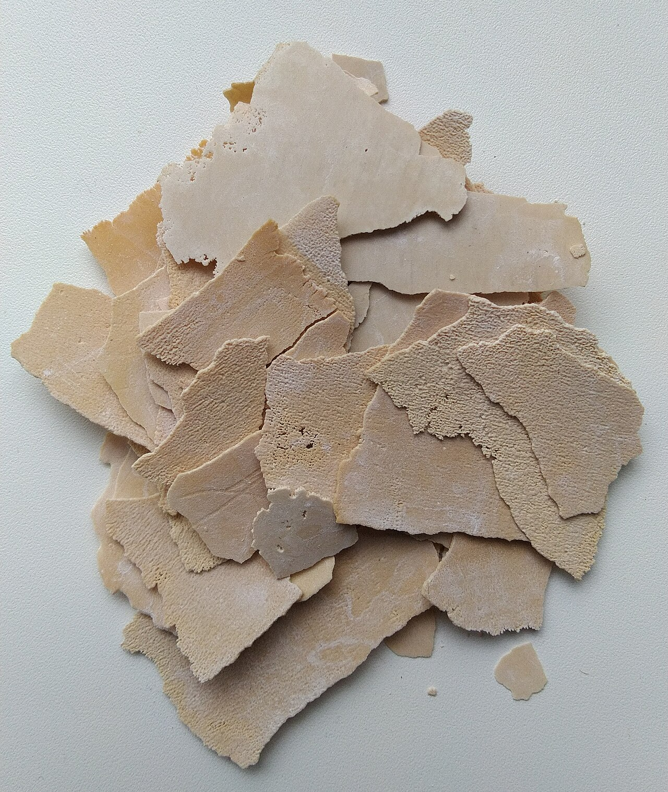{width="100%"}
[Limescale (CaCO₃) from a kettle. Photo: Alexander Davronov, CC BY-SA 4.0, Wikimedia Commons.]{.credit}
:::
::::

::: notes
The summary table is the revision sheet. Recite the chain once. pH gives the fractions. C_T turns fractions into amounts. Alkalinity counts acid-neutralising capacity. Strong acid lowers alkalinity one-for-one with C_T fixed, and pH follows. Then connect back to the opening: lakes on granite have a small reserve and acidified, lakes on limestone have a large one and resisted, and liming adds the missing reserve. The limescale photo is the teaser for the next deck. Heating drives carbon dioxide out of hard water, the carbonate equilibria shift, and calcite precipitates on the kettle element. Explaining that needs gas exchange and mineral saturation, the topics of the next lecture.
:::
