## About this lecture

:::: {.columns}
::: {.column width="62%"}
In 1896 the Swedish chemist **Svante Arrhenius** in Stockholm did long calculations by hand on one question: how would Earth's temperature change if the amount of **carbon dioxide** in the air changed? He estimated several degrees of warming for a doubling.

Air is about 99% **nitrogen and oxygen**. CO₂ is only a few hundredths of a percent. How can such a small amount matter?

Today you will learn to:

- explain why **CO₂ and H₂O absorb infrared** while N₂ and O₂ do not;
- read a **transmission spectrum** and compute absorbed power for one band;
- tell **lifetime**, half-life and climate response apart;
- explain why **particles** can cool or warm.

Last lecture: sulfate in rain. Today: sulfate, and gases, in the light.
:::
::: {.column width="38%"}
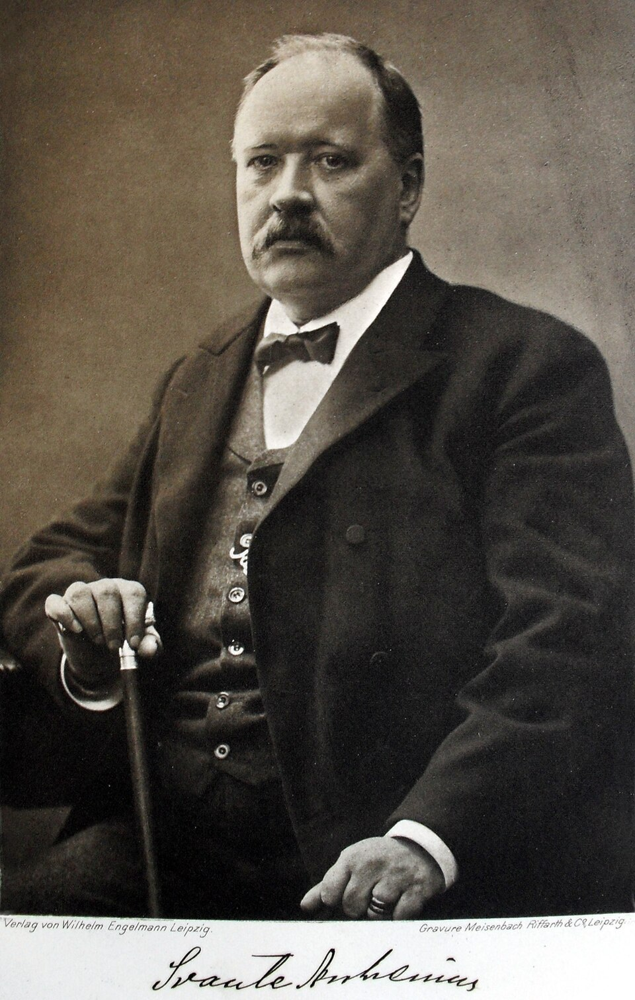{width="62%" fig-align="center"}
[Svante Arrhenius (1859–1927), Nobel Prize in Chemistry 1903. Photogravure, public domain, Wikimedia Commons.]{.credit}
:::
::::

::: notes
Arrhenius is known to chemists for the Arrhenius equation and for his theory of electrolytic dissociation, which won the 1903 Nobel Prize. In 1896 he also published a long calculation of how changes in carbonic acid, as CO2 was then called, would affect the temperature of the ground. His numbers were rough, but the physical idea was right, and his estimate for doubling CO2 is not far from modern ones. Today we explain the chemistry behind that idea: why some molecules interact with the infrared radiation that Earth emits and others do not, how to read a spectrum, and why both lifetime and particles matter. This is the last lecture of week 1.
:::

## Two kinds of light

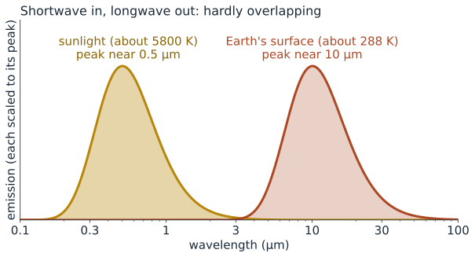{width="84%" fig-align="center"}

The Sun's surface is about 5800 K; it emits mostly **visible and near-infrared** light. Earth's surface, about 288 K, emits **thermal infrared** peaking near 10 µm. The two ranges hardly overlap, so a gas can be **transparent to sunlight but absorb Earth's heat**.

::: notes
Every warm object emits radiation, and its temperature sets the wavelengths. These curves come from Planck's law, each scaled to its own peak so the shapes can be compared. The hotter Sun peaks at about half a micrometre, in the visible. The much cooler Earth peaks around ten micrometres, in the thermal infrared, invisible to us. Because the two curves barely overlap, we can treat incoming shortwave and outgoing longwave radiation separately. That is the key to the greenhouse effect: a gas that is transparent to sunlight but absorbs in the thermal infrared lets energy in more easily than it lets energy out.
:::

## How the atmosphere intercepts outgoing heat

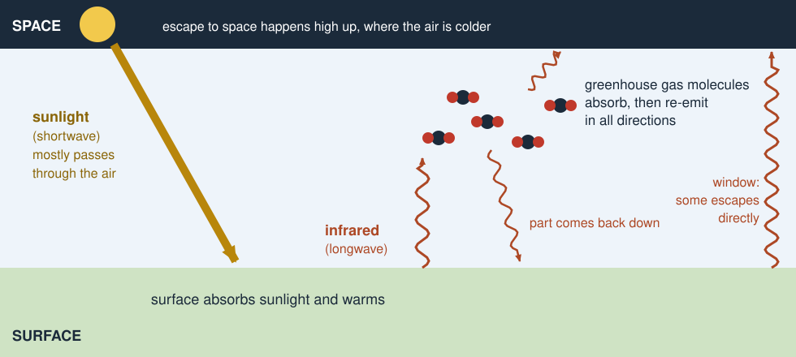{width="84%" fig-align="center"}

Sunlight warms the surface. The surface emits infrared. **Greenhouse gases absorb** part of it and **re-emit** in all directions, some back down. Energy finally escapes from higher, **colder** layers, which emit less. More absorber raises that escape level, and the surface warms.

::: notes
Walk through the picture from left to right. Most sunlight passes through the clear atmosphere and is absorbed at the surface. The warm surface emits infrared. Greenhouse gas molecules absorb that infrared and quickly pass the energy to neighbouring molecules by collisions, warming the air. The air itself emits infrared in all directions, so part returns to the surface. The radiation that reaches space at absorbing wavelengths comes from high, cold layers, and a cold layer emits less. Adding more absorber moves that emission level higher and colder, so to stay in balance the surface and lower atmosphere must warm. In the window region, surface radiation escapes directly.
:::

## Why N₂ and O₂ do not absorb, but CO₂ does

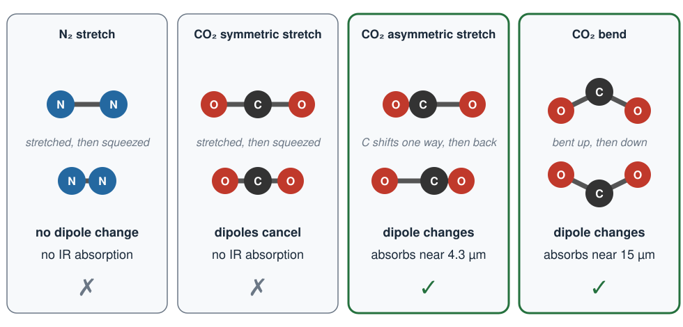{width="84%" fig-align="center"}

A vibration absorbs infrared only if it **changes the molecule's dipole moment**. N₂ and O₂ stay symmetric when they stretch. CO₂ has no dipole at rest, but its **asymmetric stretch and bend** create one while they vibrate.

::: notes
Infrared light is an oscillating electric field. It can push on a molecule only if the molecule's charge distribution oscillates too: the dipole moment must change during the vibration. In nitrogen and oxygen the two atoms are identical, so stretching the bond never creates a dipole. That is why ninety-nine percent of the air is essentially transparent to thermal infrared. Carbon dioxide is linear and symmetric at rest, so it has no permanent dipole. But in the asymmetric stretch the carbon moves towards one oxygen, and in the bend the molecule is no longer straight; both create an oscillating dipole. Water is bent and has a permanent dipole, so it absorbs strongly at many wavelengths.
:::

## Where each gas absorbs

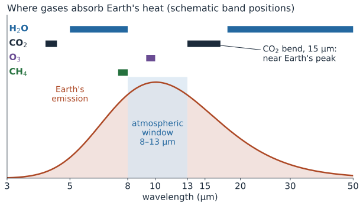{width="86%" fig-align="center"}

The CO₂ bend at about **15 µm** sits close to the peak of Earth's emission. Water vapour absorbs widely. Between about **8 and 13 µm** little absorbs: the **atmospheric window**. A gas absorbing in the window has more effect than one absorbing where others already do.

::: notes
This is a schematic of band positions, not a measured spectrum. Water vapour absorbs in a band near six micrometres and across the far infrared through its rotations. Carbon dioxide has the strong bending band near fifteen micrometres and the asymmetric stretch near 4.3 micrometres, where Earth emits little. Ozone absorbs near 9.6 micrometres and methane near 7.7. The window between about eight and thirteen micrometres is where surface radiation escapes most freely. Overlap matters: adding a gas at wavelengths already absorbed by water vapour changes less than adding one in the window. Altitude matters too. So a single peak height is not a climate metric.
:::

## Reading a simple spectrum

:::: {.columns}
::: {.column width="56%"}
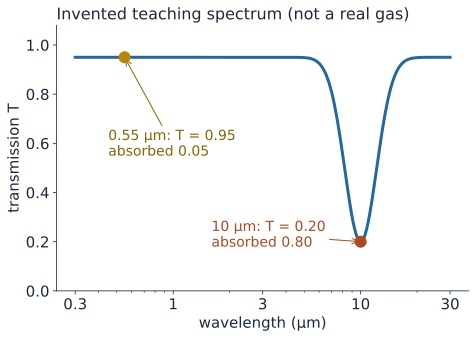{width="100%"}
:::
::: {.column width="44%"}
A transmission spectrum shows the fraction **T** of light that passes at each wavelength. If nothing is reflected, the absorbed fraction is **1 − T**.

| Wavelength | T | Absorbed |
| --- | ---: | ---: |
| 0.55 µm | 0.95 | 0.05 |
| 10 µm | 0.20 | 0.80 |

These are **invented teaching values**, not a real gas. The fraction alone does not give the **energy** absorbed.
:::
::::

::: notes
This is the deliberately simple spectrum from the notes. The model gas is almost transparent in visible light and absorbs most radiation in a band near ten micrometres. Reading it is straightforward: absorbed fraction equals one minus transmission, assuming no reflection or scattering. Exercise 1 then asks the important follow-up question: does the gas absorb more energy at ten micrometres? Not necessarily. You also need to know how much energy arrives in each band and how wide the bands are. A large fraction of a weak beam can be less energy than a small fraction of a strong one. That leads to the worked beam calculation on the next slide.
:::

## One beam, one band: a worked example

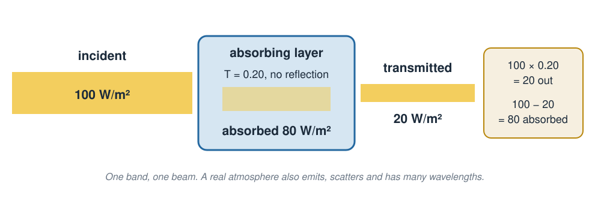{width="84%" fig-align="center"}

A constructed beam of **100 W/m²** in one band meets a layer with **T = 0.20** and no reflection: **20 W/m²** pass and **80 W/m²** are absorbed. This is a single-band calculation, **not** Earth's energy balance, which needs all wavelengths, emission and atmospheric structure.

::: notes
This is the worked example from the notes. Multiply the incident power by the transmission to get the transmitted power, and subtract to get the absorbed power. Students should be able to do this in their heads. Stress what the calculation leaves out. A real atmosphere emits as well as absorbs, so the absorbed energy does not simply disappear; it is re-radiated. There are many wavelengths, each with its own transmission and incident power, and they must be summed. The atmosphere also has layers at different temperatures. Climate models do exactly this summation for thousands of wavelengths and many layers. Our single beam is the building block.
:::

## Check yourself

::: {.checkbox}
1. Why does O₂, the second most abundant gas, contribute almost nothing to infrared absorption?
2. CO₂ is a symmetric molecule. Why can it still absorb infrared?
3. In the teaching spectrum, the gas absorbs 80% at 10 µm and 5% at 0.55 µm. Does it absorb more energy at 10 µm?
4. A 50 W/m² beam meets a layer with T = 0.60 and no reflection. How much is absorbed?
:::

::: notes
Answers. One: O2 is a homonuclear diatomic; its stretch never changes the dipole moment, so it has no ordinary infrared-active vibration. Two: its asymmetric stretch and bend create a changing dipole during the vibration, even though the molecule has no dipole at rest. Three: not necessarily. We need the incident energy in each band and the band widths. For sunlight the visible band carries a lot of energy; for Earth's emission the infrared does. This is exercise 1. Four: 50 times 0.60 gives 30 transmitted, so 20 watts per square metre are absorbed.
:::

## How long does a gas stay?

:::: {.columns}
::: {.column width="52%"}
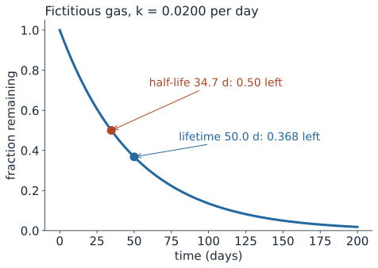{width="100%"}
:::
::: {.column width="48%"}
For a single first-order sink with rate constant k:

- amount left: $C = C_0e^{-kt}$
- lifetime τ = 1/k (37% left)
- half-life = ln 2 / k = 0.693 τ

**Worked example**, fictitious gas with k = 0.0200 per day:

- lifetime **50.0 days**
- half-life **34.7 days**
- left after 50.0 days: **0.368**
:::
::::

::: notes
This is exercise 3, and it reuses the tools from the atmospheric reactions lecture. A single first-order sink gives an exponential decline. The lifetime is the inverse of the rate constant; after one lifetime about 37 percent remains. The half-life is shorter by a factor of 0.693. In the exercise, k is 0.0200 per day, so the lifetime is 50 days and the half-life about 35 days. These numbers describe a fictitious gas with one constant sink. Real greenhouse gases are removed by chemistry, by uptake into oceans and soils, or by both, and the next slide shows why carbon dioxide does not fit this simple picture.
:::

## CO₂ has no single lifetime

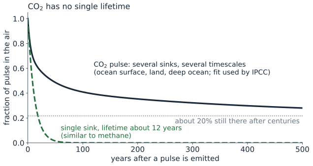{width="84%" fig-align="center"}

CO₂ is not destroyed in the air; it is **redistributed** to the ocean surface, plants and soils, and slowly the deep ocean. Each takes CO₂ at its own pace. A model fit used by the IPCC leaves about **20% of a pulse in the air after centuries**. A gas like methane, destroyed by OH, behaves more like one exponential of about a decade.

::: notes
Compare the two curves. The dashed curve is a single sink with a lifetime of about twelve years, similar to methane's, whose main sink is reaction with OH. After a few decades it is essentially gone. The solid curve is an impulse response fit to carbon-cycle models, published by Joos and colleagues in 2013 and used in the IPCC fifth assessment. It falls quickly at first, as the surface ocean and land take up carbon, then slowly, and a fraction remains for many centuries until slow processes such as carbonate dissolution and weathering act. This is the compartment balance from lecture 1 again: CO2 is transferred between reservoirs, not destroyed.
:::

## Watching the build-up

:::: {.columns}
::: {.column width="52%"}
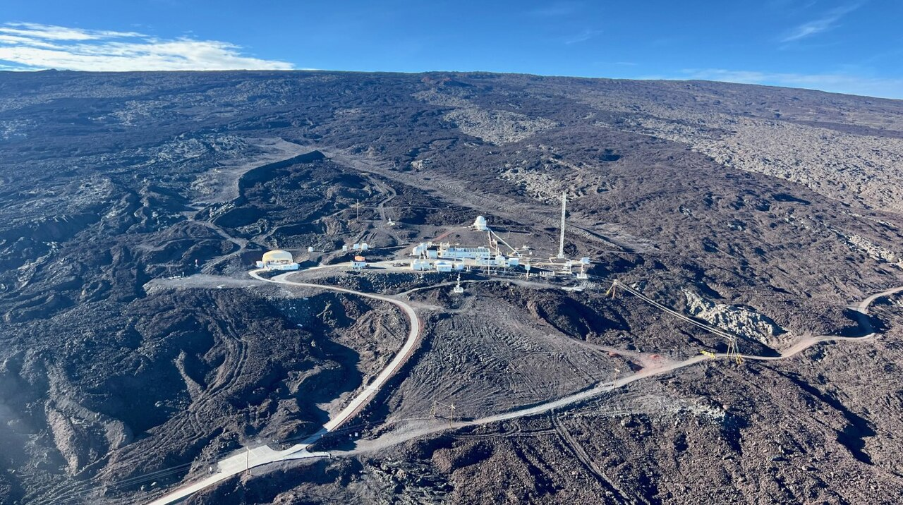{width="100%"}
[Mauna Loa Observatory, Hawaii, among old lava flows. Photo: Brian Vasel/NOAA, public domain, Wikimedia Commons.]{.credit}
:::
::: {.column width="48%"}
Since **1958**, CO₂ has been measured continuously at Mauna Loa, far from local sources. The record, begun by Charles David **Keeling**, shows:

- a **seasonal cycle**: northern plants take up CO₂ in summer and release it in winter;
- a **steady rise**, from about 315 ppm in 1958 to **above 420 ppm** today. Before industrialisation it was about **280 ppm**.

Because CO₂ is long-lived, it is **well mixed**: one remote station tracks the global trend.
:::
::::

::: notes
The Mauna Loa record is the most famous environmental chemistry time series. The site was chosen because it is high, remote and surrounded by bare lava, so local vegetation and pollution have little influence. The seasonal wiggle is a balance signal: the Northern Hemisphere biosphere takes up carbon during the growing season and releases it in winter. The rise is the accumulation from fossil-fuel burning and land-use change, partly offset by ocean and land uptake. Connect to the transport slide from the atmospheric reactions lecture: because the lifetime of CO2 in the air is much longer than the mixing time, one remote station is representative of the global background.
:::

## Equal mass is not equal effect

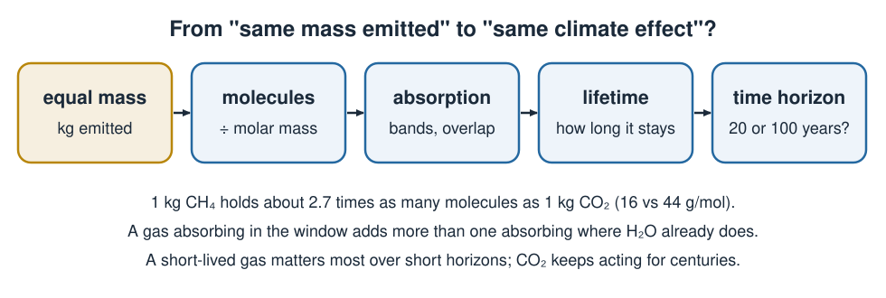{width="88%" fig-align="center"}

Two gases are emitted in **equal mass**. To compare their climate effects you need: the **number of molecules** (molar mass), their **absorption bands and overlap**, how long they **stay**, any **chemical or particle side effects**, and the **time horizon** of the comparison.

::: notes
This is exercise 4. Equal mass does not mean equal numbers of molecules: methane's molar mass is 16 grams per mole, carbon dioxide's 44, so a kilogram of methane holds about 2.7 times as many molecules. Absorption differs per molecule and depends on where the bands fall and what else already absorbs there. Lifetime decides how long the effect lasts. Some gases also have indirect effects: methane oxidation produces ozone and water vapour in the stratosphere, and sulfur dioxide forms particles. Finally, any comparison needs a stated time horizon. A short-lived gas looks more important over 20 years than over 100 years. That is why policy uses metrics with an explicit horizon.
:::

## Particles: not just another gas

:::: {.columns}
::: {.column width="40%"}
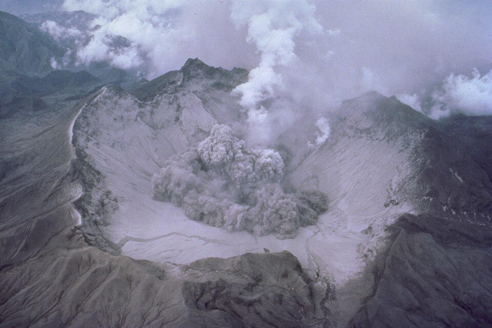{width="100%"}
[Summit caldera of Mount Pinatubo, Philippines, on 1 August 1991, six weeks after the climactic eruption of 15 June. Photo: T. J. Casadevall, USGS, public domain, Wikimedia Commons.]{.credit}
:::
::: {.column width="60%"}
In June 1991 **Mount Pinatubo** sent millions of tonnes of **SO₂** into the stratosphere. It was oxidised to **sulfate particles**, the same chemistry as in the deposition lecture.

The particle veil **scattered sunlight** back to space, and global average temperature fell by roughly **half a degree** for about a year or two. Then the particles settled out.

Particles act through **size, composition and location**, not through infrared absorption bands, and they last **days to a few years**, not centuries.
:::
::::

::: notes
Pinatubo is the natural experiment that tested climate models. The eruption injected sulfur dioxide high into the stratosphere, where it was oxidised to sulfuric acid droplets that spread around the globe. Because there is no rain in the stratosphere, they remained for over a year. They reflected sunlight, and global surface temperatures fell measurably before recovering as the particles were removed. Contrast with greenhouse gases. Particles mainly interact with sunlight rather than with Earth's infrared, their effect depends on size and composition, and their lifetime is short: days in the lower atmosphere, a year or two in the stratosphere. So aerosols cannot be treated like long-lived gases.
:::

## Three ways particles change radiation

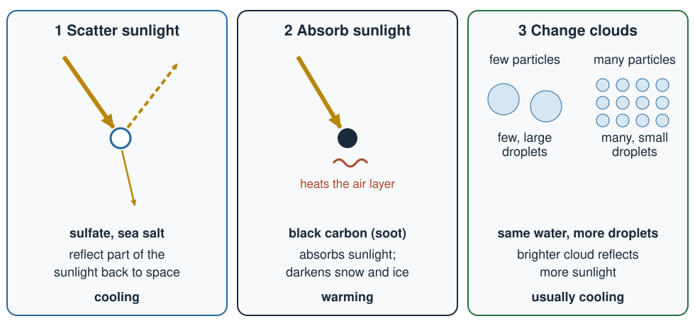{width="84%" fig-align="center"}

Bright particles such as **sulfate scatter** sunlight: cooling. Dark **black carbon absorbs** it: warming of the air layer and of snow it lands on. Particles also seed **cloud droplets**; more particles give more, smaller droplets and a **brighter cloud**.

::: notes
The three panels are three distinct pathways, and they can have opposite signs. Scattering by sulfate and sea salt sends part of the sunlight back to space, a cooling effect. Black carbon from incomplete combustion absorbs sunlight and warms the layer of air where it sits; when it lands on snow or ice it darkens the surface and speeds melting, which matters in the Arctic and in Scandinavian mountains. The cloud pathway is the most uncertain. Every cloud droplet forms on a particle. With the same amount of water spread over more particles, droplets are smaller and more numerous, and the cloud reflects more sunlight. Do not assign every aerosol a universal cooling sign.
:::

## Seeing the cloud effect from space

:::: {.columns}
::: {.column width="55%"}
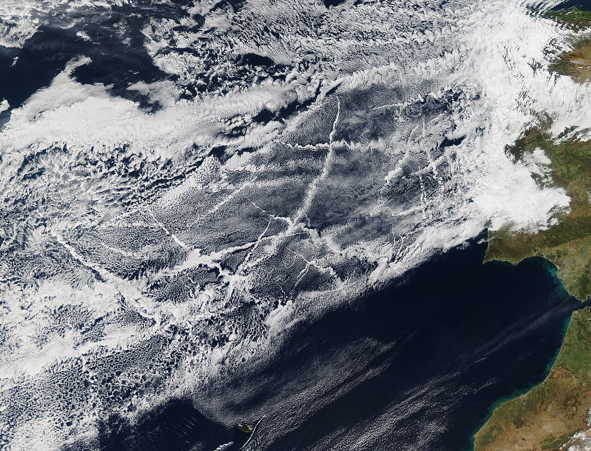{width="100%"}
[Ship tracks in low clouds over the North Atlantic off Spain and Portugal, 22 January 2018. Image: Jeff Schmaltz, NASA MODIS, public domain, Wikimedia Commons.]{.credit}
:::
::: {.column width="45%"}
The bright lines are **ship tracks**. Exhaust particles from ships seed extra cloud droplets, so the cloud along each ship's path becomes **brighter** than the cloud around it.

The ship emits SO₂ and soot; the **chemistry turns gases into particles**, and the particles change the clouds.

Since 2020, international rules have cut the sulfur content of ship fuel sharply, and ship tracks have become **less frequent**. A cleaner-air policy can therefore slightly **reduce** a cooling effect.
:::
::::

::: notes
This satellite image shows the cloud pathway directly. Low marine clouds are sensitive to the number of particles available as droplet seeds. Along each ship's path the exhaust adds particles, the droplets become smaller and more numerous, and the cloud reflects more sunlight, so the tracks appear as bright lines. The International Maritime Organization reduced the permitted sulfur content of ship fuel in 2020, and studies have reported fewer ship tracks since then. This is an example of a trade-off students should understand: removing sulfur improves air quality and reduces acid deposition, but also removes some reflective particles. It is not a reason to keep pollution, but it must be counted.
:::

## Back to Arrhenius's question

:::: {.columns}
::: {.column width="30%"}
{width="85%" fig-align="center"}
[Svante Arrhenius. Public domain, Wikimedia Commons.]{.credit}
:::
::: {.column width="70%"}
How can a few hundredths of a percent of CO₂ change the climate? Now we can answer with molecules:

1. N₂ and O₂ have **no changing dipole**; they are transparent to Earth's infrared.
2. CO₂ **bends** and absorbs near **15 µm**, close to the peak of Earth's emission.
3. Absorption makes energy escape from **higher, colder** layers.
4. CO₂ is not destroyed; a large fraction **stays for centuries**.

Particles and short-lived gases add effects of **both signs**, on **shorter** timescales.
:::
::::

::: notes
Return to the opening question and answer it in four steps, using only today's chemistry. The bulk of the air does nothing to infrared because of molecular symmetry. Carbon dioxide does, through its bending vibration, at wavelengths where Earth emits strongly. More absorption raises the level from which energy escapes to space, and a colder emitting level requires a warmer surface to stay in balance. And because carbon dioxide is redistributed between reservoirs rather than destroyed, each emission keeps acting for centuries. Arrhenius did not know all of this in 1896, but his basic reasoning about absorption and balance stands.
:::

## Common mistakes to avoid

- **"CO₂ is symmetric, so it cannot absorb infrared."** Its bend and asymmetric stretch change the dipole.
- **"The most abundant gases matter most."** N₂ and O₂ are almost inactive in the infrared.
- **"A bigger absorption peak means a bigger climate effect."** Overlap, altitude, incident energy and lifetime also matter.
- **"Absorbed fraction = absorbed energy."** Multiply by the incident power in each band.
- **"CO₂ has a lifetime of X years."** It has several timescales; part stays for centuries.
- **"Aerosols always cool."** Black carbon warms; effects depend on composition and location.
- **"Equal mass, equal effect."** Molecules, bands, lifetime and time horizon differ.

::: notes
These are the most frequent errors on this topic. Have students explain each correction in their own words. The first two are about the dipole rule and are the core chemistry of today. The third and fourth are about reading spectra correctly. The fifth is a frequent statement even in the media; the answer is that the airborne fraction of a CO2 pulse declines over several timescales, and a substantial part stays for many centuries. The sixth separates scattering from absorbing particles. The last one sums up exercise 4. Encourage students to use this list as a self-check before the week 1 exercises.
:::

## Summary {.smaller}

:::: {.columns}
::: {.column width="70%"}
| Concept | Key fact |
| --- | --- |
| Two kinds of light | Sun about 5800 K, peak near 0.5 µm; Earth about 288 K, peak near 10 µm |
| Greenhouse effect | gases absorb and re-emit infrared; escape from higher, colder layers |
| Dipole rule | IR-active vibration changes the dipole; N₂, O₂ inactive |
| CO₂ modes | bend near 15 µm, asymmetric stretch near 4.3 µm; symmetric stretch inactive |
| Bands | overlap with H₂O and the 8–13 µm window decide added effect |
| Transmission | absorbed fraction = 1 − T; energy needs incident power |
| Lifetime | τ = 1/k, half-life = 0.693 τ, for one first-order sink |
| CO₂ | several timescales; about 20% of a pulse stays for centuries |
| Particles | scatter (cool), absorb (warm), brighten clouds; short-lived |

**Next:** [aquatic composition and equilibrium](../aquatic-equilibria/lec.qmd), the start of week 2: from air to water. Then the [exercises](exercise.qmd) and [notes](notes.qmd).
:::
::: {.column width="30%"}
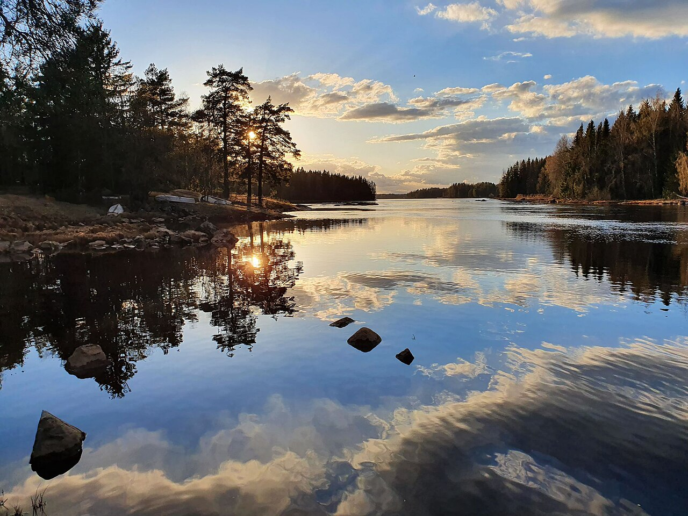{width="100%"}
[Dalälven river at Forsbo, Möklinta, Sweden. Photo: Q1959, CC BY-SA 4.0, Wikimedia Commons.]{.credit}
:::
::::

::: notes
The summary table is the revision sheet for today. Recite the chain once: two kinds of light; the dipole rule decides which molecules absorb Earth's infrared; band position and overlap decide how much an addition matters; absorbed energy needs incident power; lifetime and reservoirs decide how long an emission acts; and particles act on sunlight and clouds, with either sign and short lifetimes. That completes week 1: amounts and balances, atmospheric reactions, deposition and climate. The photo is the teaser for week 2. We now move from the air into water. Rivers and lakes carry what the atmosphere delivers, and the next lecture teaches how to read a water analysis.
:::
