## About this lecture

:::: {.columns}
::: {.column width="55%"}
In 1967 the Swedish soil scientist **Svante Odén** argued in a newspaper article that Scandinavian lakes and soils were being acidified by **sulfur emitted in other countries**, carried hundreds of kilometres by the wind. At the 1972 UN environment conference in **Stockholm**, Sweden presented the case. In 1979 it led to the first international air-pollution treaty.

Today you will learn to:

- follow SO₂ and NOₓ as they are **oxidised to acids**;
- separate **wet** and **dry** deposition and compute a **flux**;
- count **acid equivalents**, and see why sulfate alone is not an acid dose;
- build an **annual catchment budget**.

Last lecture: OH and sunlight. Today: what OH does to SO₂ and NO₂.
:::
::: {.column width="45%"}
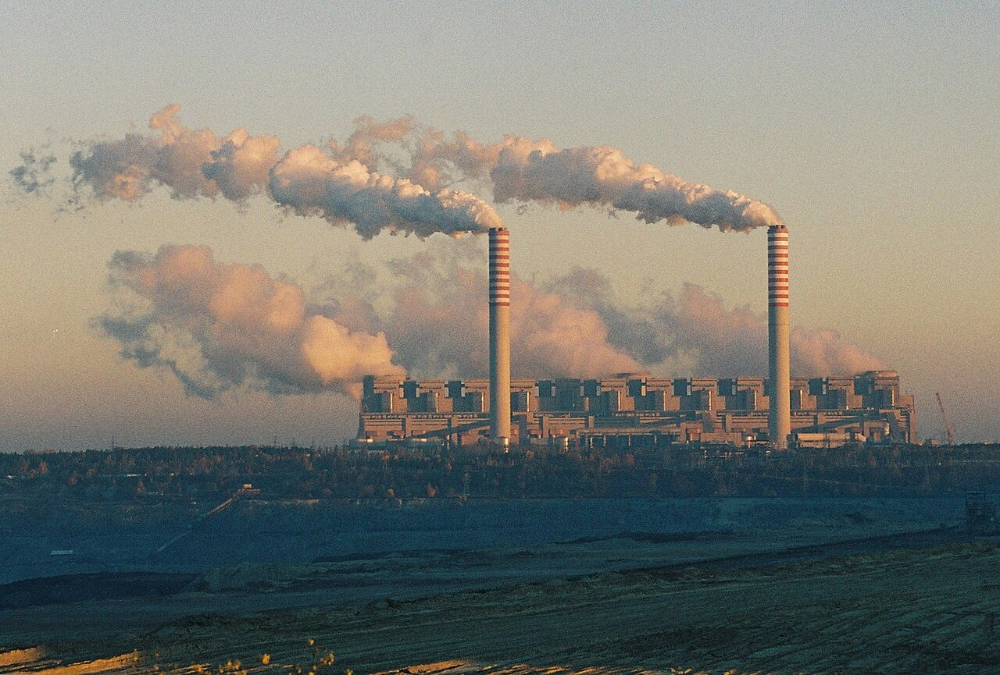{width="100%"}
[Bełchatów coal power station, Poland, one of the largest in Europe. Photo: Petr Štefek, CC BY 2.5, Wikimedia Commons.]{.credit}
:::
::::

::: notes
Open with the Swedish story, because acid rain is where environmental chemistry became international politics. In the 1960s Svante Odén connected acidifying lakes in Scandinavia with emissions from Britain and central Europe, using data from a network of precipitation samplers. Sweden brought the case to the 1972 United Nations conference in Stockholm, and in 1979 the Convention on Long-range Transboundary Air Pollution was signed. Its later protocols, including the 1999 Gothenburg Protocol, cut emissions across Europe. Today's chemical question: how does a gas leaving a chimney become an acid in a lake, and why does measuring the pH of rain not tell us how much acid a catchment receives?
:::

## From chimney to lake

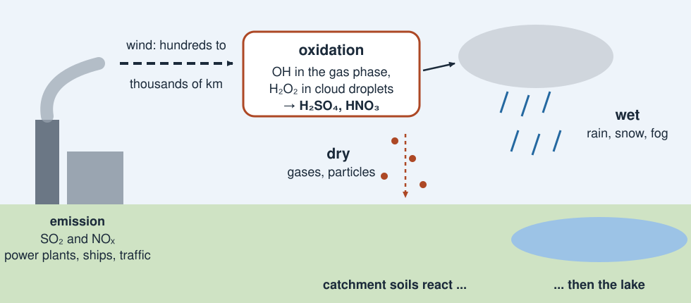{width="86%" fig-align="center"}

Sulfur dioxide and nitrogen oxides are **emitted**, **transported** by wind, **oxidised** to sulfuric and nitric acid, and then **deposited** in rain or directly onto surfaces. The catchment's soils react with the acid before the water reaches the lake.

::: notes
This is the whole lecture in one picture. Each arrow is a process we will look at, and each one changes what we can learn from a single measurement. Emission is controlled by fuel and technology. Transport by wind explains why the damage happened far from the sources. Oxidation turns gases that are not yet acids into strong acids. Deposition brings them down, either dissolved in precipitation or directly to leaves and soil. Finally the catchment soil, with its minerals and plants, modifies the acid before it reaches surface water. Keep the boundary idea from the first lecture in mind: we will draw a boundary around the catchment and do a budget.
:::

## Precursors are not yet acids

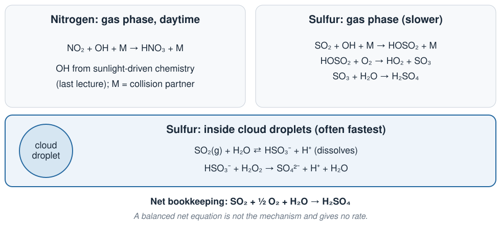{width="82%" fig-align="center"}

SO₂ and NO₂ must be **oxidised** first. NO₂ reacts with OH in daylight. SO₂ reacts more slowly with OH, but quickly inside **cloud droplets** with hydrogen peroxide. The net equation is bookkeeping, not the mechanism.

::: notes
It is tempting to think of a chimney as releasing sulfuric acid. It mostly releases sulfur dioxide, and the acid is made in the air. For nitrogen, the main daytime route is nitrogen dioxide plus OH plus a collision partner, giving nitric acid; you met OH and M last lecture. For sulfur, the gas-phase route via OH works but is relatively slow, on the order of days to weeks. When clouds are present, sulfur dioxide dissolves in the droplets as bisulfite and is oxidised quickly by hydrogen peroxide. That is why sulfate formation is often fastest in clouds. The net equation at the bottom balances atoms but says nothing about which pathway operates or how fast.
:::

## Clouds and fog are chemical reactors

:::: {.columns}
::: {.column width="50%"}
{width="100%"}
[Fog over a Swedish landscape. Photo: Robin Stumm, CC BY-SA 3.0, Wikimedia Commons.]{.credit}
:::
::: {.column width="50%"}
A cloud or fog is a huge number of tiny water droplets. Each droplet:

- **dissolves** SO₂, H₂O₂ and acids from the surrounding air;
- hosts **fast aqueous oxidation** of SO₂ to sulfate;
- forms around a **particle**, often itself sulfate or nitrate.

Fog and cloud water can be **more acidic** than rain, because the droplets are small and hold less water per unit of dissolved acid. Forests in cloudy mountains catch this water directly.
:::
::::

::: notes
Clouds are not just a delivery mechanism; they are where much of the chemistry happens. Droplets take up soluble gases, and the reaction of bisulfite with hydrogen peroxide is fast in the aqueous phase. Most cloud droplets do not evaporate into rain: they evaporate again, leaving behind a sulfate particle that is now larger. When droplets do fall, they carry the acid down. Fog and cloud water in contact with mountain forests can be several times more concentrated than rain, because the droplets contain little water. This occult or cloud deposition is easy to overlook if you only sample rain in an open bucket.
:::

## Two routes down: wet and dry

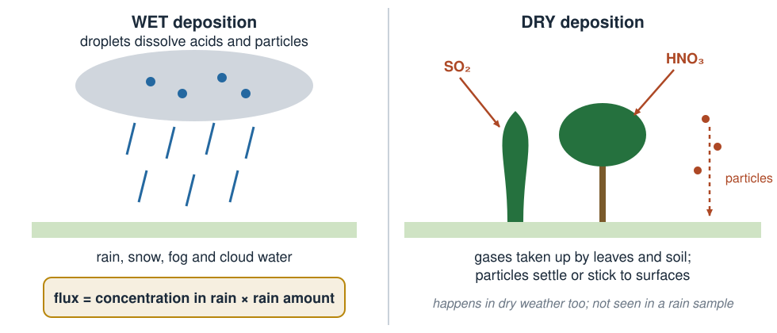{width="84%" fig-align="center"}

**Wet deposition** arrives in rain, snow, fog or cloud water. **Dry deposition** is the direct uptake of gases and particles by surfaces, also in dry weather. A rain sample only measures the wet part.

::: notes
Wet deposition is the easy part to measure: put out a clean collector, measure the volume of water and its concentration. Dry deposition is harder. Gases such as sulfur dioxide and nitric acid are taken up directly by leaves, needles and soil, and particles settle or are caught by surfaces. Forests are very efficient collectors because they have a large surface area. Dry deposition is usually estimated from air concentrations and models, or from throughfall measurements under the forest canopy. For our purposes the important point is logical: a rain sample cannot tell you the dry deposition, so a budget based only on rain is incomplete.
:::

## Measuring wet deposition

:::: {.columns}
::: {.column width="45%"}
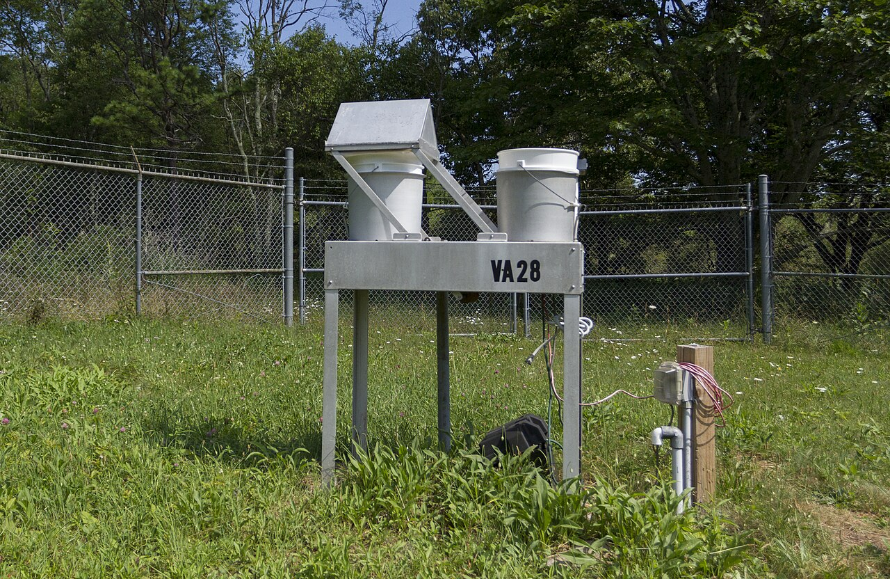{width="100%"}
[Wet deposition sampler of the US National Atmospheric Deposition Program. The lid opens only when it rains. Photo: Mary O'Neill, USGS, public domain, Wikimedia Commons.]{.credit}
:::
::: {.column width="55%"}
A wet-only collector opens its lid when it senses rain, so dry dust and gases are excluded. Each sample gives a **volume** and **concentrations** of ions such as SO₄²⁻, NO₃⁻, NH₄⁺, Ca²⁺ and H⁺.

The **wet flux** is

$$F_{wet} = C_{rain} \times P$$

C~rain~ in mol/L, P (rain depth) in L/m². Note that **1 mm of rain on 1 m² is 1 L**.

Networks like this exist across Europe, coordinated by EMEP.
:::
::::

::: notes
This is a standard wet-only sampler. Two buckets sit under a lid that moves to cover the dry bucket when it rains, so the wet bucket collects precipitation only. Samples are analysed for the major ions. The flux is concentration times precipitation amount. The unit trick to remember: one millimetre of rain on one square metre is one litre of water, so millimetres of rain are litres per square metre. European countries run similar networks under the EMEP programme, which grew out of the 1979 convention. These long records are how we know that sulfate deposition in Scandinavia has fallen since the 1980s.
:::

## Worked example: wet nitrate flux

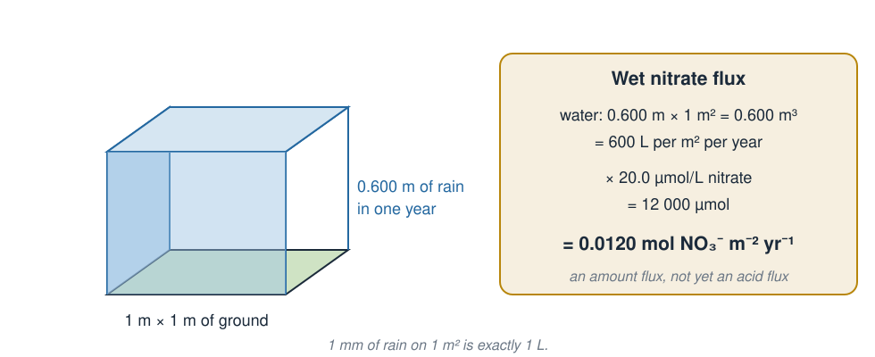{width="80%" fig-align="center"}

Annual rain 0.600 m with nitrate 20.0 µmol/L throughout: 600 L/m² × 20.0 µmol/L = **0.0120 mol NO₃⁻ m⁻² yr⁻¹**. This is an **amount** flux. Calling it an acid flux needs to know what came with the nitrate.

::: notes
This is exercise 1. Convert the depth of rain into a volume per square metre: 0.600 metres over one square metre is 0.600 cubic metres, which is 600 litres. Multiply by the concentration, 20 micromoles per litre, to get 12 000 micromoles, or 0.0120 moles of nitrate per square metre per year. The assumption that the concentration is the same throughout the year is a simplification. Real samplers give a different concentration for every event, and the annual flux is the sum of concentration times volume for each event. Point out the last sentence on the slide: nitrate is an anion. Whether it arrived as nitric acid or as a neutral salt is a separate question.
:::

## Rain pH does not give the acid load

:::: {.columns}
::: {.column width="58%"}
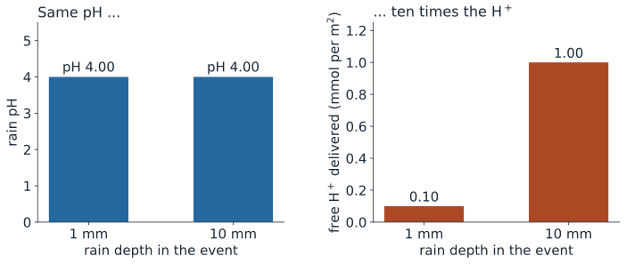{width="100%"}
:::
::: {.column width="42%"}
Two rain events both have **pH 4.00**, so [H⁺] = 10⁻⁴ mol/L.

- 1 mm: 1 L/m² × 10⁻⁴ mol/L = **0.100 mmol H⁺/m²**
- 10 mm: 10 L/m² × 10⁻⁴ = **1.00 mmol H⁺/m²**

Same pH, **ten times the acid** delivered. A concentration needs a water amount to become a load.

pH also counts only **free** H⁺, not acidity that appears later.
:::
::::

::: notes
This is exercise 2, and it is the same lesson as the first lecture, now in the atmosphere. pH describes a concentration: the free hydrogen ion in the sample. The amount delivered to the ground also depends on how much water fell. The large event brought ten times as much hydrogen ion per square metre, even though a pH meter would read the same for both. We use the dilute approximation that hydrogen-ion activity equals concentration. The last point is important for the next slides: some acidity is not present as free hydrogen ion when it lands, but is generated later in the soil. A rain pH value cannot show that either.
:::

## Check yourself

::: {.checkbox}
1. 20 mm of rain falls with 15 µmol/L sulfate. What is the sulfate input per m²?
2. Rain at pH 4.5 falls in a wet year; rain at pH 4.2 falls in a dry year. Which year brought more free H⁺? What do you need to know?
3. Why can a rain collector not measure the SO₂ taken up directly by a spruce forest?
4. Is SO₂ an acid when it leaves the chimney?
:::

::: notes
Answers. One: 20 millimetres is 20 litres per square metre; times 15 micromoles per litre gives 300 micromoles, or 0.300 millimoles of sulfate per square metre. Two: you cannot tell without the rain amounts. pH 4.2 means about twice the concentration of pH 4.5, so the wet year needs more than twice the rainfall to bring more hydrogen ion. Three: dry deposition happens directly to the needles, also in dry weather, and never passes through the collector. Four: not yet in the sense we mean. It is a precursor: it forms an acid only after oxidation, mainly in clouds or by OH. It is slightly acidic when it dissolves, but the strong acid is sulfuric acid.
:::

## Counting acid in equivalents

:::: {.columns}
::: {.column width="55%"}
Acids differ in how many H⁺ each molecule can give. Count **equivalents** (eq): moles of H⁺ that can be neutralised.

| Acid | eq per mol |
| --- | ---: |
| HNO₃ | 1 |
| H₂SO₄ | 2 |

**Teaching catchment flux:** 0.0200 mol HNO₃ + 0.0100 mol H₂SO₄ per m² per year

= 0.0200 × 1 + 0.0100 × 2 = **0.0400 eq m⁻² yr⁻¹**
:::
::: {.column width="45%"}
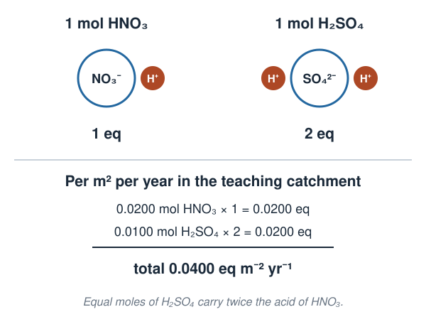{width="100%"}
:::
::::

::: notes
Equivalents let us add different acids on one scale: each equivalent can neutralise one mole of hydrogen ion, or consume one equivalent of alkalinity, a link to the carbonate lecture in week 2. Nitric acid gives one, sulfuric acid two, under the stated convention of complete neutralisation. The worked number is the flux for the teaching catchment that we will use for the rest of the lecture. Notice that it is based on supplied acid amounts, not on measured sulfate. The next slide shows why that distinction matters. Ask students: if I told you only the sulfate flux, could you compute the acid equivalents?
:::

## Sulfate does not identify the acid

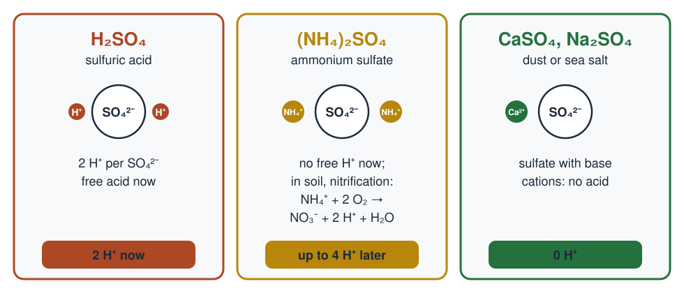{width="78%" fig-align="center"}

The **same** sulfate ion can arrive with 2 H⁺, with 2 NH₄⁺, or with base cations from **dust or sea salt**. Measured sulfate only fixes the anion. To find the acid, also measure H⁺, NH₄⁺ and the base cations.

::: notes
This is the trap in exercise 4. A sulfate measurement tells you how much sulfate arrived, nothing more. If it came as sulfuric acid, it brings two hydrogen ions now. If it came as ammonium sulfate, the solution is close to neutral when it lands; but as we will see next, soil bacteria can later turn each ammonium into nitrate and two hydrogen ions. If it came with calcium from dust or with sodium and magnesium from sea spray, it brings no acid at all. Near the coast, a large part of sulfate is sea salt. So to report an acid dose you must measure the cations too, and think about what happens after deposition.
:::

## Ammonia: neutraliser now, acid later

:::: {.columns}
::: {.column width="48%"}
{width="100%"}
[Tractor with a manure spreader, New York State, USA. Agriculture is the main source of ammonia. Photo: Pollinator, CC BY-SA 3.0, Wikimedia Commons.]{.credit}
:::
::: {.column width="52%"}
Ammonia (NH₃) from manure and fertiliser is a **base**. In the air it neutralises acid:

$$\mathrm{NH_3+HNO_3\rightarrow NH_4NO_3}$$

So the rain becomes **less acidic**. But in soil, bacteria **nitrify** ammonium:

$$\mathrm{NH_4^++2\,O_2\rightarrow NO_3^-+2\,H^++H_2O}$$

Each NH₄⁺ can produce **2 H⁺** later, unless plants take it up first. Rain pH hides this **potential acidity**.
:::
::::

::: notes
Ammonia is the main gaseous base in the atmosphere, and agriculture is its main source. It reacts with nitric and sulfuric acid to form ammonium salts, so it raises rain pH. That made rain look cleaner as sulfur emissions fell while ammonia stayed high. But ammonium is not chemically inert after deposition. If soil bacteria oxidise it to nitrate, two hydrogen ions are released for each ammonium. If plants take up the ammonium instead, the acidity is not produced. That is why we distinguish free hydrogen ion, which a pH meter sees, from potential acidity, which depends on what happens in the soil. Ammonia is also a nitrogen input that can over-fertilise ecosystems.
:::

## From flux to a catchment budget

:::: {.columns}
::: {.column width="45%"}
**Teaching catchment** (constructed):

- area A = 1.00 × 10⁶ m² (1 km²)
- water export = 5.00 × 10⁸ L/yr, about 500 mm of runoff
- acid flux = 0.0400 eq m⁻² yr⁻¹

**Annual input** = flux × area = 0.0400 × 10⁶ = **40 000 eq/yr**

**Flow-weighted concentration** = 40 000 / 5.00 × 10⁸ L = **0.0800 meq/L**
:::
::: {.column width="55%"}
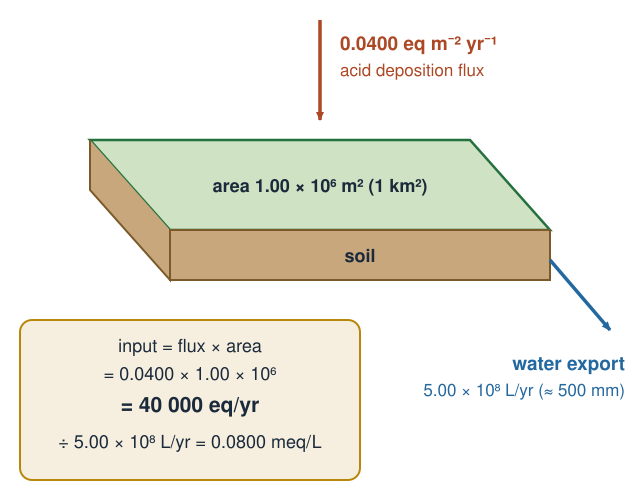{width="92%"}
:::
::::

::: notes
Now apply the balance from lecture 1. Draw the boundary around the catchment. The input is the flux times the area. Converting that to a water concentration needs the annual water that leaves the catchment, here 500 million litres, corresponding to half a metre of runoff over one square kilometre. Dividing equivalents by litres gives an annual flow-weighted equivalent concentration. It is the average concentration you would see if every litre exported in the year carried an equal share. It is not a pulse into a closed lake, and it is not a pH. The next slide adds what the catchment soils do to this input.
:::

## The annual budget with neutralisation

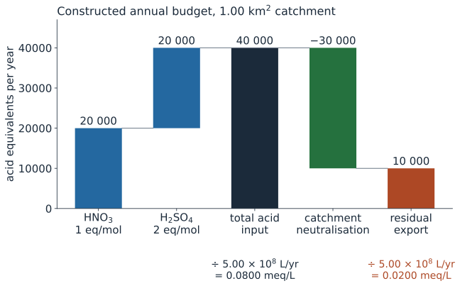{width="74%" fig-align="center"}

If catchment processes neutralise **30 000 eq/yr**, the residual is 10 000 eq/yr: 10 000 / 5.00 × 10⁸ L = **0.0200 meq/L** in the export. With only 20 000 eq/yr neutralised, it doubles to **0.0400 meq/L**. A constructed budget, not a pH prediction.

::: notes
This is the worked example from the notes and exercise 3. Subtract equivalents first, then divide by the annual water volume. The neutralisation term stands for weathering and cation exchange in the soil, which we discuss in two slides. Exercise 3 asks what happens with less neutralisation, 20 000 instead of 30 000: the residual doubles to 20 000 equivalents and the concentration doubles to 0.0400 milliequivalents per litre. Stress the two caveats. The numbers are constructed. And an equivalent concentration is not a pH; to get a pH you need the carbonate chemistry of week 2, and other ions. The budget tells us how much acid the water must carry, not how acidic it will be.
:::

## Load and concentration are different

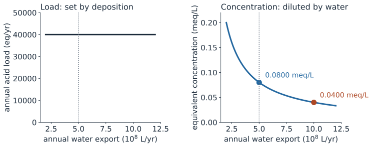{width="88%" fig-align="center"}

Double the water export at the same deposition: the annual acid **load stays 40 000 eq/yr**, but the equivalent concentration **halves** to 0.0400 meq/L. A wet year can lower concentrations without any change in the acid input.

::: notes
This is the question the week 1 demo asks, and the answer follows from the definitions. The load is set by the deposition flux and the area. Water only dilutes it. If you see lower concentrations in a wet year, do not conclude that deposition fell. Conversely, a dry year can raise concentrations without any increase in input. This is exactly the dilution-versus-destruction lesson from the Tisza case in the first lecture. Monitoring programmes therefore report both concentrations and fluxes, and they correct for water flow before claiming a trend. Ask students what measurement they would need to calculate a load from a stream concentration: the flow.
:::

## Why catchments respond differently

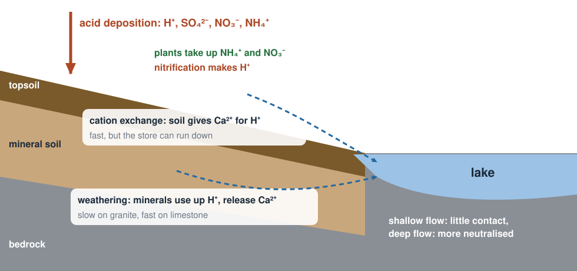{width="80%" fig-align="center"}

Between rain and lake, soils **neutralise** acid by **mineral weathering** and **cation exchange**, and **plants** take up nitrogen. **Nitrification** adds acid. Flow paths decide how much contact water has with soil.

::: notes
The neutralisation term in our budget is not a single number of nature; it depends on the catchment. Weathering of minerals consumes hydrogen ions and releases base cations such as calcium and magnesium. It is slow on granite and gneiss, which cover much of Sweden, and fast on limestone. Cation exchange is fast: soil particles hold calcium and release it in exchange for hydrogen ions, but the store can be depleted after decades of acid input. Plants take up ammonium and nitrate, which affects acidity. Water that runs off quickly through the topsoil during snowmelt has little contact time, which is why spring floods can bring acid pulses to streams.
:::

## Europe cut its emissions

:::: {.columns}
::: {.column width="48%"}
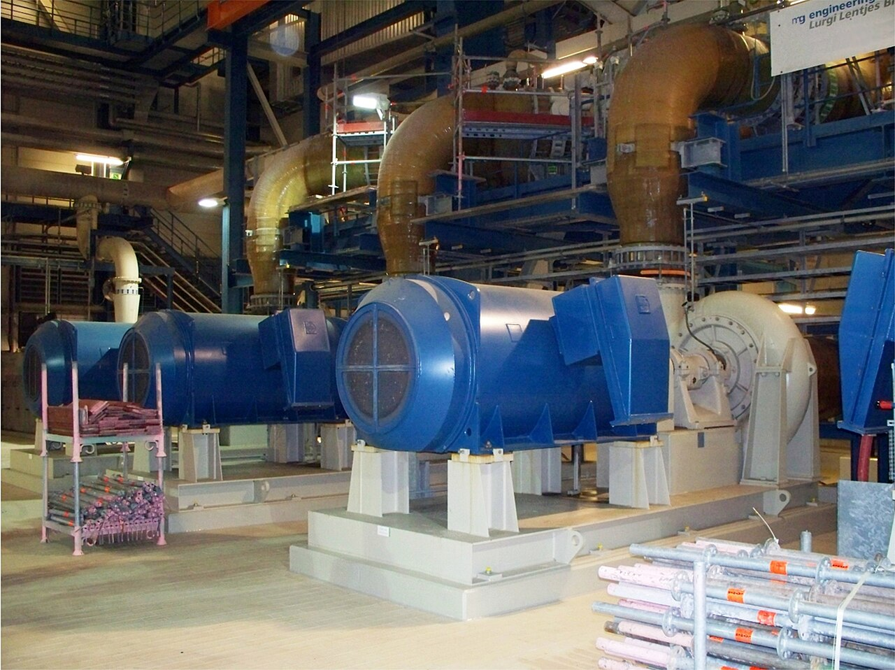{width="100%"}
[Flue-gas desulfurisation equipment inside Lippendorf power station, Germany. Photo: High Contrast, CC BY 3.0 DE, Wikimedia Commons.]{.credit}
:::
::: {.column width="52%"}
After the 1979 convention and its protocols, Europe reduced SO₂ emissions by **well over three quarters** since the 1980s: low-sulfur fuels, fewer coal plants, and **flue-gas desulfurisation**, which captures SO₂ with limestone.

Sulfate deposition in Scandinavia fell accordingly. Many lakes now show **rising pH and alkalinity**, but recovery is **slow**: soils lost base cations over decades. Nitrogen and ammonia have fallen much less.
:::
::::

::: notes
Acid rain is one of the success stories of environmental policy, and chemistry was central to it. Flue-gas desulfurisation scrubs sulfur dioxide from exhaust with a limestone slurry, producing gypsum; the photo shows the machinery inside a German lignite power station. Together with cleaner fuels and the closure of old plants, this cut European sulfur emissions dramatically. The numbers vary by country and period, so the slide gives a rounded statement. The recovery of surface waters lags behind, because soils lost exchangeable base cations and need time to rebuild them by weathering. That is one reason Sweden still limes some lakes, the topic that opens the carbonate lecture in week 2.
:::

## Back to the rain sample

:::: {.columns}
::: {.column width="45%"}
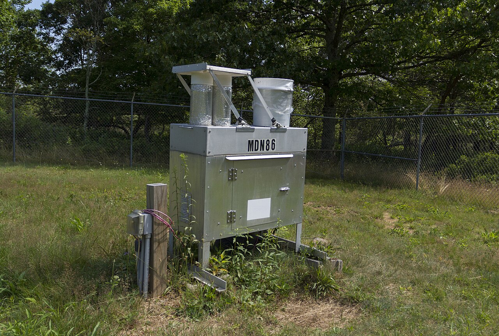{width="100%"}
[Precipitation sampler of the NADP Mercury Deposition Network. Photo: Mary O'Neill, USGS, public domain, Wikimedia Commons.]{.credit}
:::
::: {.column width="55%"}
A rain sample contains sulfate. Before reporting a **strong-acid dose**, you need:

- the **acidity** (H⁺) or alkalinity of the sample;
- the **major cations**, including NH₄⁺, Ca²⁺, Na⁺, Mg²⁺;
- the other **anions** (NO₃⁻, Cl⁻);
- the **precipitation volume**, to turn concentration into flux;
- an estimate of **dry deposition**;
- what happens **after** deposition: nitrification, uptake, weathering.
:::
::::

::: notes
This is exercise 4 and the opening question of the lecture. The answer collects every idea from today. Sulfate tells you the anion. Measured acidity tells you the free hydrogen ion now. The cations tell you whether sulfate came as acid, as ammonium salt or as sea salt or dust. The volume converts concentration to an amount per square metre. Dry deposition is missing from the sample by design. And the catchment processes decide how much of the deposited acidity actually reaches the lake. A careful report states which of these were measured and which were assumed. That is the same discipline as closing a mass balance in lecture 1.
:::

## Common mistakes to avoid

- **"Chimneys emit sulfuric acid."** They mostly emit SO₂; the acid forms by oxidation.
- **"Rain pH gives the acid load."** Multiply concentration by the water amount; pH misses potential acidity.
- **"A rain sample measures all deposition."** Dry deposition is missing.
- **"Every sulfate brings 2 H⁺."** Only if it arrives as H₂SO₄.
- **"Ammonia makes deposition harmless."** Nitrification can release 2 H⁺ per NH₄⁺ later.
- **"Lower concentration in a wet year means less deposition."** Water dilutes; the load may be unchanged.
- **"An equivalent concentration is a pH."** It needs carbonate chemistry to become one.

::: notes
These errors appear often in exercises and in public discussion of acid rain. Ask students to fix each statement in one sentence. The first three are about where acids form and what a sample measures. The fourth and fifth are about counter-ions and the difference between free and potential acidity. The sixth is the dilution lesson from lecture 1 in a new context. The last one prepares for week 2. The budget in equivalents tells us how much acid-neutralising capacity is consumed, but the resulting pH depends on the carbonate system of the water, which is exactly what the alkalinity concept in the carbonate lecture describes.
:::

## Explore: deposition and dilution {#explore}

```{=html}
<link rel="stylesheet" href="../demos/demo.css">
<div data-demo="deposition" role="group" aria-label="Deposition and dilution">
<p>Double water export. Which changes: annual load or equivalent concentration?</p>
</div>
<script src="../demos/core.js"></script>
<script src="../demos/deposition.js"></script>
```

[Double water export. Which changes: annual load or equivalent concentration?](exercise.qmd#explore)

::: notes
Use the reference presets, then change one variable. The complete exercise has
model assumptions, a hand-check result, and a static reference for printing.
:::

## Summary {.smaller}

:::: {.columns}
::: {.column width="70%"}
| Concept | Key fact |
| --- | --- |
| Precursors | SO₂ and NOₓ are oxidised to H₂SO₄ and HNO₃ (OH; H₂O₂ in clouds) |
| Net equation | SO₂ + ½ O₂ + H₂O → H₂SO₄ is bookkeeping, not mechanism |
| Wet deposition | flux = concentration × rain amount; 1 mm on 1 m² = 1 L |
| Dry deposition | gases and particles to surfaces; not in a rain sample |
| Rain pH | a concentration of free H⁺; same pH, more rain = more acid |
| Equivalents | HNO₃ 1 eq/mol, H₂SO₄ 2 eq/mol |
| Sulfate | with H⁺, NH₄⁺ or base cations: measure the cations |
| Ammonium | neutralises now; nitrification gives 2 H⁺ per NH₄⁺ later |
| Budget | 40 000 eq/yr in; − neutralisation; ÷ water export = meq/L |
| Catchments | weathering, exchange, uptake and flow paths set the response |

**Next:** [molecules, radiation and climate](../climate-chemistry/lec.qmd). The same particles that carry acid also scatter sunlight. Then the [exercises](exercise.qmd), [notes](notes.qmd) and the [week 1 demo](../interactives/week1.qmd).
:::
::: {.column width="30%"}
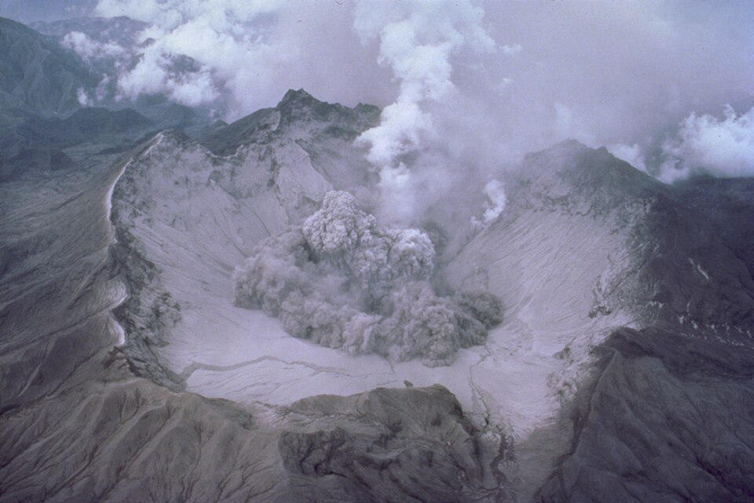{width="100%"}
[Summit caldera of Mount Pinatubo, Philippines, on 1 August 1991, six weeks after the climactic eruption of 15 June. Photo: T. J. Casadevall, USGS, public domain, Wikimedia Commons.]{.credit}
:::
::::

::: notes
The summary table is the revision sheet. Recite the chain once: emission of precursors, oxidation to strong acids, wet and dry deposition, counting in equivalents with attention to counter-ions, and an annual budget for a catchment whose soils neutralise part of the input. Then return to the opening: Odén's argument needed exactly this chain, from British and German chimneys to Swedish lakes. The photo is the teaser for the next lecture. In 1991 Mount Pinatubo injected so much sulfur dioxide into the stratosphere that the resulting sulfate particles cooled the planet for a year or two. Sulfate is not only an acid; it also changes how sunlight and heat move through the atmosphere.
:::
