## About this lecture

:::: {.columns}
::: {.column width="55%"}
In January 2000 a tailings dam at a gold mine near **Baia Mare, Romania**, failed. About 100 000 m³ of cyanide-laden water entered the rivers and travelled down the Someș, the **Tisza** and the Danube. Fish died along hundreds of kilometres.

Downstream, the measured cyanide concentration fell. **Was the poison destroyed, or only spread out?**

Today you will learn to:

- tell **concentration** apart from **amount** and **load**;
- draw a **boundary** and write a **balance**;
- separate **mixing**, **transfer** and **reaction**;
- estimate a **timescale** from volume and flow.

This is the first lecture of the course. Every later unit uses these tools.
:::
::: {.column width="45%"}
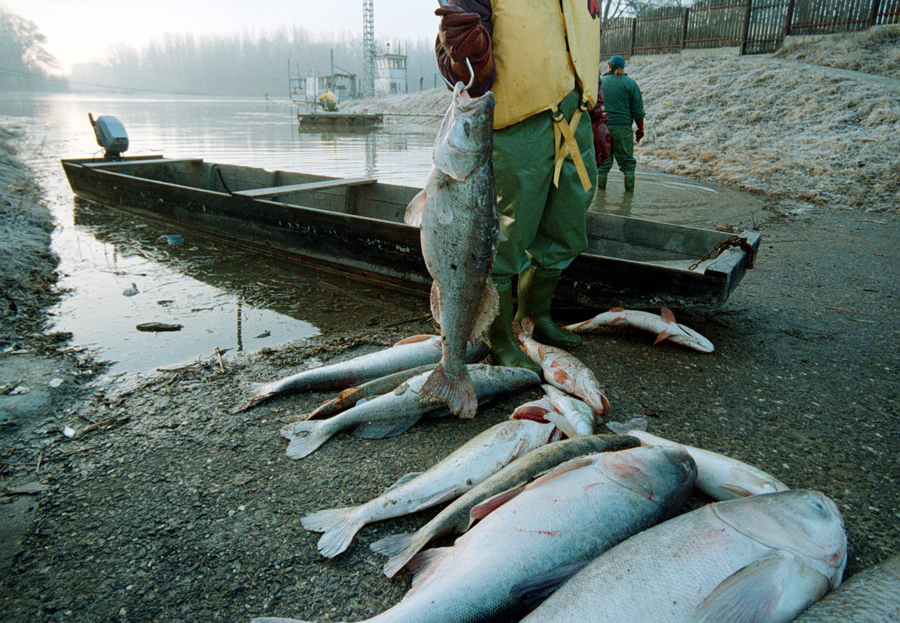{width="100%"}
[Dead fish collected on the Tisza after the 2000 cyanide spill, Hungary. Photo: Délmagyarország/Karnok Csaba, CC BY-SA 3.0, Wikimedia Commons.]{.credit}
:::
::::

::: notes
Welcome to the course. Start with the story. In early 2000 a dam holding mining waste near Baia Mare failed, and water contaminated with cyanide flowed into the river system that drains into the Tisza and then the Danube. The images of dead fish were shown across Europe. The question for today sounds simple: when the measured concentration downstream was lower, had nature removed the cyanide? To answer, we need to count amounts, not just read concentrations, and we need to decide where we draw the line around our system. These are the habits that every later lecture relies on, from lake acidification to contaminant fate.
:::

## A concentration falls downstream. Why?

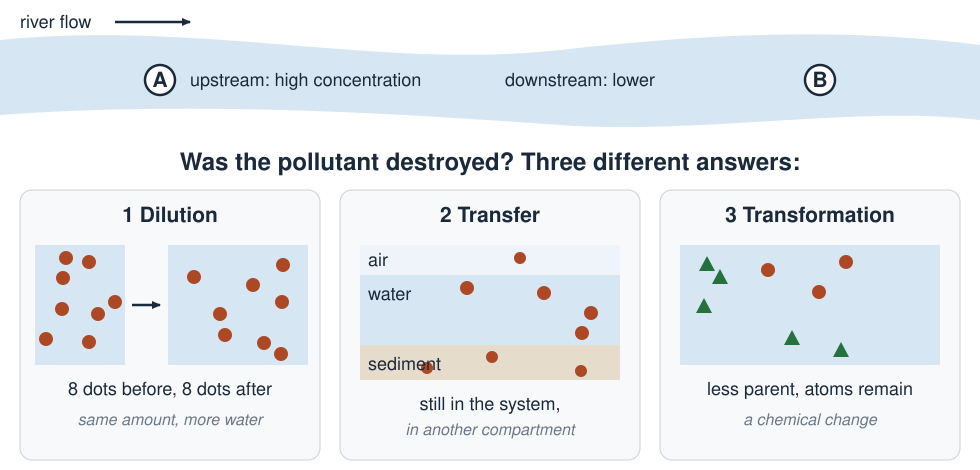{width="86%" fig-align="center"}

A lower number at station B has at least **three explanations**. Water joined the river (**dilution**). The substance moved into sediment or air (**transfer**). Or it reacted to something else (**transformation**). Only the third is chemical destruction, and even then the atoms remain.

::: notes
This slide sets the question for the whole lecture. Draw students' attention to the dots. In the dilution panel the number of dots is unchanged; only the water volume grew. In the transfer panel the dots are still in the system, but some now sit in the sediment or have escaped to the air. Only in the transformation panel do the original molecules disappear, and they are replaced by products. A concentration measurement at A and at B cannot by itself tell these three cases apart. Our job today is to find the extra information that can: volumes, flows, other compartments and products.
:::

## Concentration is not amount

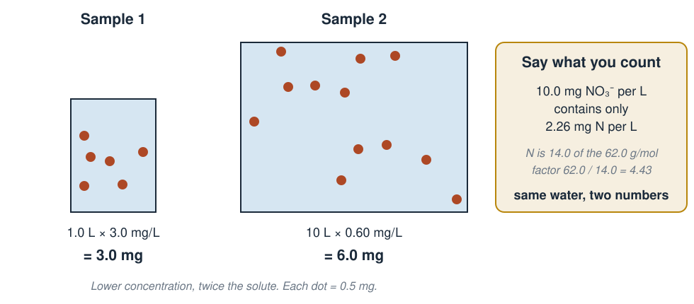{width="84%" fig-align="center"}

**Amount = concentration × volume.** A dilute large sample can hold more solute than a concentrated small one. Also state **what you count**: mg of nitrate and mg of nitrogen are different numbers for the same water.

::: notes
Concentration is amount divided by volume. It describes how crowded the solute is, not how much exists. Sample 2 has a fifth of the concentration of sample 1 but twice the solute, because its volume is ten times larger. The box on the right is a common reporting trap. Nitrate results are reported either as mass of nitrate ion or as mass of nitrogen. The molar mass of nitrate is about 62 grams per mole and nitrogen contributes 14 of those, so the two numbers differ by a factor of about 4.4. Always check the label, mg NO3 per litre or mg N per litre, before comparing data from different sources.
:::

## Load: amount carried per time

:::: {.columns}
::: {.column width="48%"}
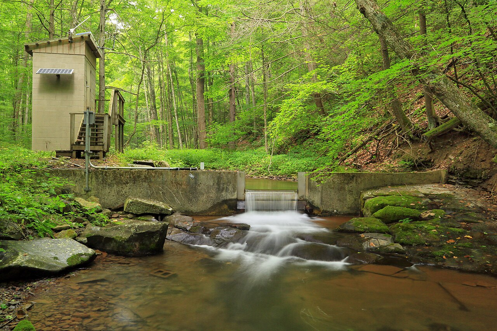{width="100%"}
[A US Geological Survey streamgage that records river flow. Photo: U.S. Geological Survey, public domain, Wikimedia Commons.]{.credit}
:::
::: {.column width="52%"}
A river does not hold a fixed amount; it **carries** one. The rate is the **load**:

$$\text{load} = Q \times C$$

**Worked example.** A stream carries Q = 0.200 m³/s at C = 0.500 mg/L.

- Q = 200 L/s
- load = 200 L/s × 0.500 mg/L = 100 mg/s = **0.100 g/s**
- per day: 0.100 g/s × 86 400 s = **8.64 kg/day**

A load needs **both** a concentration and a flow measurement.
:::
::::

::: notes
For a flowing water, the useful quantity is the load: amount per time. It is concentration times flow. This is why monitoring stations such as this streamgage measure water flow continuously, and why chemistry samples are taken at gauged sites. Walk through the units: convert cubic metres to litres first, then milligrams per second, then grams per day. The daily figure assumes flow and concentration stay constant over the day, which is rarely true in a real river. Students repeat this in exercise 2. Point out that a river with low concentration but very high flow can carry a larger load than a polluted small stream.
:::

## Choose the boundary first

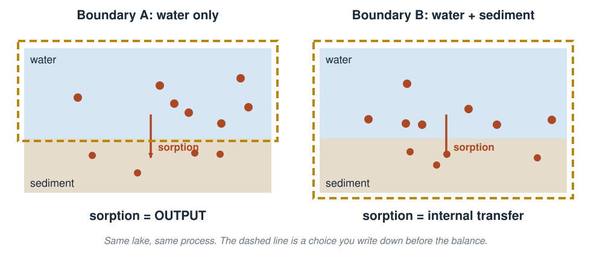{width="84%" fig-align="center"}

A **compartment** is a volume you define: a lake, a sample bottle, or water plus sediment. A **flux** crosses the boundary. A **reaction** happens inside it. Sorption to sediment is an output from the water, but only an internal move for the lake as a whole.

::: notes
Before writing any balance, write down what is inside your boundary. The same physical process can be a loss or no loss at all, depending on that choice. If the boundary is drawn around the water only, sorption to the sediment removes the compound and appears as an output. If the boundary includes the sediment, sorption just moves the compound from one part of the system to another, and the total is unchanged. Neither choice is wrong. Problems arise when the boundary is not stated, and someone reports "removal" that is really a transfer. Many disagreements in environmental reports come down to unstated boundaries.
:::

## Write the balance

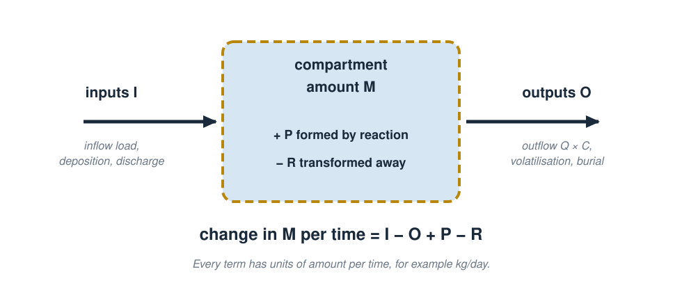{width="80%" fig-align="center"}

For a well-mixed water body of constant volume, the outflow term is **Q × C**: outflow water times the outlet concentration. Inflow and outflow water must also balance if the volume stays fixed.

::: notes
This is the general balance, written in words: the change of the amount per unit time equals inputs minus outputs plus production minus consumption. Inputs and outputs cross the boundary. Production and consumption are reactions inside it. Check that every term has the same units, amount per time. If one term is in milligrams per litre and another in kilograms per day, something is missing, usually a volume or a flow. For a well mixed lake, the outlet concentration equals the lake concentration, so the advective output is flow times lake concentration. We will use exactly this form when we discuss flushing and steady state.
:::

## Transfer or transformation?

:::: {.columns}
::: {.column width="50%"}
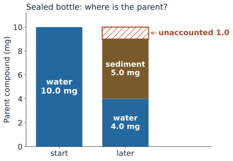{width="100%"}
:::
::: {.column width="50%"}
A sealed bottle starts with **10.0 mg** of a parent compound in water. Later the water holds 4.0 mg and the sediment 5.0 mg.

- Water alone: 6.0 mg "lost".
- Water + sediment: only **1.0 mg** missing.

The missing 1.0 mg may be **transformation**, loss to the bottle wall, or **analytical error**. The balance tells you how much to explain, not what happened to it.
:::
::::

::: notes
This is exercise 3, and it shows why the boundary matters. If you only measure the water, it looks as if most of the compound has gone. Once the sediment is measured, most of it is accounted for, and the real question shrinks to one milligram. That remaining milligram is not automatically degradation. It could be stuck to the glass, it could be a measurement error of ten percent, or it could have been transformed. To claim transformation you need positive evidence, such as measured products. Also note that transformation of the parent does not destroy its elements. A balance on carbon or chlorine atoms is a different balance from one on the parent molecule.
:::

## Steady state does not mean nothing happens

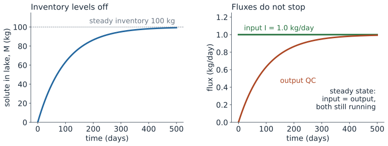{width="92%" fig-align="center"}

A constructed lake (V = 10⁶ m³, Q = 10⁴ m³/day) receives 1.0 kg/day of a conservative solute. The inventory rises and levels off when **output = input**. At steady state the amount stops changing, but **both fluxes keep running**.

::: notes
Steady state is one of the most misunderstood words in this course. It means that accumulation is zero: the amount in the compartment no longer changes. It does not mean that inputs have stopped. In this constructed lake, one kilogram enters every day and one kilogram leaves every day at steady state. The level of 100 kilograms is set by the balance: input divided by flow gives the steady concentration, 0.1 milligram per litre, times the volume. Ask students: if the input doubled, what would the steady inventory be? It doubles. Also note that real lakes are often not at steady state, so treat it as an assumption to be checked, not a fact.
:::

## Mixing without reaction

:::: {.columns}
::: {.column width="50%"}
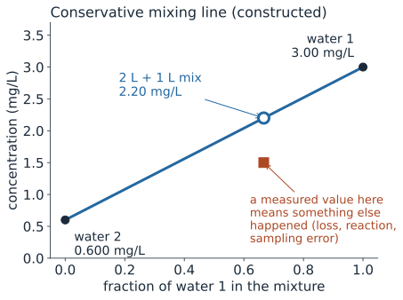{width="100%"}
:::
::: {.column width="50%"}
Mix 2.00 L at 3.00 mg/L with 1.00 L at 0.600 mg/L.

- amounts: 6.00 mg + 0.600 mg = **6.60 mg**
- volume: 3.00 L
- concentration: 6.60 / 3.00 = **2.20 mg/L**

Add **amounts**, then divide by total volume. Never average concentrations.

All conservative mixtures of two waters fall on a **straight mixing line**. A point off the line needs another explanation.
:::
::::

::: notes
This is the worked example from the notes. The concentration fell from 3.00 to 2.20 milligrams per litre, yet no solute was lost: all 6.60 milligrams are in the mixture. The method is always the same: convert to amounts, add, divide by total volume. A simple average of the two concentrations would give 1.80, which is wrong because the volumes differ. The mixing line is a powerful field tool. Plot measured concentration against the fraction of each water, often estimated from a conservative tracer such as chloride. If the sample lies below the line, something removed solute, or the sampling, timing or measurement needs checking.
:::

## Rivers mix by load

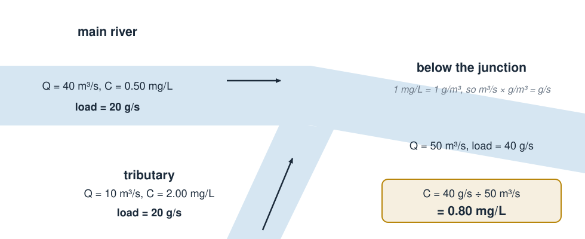{width="80%" fig-align="center"}

At a junction, add **loads**, then divide by total flow. The tributary is four times more concentrated, yet the mixed river is only 0.80 mg/L. Nothing reacted; the solute was **diluted**.

::: notes
The same logic applies to flowing water, with flows in place of volumes and loads in place of amounts. The main river carries 20 grams per second and so does the tributary. Below the junction 40 grams per second flow in 50 cubic metres per second, which gives 0.80 milligrams per litre. Remind students that one milligram per litre equals one gram per cubic metre, which makes the unit arithmetic clean. In the Tisza case, every tributary and the Danube itself added water to the plume. That alone lowered concentration a great deal, without any chemical destruction.
:::

## Check yourself

::: {.checkbox}
1. Mix 4.00 L at 2.00 mg/L with 1.00 L of clean water. What is the final concentration? Was solute destroyed?
2. A lake is at steady state. Does that mean no pollutant enters it?
3. A report says "60% of the pesticide was removed from the pond water within a week." What would you ask before calling it degradation?
4. Is 5 mg NO₃⁻/L more or less nitrogen than 5 mg N/L?
:::

::: notes
Answers. One: 8.00 milligrams in 5.00 litres gives 1.60 milligrams per litre; nothing was destroyed, it is dilution. This is exercise 1. Two: no, steady state only means inputs and outputs balance, so the amount does not change. Three: ask about the boundary. Was the sediment measured? Were plants, the air and the container considered? Were products measured? Was the water volume constant? Four: less. Five milligrams of nitrate contains only about 1.1 milligrams of nitrogen, whereas 5 milligrams of nitrogen per litre corresponds to about 22 milligrams of nitrate per litre.
:::

## How long does the water stay?

:::: {.columns}
::: {.column width="50%"}
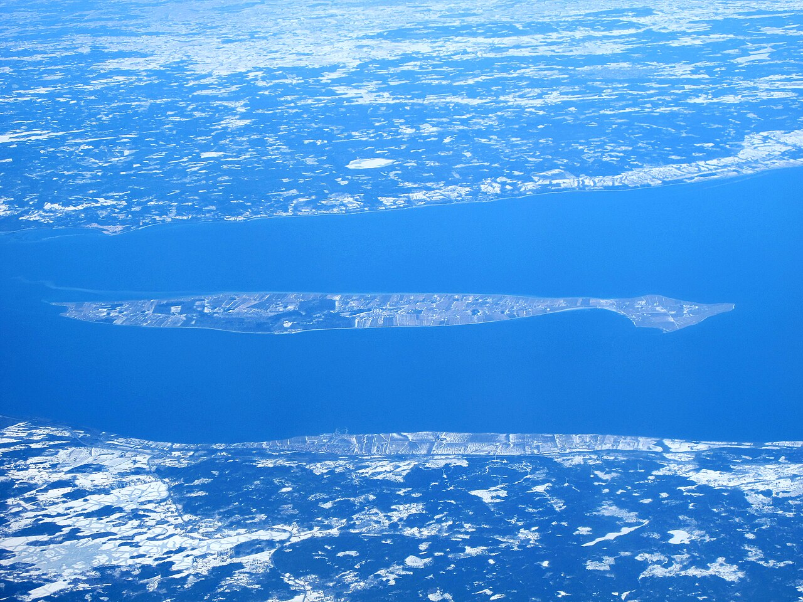{width="100%"}
[Lake Vättern with the island of Visingsö, Sweden, from the air. Photo: acediscovery, CC BY 4.0, Wikimedia Commons.]{.credit}
:::
::: {.column width="50%"}
The **hydraulic replacement time** is

$$\tau = V / Q$$

**Lake Vättern**, Sweden's second-largest lake: V ≈ 77 km³, outflow Q ≈ 40 m³/s.

τ ≈ 77 × 10⁹ m³ ÷ 40 m³/s ≈ 1.9 × 10⁹ s ≈ **60 years**.

A conservative pollutant that enters Vättern today can stay for decades. A small forest pond may be replaced in days.
:::
::::

::: notes
The ratio of volume to flow gives a timescale: how long the outflow would take to replace the lake's water. For Vättern, with its large volume and modest outflow through Motala ström, the answer is around 60 years. These are rounded values; the exact figure depends on the source. The message is that big, slowly flushed lakes have long memories. That is why persistent pollutants are a special concern there. Be careful with the interpretation: tau is a replacement scale for the water. It is not the age of every water molecule, and it is not the chemical lifetime of a solute that also reacts or sorbs.
:::

## Flushing and reaction act together

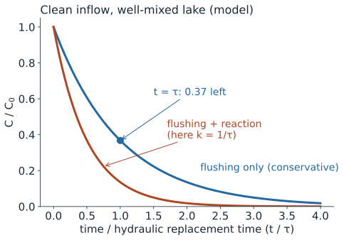{width="68%" fig-align="center"}

Clean water flushes a well-mixed lake: a conservative solute falls as $C = C_0e^{-t/\tau}$. After one τ about **37%** remains, not zero. A solute that also reacts with rate constant k disappears faster: the two loss rates **add**, 1/τ + k.

::: notes
Under the well-mixed model, flushing an initially contaminated lake with clean water gives an exponential decline. After one replacement time, about 37 percent is left, because new clean water mixes with the old water rather than pushing it out like a piston. If the solute also reacts with a first-order rate constant, the losses add: the total rate constant is one over tau plus k. In the plot k equals one over tau, so the reactive solute falls twice as fast. Here is the important consequence: if you only see the concentration fall, you cannot know how much was flushing and how much was reaction without knowing tau.
:::

## Back to the Tisza: a pulse moving downstream

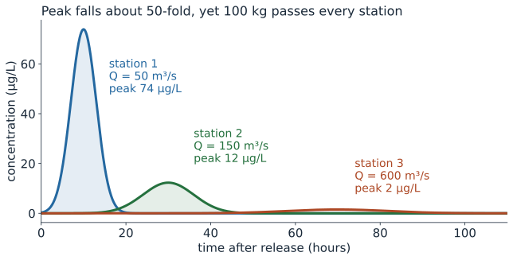{width="90%" fig-align="center"}

A **constructed** 100 kg pulse of a conservative tracer. As tributaries join, flow rises and the pulse spreads out. The peak falls about 50-fold, yet the area under each curve times Q gives **100 kg at every station**.

::: notes
Now return to the opening case with a model. This is not the measured Tisza plume. It is a constructed pulse that cannot react at all. Each curve is what a sampler at one station would see as the pulse passes. The peak concentration collapses downstream for two physical reasons: more water joins the river, and the pulse is stretched along the channel. But if you multiply flow by concentration and add up over the whole passage, you recover the same 100 kilograms each time. This is the test that separates dilution from destruction. For the real cyanide plume, some cyanide was also lost by reaction and volatilisation, but much of the drop was dilution.
:::

## Closing the balance in the field

:::: {.columns}
::: {.column width="45%"}
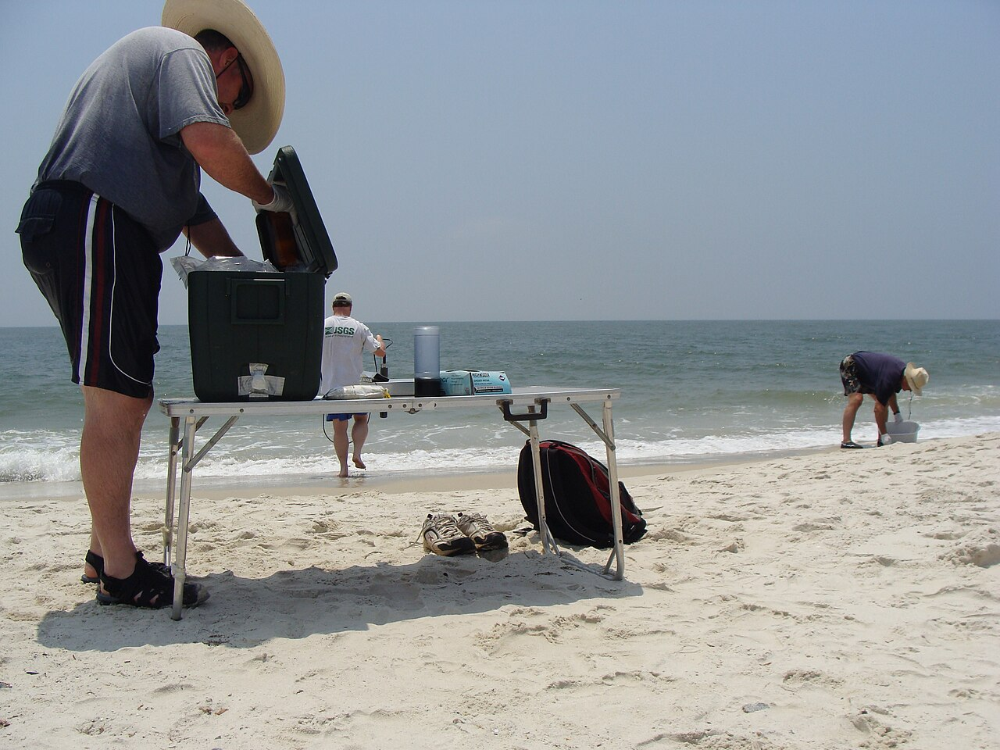{width="100%"}
[USGS team taking baseline water and sediment samples at Gulf Shores, Alabama, before oil from the 2010 Deepwater Horizon spill arrived. Photo: U.S. Geological Survey, public domain, Wikimedia Commons.]{.credit}
:::
::: {.column width="55%"}
A lake's concentration falls while its volume rises. To tell dilution, export and transformation apart, measure over the same period:

- **volume** and total **inventory** in the water;
- **inflow and outflow loads**;
- amounts in **sediment**, biota or air;
- likely **transformation products**.

A concentration time series alone cannot close the balance.
:::
::::

::: notes
This is exercise 4. The general lesson is that a closed balance needs several kinds of measurement, collected over a consistent period. Volume and inventory tell you whether the amount actually changed. Loads at the inlet and outlet tell you about export. Solid phases tell you about transfer. Products are the positive evidence for transformation. If any of these are missing, say which explanation remains open. The photo shows routine field sampling; field teams plan exactly this: which compartments and which species, at which times. In later units we will add sorption, redox reactions and biodegradation, but the bookkeeping stays the same.
:::

## Common mistakes to avoid

- **"The concentration fell, so the pollutant was destroyed."** Check dilution and transfer first.
- **"Average the concentrations."** Add amounts or loads; then divide by total volume or flow.
- **"Steady state means no input."** It means input and output balance.
- **"τ = V/Q is how long every molecule stays."** It is a replacement scale for the water, not a chemical lifetime.
- **"Removed from the water" = "gone."** Name the boundary; sorption may be internal transfer.
- **"mg/L nitrate equals mg/L N."** State the basis; they differ by a factor of about 4.4.

::: notes
These are the errors that appear most often in exercises and in real environmental reports. Ask students to explain in their own words why each statement is wrong. The first is the central lesson of the lecture. The second is an arithmetic error that only works when the volumes are equal. The third and fourth concern the meaning of words: steady state and residence time sound like they describe processes stopping or molecules waiting, but they describe balances. The fifth is about boundaries. The last is about units, and it causes real confusion when comparing data sets from different countries or laboratories.
:::

## Summary {.smaller}

:::: {.columns}
::: {.column width="70%"}
| Concept | Key fact |
| --- | --- |
| Amount | concentration × volume; state the basis (mg N or mg NO₃⁻) |
| Load | flow × concentration; 1 mg/L = 1 g/m³ |
| Boundary | decides whether a process is an output or an internal transfer |
| Balance | change in M per time = I − O + P − R; same units in every term |
| Steady state | accumulation zero; fluxes still run |
| Mixing | add amounts or loads, then divide; points off the mixing line need explaining |
| Timescale | τ = V/Q; about 37% of a conservative solute left after one τ |
| Losses add | flushing (1/τ) and reaction (k) combine |
| Opening case | falling concentration downstream: mostly dilution unless the load also falls |

**Next:** [reactions in the atmosphere](../atmospheric-reactions/lec.qmd). The air is a compartment too, and there light drives the reactions. Then the [exercises](exercise.qmd) and [notes](notes.qmd).
:::
::: {.column width="30%"}
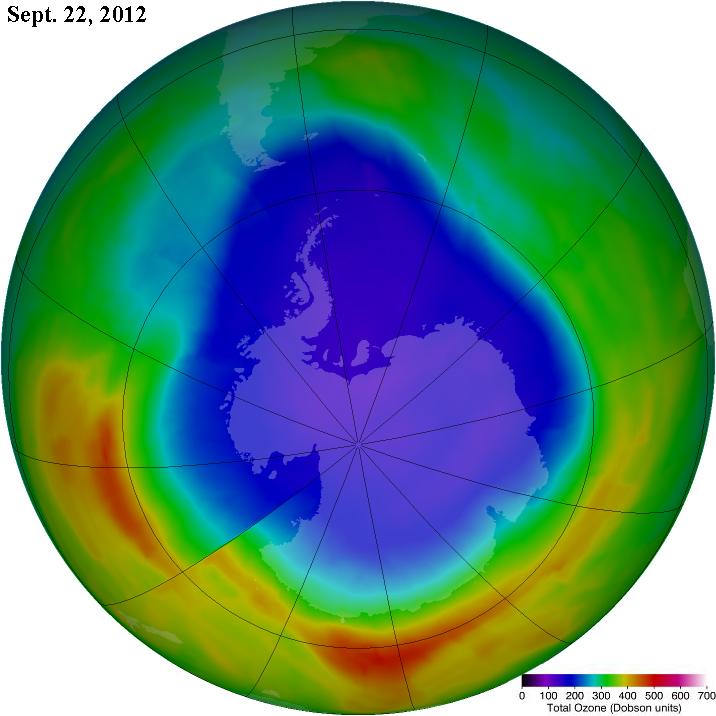{width="100%"}
[Antarctic ozone hole, 22 September 2012. Image: NASA, public domain, Wikimedia Commons.]{.credit}
:::
::::

::: notes
The summary table is the revision sheet. Recite the chain once. Convert concentrations to amounts or loads. Draw a boundary. Write the balance with consistent units. Ask whether a change is dilution, transfer or transformation, and what measurement would tell them apart. Then return to the opening: the falling cyanide concentration along the Tisza and Danube was largely dilution, so the load, not the concentration, is the quantity to follow. The image is the teaser for the next lecture. In the atmosphere we apply the same balance thinking, but now sunlight drives chemical production and loss, and ozone is both made and destroyed.
:::
