## About this lecture

:::: {.columns}
::: {.column width="56%"}
In 1972 the United Nations held its first environment conference in **Stockholm**. Sweden's own case study argued something new: **sulfur emitted in other countries was acidifying Swedish lakes**. The argument linked air chemistry, soils and water in one chain, and it led to the first international treaty on cross-border air pollution, in 1979.

Today we build that kind of argument ourselves, with every unit of the course:

- one **budget in equivalents** from air to lake;
- **annual export** is not a **closed-water pH**;
- a **sediment redox** hypothesis tested against evidence;
- an explanation is only as good as **the test that could break it**.
:::
::: {.column width="44%"}
{width="100%"}
[Delegates to the UN Conference on the Human Environment cycle through Stockholm, 1972. Photo: Pressens Bild, public domain, Wikimedia Commons.]{.credit}
:::
::::

::: notes
Start with history, because the course's chemistry was once a political argument. In the late 1960s Swedish scientists linked acidifying lakes in the west of Sweden to sulfur emissions from industrial regions elsewhere in Europe. Sweden presented this as its case study at the 1972 Stockholm conference. Many were sceptical, and it took years of measurements of deposition, soils and lake chemistry before the case was accepted. The 1979 Convention on Long-Range Transboundary Air Pollution followed. Last lecture we followed organic contaminants through phases. Today we put every thread together for one constructed catchment, and practise building a chemical explanation that could convince a sceptic.
:::

## One catchment, the whole course

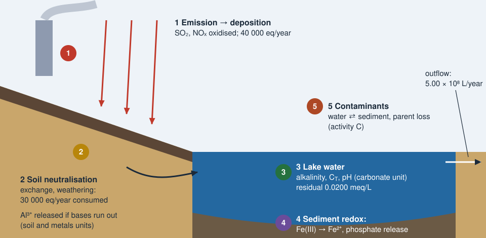{width="86%" fig-align="center"}

Every unit appears here: **deposition** brings acid, **soils** neutralise most of it, **carbonate chemistry** sets the lake's alkalinity and pH, **metals** follow pH, **redox** controls the sediment, and **contaminants** partition between water and sediment.

::: notes
This is the map for today. It is a constructed teaching catchment of one square kilometre, the same one used in the deposition unit. Each numbered thread is a unit you have studied. We follow the threads in order. First, acid from the air. Second, the soils, which consume most of it. Third, the lake, where we convert an annual budget to an alkalinity. Fourth, aluminium and metals, which depend on how well the first three balance. Fifth, a separate set of sediment observations and a redox hypothesis. Sixth, the contaminant model from activity C. Keep asking at each step: what is measured, what is assumed, and what boundary does the number refer to?
:::

## Thread 1: from smokestack to acid input

:::: {.columns}
::: {.column width="45%"}
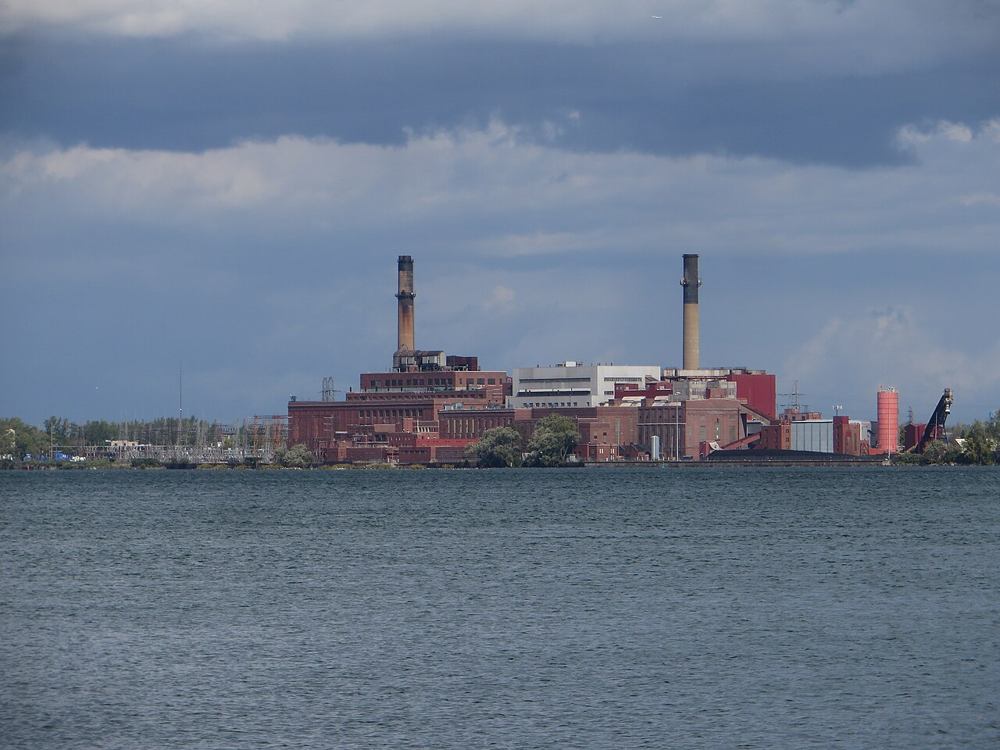{width="100%"}
[A coal-fired power station (Huntley Station, New York). Photo: Ken Lund, CC BY-SA 2.0, Wikimedia Commons.]{.credit}
:::
::: {.column width="55%"}
SO₂ and NO~x~ are oxidised in air to sulfuric and nitric acid, then deposited wet or dry.

Deposition unit, worked example:

- HNO₃: 0.0200 mol m⁻² yr⁻¹ × 1 eq/mol
- H₂SO₄: 0.0100 mol m⁻² yr⁻¹ × 2 eq/mol
- total: **0.0400 eq m⁻² yr⁻¹**

Over 1.00 × 10⁶ m²: **40 000 eq/year** of acid.

Counting in **equivalents** lets us add acids of different charge.
:::
::::

::: notes
Recall the deposition unit. Sulfur dioxide and nitrogen oxides are precursors; oxidation in gas and droplets turns them into sulfuric and nitric acid. Sulfuric acid supplies two equivalents per mole, nitric acid one. Multiplying the flux per square metre by the catchment area gives the annual input. Remind students of the caveat from that unit: deposited sulfate does not always arrive as free acid. Ammonia can neutralise it in the air, and ammonium deposition can later generate acidity through nitrification. In our budget we use the stated convention that all of it counts as acid. The power station photo is a reminder that this budget starts with fuel chemistry, and that cutting sulfur emissions was the effective long-term remedy.
:::

## Close the annual budget

:::: {.columns}
::: {.column width="55%"}
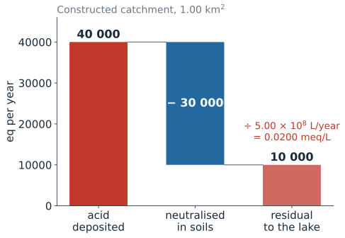{width="100%"}
:::
::: {.column width="45%"}
$$\text{residual}=\text{input}-\text{neutralised}$$

40 000 − 30 000 = **10 000 eq/year**

Convert to a flow-weighted concentration with the annual water export:

$$\frac{10\,000\ \text{eq/yr}}{5.00\times10^{8}\ \text{L/yr}}=2.00\times10^{-5}\ \text{eq/L}$$

= **0.0200 meq/L**

Work in **annual amounts first**, then divide by water.
:::
::::

::: notes
This is exercise 1, part one. The neutralisation term, 30 000 equivalents per year, is stipulated in this teaching budget. In a real catchment it would be estimated from weathering rates, changes in soil exchangeable cations and stream chemistry, each with uncertainty. The order of operations matters. First close the balance in annual amounts, where addition and subtraction are valid. Only then divide by the annual water volume. The units cancel to equivalents per litre, and multiplying by a thousand gives milliequivalents. Warn against a common shortcut: do not silently add an unmeasured retention or biological term to make a budget match an observation. If a budget does not close, that is information.
:::

## Thread 2: where the 30 000 eq went

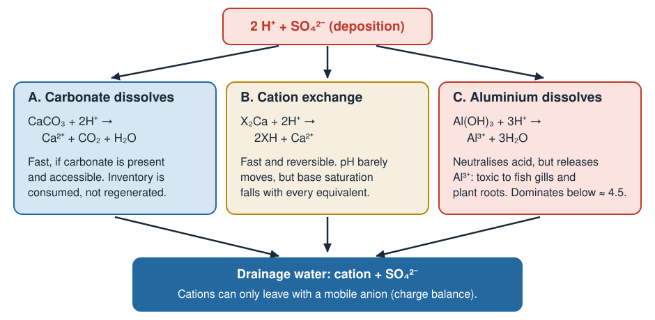{width="66%" fig-align="center"}

The soil lecture's three pathways: **carbonate** dissolution, **cation exchange**, and **aluminium** release. Exchange and weathering supply base cations, which leave with sulfate. Each pathway draws on a **finite inventory**.

::: notes
Bring back the soil lecture. Most of the acid entering a catchment never reaches the lake as acid, because soils neutralise it. In a granite catchment without carbonate, the main terms are silicate weathering, which is slow, and cation exchange, which is fast but finite. The calcium and magnesium released leave in drainage together with sulfate, so stream chemistry records the process: base cations and sulfate rise together. At Hubbard Brook this is what depleted the soil's exchangeable calcium. The budget treats 30 000 equivalents per year as fixed. A key exam idea is that this term is not a constant of nature. It declines as the exchanger is depleted, which is why the residual acid can grow even when deposition is constant.
:::

## An annual budget is not a pulse

:::: {.columns}
::: {.column width="55%"}
The carbonate lecture added a **single acid dose** to a **closed** beaker: alkalinity fell by the dose, C~T~ stayed fixed, and a pH followed.

The catchment budget is different:

- it is a **flux over a year**, spread over 5.00 × 10⁸ L of water;
- the water exchanges CO₂ with air and soil;
- the lake is continuously **flushed and replaced**.

0.0200 meq/L is a **flow-weighted annual average**, not the result of pouring acid into a lake.
:::
::: {.column width="45%"}
::: {.checkbox}
**Same units, different meanings**

- eq/year: an **amount per time** (budget)
- meq/L: a **concentration** (after dividing by water)
- pH: a **present state** (needs C~T~ and CO₂)

Before combining two numbers, check that they refer to the same boundary and time.
:::
:::
::::

::: notes
Students often carry the carbonate lecture's model into the catchment without noticing that the boundary has changed. Water A and Water B were closed: nothing entered or left except the acid dose. A lake is an open, flushed system. Its water is replaced over its residence time, it exchanges carbon dioxide with the air, and inflow chemistry varies with season and flow. The annual budget averages over all of that. It is useful for comparing catchments and scenarios, but it does not tell you the pH on any particular day. The box is a checklist students can use in the exam: ask what kind of quantity each number is before you add, subtract or compare it.
:::

## Thread 3: alkalinity needs a reference

:::: {.columns}
::: {.column width="48%"}
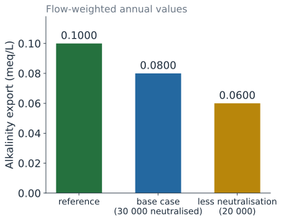{width="100%"}
:::
::: {.column width="52%"}
"Lower alkalinity" only means something **compared with a reference**.

Suppose that without the added acid, the catchment would export **50 000 eq/year** of alkalinity: 0.100 meq/L.

The residual acid consumes alkalinity one-for-one:

50 000 − 10 000 = **40 000 eq/year = 0.0800 meq/L**

As in the carbonate lecture, strong acid lowers alkalinity by exactly its amount in equivalents.
:::
::::

::: notes
This is exercise 1, part two. The reference alkalinity export is stipulated, and it must be stated explicitly. Without a reference, a statement like the lake lost alkalinity has no number attached to it. The logic is the same as the carbonate lecture's strong-acid rule: each equivalent of strong acid removes one equivalent of alkalinity. Here we apply it to annual amounts and then divide by water. The third bar anticipates the worked example: if the soils neutralised less, the alkalinity export would be lower. Ask students to connect this to the granite and limestone lakes from week 2: a granite catchment starts with a small reference alkalinity, so the same residual acid takes a much larger fraction of it.
:::

## Alkalinity alone does not give a pH

:::: {.columns}
::: {.column width="55%"}
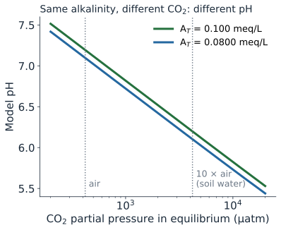{width="100%"}
:::
::: {.column width="45%"}
Model: carbonate system in equilibrium with a given CO₂ pressure, 25 °C, constants from the carbonate reference sheet.

With A~T~ = 0.0800 meq/L:

- in equilibrium with **air**: pH ≈ **7.1**
- with **10 × air** CO₂, typical of soil water and groundwater: pH ≈ **6.1**

Same alkalinity, **one pH unit apart**. To get a pH you need A~T~ **and** C~T~ or the CO₂ pressure.
:::
::::

::: notes
This slide proves the notes' warning with a calculation. For a fixed alkalinity, the pH depends on how much dissolved carbon dioxide is present, which depends on gas exchange. Stream water fed by groundwater is often supersaturated in carbon dioxide because soil respiration raises its partial pressure, so its pH is lower than the same water after it degasses in a lake. The two lines show that the difference between our base case and the reference alkalinity changes pH by only about 0.1 units at fixed CO2, much less than the effect of CO2 itself. The model ignores organic acids, which matter in brown Swedish waters. The point stands: alkalinity is a capacity, pH a state.
:::

## Which term controls the budget?

:::: {.columns}
::: {.column width="52%"}
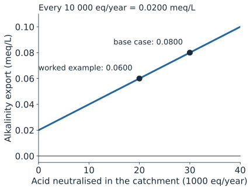{width="100%"}
:::
::: {.column width="48%"}
**Worked example:** suppose soils neutralise only **20 000** eq/year.

- residual: 40 000 − 20 000 = 20 000 eq/year = 0.0400 meq/L
- alkalinity: 50 000 − 20 000 = 30 000 eq/year = **0.0600 meq/L**

Each 10 000 eq/year less neutralisation lowers alkalinity export by 0.0200 meq/L.

This is a **sensitivity** test: it shows which term matters, not which process actually changed.
:::
::::

::: notes
This is the worked example from the notes. Change one term, hold the others fixed, and see how much the result moves. The line is straight because the budget is linear: every equivalent of acid not neutralised in the soil removes one equivalent of alkalinity from the lake. The calculation tells us the lake's alkalinity is very sensitive to the soil term, which is exactly what made thin, granite-dominated catchments so vulnerable. It does not tell us why neutralisation might fall. Exhausted exchange sites, less weathering, more water bypassing the soil, or forestry removing base cations are all possible. Distinguishing them needs other measurements, such as soil base saturation trends and stream base cations.
:::

## Amount or dilution?

:::: {.columns}
::: {.column width="55%"}
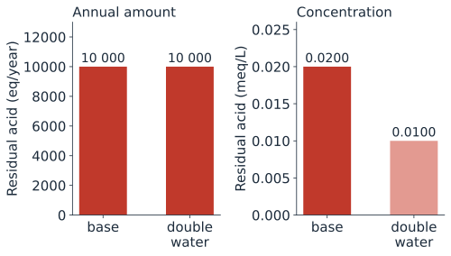{width="100%"}
:::
::: {.column width="45%"}
**Exercise 2:** double the water export to 1.00 × 10⁹ L/year, holding the acid amounts fixed.

- residual amount: still **10 000 eq/year**
- residual concentration: **0.0100 meq/L**

The concentration halved, but **nothing chemical changed**. That is dilution.

In a real catchment, more water also changes contact time, flow paths and weathering, so "everything else fixed" is an **assumption**.
:::
::::

::: notes
This is exercise 2, and it is the same lesson as load versus concentration in the waste lecture and the very first unit. A wet year can lower concentrations simply by spreading the same amount over more water. A dry year can do the opposite. If you compared only concentrations between two years, you might wrongly conclude that the catchment's chemistry had improved. The second caution is real hydrology. More water often means more flow through shallow soil layers and macropores, as in the soil lecture, which reduces contact with weathering minerals and exchange sites. Then the neutralisation term would also change. The demo at the end lets you compare these two cases directly.
:::

## Thread 4: when the balance tips, aluminium moves

:::: {.columns}
::: {.column width="50%"}
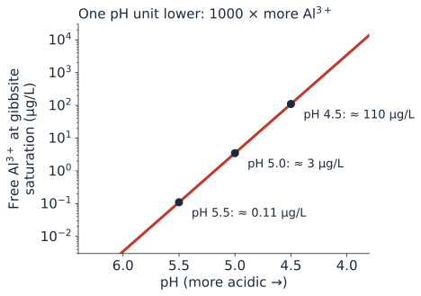{width="100%"}
:::
::: {.column width="50%"}
If acid input outruns neutralisation for long enough, alkalinity approaches **zero** and pH falls below about 5.5.

Then the soil's **aluminium buffer** takes over, and Al³⁺ leaves with the drainage water. Free Al³⁺ rises about **1000-fold per pH unit**.

The metals unit adds the next step: in **brown, humus-rich** water, organic ligands bind much of the aluminium, so the **free ion**, which harms fish gills, is lower than the total suggests.
:::
::::

::: notes
This links the budget to biology. As long as the residual acid is small compared with the reference alkalinity, the lake keeps a positive alkalinity and a pH where aluminium stays mostly in the soil. Once the balance tips, aluminium dissolves in the soil and is carried to the stream. The figure is the gibbsite model from the soil lecture. The metals unit showed why total aluminium is not the whole story. Dissolved organic matter complexes aluminium, so the toxic inorganic fraction in a brown lake can be much lower than in a clear one at the same pH. In Swedish acidified lakes, fish deaths correlated better with inorganic aluminium than with pH alone. Speciation again decides the effect.
:::

## Check yourself

::: {.checkbox}
1. Acid input 40 000 eq/year, neutralisation 35 000 eq/year, water 5.00 × 10⁸ L/year. Residual acid in meq/L?
2. With reference alkalinity 50 000 eq/year, what alkalinity export (meq/L) follows from question 1?
3. A lake's alkalinity export halves between a dry and a wet year, with the same deposition. Name two explanations and a measurement to tell them apart.
4. Can you state the lake's pH from your answer to question 2? What else would you need?
:::

::: notes
Answers. One: the residual is 5000 equivalents per year, divided by 5.00 times ten to the eight litres gives 1.00 times ten to the minus five equivalents per litre, 0.0100 meq per litre. Two: 50 000 minus 5000 is 45 000 equivalents per year, which is 0.0900 meq per litre. Three: either dilution only, with the same annual alkalinity amount in twice the water, or a real fall in the annual amount, for example because wet-year water bypassed the soil. Measure flow and calculate annual loads: if the load is unchanged, it was dilution. Four: no. You need the dissolved inorganic carbon or the carbon dioxide pressure, and any organic acids.
:::

## Thread 5: a separate set of observations

:::: {.columns}
::: {.column width="42%"}
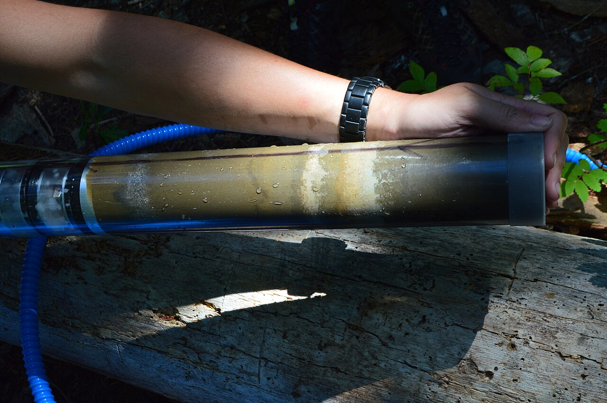{width="100%"}
[A lake sediment core, Forlorn Lakes, Washington, USA. Photo: Molly McKnight, US Forest Service, public domain, Wikimedia Commons.]{.credit}
:::
::: {.column width="58%"}
Now a **different question** in the same lake. Water just above the sediment is sampled before and during a period of **oxygen depletion** (constructed observations):

| Indicator | Before | During |
| --- | ---: | ---: |
| O₂ (mg/L) | 8.0 | 0.20 |
| filtered Fe (mg/L) | 0.020 | 1.00 |
| filtered PO₄-P (mg P/L) | 0.010 | 0.200 |

These are **observations**, not model outputs. What chemistry could explain them?
:::
::::

::: notes
Change gear. This is not part of the acid budget. It is a second, independent evidence set, so it needs its own boundary and its own explanation. Sediment cores like the one in the photo show layers of mineral and organic material deposited over years. Bacteria in the upper sediment consume oxygen while decomposing organic matter. In summer, when a lake is stratified, the bottom water is cut off from the atmosphere and its oxygen can run out. The numbers are invented for teaching but realistic in direction. Ask students to propose an explanation before showing the next slide. Most will recall the redox unit and suggest iron reduction. Then we test that idea.
:::

## What changed, and by how much

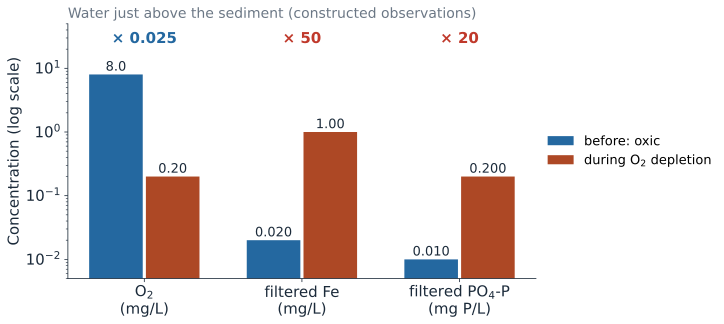{width="76%" fig-align="center"}

Oxygen fell **40-fold** while filtered iron rose **50-fold** and phosphate-P **20-fold**. All three changed **together**, in the same water, at the same time. That pattern is what a hypothesis has to explain.

::: notes
Plotting on a log scale lets us compare changes of very different size. Oxygen dropped from 8.0 to 0.20 milligrams per litre, a factor of 40. Iron rose by a factor of 50, and phosphate-P by 20. The co-occurrence is the key observation. Remind students what the redox ladder from the redox unit predicts. After oxygen is used up, microbes turn to nitrate, then to manganese and iron oxides, then to sulfate. Rising dissolved iron fits that sequence. But a coincidence in time does not prove a mechanism. Two separate processes could be triggered by the same event, or a different water mass could have moved in. We first write the mechanism, then look for alternatives.
:::

## A mechanism: iron reduction releases phosphate

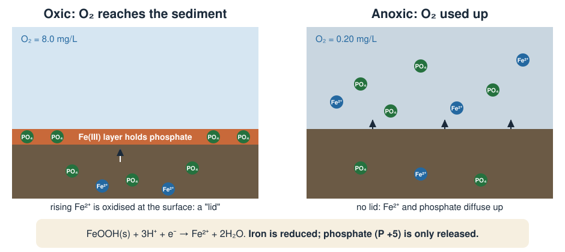{width="80%" fig-align="center"}

Under oxic conditions, an **Fe(III) oxyhydroxide** layer at the sediment surface holds phosphate. When O₂ runs out, Fe(III) is **reduced** and dissolves, and the phosphate it held is **released**. Phosphorus itself does not change oxidation state.

::: notes
This is the classic iron–phosphate mechanism from the redox unit. Phosphate binds strongly to iron(III) oxyhydroxide surfaces. While the bottom water has oxygen, any iron(II) diffusing up from deeper sediment is oxidised at the surface and forms a fresh iron(III) layer, which acts as a lid for phosphate. When oxygen is gone, microbes use the iron(III) as an electron acceptor. The half-reaction is in the box. The solid dissolves, and its phosphate is released. Stress the last line: phosphate is not reduced. It is a passenger. This is the same idea as the waste lecture's warning that metals held on iron hydroxide return when conditions change.
:::

## The same chemistry, on a sea-wide scale

:::: {.columns}
::: {.column width="55%"}
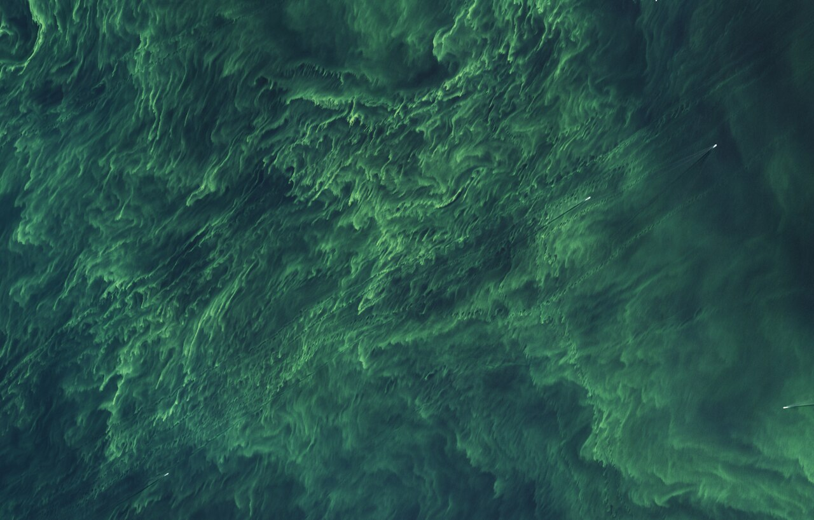{width="100%"}
[Cyanobacteria bloom in the Baltic Sea, July 2025, Landsat. Image: NASA Earth Observatory, public domain, Wikimedia Commons.]{.credit}
:::
::: {.column width="45%"}
The deep Baltic Sea has **large areas of oxygen-free bottom water**.

There, iron-bound phosphate is released from sediments, as in our lake. This **internal loading** adds to the phosphorus from rivers and helps sustain **summer cyanobacteria blooms** like this one.

Cutting nutrient inputs from land is necessary, but the sediments keep releasing phosphate for years. Recovery is slow for the same reason as at Hubbard Brook: a **stored inventory**.
:::
::::

::: notes
The Baltic is a large-scale version of our lake. Its deep basins are poorly ventilated because salty, dense water sits below fresher surface water, so oxygen-free bottoms are common and have expanded since the mid-twentieth century as nutrient inputs increased. Iron-bound phosphate released from those sediments contributes substantially to the phosphorus available for summer blooms of nitrogen-fixing cyanobacteria. Keep the numbers qualitative here; the point is the mechanism. Draw the parallel with the soil lecture. In both cases, decades of input built up a stored inventory, base-cation depletion in one case and phosphorus-rich sediments in the other, and that inventory delays recovery after the inputs are reduced.
:::

## Consistent is not proven

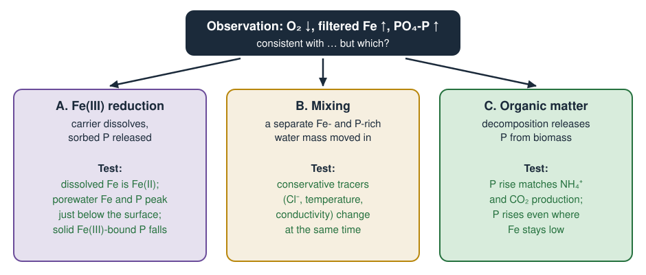{width="80%" fig-align="center"}

Our data are **consistent with** iron reduction, but they do not identify it uniquely. Each alternative predicts something different. A good explanation names the **measurement that would tell them apart**.

::: notes
This is exercise 3. The observations fit the iron reduction mechanism, but they also fit other explanations. Mixing: if a different water mass, for example porewater-rich water stirred up from deeper sediment, moved past the sampling point, iron and phosphate would rise together without any new reaction. Conservative tracers, such as chloride or temperature, would change at the same time. Organic matter decomposition releases phosphate from biomass directly; then phosphate would rise with ammonium and carbon dioxide, even where iron stays low. Supporting evidence for iron reduction includes iron(II) speciation, porewater profiles with peaks just below the surface, and a fall in iron-bound phosphorus in the solid. Several processes can act together.
:::

## Keep forms and units aligned

:::: {.columns}
::: {.column width="55%"}
- **Phosphate-P** is reported as mass of **phosphorus**. 0.200 mg P/L = 6.46 µmol/L = 0.613 mg PO₄³⁻/L. Mixing the two bases gives a factor-3 error.
- **Filtered Fe** is an **operational** fraction. It can include Fe(III) colloids and organic complexes, not just Fe²⁺.
- **eq/year** (budget), **meq/L** (concentration) and **pH** (state) are three different kinds of quantity.

Before you combine two numbers, check they refer to the **same water, time and fraction**.
:::
::: {.column width="45%"}
::: {.checkbox}
**Quick conversion check**

1.00 mg/L Fe ÷ 55.85 g/mol = **17.9 µmol/L**

0.200 mg P/L ÷ 30.97 g/mol = **6.46 µmol/L**

Molar ratio Fe : P released ≈ 18 : 6.5, about **3 : 1**. Does that fit the Fe : P ratio of the sediment's iron oxides? Only a solid-phase measurement can say.
:::
:::
::::

::: notes
These are the bookkeeping traps that ruin otherwise good arguments. Phosphorus is conventionally reported as phosphorus mass, so the phosphate ion mass is about three times larger. Always check which convention a dataset uses. Filtered iron passes through a filter, typically 0.45 micrometres, which lets through small colloids and organic complexes. It is not automatically dissolved iron(II), which is why a speciation measurement is part of the test. The molar ratio in the box is a useful habit: converting to moles lets you ask whether the amounts fit a proposed reaction. Whether three iron per phosphorus fits depends on how much phosphate the sediment's iron oxides actually held, which needs a solid-phase measurement. Also, some released iron(II) may be reoxidised or precipitate as sulfide before sampling. The ratio is a check, not a proof.
:::

## Thread 6: the contaminant in the same lake

:::: {.columns}
::: {.column width="55%"}
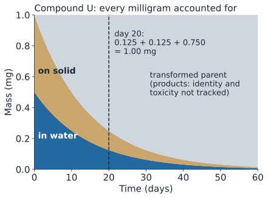{width="100%"}
:::
::: {.column width="45%"}
Activity C's compound U behaves like this in a closed water–sediment system: half sorbed (K~d~ = 100 L/kg), half-life 10 days.

In the real lake, this is a **separate argument** with its **own boundary**:

- outflow and inflow would add terms;
- if sorbed U is **buried**, it leaves the active system without being destroyed;
- anoxic sediment may change both K~d~ and the rate.

Keep the compound model and the budget in **separate sections** of your report.
:::
::::

::: notes
The contaminant model from activity C is the last thread. It describes a closed system with fixed Kd and one first-order rate, and it accounts for every milligram. In a real lake, the boundary is open. Water flows out, carrying dissolved parent. Sediment accumulates and buries sorbed parent, which removes it from contact with the water without transforming it. And the redox change we just discussed can change both sorption, for example if the compound was bound to iron oxides, and degradation rates. The report template asks students to keep the compound model and the catchment and sediment arguments in clearly identified sections, so a reader can see which numbers come from which model.
:::

## Anatomy of a chemical explanation

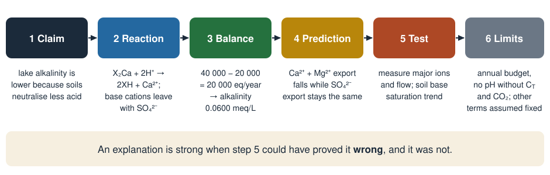{width="90%" fig-align="center"}

Every strong argument in this course had these six parts. The **test** is what makes it science: a measurement that **could have proved the claim wrong**. The **limits** say what the numbers do not show.

::: notes
This is the structure the integrated exercise and the exam expect. Walk through the example in the figure, which uses today's worked case. The claim is a sentence a non-chemist could understand. The reaction chain shows how it happens. The balance gives a number, here 0.0600 meq per litre. The prediction says what else must be true if the claim holds; here, base-cation export should fall while sulfate stays the same. The test names a measurement that could contradict the prediction. And the limits state the boundaries: an annual budget, no pH without carbon data, other terms held fixed. Students should be able to fill these six boxes for any unit in the course.
:::

## Back to Sweden: what happened next

:::: {.columns}
::: {.column width="45%"}
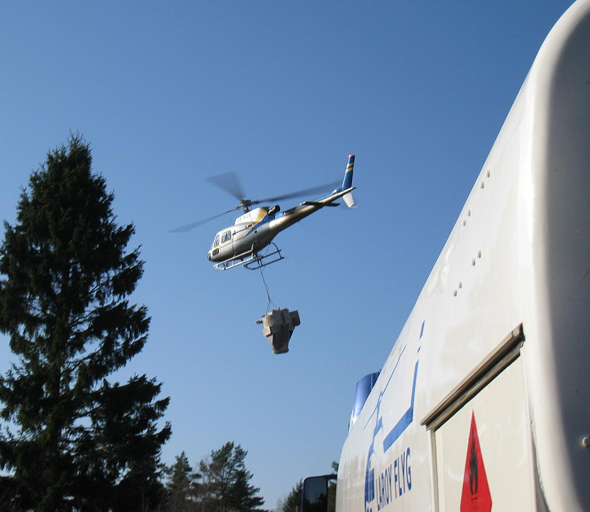{width="100%"}
[Liming by helicopter, Kungsbacka, Sweden. Photo: Bulver, CC BY-SA 3.0, Wikimedia Commons.]{.credit}
:::
::: {.column width="55%"}
The 1972 argument was eventually accepted. International agreements cut sulfur emissions across Europe, and **sulfur deposition over Sweden has fallen to a small fraction** of its 1980s peak.

Many lakes are recovering, but **slowly**:

- soils must rebuild **exchangeable base cations** by weathering;
- forestry removes base cations in harvested wood;
- thousands of lakes are still **limed** to bridge the gap.

The chemistry of every unit was needed to understand both the damage and the slow recovery.
:::
::::

::: notes
Close the historical loop. Following the 1979 convention and later protocols, sulfur emissions in Europe fell dramatically, and sulfur deposition in Sweden is now far below its peak. Lake chemistry has responded: sulfate concentrations fell and alkalinity rose in many lakes. But recovery is slower than the cut in deposition, for the reasons this course has developed. Soil exchange sites lost base cations and refill slowly. Whole-tree harvesting removes additional base cations. Nitrogen deposition remains. Liming continues in many sensitive waters, as shown in the carbonate lecture. Students should see that the course's chemistry is not abstract: it was the evidence base for one of Europe's most successful environmental agreements.
:::

## Preparing for the exam

::: {.checkbox}
For any synthesis question, work through the same steps:

1. **Draw the boundary.** Which water, solid or air volume, and over what time?
2. **List the quantities** and their kind: amount, flux, concentration, state.
3. **Write the reactions** and check element and charge balance.
4. **Close the budget** in amounts or equivalents before converting.
5. **Separate** model predictions, constructed data and real observations.
6. **Name an alternative** explanation and the measurement that would distinguish it.
7. **State the limits**: what your numbers cannot tell you.
:::

[Course overview and unit list](../overview.qmd) · [Integrated exercises](exercise.qmd) · [Activity C report template](../organic-contaminants/fate-report.Rmd)

::: notes
Give students a reusable procedure. These seven steps condense the habits from all units. Drawing the boundary first prevents most errors in this course: mixing an annual budget with a closed-water pulse, or a water concentration with a total inventory. Listing quantities by kind catches unit errors. Balancing reactions catches stoichiometry errors, like forgetting the second pair of hydrogen ions from pyrite. Closing budgets in amounts first avoids dilution traps. Separating model output from observations is required in the report. Naming an alternative and a test is what distinguishes an explanation from a story. And stating limits shows understanding, not weakness. Encourage students to practise on each unit's exercises.
:::

## Common mistakes to avoid

- **"0.0200 meq/L of residual acid gives pH X."** Not without C~T~, CO₂ and other acids.
- **"Lower concentration this year, so less acid."** Check the annual amount: dilution is not chemistry.
- **"Neutralisation is a fixed property of the catchment."** It draws on finite inventories that change.
- **"Fe and P rose together, so iron reduction released P."** Consistent is not proven; test alternatives.
- **"Phosphate-P and phosphate are the same number."** Factor of about 3.
- **"One model covers the whole lake."** The budget, the sediment and the contaminant need separate boundaries.

::: notes
These mistakes collect the course's main traps in their synthesis form. Ask students which unit each mistake comes from. The first comes from the carbonate unit: pH needs more than alkalinity. The second from the very first unit and the waste lecture: concentration is not load. The third from soils: inventories are finite. The fourth from redox, sharpened today: a pattern is not a mechanism. The fifth from units and forms, and the sixth from activity C: models have boundaries. If students can explain each correction with a number or a reaction, they are well prepared. Then use the interactive demo to check the budget reasoning one more time.
:::

## Explore: catchment acid budget {#explore}

```{=html}
<link rel="stylesheet" href="../demos/demo.css">
<div data-demo="catchment" role="group" aria-label="Catchment acid budget">
<p>Compare less neutralisation with double water export. Which annual quantities change?</p>
</div>
<script src="../demos/core.js"></script>
<script src="../demos/catchment.js"></script>
```

[Compare less neutralisation with double water export. Which annual quantities change?](exercise.qmd#explore)

::: notes
Use the reference presets, then change one variable. The complete exercise has
model assumptions, a hand-check result, and a static reference for printing.
:::

## Summary {.smaller}

| Thread | Key fact |
| --- | --- |
| Deposition | 0.0200 HNO₃ + 2 × 0.0100 H₂SO₄ = 0.0400 eq m⁻² yr⁻¹ → 40 000 eq/year |
| Soils | neutralise 30 000 eq/year from finite inventories; base cations leave with SO₄²⁻ |
| Budget | residual 10 000 eq/year ÷ 5.00 × 10⁸ L/year = 0.0200 meq/L |
| Alkalinity | needs a reference: 50 000 − 10 000 = 40 000 eq/year = 0.0800 meq/L |
| pH | not fixed by alkalinity: needs C~T~ or CO₂ pressure (≈ 7.1 vs 6.1 here) |
| Sensitivity | 20 000 neutralised → 0.0600 meq/L; double water → dilution only |
| Metals | below pH ≈ 5.5, Al³⁺ rises steeply; organic ligands lower the free ion |
| Sediment | O₂ ↓ 40×, Fe ↑ 50×, PO₄-P ↑ 20×: consistent with Fe(III) reduction, not proof |
| Mechanism | FeOOH + 3H⁺ + e⁻ → Fe²⁺ + 2H₂O; phosphate released, not reduced |
| Explanation | claim, reaction, balance, prediction, test, limits |

**Next:** the [course overview](../overview.qmd) for exam preparation: revisit each unit's summary slide and exercises. Then the [integrated exercises](exercise.qmd), the [notes](notes.qmd) and the [activity C report](../organic-contaminants/exercise.qmd#activity-c-a-fate-model-in-r).

::: notes
This is the last summary of the course, so recite the whole chain. Emissions become acid deposition, counted in equivalents. Soils neutralise most of it from finite inventories, so their capacity can decline. The residual, divided by water export, lowers the lake's alkalinity relative to a stated reference, but pH needs carbon dioxide and dissolved carbon too. If the balance tips, aluminium moves. A separate sediment observation set is consistent with iron reduction releasing phosphate, and the Baltic shows the same chemistry at sea scale. Every step needs a boundary, a balance and a test. For revision, use the overview page: each unit's summary table and exercises cover the facts this synthesis relied on.
:::
