## About this lecture

:::: {.columns}
::: {.column width="56%"}
When acid rain fell on southern Scandinavia, **brown trout and salmon disappeared from many lakes and rivers**. Researchers found that the acid itself was often not the main killer. The fish died from **aluminium**, washed out of the soil by the acid.

Yet in brown, humic lakes with the same pH and the same aluminium, fish often survived.

Today you will learn to:

- see that a **dissolved total is not the free ion**;
- describe **complexation** and **hydrolysis**, and tell them apart from redox;
- use a **one-ligand model** to find the free metal;
- test **mineral saturation** with the free ion, not the total.

Last lecture showed that dissolved organic matter carries binding groups. Today we use them.
:::
::: {.column width="44%"}
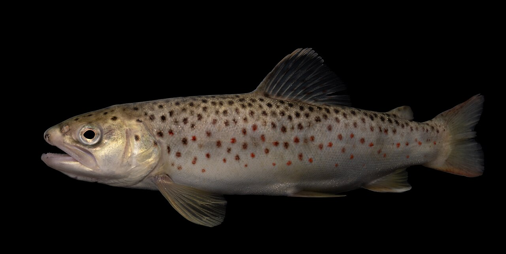{width="100%"}
[Brown trout (*Salmo trutta*), a species lost from many acidified Scandinavian lakes. Photo: Sam Stukel, USFWS, public domain, Wikimedia Commons.]{.credit}
:::
::::

::: notes
Start with the story. In the acid-rain decades, fish populations collapsed across southern Norway and Sweden. Field and laboratory work showed that aluminium, mobilised from soils by the acid, was a main cause of fish death, often more important than the low pH itself. Then add the twist that makes this a speciation lecture: in brown, humic lakes, fish often survived at the same pH and the same measured aluminium. The total was the same, so something else differed. That something is the chemical form of the metal. Remind students that the previous lecture introduced dissolved organic matter and its carboxyl and phenol groups. Today those groups become ligands.
:::

## Same total, different danger

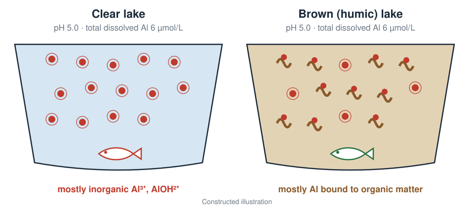{width="80%" fig-align="center"}

Two **constructed** lakes have the same pH (5.0) and the same total dissolved aluminium. In the clear lake, most aluminium is present as small inorganic ions. In the brown lake, most is held by **dissolved organic matter**.

**Question for this lecture:** how can the same total hide such different chemistry, and how do we calculate the part that matters?

::: notes
Present this as the puzzle that the rest of the lecture solves. The numbers are constructed but realistic: an acidified lake at pH 5 can carry several micromoles per litre of aluminium. Both lakes would give the same number on a standard laboratory report of filtered aluminium. The difference is what the aluminium is bound to. In the clear lake, the aluminium is mostly the hydrated ion and its first hydrolysis products. In the brown lake, organic matter binds most of it. Ask students to predict which lake is more dangerous for fish, and why. Most will guess correctly. The task today is to make that intuition quantitative.
:::

## What does "dissolved metal" contain?

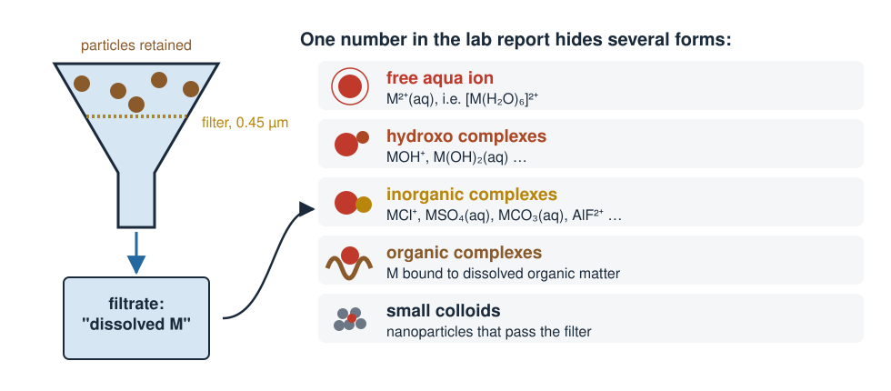{width="88%" fig-align="center"}

"Dissolved" usually means **whatever passes a 0.45 µm filter**. It is an operational definition. The filtrate holds the free ion, several kinds of complexes and even small colloids. One number sums them all.

::: notes
Walk through the figure from left to right. The laboratory filters the sample, often through 0.45 micrometres, and reports everything in the filtrate as dissolved. That number is useful for mass balances. It does not tell you which species are present. The free aqua ion, hydroxo complexes, inorganic complexes with chloride, sulfate, carbonate or fluoride, complexes with organic matter, and nanoparticles small enough to pass the filter all count. For aluminium in acid waters, fluoride and organic complexes are important. When you read a metal concentration in a report, ask: which fraction is this, and which species might it contain? The rest of the lecture gives you tools to estimate the split.
:::

## A metal ion in water is already a complex

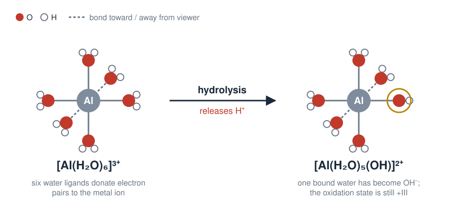{width="74%" fig-align="center"}

A dissolved Al³⁺ ion is surrounded by **six water molecules**. Each donates an electron pair to the metal: the waters are **ligands**, the whole unit is a **complex**. Another ligand can **replace** a water (complexation), or a bound water can **lose H⁺** (hydrolysis). In both cases aluminium stays at +III.

::: notes
This picture is the foundation of the lecture. Writing Al3+ is shorthand. In water the ion is really hexaaqua-aluminium, with six water molecules arranged around it in an octahedron. The metal is an electron-pair acceptor, the water molecules are electron-pair donors. Two things can now happen. Another ligand, such as fluoride or a carboxylate group, can push out a water: complexation. Or a bound water can give up a proton to the solution, leaving a hydroxide ligand on the metal: hydrolysis. The highly charged metal pulls electron density from the water, which makes its protons easier to lose. Neither change involves electron transfer to or from the metal.
:::

## Ligands that compete with water

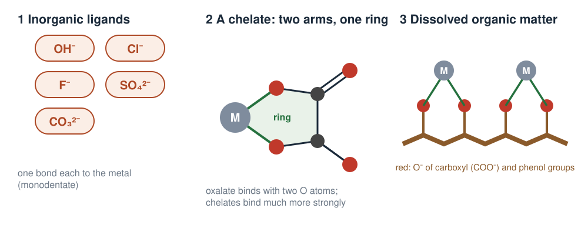{width="92%" fig-align="center"}

Natural waters offer **inorganic ligands** that bind with one atom, and **organic ligands** that can bind with two or more. A ligand that grips the metal with two arms forms a ring, a **chelate**. Chelates usually bind much more strongly. Dissolved organic matter carries many such groups.

::: notes
Give the cast of ligands. Hydroxide, chloride, fluoride, sulfate and carbonate are common inorganic ligands. Each binds through one atom. Oxalate is a small organic example that binds through two oxygen atoms and closes a five-membered ring with the metal. That ring makes the complex much more stable, which is called the chelate effect. Humic and fulvic substances, the bulk of dissolved organic matter, carry many carboxyl and phenol groups. Pairs of neighbouring groups can act like chelating ligands. Their binding depends on pH, because the groups must lose their protons before they bind well, and on competition from other metals such as calcium. This is why the brown lake could hold most of its aluminium.
:::

## Four ways a metal changes form

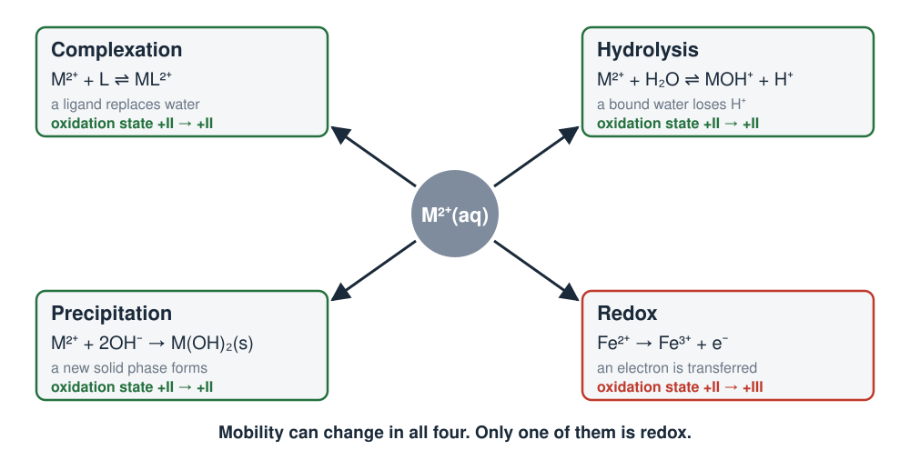{width="74%" fig-align="center"}

Complexation, hydrolysis and precipitation all **keep the oxidation state**. Only redox moves electrons. Each process can change how mobile a metal is, so a change in mobility is **not** evidence of redox by itself.

::: notes
Students often call every change in a metal "oxidation" or "reaction". Separate four processes clearly. Complexation exchanges ligands. Hydrolysis is a special case where water itself becomes hydroxide by losing a proton. Precipitation forms a new solid phase. Redox transfers electrons and changes the oxidation state, as when iron(II) becomes iron(III). Only the last one changes the oxidation state, but all four can change whether a metal travels with water. Sorption to surfaces, the topic of the next lecture, is a fifth process that also keeps the oxidation state. When you explain a field observation, name the process and check whether an oxidation state actually changed.
:::

## A one-ligand model

:::: {.columns}
::: {.column width="45%"}
For one complex, $\mathrm{M+L\rightleftharpoons ML}$:

$$\beta=\frac{[\mathrm{ML}]}{[\mathrm{M}][\mathrm{L}]}$$

The metal balance is $M_T=[\mathrm{M}]+[\mathrm{ML}]=[\mathrm{M}](1+\beta[\mathrm{L}])$, so

$$[\mathrm{M}]=\frac{M_T}{1+\beta[\mathrm{L}]}$$

Here [L] is the **free** ligand. The product β[L] decides the split: at β[L] = 1, half the metal is free.
:::
::: {.column width="55%"}
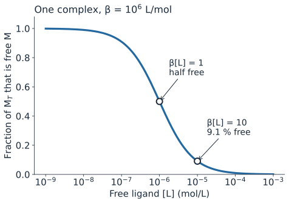{width="100%"}
:::
::::

::: notes
This is the one calculation model of the lecture. We keep only two metal species, the free ion M and one complex ML. The constant beta has units of litres per mole, so beta times the free ligand concentration is dimensionless. Write the mass balance for the metal, factor out the free metal, and divide. The curve shows the free fraction, one divided by one plus beta L, against free ligand on a log axis. Point out the midpoint at beta L equal to one, and that one more factor of ten in ligand leaves only about nine percent free. The constants are concentration-based teaching values; activity corrections are ignored in dilute water.
:::

## Worked example: how much metal is free?

:::: {.columns}
::: {.column width="50%"}
A fictitious metal: M~T~ = 2.00 µmol/L, β = 1.00 × 10⁶ L/mol, free ligand [L] = 1.00 × 10⁻⁵ mol/L.

1. β[L] = 10⁶ × 10⁻⁵ = **10.0**
2. [M] = 2.00 / (1 + 10.0) = **0.1818 µmol/L**
3. [ML] = 2.00 − 0.1818 = **1.818 µmol/L**

Check: 0.1818 + 1.818 = 2.00. Nothing was lost.

With ten times less ligand, β[L] = 1.00 and the metal splits **1.00 : 1.00**.
:::
::: {.column width="50%"}
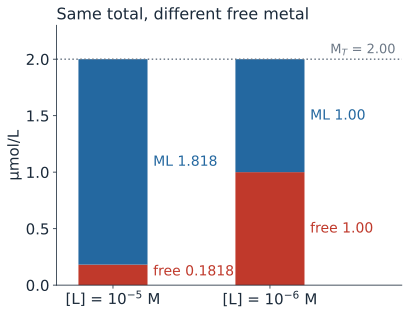{width="100%"}
:::
::::

::: notes
Do the calculation slowly with the class. First form the dimensionless product: ten. Then divide the total by eleven to get the free metal, 0.1818 micromoles per litre. The complex is the rest. Always close the balance: free plus complexed must return the total you started with. The right-hand bar is exercise 1: reduce the free ligand tenfold and the product becomes one, so the metal is split evenly. The total metal is identical in both bars, but the free metal differs by a factor of five and a half. Connect this to the opening: a laboratory total of two micromoles per litre would look the same in both cases.
:::

## Check the ligand before you trust the answer

:::: {.columns}
::: {.column width="48%"}
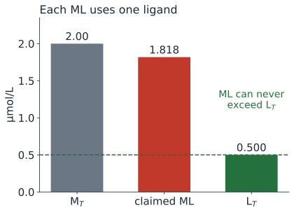{width="100%"}
:::
::: {.column width="52%"}
The model asks for **free** ligand. That is safe only if the ligand is in large excess, so binding hardly uses it up.

Suppose total ligand L~T~ is only 0.500 µmol/L. A claim of 1.818 µmol/L ML is then **impossible**: each ML uses one ligand. At most 0.500 µmol/L can be complexed, and at least 1.50 µmol/L of metal stays outside ML.

When ligand is scarce, write a second balance, $L_T=[\mathrm{L}]+[\mathrm{ML}]$, and solve both together.
:::
::::

::: notes
This is exercise 2 and an important habit. The simple formula hides an approximation: it treats the free ligand concentration as known and fixed. That works when ligand is plentiful compared with the metal, for example organic matter in a brown lake. When the ligand is scarce, the complex uses it up and the free ligand falls. A quick bookkeeping check catches the error. Every complex contains one ligand, so the complex can never exceed the total ligand. If someone substitutes the total ligand for the free ligand without checking, they can overestimate binding. Solving the coupled balances exactly is beyond today, but recognising the impossible answer is required.
:::

## Hydrolysis makes metal ions acids

:::: {.columns}
::: {.column width="50%"}
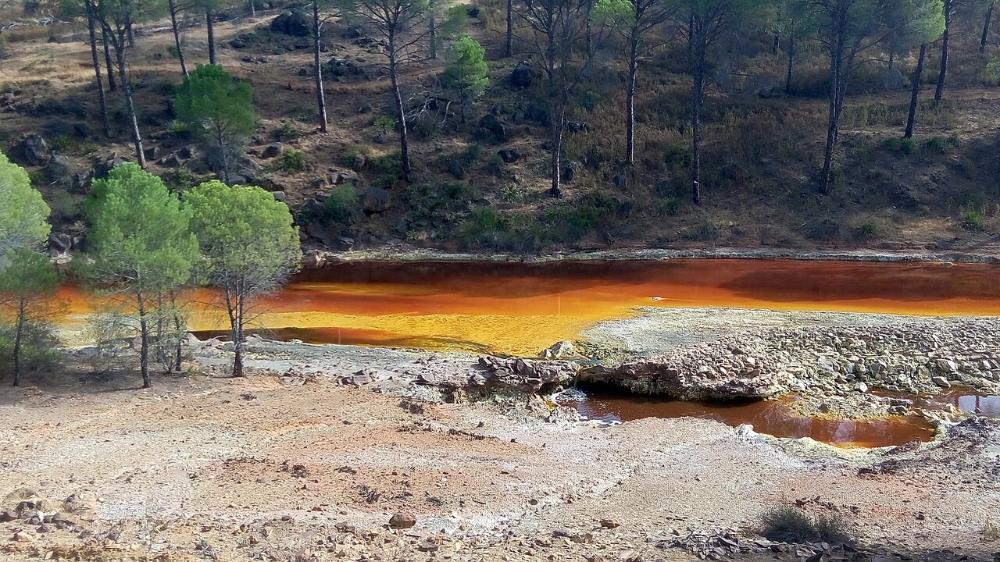{width="100%"}
[Río Tinto, Huelva, Spain. Photo: David Mata Verdejo, CC BY-SA 4.0, Wikimedia Commons.]{.credit}
:::
::: {.column width="50%"}
$$\mathrm{[Al(H_2O)_6]^{3+}\rightleftharpoons[Al(H_2O)_5OH]^{2+}+H^+}$$

The more charged and smaller the ion, the more strongly it pulls on its water, and the easier the proton leaves. For Al³⁺ the pK~a~ is about 5. For Fe³⁺ it is about 2.

Spain's **Río Tinto** drains sulfide ores that have been mined for thousands of years. Its water has a pH near 2 and carries iron(III), whose hydrolysis products colour the river red.
:::
::::

::: notes
Hydrolysis means a metal ion behaves like a weak acid. Hexaaqua-aluminium has a first acid constant near ten to the minus five, similar to acetic acid. Iron(III) is a much stronger acid, with a pK near 2. This explains two everyday observations. Solutions of iron(III) or aluminium salts are acidic, which matters again in the water-treatment lecture, when we add these salts as coagulants. And when acidic, iron-rich water meets less acidic conditions, iron hydrolyses further and precipitates as red and orange oxyhydroxides. The Río Tinto is an extreme natural and mining-affected example, with very low pH. The colours are iron(III) species and their precipitates. Notice that hydrolysis releases protons: the water becomes more acidic as the metal hydrolyses.
:::

## Why acid water carries so much aluminium

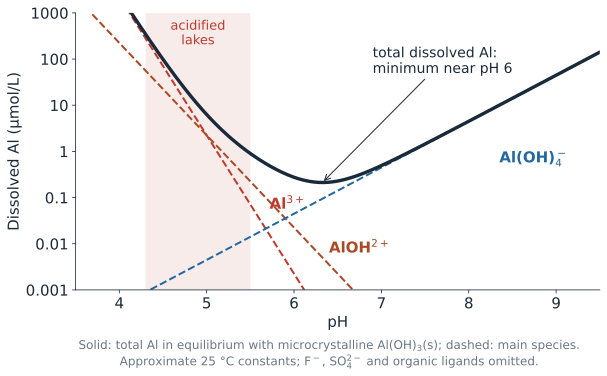{width="78%" fig-align="center"}

In equilibrium with solid Al(OH)₃, dissolved aluminium is lowest near **pH 6**. Below that, every pH unit raises Al³⁺ a **thousandfold**, because the solid takes up three H⁺. In this model, pH 5 water holds about **thirty times** more Al than at the minimum.

::: notes
This is the key aluminium figure. Dissolving aluminium hydroxide uses three protons per aluminium, so the free Al3+ concentration in equilibrium with the solid rises by a factor of one thousand for each unit drop in pH. That is the steep red line. At high pH the solid dissolves instead as the aluminate anion. The total, the black curve, has a minimum near pH 6. The constants are approximate, and real soils hold aluminium in several solids and on clay exchange sites, so read the shape rather than exact numbers. The message for the lakes is clear. Acidification from pH 6.5 to 5 moves the water from the bottom of the curve onto the steep acid branch. Aluminium that stayed in the soil now comes out with the water.
:::

## Test saturation with the free ion

:::: {.columns}
::: {.column width="58%"}
For a fictitious hydroxide, $\mathrm{M(OH)_2(s)\rightleftharpoons M^{2+}+2OH^-}$:

$$[\mathrm{M^{2+}}]_{sat}=\frac{K_{sp}}{[\mathrm{OH^-}]^2}$$

With K~sp~ = 1.00 × 10⁻¹⁶ and pH 9 ([OH⁻] = 10⁻⁵ mol/L): [M²⁺]~sat~ = **1.00 µmol/L**.

A water holds **10.0 µmol/L** total with β[L] = 9.00. Free M = 10.0 / 10.0 = **1.00 µmol/L**: exactly saturated.

Using the total would wrongly suggest a **tenfold** excess.
:::
::: {.column width="42%"}
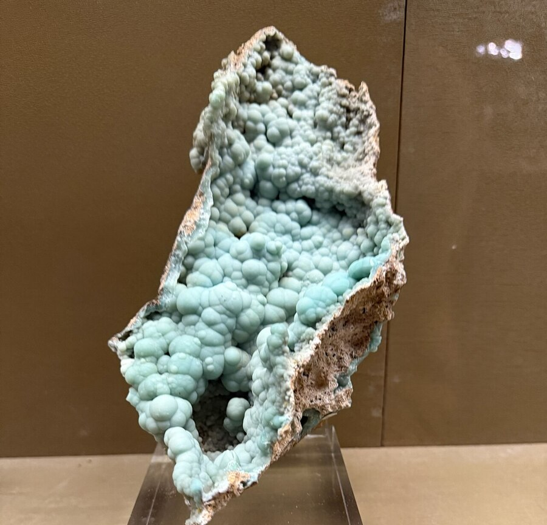{width="100%"}
[Gibbsite, Al(OH)₃, the natural aluminium hydroxide mineral (museum specimen). Photo: TheUltimateGrass, CC0, Wikimedia Commons.]{.credit}
:::
::::

::: notes
This is exercise 3. The solubility product only contains free ions, because only free M2+ and hydroxide take part in the equilibrium with the solid. Complexed metal is dissolved, but it is not M2+. First compute the free saturation concentration: ten to the minus sixteen divided by ten to the minus ten gives one micromole per litre. Then compute the free metal in the sample from the binding model. Ten divided by one plus nine is one, so the water is exactly at saturation. If you had compared the total, ten, with the saturation value, you would have predicted heavy precipitation that does not happen. The photo shows gibbsite, the real mineral form of aluminium hydroxide.
:::

## Complexation raises the dissolved total

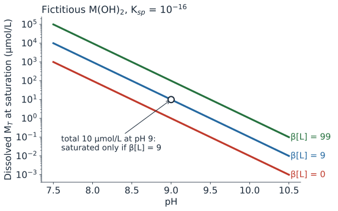{width="64%" fig-align="center"}

At saturation the **free** ion is fixed by K~sp~ and pH. Each line adds complexed metal on top: dissolved total = [M²⁺]~sat~ × (1 + β[L]). A strong ligand lets far more metal stay in solution beside the same solid.

::: notes
Turn the previous result into a general picture. For each pH, the solid fixes the free ion. The complex adds more dissolved metal in proportion to beta L. With beta L equal to 99, the water can hold one hundred times more metal in solution than without ligand, even though the free ion is the same. This is why organic-rich waters often carry high dissolved iron and aluminium. It also explains why the brown lake can have the same total aluminium as the clear lake while having much less free aluminium. The lines fall steeply with pH because hydroxide is squared. The figure ignores hydrolysis and precipitation kinetics; it compares equilibrium states only.
:::

## Check yourself

::: {.checkbox}
Use the one-ligand model and the saturation rule.

1. M~T~ = 5.0 µmol/L and β[L] = 4.0. What are free M and ML?
2. A report says "dissolved copper 3 µg/L". Name three forms that could make up this number.
3. Iron changes from a dissolved complex to a solid hydroxide. Is this redox?
4. Two waters at pH 9 contain 10 µmol/L total M. One has β[L] = 0, the other β[L] = 9. Which is supersaturated with M(OH)₂?
:::

::: notes
Answers. One: free M is 5 divided by 5, so 1.0 micromole per litre, and ML is 4.0. Two: any three of the free aqua ion, hydroxo or carbonate complexes, organic complexes, and small colloids that pass the filter. Three: not necessarily. If iron stays iron(III), this is precipitation, not redox. Only if the oxidation state changes is it redox. Four: the water without ligand. Its free metal is 10 micromoles per litre, ten times the saturation value of one. The other water has a free metal of exactly one, so it is just saturated. Ask students to say which numbers they needed for each answer.
:::

## Back to the lakes: how aluminium harms fish

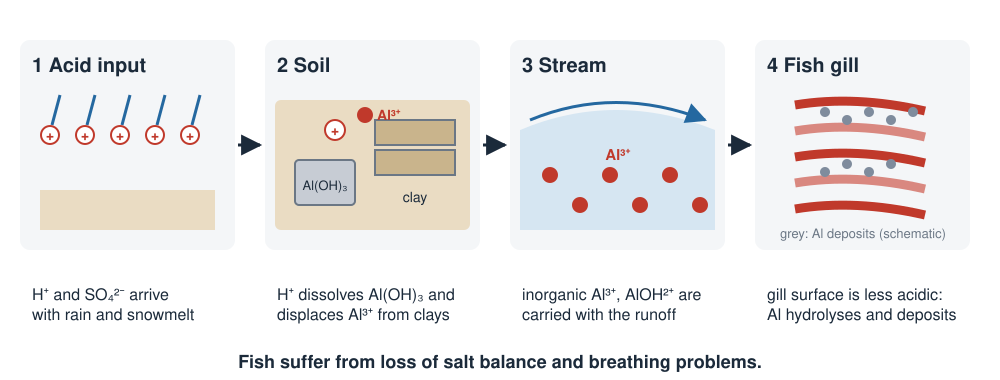{width="88%" fig-align="center"}

Acid input dissolves aluminium from soil minerals and clays. Runoff carries **inorganic Al** to the stream. At the fish gill the water is less acidic, so aluminium hydrolyses and **deposits on the gill surface**, disturbing salt balance and breathing.

::: notes
Now we can explain the opening story. Acid deposition supplies protons to the soil. They dissolve aluminium hydroxides and exchange aluminium off clay minerals, exactly the steep branch of the solubility curve. Runoff delivers inorganic aluminium to streams and lakes, often in pulses during snowmelt. The gill is the critical site. The fish's gill surface has a different, typically higher pH than the acidic water, so the inorganic aluminium hydrolyses and polymerises right there and binds to the gill. Fish then lose control of their salt balance and have trouble taking up oxygen. Speak of a main mechanism rather than the only one; low pH itself also stresses fish. Aluminium bound to organic matter is far less able to do this.
:::

## Why the brown lake was safer

:::: {.columns}
::: {.column width="50%"}
Return to the two lakes. Use the model with the lake numbers, treating organic matter as one ligand with β[L] ≈ 10 (constructed):

- clear lake: β[L] ≈ 0, so nearly **all 6 µmol/L** Al is inorganic;
- brown lake: free fraction = 1/11, about **0.5 µmol/L** inorganic Al.

Same total, about **ten times less** of the harmful form.

Biological effect also depends on the organism, calcium and other ions. The model compares chemistry, not risk.
:::
::: {.column width="50%"}
{width="100%"}
:::
::::

::: notes
Close the loop with the same model we used for the fictitious metal. Treat organic matter as a single ligand with beta L of about ten; that is a constructed value chosen to show the effect, not a measured constant for humic aluminium. In the clear lake there is almost no organic ligand, so the six micromoles per litre are essentially all inorganic. In the brown lake one eleventh remains inorganic, about half a micromole per litre. The figure shows where each lake sits on the free-fraction curve. Stress the limits. Real toxicity depends on calcium, which protects gills, on fish species and life stage, and on fluoride and other complexes. The model ranks the lakes chemically; it does not predict how many fish die.
:::

## A filtered metal rises as pH falls

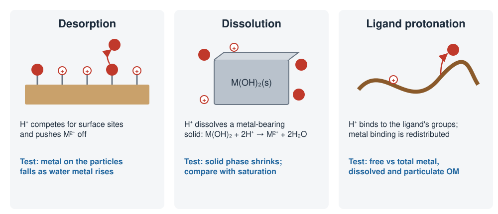{width="86%" fig-align="center"}

The oxidation state stays the same, so redox is not needed. Acid can **desorb** metal from particles, **dissolve** a metal-bearing solid, or **protonate a ligand** and shift the binding. Each mechanism predicts a different measurement.

::: notes
This is exercise 4 and a typical exam question. Students should first rule out the assumption that something was oxidised or reduced, because the oxidation state was measured and stayed the same. Then list mechanisms that do not involve electron transfer. Protons compete with metal ions for surface sites, so acid pushes metal off particles. Protons dissolve hydroxides and carbonates, as in the aluminium curve. Protons also bind to the carboxyl and phenol groups of organic ligands, which weakens their hold on the metal. A good answer names a test for each: metal on the particles, the solid phase, and free versus total metal together with organic carbon. Correlation with pH alone cannot tell the three apart.
:::

## Metals from mines: a Swedish legacy

:::: {.columns}
::: {.column width="52%"}
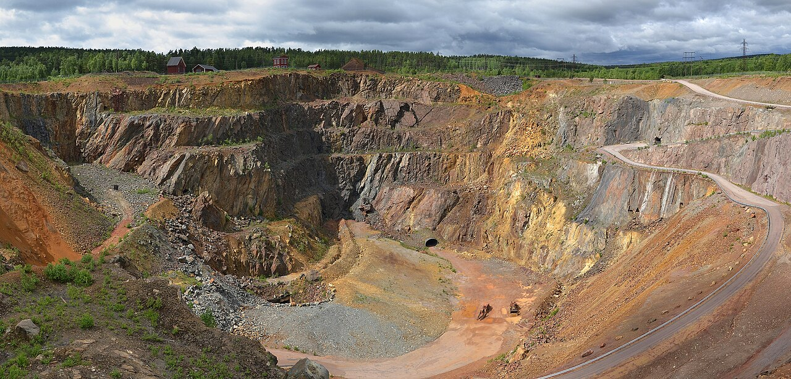{width="100%"}
[Stora Stöten, the great pit of the Falun copper mine, Sweden. Photo: Pudelek, CC BY-SA 4.0, Wikimedia Commons.]{.credit}
:::
::: {.column width="48%"}
Copper was mined at **Falun** for about a thousand years. Today the mine is a World Heritage Site.

When sulfide ore meets air and water, it oxidises and releases **acid and dissolved metals**. Downstream, as the water is neutralised, iron and aluminium **hydrolyse and precipitate** as orange and white solids.

Those fresh solids have large, reactive surfaces that bind copper, zinc and lead. That is the next lecture.
:::
::::

::: notes
Bring the chemistry home to Sweden. The Falun mine produced much of Europe's copper in the seventeenth century, and its waste rock and slag still release metals to local waters. The red Falu paint used on Swedish houses is made from iron-rich mine residues, a reminder of how much iron oxide such sites produce. The chain is the same as in the Río Tinto. Oxidation of sulfide minerals produces sulfuric acid, which keeps metals dissolved. As the drainage mixes with other water, the pH rises, iron and aluminium hydrolyse, and their hydroxides precipitate. Those precipitates bind other metals on their surfaces, which can retain them or carry them downstream. Note that sulfide oxidation is redox, but the precipitation that follows is not.
:::

## Common mistakes to avoid

- **"Dissolved means free."** A filtered total includes complexes and small colloids.
- **"The metal changed form, so it was oxidised."** Complexation, hydrolysis and precipitation keep the oxidation state.
- **"Put total ligand into β[L]."** The model needs free ligand; check that ligand is in excess.
- **"Compare the total with K~sp~."** Saturation is tested with the free ion.
- **"Bound metal is harmless."** A dissolved complex can still travel, and it can release metal if conditions change.
- **"A free-ion calculation predicts toxicity."** It compares chemistry; biological effect needs more information.

::: notes
These are the errors seen most often in exercises on this topic. Go through them and ask students to explain each correction in their own words, ideally with an example from today. The second one is the most persistent: students see colour changes or precipitates and call them oxidation. The fifth is subtle. Complexation can lower the free ion and reduce immediate toxicity, but a mobile complex can carry metal far downstream, where a change in pH or competition can release it again. The last reminds us that the free-ion idea is a good chemical guide, but toxicity depends on the organism, on competing ions such as calcium, and on exposure time.
:::

## Explore: metal binding and saturation {#explore}

```{=html}
<link rel="stylesheet" href="../demos/demo.css">
<div data-demo="metals" role="group" aria-label="Metal binding and saturation">
<p>Compare the exactly saturated case with the same total and no ligand.</p>
</div>
<script src="../demos/core.js"></script>
<script src="../demos/metals.js"></script>
```

[Compare the exactly saturated case with the same total and no ligand.](exercise.qmd#explore)

::: notes
Use the reference presets, then change one variable. The complete exercise has
model assumptions, a hand-check result, and a static reference for printing.
:::

## Summary {.smaller}

:::: {.columns}
::: {.column width="70%"}
| Concept | Key fact |
| --- | --- |
| Dissolved total | operational (filter); includes free ion, complexes, small colloids |
| Aqua ion | a metal ion in water is a complex with water ligands |
| Complexation | ligand replaces water; oxidation state unchanged |
| Chelate | ligand with two or more binding atoms; binds more strongly |
| One-ligand model | $[\mathrm{M}]=M_T/(1+\beta[\mathrm{L}])$, with **free** L in excess |
| Ligand check | ML can never exceed L~T~ |
| Hydrolysis | bound water loses H⁺; Al³⁺ pK~a~ ≈ 5, Fe³⁺ ≈ 2 |
| Al solubility | lowest near pH 6; rises steeply in acid water |
| Saturation | compare the **free** ion with K~sp~/[OH⁻]² |
| Acid lakes | inorganic Al harms fish gills; organic binding lowers it |

**Next:** [Colloids, surfaces, and sorption](../surfaces/lec.qmd). Where do metals go when they leave the water? Then the [exercises](exercise.qmd) and the [notes](notes.qmd).
:::
::: {.column width="30%"}
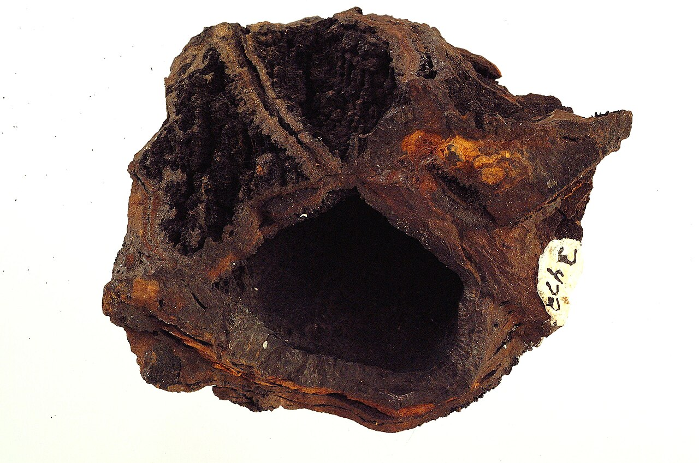{width="100%"}
[Iron oxyhydroxides (limonite and goethite). Photo: Darla Sondrol, CC0, Wikimedia Commons.]{.credit}
:::
::::

::: notes
The table is the revision sheet. Read the chain once more. A dissolved total is a sum of forms. The free ion is the part that takes part in mineral equilibria and that many organisms respond to most directly. Ligands, including dissolved organic matter, lower the free ion while keeping metal in solution. Hydrolysis and acidity control aluminium and iron. For the acid lakes, low pH released inorganic aluminium, and organic matter offered protection. The teaser photo shows iron oxyhydroxides, the orange solids that form when iron hydrolyses. Their surfaces bind metals, phosphate and organic molecules. The next lecture asks whether a metal that leaves the water has been removed, or has only moved onto a particle.
:::
