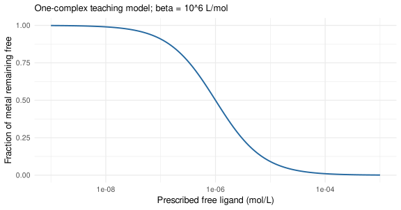

What does a dissolved metal total conceal, and how can complexation change solubility without changing the metal oxidation state?

Read these notes with the [lecture](lec.qmd), then complete the
[exercises](exercise.qmd). Numerical examples are constructed teaching cases
unless explicitly described otherwise.

## Learning goals

- Use a one-ligand equilibrium with an explicit free-ligand approximation.
- Distinguish complexation, hydrolysis, precipitation, and redox.
- Check a free-ion solubility condition before interpreting a metal total.

## Specify the species

A dissolved metal may be a hydrated ion, a hydrolysis product, a ligand complex, or an operationally included small colloid. A species balance sums forms of the same element. Complexation changes coordination and can change charge; it does not require electron transfer. Fe(II) to Fe(III), in contrast, changes oxidation state. Use oxidation state and species identity separately.

## A transparent binding model

Take one complex, $\mathrm{M+L\rightleftharpoons ML}$, and use the concentration-based teaching constant $\beta=[ML]/([M][L])$. With ligand in sufficiently large excess, prescribe **free** $[L]$ and write
$$M_T=[M]+[ML]=[M](1+\beta[L]).$$
Then $[M]=M_T/(1+\beta[L])$. If binding appreciably depletes ligand, a second balance $L_T=[L]+[ML]$ is needed. Substituting total ligand for free ligand without checking this approximation can overestimate binding.

## pH changes coordination

Water ligands can lose protons, schematically $\mathrm{M^{2+}+H_2O\rightleftharpoons MOH^++H^+}$. Rising pH often favours hydrolysis; it can also deprotonate organic ligands, changing their binding capacity. The competing trends depend on the specific metal and ligand. An acidic shift can release metal from a surface or ligand without requiring oxidation of the metal.

## Test mineral saturation with free ions

For the fictitious hydroxide $\mathrm{M(OH)_2(s)\rightleftharpoons M^{2+}+2OH^-}$, saturation requires $[M^{2+}][OH^-]^2=K_{sp}$ in the dilute approximation. The free-ion saturation concentration is $K_{sp}/[OH^-]^2$. Complexation can increase the dissolved total compatible with this free-ion limit. If the solution is supersaturated, a reaction may be favoured, but the rate and final state still require kinetics and balances.

## Mobility and exposure are separate questions

Strong dissolved binding can reduce free-ion concentration while allowing metal to travel with mobile water or colloids. Conversely, binding to immobile solids can retain metal locally. Biological exposure depends on metal form, competition, uptake mechanism, and reaction rates. A simple free-ion calculation is a chemical comparison, not a universal toxicity or risk model.

## Worked example

For a fictitious M, use $M_T=2.00$ µmol/L, $\beta=1.00\times10^6$ L/mol, and prescribed free ligand $[L]=1.00\times10^{-5}$ mol/L. Then $\beta[L]=10.0$, so free M is **0.1818 µmol/L** and ML is **1.818 µmol/L**. The two forms sum to 2.00 µmol/L. These supplied values are a generic teaching model, not measured constants for a named environmental metal.

## Reading focus and further explanation

Book: vanLoon and Duffy, fourth edition, chapter(s) 13. Focus on coordination, hydrolysis, a one-ligand balance, and a free-ion mineral test. Defer multi-ligand numerical speciation and formal toxicity modelling.

[IUPAC formation constants](https://goldbook.iupac.org/terms/view/F02485): Stepwise and overall metal–ligand formation conventions.

[EPA metal bioavailability research](https://www.epa.gov/system/files/documents/2022-03/metals-crada-report.pdf): Why dissolved totals and chemical conditions do not define a single biological exposure.

## Interactive practice

Try the [week 3 demo](../interactives/week3.qmd). Compare the exactly saturated case with the same total and no ligand.
