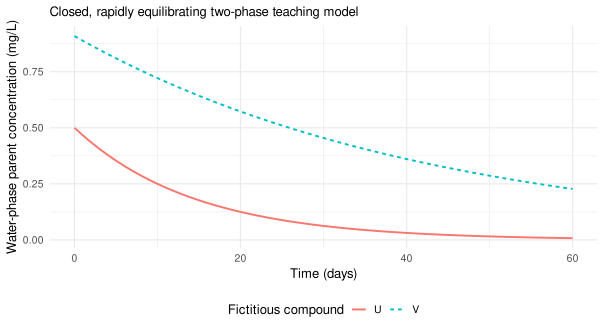

Use the [notes](notes.qmd). All numerical inputs below are constructed
teaching examples; use the stated assumptions rather than looking up extra
constants. Predict the direction of change before calculating.

## 1. Organic-carbon fraction

Take foc = 0.0200 and Koc = 5000 L/kg organic C for a suitable neutral compound. Find Kd. What mistake results from entering 2.00 instead of 0.0200?

::: {.callout-tip collapse="true" title="Hint"}
Convert percent to a mass fraction first.
:::

::: {.callout-note collapse="true" title="Worked solution"}
Kd = **100 L/kg dry solid**. Using 2.00 would give 10000 L/kg, a hundredfold overestimate. The model also needs evidence that organic carbon dominates sorption.
:::

## 2. Ionisation

A fictitious organic acid has pKa 4.50. Find the neutral fraction at prescribed pH 4.50 and 6.50. Can a neutral-form Koc automatically describe total sorption in both waters?

::: {.callout-tip collapse="true" title="Hint"}
Use 1/(1 + 10^(pH − pKa)).
:::

::: {.callout-note collapse="true" title="Worked solution"}
Neutral fractions are **0.500** and **0.009901**. A neutral-form coefficient alone cannot describe the total charged-plus-neutral pool without an appropriate ionisation/sorption model.
:::

## 3. Another half-life

For compound U in the worked example, find total and aqueous parent after 30.0 days. State what the model says about products.

::: {.callout-tip collapse="true" title="Hint"}
Three half-lives leave one eighth of the starting parent.
:::

::: {.callout-note collapse="true" title="Worked solution"}
Total parent = **0.125 mg**; water contains 0.0625 mg, so Cw = **0.0625 mg/L**. The model records parent transformation but does not specify product identity, product toxicity, or elemental mineralisation.
:::

## 4. A decline is not a mechanism

Water parent concentration falls after sediment is added. What would distinguish sorption from transformation, and why does log Kow alone not answer the question?

::: {.callout-tip collapse="true" title="Hint"}
Measure both phases and plausible products on a consistent time basis.
:::

::: {.callout-note collapse="true" title="Worked solution"}
Track total parent across water, solids, and any gas phase, plus products and analytical recoveries. Sorption conserves parent across phases; transformation changes identity. Log Kow describes partition preference, not a measured degradation mechanism or rate.
:::


## Activity C: a fate model in R

Download [compounds.csv](compounds.csv), [fate.R](fate.R), and
[fate-report.Rmd](fate-report.Rmd) into one folder. Read the
[input dictionary](data-dictionary.qmd). Reuse `readr`, `dplyr`, `ggplot2`,
and the R Markdown workflow. The new mathematical operation is
[`exp()`](https://stat.ethz.ch/R-manual/R-devel/library/base/html/Log.html),
the inverse of the natural logarithm.

The script creates a regular daily table for the two cases and evaluates:

```r
remaining_fraction = exp(-k_per_day * time_days)
total_parent_mg = initial_parent_mg * remaining_fraction
water_mg_l = total_parent_mg / (water_volume_l + kd_l_kg * dry_solid_kg)
```

These lines are expressions used inside `mutate()` in the supplied script.
The starting mass is already distributed between phases at time zero.
The coefficient k applies equally to parent in water and solids; this assumption
is what lets total parent follow one exponential.

1. Predict which compound has more parent in water initially. Calculate U's
   day-20 state by hand before running the code.
2. Run `source("fate.R")`, inspect `fate`, and print `fate_plot`.
3. Check time zero, one half-life, and the sum of the two phase inventories.
4. Explain why a smaller water concentration does not automatically mean a
   shorter half-life, less total parent, or lower biological risk.
5. Complete the report, restart R, and Knit it from saved inputs. Use its final
   section to make the separate catchment and sediment arguments in the
   [integrated case](../integrated-case/notes.qmd).

::: {.callout-note collapse="true" title="Expected model results"}
At day zero, U has **0.500 mg/L** water parent and V has **0.9091 mg/L**,
because their Kd values differ. At day 20, U has **0.250 mg total parent**,
split equally between phases, giving **0.125 mg/L** water concentration.
At day 30, U has **0.125 mg total** and **0.0625 mg/L** water concentration;
V has **0.500 mg total** and **0.4545 mg/L** water concentration.

The two parent phase inventories sum to the declining total. Total parent plus
the transformed-parent accounting term equals the initial mass. The latter term
records loss of parent identity, not a measured product mass or proof of
mineralisation. These are model predictions under supplied constants, not a fit,
a statistical comparison, or field evidence.
:::


