## About this lecture

:::: {.columns}
::: {.column width="56%"}
In December 2013, the town of **Ronneby** in southern Sweden closed one of its waterworks. Its groundwater contained **PFAS**, fluorinated compounds from firefighting foam used for years at a nearby air base training site. Residents had drunk the water for a long time, and blood tests later showed strongly raised PFAS levels.

How did a foam sprayed on the ground end up in people's blood?

Today you will learn that:

- molecular **structure** sets where a compound goes: water, solids, air or organisms;
- **ionisation** changes that answer with pH;
- **persistence** is a separate property, described by a rate;
- **disappearing from water is not destruction**.
:::
::: {.column width="44%"}
{width="100%"}
[Sailors test a firefighting foam (AFFF) hose on an aircraft carrier, 2016. Photo: US Navy, public domain, Wikimedia Commons.]{.credit}
:::
::::

::: notes
Open with Ronneby. The drinking water came from a groundwater source near the Blekinge air base, where firefighting foam had been used in training. The foam contained per- and polyfluoroalkyl substances, PFAS, which seeped into the ground and reached the wells. The waterworks was closed when the contamination was discovered in late 2013, and later health studies of residents became an important source of knowledge about PFAS exposure. The photo shows the same kind of foam in a different setting. Link to last lecture: we followed acid and metals out of a waste heap. Today we follow organic molecules, and we ask two questions about each one: where does it go, and how long does it last?
:::

## Why PFAS do not go away

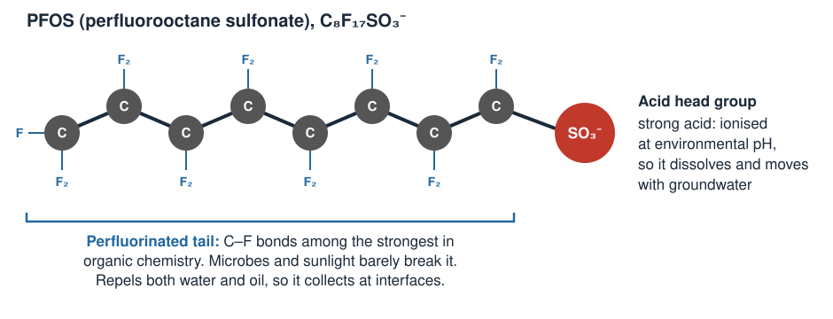{width="86%" fig-align="center"}

PFOS combines two unusual features: a fully **fluorinated tail** that hardly degrades, and an **ionised head** that keeps it in water. That combination makes it both **persistent** and **mobile**.

::: notes
Show the structure and let students find the two parts. The tail is a chain of eight carbons, each carrying fluorine instead of hydrogen. Carbon–fluorine bonds are among the strongest in organic chemistry, and microbes have essentially no pathway to break this chain under environmental conditions. The tail repels both water and oils, which is exactly why these compounds are excellent in foams and coatings. The sulfonate head is a very strong acid, so in any natural water it is present as an anion. That is important for today. It means PFOS dissolves, moves with groundwater and does not simply stick to soil. Persistence plus mobility is what brought it to the Ronneby taps.
:::

## A contrasting story: DDT

:::: {.columns}
::: {.column width="45%"}
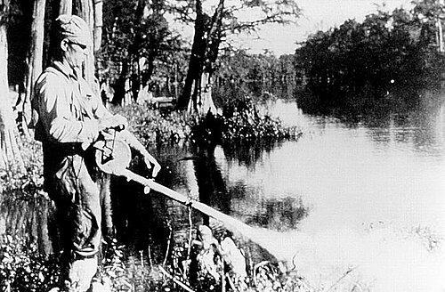{width="100%"}
[DDT spraying in the US malaria eradication programme, 1958. Photo: CDC, public domain, Wikimedia Commons.]{.credit}
:::
::: {.column width="55%"}
**DDT** was the most widely used insecticide of the mid-20th century, in agriculture and against malaria mosquitoes.

Like PFOS it is **persistent**. Unlike PFOS it is **neutral and very hydrophobic**: it barely dissolves in water and collects in **organic matter, sediments and fat**.

Sweden banned most uses around 1970. DDT and its product DDE are still measurable in Baltic sediments and wildlife.

Two persistent compounds, two different destinations. Why?
:::
::::

::: notes
DDT is the classic persistent organic pollutant and a useful contrast to PFAS. It was sprayed in huge quantities after the Second World War. Rachel Carson's book Silent Spring in 1962 drew public attention to its effects on birds, and many countries banned agricultural use in the 1970s. Sweden was among the early countries to act. The key point for today is that DDT and PFOS share persistence but differ completely in where they end up. DDT goes to sediments, soil organic matter and the fatty tissue of animals. PFOS stays largely in water and binds to proteins. The difference comes from molecular properties we can describe with a few numbers. That is the rest of the lecture.
:::

## Where can a molecule go?

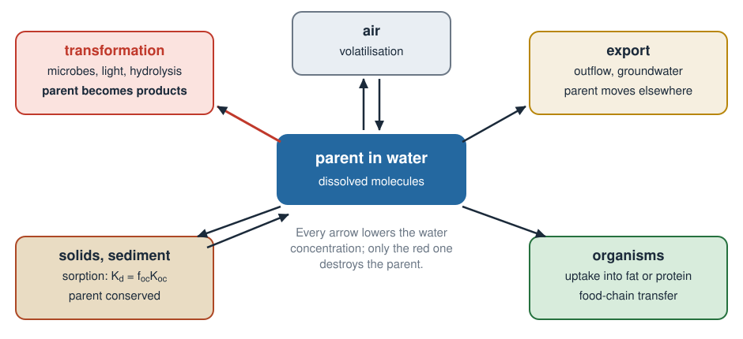{width="82%" fig-align="center"}

From water, a contaminant can **sorb** to solids, **volatilise**, be **taken up** by organisms, be **exported**, or be **transformed**. Only transformation changes the parent molecule. The others just move it.

::: notes
This map organises the lecture. The central box is the dissolved parent compound. Four arrows move the same molecule to another phase or another place: sorption to particles and sediment, volatilisation to air, uptake into organisms, and export by flowing water. Each one lowers the dissolved concentration you would measure in a water sample, yet none destroys anything. Only the red arrow, transformation by microbes, sunlight or chemical reaction, changes the parent into products. This distinction will matter repeatedly. Today we quantify two arrows: sorption with a partition coefficient, and transformation with a first-order rate. Volatilisation and bioaccumulation use similar partition ideas, which we treat qualitatively.
:::

## Measuring phase preference: K~ow~

:::: {.columns}
::: {.column width="42%"}
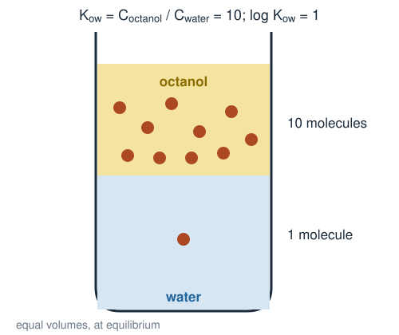{width="100%"}
:::
::: {.column width="58%"}
Shake a compound with **octanol** (an oily liquid standing in for fat and organic matter) and **water**. At equilibrium:

$$K_{ow}=\frac{C_\text{octanol}}{C_\text{water}}$$

The values span many orders of magnitude, so we use **log K~ow~**.

- Polar groups (–OH, –COOH, charges) favour water: low K~ow~.
- Large, nonpolar, chlorinated molecules favour octanol: high K~ow~.

K~ow~ is a **partition** property. It is **not** a half-life and **not** a toxicity.
:::
::::

::: notes
Octanol was chosen decades ago because it has a long hydrocarbon chain like lipids but one polar hydroxyl group, so it mimics the mixed environment of cell membranes and organic matter. In the picture, ten molecules sit in the octanol for every one in the water, so Kow is ten and log Kow is one. Real contaminants go far beyond that. Point out the warning in the last line. Students often assume a high Kow means a dangerous or persistent compound. Kow says only how the compound distributes between two liquids at equilibrium. It says nothing about how quickly the compound breaks down, or about what it does in an organism. Those are separate questions.
:::

## The K~ow~ scale for real compounds

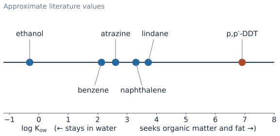{width="84%" fig-align="center"}

Each unit of log K~ow~ is a **factor of ten**. DDT prefers octanol over water by roughly ten million to one. Ethanol slightly prefers water. Notice what is missing: **PFOS has no meaningful K~ow~**, because it is ionised and gathers at the oil–water interface.

::: notes
These are rounded literature values, for orientation. Benzene, from petrol, has log Kow around two. The herbicide atrazine is similar, which is one reason it is found in groundwater. Naphthalene and lindane are in the middle. DDT is near seven, so it is about ten million times more concentrated in octanol than in water at equilibrium. That explains its accumulation in sediments and fat. PFOS is not on the scale. Surfactants sit at the boundary between phases instead of dissolving in one, so the octanol–water experiment does not give a useful number. This is a good example of a tool with clear limits. The next slide shows the other reason: ionisation.
:::

## Ionisation changes the problem

:::: {.columns}
::: {.column width="52%"}
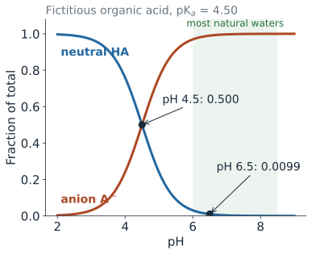{width="100%"}
:::
::: {.column width="48%"}
For an organic acid HA:

$$f_{HA}=\frac{1}{1+10^{\,\mathrm{pH}-pK_a}}$$

The same form as the carbonate fractions. For pK~a~ = 4.50:

- pH 4.50: neutral fraction **0.500**
- pH 6.50: **0.009901**, about 1 %

The anion is far more water-loving. A K~ow~ measured for the **neutral** form does not describe the **total** at pH 6.5.
:::
::::

::: notes
This is exercise 2. The equation is the same Henderson–Hasselbalch logic as the carbonate unit, and students should recognise the shape of the curves. Each pH unit above the pKa reduces the neutral fraction tenfold. In most natural waters, between about pH 6 and 8.5, an organic acid with pKa 4.5 is almost entirely an anion. Many pesticides and pharmaceuticals are weak acids or bases, so their behaviour changes with pH. PFOS is an extreme case: its pKa is very low, so it is ionised everywhere in the environment. The neutral-form Kow then describes only a tiny fraction of the compound, and using it for the total would overestimate sorption badly.
:::

## Ionised does not mean unsorbed

:::: {.columns}
::: {.column width="55%"}
Charged organic compounds still bind, but by **different mechanisms**:

- **Cations** (many amine drugs, some pesticides) sit on **cation exchange sites**, as in the soil lecture.
- **Anions** such as PFOS bind to **proteins**, to positively charged **iron oxide** surfaces, and at **air–water interfaces**.

So "ionised means mobile" is a tendency, not a rule.

**Why PFOS ends up in blood, not fat:** it binds to **blood proteins** such as albumin and is excreted slowly, over years.
:::
::: {.column width="45%"}
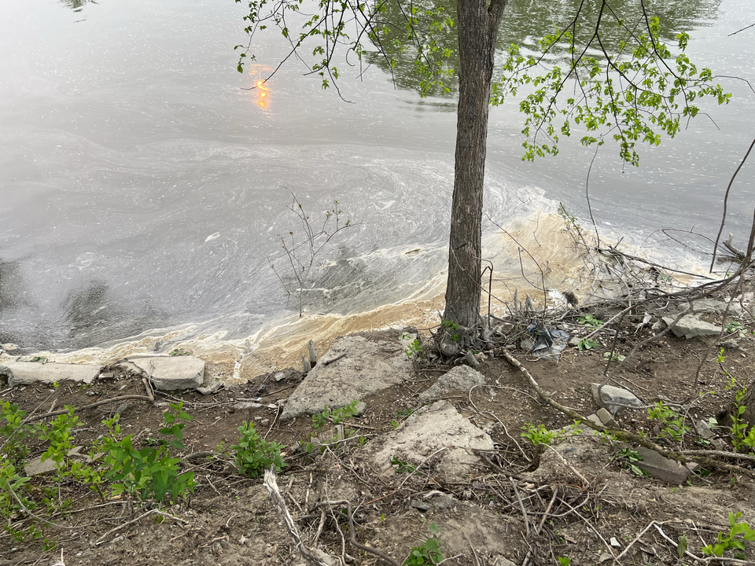{width="100%"}
[PFAS-containing foam on the Huron River, Michigan: surfactants gather at the air–water surface. Photo: MountainFae, CC BY-SA 4.0, Wikimedia Commons.]{.credit}
:::
::::

::: notes
The notes warn against the rule that ionised compounds never sorb. Cationic organic compounds behave like the cations in last week's lecture. They compete for negative exchange sites on clays and organic matter and can be held quite strongly. Anionic compounds avoid negatively charged surfaces but can bind to positively charged oxide surfaces at low pH, and to proteins. PFAS also concentrate at air–water interfaces, which matters in unsaturated soil; the river foam in the photo is a visible example. The last line connects to exposure. PFOS in humans binds to proteins in blood serum and is eliminated slowly, with half-lives of several years reported in the literature. That is why Ronneby residents still had elevated levels long after the clean water supply was restored.
:::

## From K~ow~ to sorption on soil: K~d~ = f~oc~K~oc~

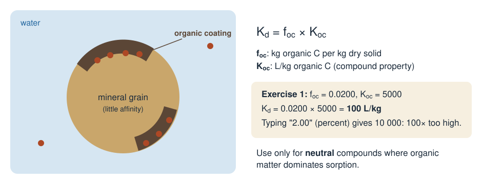{width="84%" fig-align="center"}

For neutral hydrophobic compounds, the **organic matter** of a soil or sediment does the sorbing. Only that fraction counts. Two soils with the same compound can differ in K~d~ by a factor of 100.

::: notes
Neutral hydrophobic molecules partition into organic matter much as they partition into octanol. The coefficient Koc describes this per kilogram of organic carbon and is a property of the compound. Multiplying by the organic-carbon fraction of a particular solid gives Kd for that solid. Exercise 1 does this: 0.02 times 5000 gives 100 litres per kilogram. The trap is units. A soil described as two percent organic carbon has foc 0.02, not 2. Using 2 gives a Kd a hundred times too high. Remind students of the conditions: this works for neutral compounds where organic matter dominates sorption. It is not valid for ions, for clean mineral surfaces, or for soot-like carbon.
:::

## How much stays in the water?

:::: {.columns}
::: {.column width="52%"}
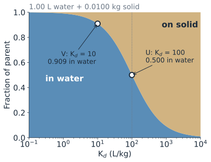{width="100%"}
:::
::: {.column width="48%"}
At equilibrium, mass is shared between water and solid:

$$M = C_w V_w + C_s m_s,\qquad C_s = K_d C_w$$

$$C_w = \frac{M}{V_w + K_d\, m_s}$$

With 1.00 L water and 0.0100 kg solid:

- **U** (K~d~ = 100): half in water, C~w~ = 0.500 mg/L
- **V** (K~d~ = 10): 0.909 in water, C~w~ = 0.909 mg/L
:::
::::

::: notes
This is the mass balance from the surfaces unit, applied to the fictitious compounds U and V from activity C. Each starts with one milligram of parent. The denominator is an effective volume: the water itself plus the amount of solid weighted by Kd. When Kd times the solid mass equals the water volume, half the compound is on each phase. That is U's case: one hundred times 0.01 equals one. V has a ten times smaller Kd, so most of it stays in water. The figure shows the whole curve. Emphasise that sorption moves mass but does not remove it. The sorbed parent is still there and can return to the water if conditions change.
:::

## Persistence: a first-order rate

:::: {.columns}
::: {.column width="52%"}
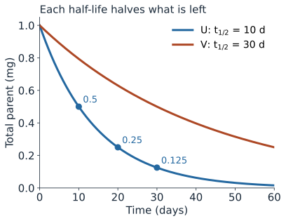{width="100%"}
:::
::: {.column width="48%"}
If transformation is first order with constant k and no new input:

$$M(t)=M_0\,e^{-kt},\qquad k=\frac{\ln 2}{t_{1/2}}$$

- U: t~1/2~ = 10 days. After 10, 20, 30 days: 0.5, 0.25, 0.125 mg.
- V: t~1/2~ = 30 days.

The half-life describes **how fast the parent disappears**, under stated conditions. It says nothing about where the parent is.
:::
::::

::: notes
First-order kinetics is the simplest persistence model. The rate of loss is proportional to the amount present, so each half-life removes half of what remains, regardless of the starting amount. Students have met this in radioactive decay. The half-lives here are stipulated for the fictitious compounds. Real half-lives depend strongly on conditions: temperature, oxygen, microbes, light and whether the compound is dissolved or sorbed. A pesticide may degrade in weeks in warm topsoil and persist for years in cold, anoxic groundwater. For PFOS, no relevant environmental degradation is known, so its effective half-life in groundwater is extremely long. Note again: the half-life is about identity, not location.
:::

## Combining the two: the activity C model

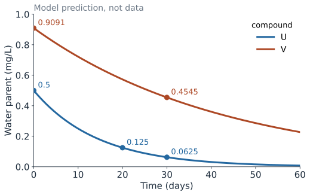{width="70%" fig-align="center"}

Assume rapid sorption equilibrium and the **same** k in both phases. Then the total decays exponentially and water concentration follows: $C_w(t) = M(t)/(V_w + K_d m_s)$. V starts higher (less sorbed) **and** declines more slowly (longer half-life).

::: notes
This is the model in fate.R. Two simplifications make it easy. First, sorption reaches equilibrium much faster than transformation, so the phase split stays constant. Second, the parent transforms at the same rate whether dissolved or sorbed, so the total follows one exponential. Water concentration is then just the total divided by the effective volume. The curves show two separate effects that are easy to confuse. V's curve starts higher because V sorbs less. It falls more slowly because V persists longer. If only dissolved parent degraded, or exchange were slow, we would need a different kinetic model. The figure is a model prediction, not data, and the markers match the table in the exercise.
:::

## Worked example: compound U at day 20

:::: {.columns}
::: {.column width="55%"}
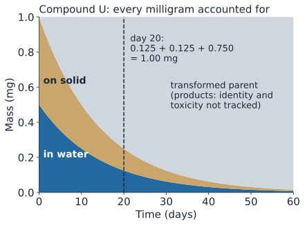{width="100%"}
:::
::: {.column width="45%"}
Start: 1.00 mg U, half on each phase, C~w~ = 0.500 mg/L.

After 20 days = **two half-lives**:

- total parent: 1.00 × ¼ = **0.250 mg**
- water: 0.125 mg, so C~w~ = **0.125 mg/L**
- solid: 0.125 mg
- transformed: **0.750 mg**

The missing 0.750 mg is **no longer U**. It did not "go to the sediment". What it became, the model does not say.
:::
::::

::: notes
Work through the numbers from the notes. Two half-lives leave a quarter of the starting parent, 0.25 milligrams. The phase split is unchanged, so half is in water and half on the solid. The water concentration is 0.125 milligrams per litre, a quarter of the starting value. The three bands always add up to one milligram, which is the check students should do every time. The grey band is an accounting term. It records parent that has changed identity, nothing more. It is not a measured product, not proof that the compound was mineralised to carbon dioxide, and not a statement about toxicity. Exercise 3 extends this to day 30: total 0.125 milligrams and water 0.0625 milligrams per litre.
:::

## Check yourself

::: {.checkbox}
1. A soil has 3.0 % organic carbon. For K~oc~ = 1000 L/kg OC, what is K~d~?
2. An organic acid has pK~a~ 4.50. Roughly what fraction is neutral at pH 7.0?
3. For U, double the solid mass to 0.0200 kg. What fraction of parent is now in water? Does the half-life change?
4. True or false: "Compound X has log K~ow~ 6, so it will persist for decades."
:::

::: notes
Answers. One: foc is 0.030, so Kd is 30 litres per kilogram. Two: pH 7 is 2.5 units above the pKa, so the neutral fraction is about one over 316, about 0.003. Three: the effective volume becomes 1 plus 100 times 0.02, which is 3 litres, so one third of the parent is in water. The half-life is unchanged in this model, because transformation acts equally in both phases. Changing Kd or the solid mass changes the split, not the persistence. That is exactly what the demo shows later. Four is false. Log Kow describes partitioning. Persistence needs a separate rate measurement. Some high-Kow compounds degrade quickly, and PFOS has no useful Kow at all but persists.
:::

## A falling concentration is not a mechanism

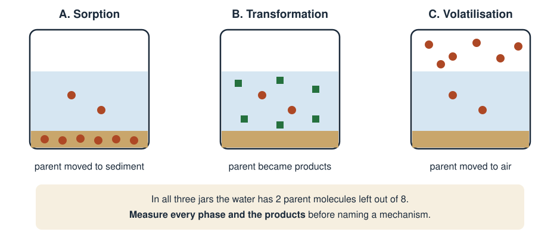{width="80%" fig-align="center"}

Three different processes give the same water result. To tell them apart, measure **all phases** (water, solid, gas) and look for **products**, with good analytical recovery, at matching times.

::: notes
This is exercise 4. A water sample shows the parent concentration falling after sediment is added. Is it degrading? Not necessarily. In jar A, the parent simply moved to the sediment. In jar B, it became products. In jar C, it escaped to the headspace. Measuring only the water cannot separate these. The test is a mass balance: extract the solid and analyse it, trap or sample the gas, and look for expected products. Recoveries matter, because sorbed compounds are often harder to extract, and a poor extraction can look like degradation. Log Kow alone cannot answer the question, because it describes a preference, not a process that happened.
:::

## Transformation is not mineralisation

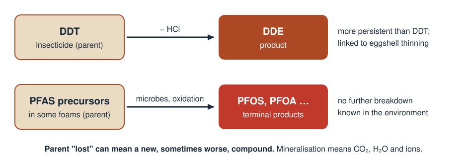{width="82%" fig-align="center"}

A disappearing parent can leave products that are **more persistent** or **just as harmful**. Only complete **mineralisation** to CO₂, water and inorganic ions removes the problem.

::: notes
Two examples make this concrete. DDT loses hydrogen chloride to form DDE. DDE is more persistent than DDT in many environments and was the main cause of eggshell thinning in birds of prey. So the decline of DDT in an ecosystem did not mean the problem was solving itself. PFAS have a similar story. Some foams contained precursor compounds, which microbes or oxidation convert to terminal perfluoroalkyl acids such as PFOS and PFOA. These do not break down further under environmental conditions, so precursor transformation increases the amount of the most persistent products. The lesson: always ask what the products are before treating parent loss as good news.
:::

## Partitioning into organisms: the sea eagle

:::: {.columns}
::: {.column width="48%"}
{width="100%"}
[White-tailed eagles in Färnebofjärden National Park, Sweden. Photo: LG Nyqvist, CC BY-SA 4.0, Wikimedia Commons.]{.credit}
:::
::: {.column width="52%"}
Hydrophobic, persistent compounds partition into **fat**. Each step of a food chain eats much more than it retains, so concentrations rise up the chain: **biomagnification**.

Around the Baltic, **white-tailed eagles** at the top of the chain had very poor breeding success in the 1960s and 70s. DDE and PCBs were the main causes.

After bans on DDT and PCB, contaminant levels fell and the eagle population **recovered**. A clear case where chemistry explained, and policy fixed, a problem.
:::
::::

::: notes
This brings partitioning into biology. An organism is partly an oily phase, so a compound with high Kow that is not metabolised accumulates in fat. Predators eat many prey and keep the persistent fraction, so concentrations increase at each level. In the Baltic the white-tailed eagle declined dramatically. Studies linked the reproductive failure to DDE and PCBs. Conservation work, including winter feeding with uncontaminated food, helped the remaining birds, but the long-term recovery followed the bans of DDT and PCBs and the gradual decline of these compounds in Baltic fish. Today the species is much more common again. It is a good story of chemistry, monitoring and policy working together.
:::

## Back to Ronneby: putting the properties together

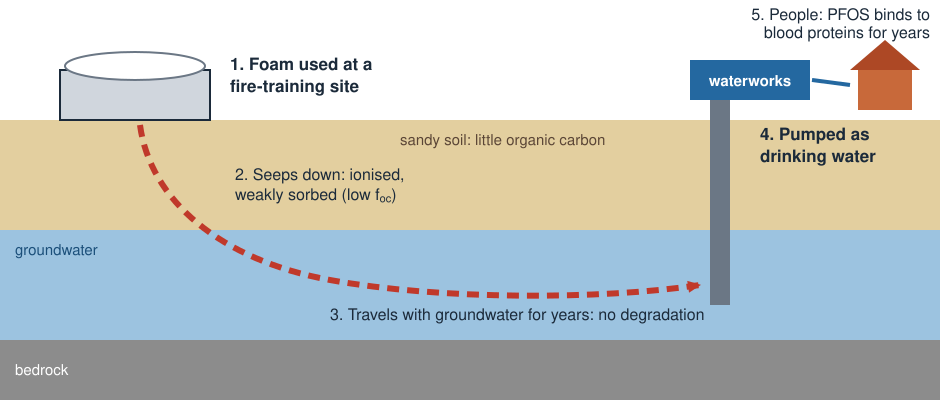{width="84%" fig-align="center"}

Each step follows from a property: **ionised**, so weakly sorbed in low-carbon sand; **not degraded**, so it accumulates and travels for years; **protein-binding**, so it stays in people. A DDT-like compound would have stayed near the source.

::: notes
Return to the opening question and answer it with today's tools. Foam was used repeatedly on a training ground. The PFAS were ionised and the sandy soils contained little organic carbon, so sorption was weak and the compounds reached groundwater. With no relevant degradation pathway, a first-order half-life is effectively infinite, so the compounds accumulated and moved with groundwater toward the wells. The waterworks pumped them into the drinking water. In people, PFOS binds to serum proteins and is excreted slowly, so blood levels stayed high for years. Contrast with DDT: neutral and hydrophobic, it would have sorbed to soil organic matter near the source. Different properties, different destinations, different exposure routes.
:::

## Four separate questions

| Question | Property or measurement | Example |
| --- | --- | --- |
| **Where does it go?** | K~ow~, K~d~ = f~oc~K~oc~, pK~a~, volatility | DDT to sediment; PFOS stays in water |
| **How long does it last?** | half-life under stated conditions | U: 10 days; PFOS: no known degradation |
| **Who is exposed?** | pathway: water, food, air, soil | Ronneby: drinking water |
| **What does it do?** | toxicity, measured separately | DDE: eggshell thinning |

A strong answer to one question **never** answers another. High K~ow~ is not toxicity; low concentration in water is not low risk.

::: notes
This table is the conceptual summary of the lecture and a template for exam answers. Partitioning tells you where a compound will be found. Persistence tells you how long it lasts. Exposure depends on where people or organisms meet the compound. Effect depends on biology and needs toxicity data. Many weak arguments merge these. For example, a low concentration in water may hide a large amount in sediment or fish. A short half-life may hide a toxic product. Ask students to apply the four questions to a compound they know, such as a pharmaceutical in wastewater, and say which they could answer from today's numbers and which need new data.
:::

## Common mistakes to avoid

- **"Gone from the water means destroyed."** It may be sorbed, volatilised or taken up.
- **"High K~ow~ means toxic" or "means persistent."** K~ow~ is a partition property only.
- **"Ionised means it never sorbs."** Cations exchange; anions bind proteins and oxides.
- **"f~oc~ = 2 for 2 % organic carbon."** It is 0.02. A factor-100 error.
- **"Changing K~d~ changes the half-life."** In our model it changes only the phase split.
- **"Parent lost = problem solved."** Ask what the products are.

::: notes
Run through these as a self-test. The first and last are the conceptual errors that matter most in environmental decisions. The fifth is the one the demo is built to expose. In the activity C model, transformation acts equally on both phases, so moving mass between them does not change how fast the total declines. In a real system where only dissolved parent degrades, stronger sorption would actually slow transformation, but that is a different model with different assumptions. Ask students to say which assumption they would change to make Kd affect persistence. Then move to the interactive demo, which lets them test each statement directly.
:::

## Explore: sorption and parent transformation {#explore}

```{=html}
<link rel="stylesheet" href="../demos/demo.css">
<div data-demo="fate" role="group" aria-label="Sorption and parent transformation">
<p>Change Kd alone. Does total-parent persistence change in this model?</p>
</div>
<script src="../demos/core.js"></script>
<script src="../demos/fate.js"></script>
```

[Change Kd alone. Does total-parent persistence change in this model?](exercise.qmd#explore)

::: notes
Use the reference presets, then change one variable. The complete exercise has
model assumptions, a hand-check result, and a static reference for printing.
:::

## Summary {.smaller}

:::: {.columns}
::: {.column width="70%"}
| Concept | Key fact |
| --- | --- |
| Fate map | sorption, volatilisation, uptake, export move the parent; only transformation changes it |
| K~ow~ | octanol/water ratio at equilibrium; log scale; partition, not persistence or toxicity |
| Ionisation | $f_{HA}=1/(1+10^{\mathrm{pH}-pK_a})$; ions need their own sorption model |
| Sorption | $K_d=f_{oc}K_{oc}$ for neutral compounds; f~oc~ is a fraction, not a percent |
| Phase split | $C_w=M/(V_w+K_d m_s)$; U: half in water, V: 0.909 |
| Persistence | $M=M_0e^{-kt}$, $k=\ln2/t_{1/2}$; U day 20: 0.250 mg total, 0.125 mg/L |
| Evidence | measure all phases and products before naming a mechanism |
| Products | DDT → DDE; PFAS precursors → PFOS, PFOA; parent loss is not mineralisation |
| PFOS | persistent, ionised, mobile in groundwater, protein-bound in people |
| Four questions | where, how long, who is exposed, what effect: separate evidence |

**Next:** [Connecting air, catchments, and water](../integrated-case/lec.qmd). One catchment, all the course's chemistry at once. Then the [exercises](exercise.qmd), the [notes](notes.qmd) and [activity C](exercise.qmd#activity-c-a-fate-model-in-r).
:::
::: {.column width="30%"}
{width="100%"}
[Cyanobacteria (*Nodularia*) bloom in the Baltic Sea, August 2015, false colour. Image: NASA, public domain, Wikimedia Commons.]{.credit}
:::
::::

::: notes
Recite the chain once. For any contaminant, first ask where it goes: partition coefficients and ionisation answer that, within their conditions. Then ask how long it lasts: a rate under stated conditions. Combine them with a mass balance, as in activity C, and keep every milligram accounted for. A falling water concentration needs evidence from all phases before it is called degradation, and degradation needs a look at the products. Ronneby and the Baltic eagles show the same tools explaining real events. The image previews the final lecture. Blooms in the Baltic are fed partly by phosphate released from sediments when oxygen runs out, which ties together redox, nutrients and catchment budgets.
:::
