## About this lecture

:::: {.columns}
::: {.column width="56%"}
Every summer, **cyanobacteria blooms** swirl across the Baltic Sea. Below them, the deep water of the central Baltic holds one of the **largest areas of oxygen-free bottom water** made by human activity anywhere in the world.

Cutting nutrient inputs from land has helped, but slowly. One reason: the sea floor itself **releases phosphate** when oxygen disappears.

Today you will learn to:

- **balance redox reactions** by counting electrons;
- use the **sequence of electron acceptors** as a guide, not a timetable;
- explain how **iron reduction releases phosphate** without any phosphorus redox.

Last lecture: phosphate binds to iron oxides. Today: what happens when those oxides dissolve.
:::
::: {.column width="44%"}
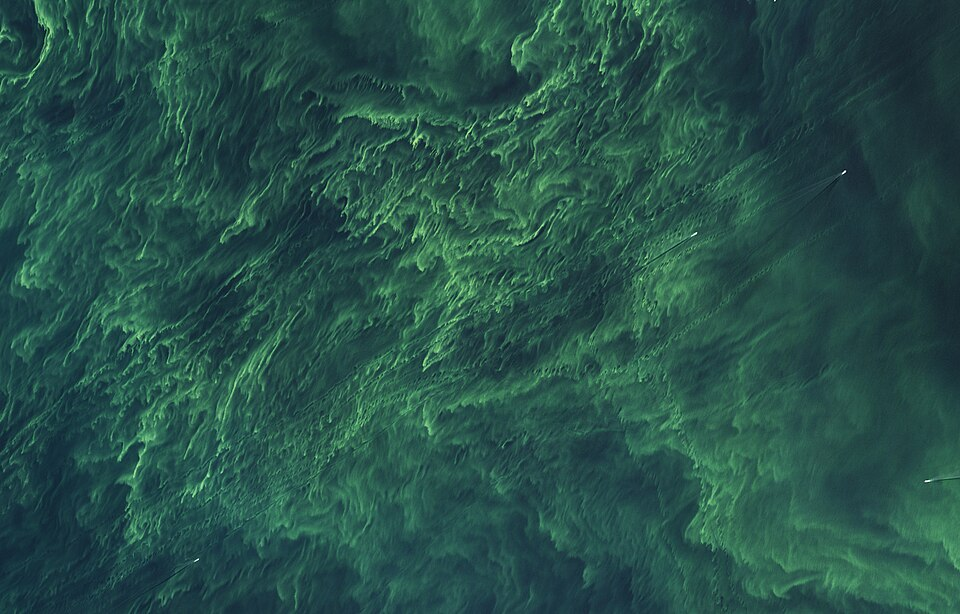{width="100%"}
[Phytoplankton bloom swirling in the Baltic Sea, July 2025, seen by a Landsat satellite. Image: NASA Earth Observatory (Michala Garrison), public domain, Wikimedia Commons.]{.credit}
:::
::::

::: notes
Open with the satellite image. The swirls are cyanobacteria, which bloom in late summer in the Baltic Proper and Gulf of Finland. Their growth depends strongly on phosphate, because many of them can fix nitrogen gas. Under the bloom is a less visible problem: large areas of deep water with little or no oxygen. Since the 1980s the riparian countries have reduced nutrient loads, especially phosphorus from wastewater. Yet the sea has responded slowly. A large part of the explanation is chemistry at the sediment surface, where iron, phosphorus, sulfur and carbon are linked by electron transfer. The last lecture showed phosphate binding to iron oxides. Today we see what happens to that binding when the iron is reduced.
:::

## Why the deep Baltic runs out of oxygen

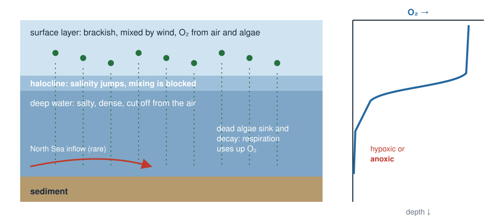{width="82%" fig-align="center"}

Fresh river water floats on top of salty water from the North Sea. A **halocline** separates them and blocks mixing. Organic matter sinks through it and decays, **using oxygen** that cannot be replaced from the air. Salty inflows that refresh the deep water are rare.

::: notes
Explain the physics first, because it sets up the chemistry. The Baltic is brackish: rivers supply fresh water at the surface, and denser salt water enters only through the narrow Danish straits. The density difference creates a sharp salinity jump, the halocline, at a depth of very roughly 60 to 80 metres in the central Baltic. Wind mixes the surface layer, but not across the halocline. Below it, oxygen is consumed by bacteria decomposing sinking algae and is only replaced when a large inflow of salty, oxygen-rich North Sea water pushes into the deep basins. Such major inflows happen irregularly, sometimes with gaps of a decade. Between them, the deep water gradually loses its oxygen.
:::

## What happens when the oxygen is gone?

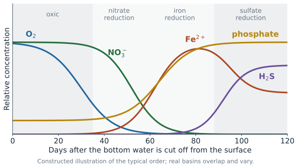{width="90%" fig-align="center"}

In a cut-off bottom water, chemistry changes in a **typical order**: first oxygen falls, then nitrate, then dissolved iron and **phosphate** rise, and finally **hydrogen sulfide** appears. Nobody added phosphate. **Why this order, and where does the phosphate come from?**

::: notes
This figure is constructed, with relative units, to show the typical order rather than real data from a particular station. Read it left to right. Oxygen declines first. Once it is low, nitrate declines. Then dissolved iron(II) and phosphate rise together. Later, hydrogen sulfide appears, and dissolved iron falls again. Ask students to note two puzzles. First, why does each substance wait for the one before it? Second, phosphate has no reason to change oxidation state, so why does it rise at the same time as iron? The rest of the lecture answers both. Remind them that real basins overlap these stages, because of mixing and patchy sediments.
:::

## Redox is electron bookkeeping

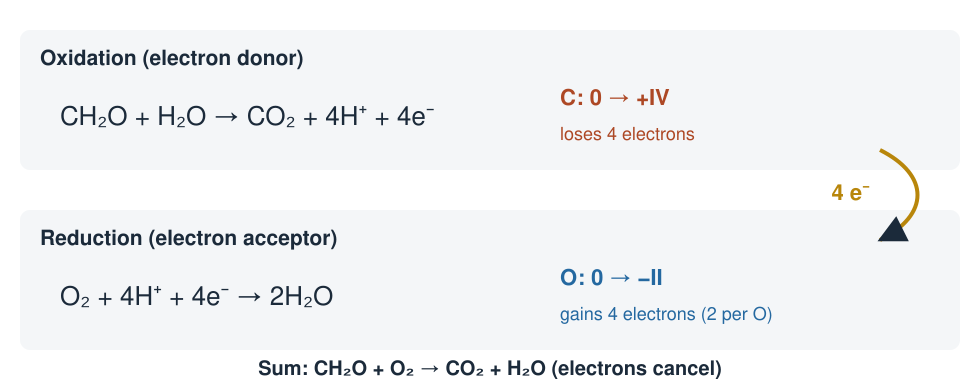{width="72%" fig-align="center"}

Every redox reaction pairs an **electron donor**, which is oxidised, with an **electron acceptor**, which is reduced. **Electrons lost = electrons gained.** CH₂O is a bookkeeping formula for organic matter, with carbon at oxidation state 0.

::: notes
Start with the familiar reaction, aerobic respiration, split into two half-reactions. In the first, organic carbon goes from oxidation state zero to plus four in carbon dioxide and releases four electrons. In the second, oxygen accepts those four electrons, each oxygen atom going from zero to minus two. When the half-reactions are added, the electrons cancel. This is the rule for every redox reaction: the donor's loss equals the acceptor's gain. CH2O is not a real molecule in sediments. It is a convenient formula with the average oxidation state of carbon in carbohydrates. Microbes carry out these reactions to gain energy; chemistry tells us which are possible and in what proportions, not how fast they go.
:::

## Oxidation states you will need

:::: {.columns}
::: {.column width="50%"}
| Element | Species | Oxidation state |
| --- | --- | ---: |
| C | CH₂O / CO₂ / CH₄ | 0 / +IV / −IV |
| N | NH₄⁺ / N₂ / NO₃⁻ | −III / 0 / +V |
| Fe | Fe²⁺ / FeOOH | +II / +III |
| S | HS⁻ / SO₄²⁻ | −II / +VI |
| P | PO₄³⁻ | +V (stays) |
| O | O₂ / H₂O | 0 / −II |
:::
::: {.column width="50%"}
Rules: H is +I, O is −II (except in O₂), and the states add up to the charge of the species.

Example, nitrate: N + 3(−II) = −1, so **N = +V**.

Each change of one unit is **one electron** per atom.

Notice phosphorus. In natural waters it stays at **+V**. If phosphate moves during a redox change, something **else** was reduced.
:::
::::

::: notes
This is a refresher slide, to be used as a reference during the rest of the lecture. Work one example aloud, nitrate: three oxygens at minus two give minus six, the ion has charge minus one, so nitrogen must be plus five. Ask students to do sulfate themselves. The table already holds the key to the second puzzle from the time series. Phosphorus stays at plus five in phosphate. Phosphate rose when oxygen disappeared, but phosphorus itself was not reduced. So the phosphate must have been released from something that was. That something is iron, as we will see. Keep the table visible when balancing reactions later.
:::

## When oxygen runs out: the redox ladder

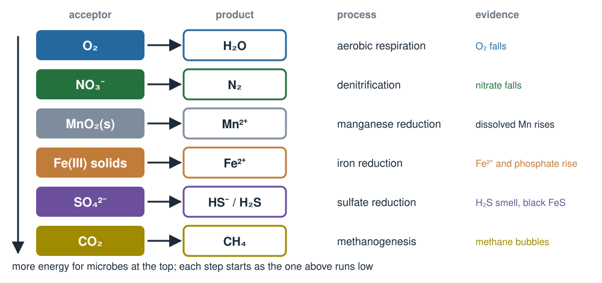{width="78%" fig-align="center"}

Microbes use the acceptor that gives the most energy first. As it runs low, the next one takes over. That explains the order in the bottom-water series. It is a **guide, not a timetable**: steps overlap in space and time.

::: notes
This is the central concept of the lecture. Organic matter is the common electron donor. Several acceptors can take its electrons, and they yield different amounts of energy to the microbes. Oxygen gives the most, then nitrate, then manganese and iron oxides, then sulfate, and finally carbon dioxide itself in methanogenesis. Microbes that use a higher-energy acceptor tend to outcompete the others while it lasts. Each step also leaves evidence: what disappears and what appears. Stress the caveat in the notes. The thresholds depend on pH, on which minerals are present, and on local conditions. Different processes run side by side in neighbouring microsites. Use the ladder to make predictions, then check them with measurements.
:::

## The ladder in the mud

:::: {.columns}
::: {.column width="50%"}
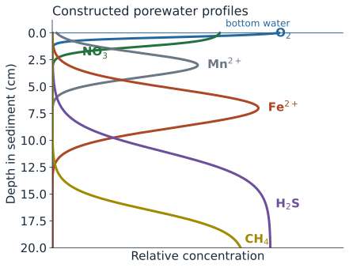{width="100%"}
:::
::: {.column width="50%"}
In a sediment, the ladder is laid out **in depth**. Oxygen often disappears within millimetres. Below it, nitrate, then dissolved manganese and iron, then sulfide and methane.

The steps overlap and their depths change with season and with how much organic matter arrives.

When the bottom water itself loses its oxygen, the upper rungs vanish and **iron reduction reaches the sediment surface**.
:::
::::

::: notes
The time series showed the ladder in time; a sediment shows it in space. These profiles are constructed, but the order is typical of lake and coastal sediments. Oxygen diffusing from the water is consumed so fast that it often penetrates only a few millimetres. Nitrate is consumed just below. Manganese and iron(II) appear deeper, where their oxides are being reduced, and sulfide and methane deeper still. Peaks occur because dissolved products diffuse up and are re-oxidised where the acceptor above is still present. The crucial point for the Baltic: as long as the bottom water has oxygen, a thin layer of iron(III) oxide stays at the sediment surface. When oxygen vanishes, the iron-reduction zone moves up to the surface.
:::

## You can see the ladder in a jar

:::: {.columns}
::: {.column width="45%"}
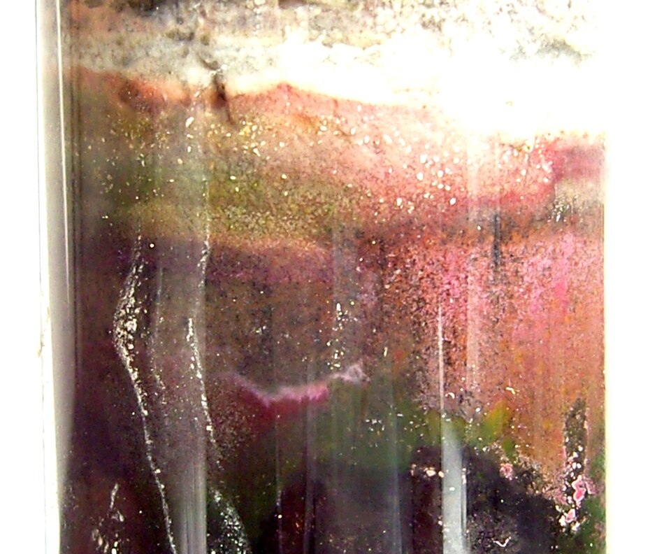{width="100%"}
[Upper part of a Winogradsky column: purple sulfur bacteria in bands above dark, sulfide-rich mud. Photo: kOchstudiO, public domain, Wikimedia Commons.]{.credit}
:::
::: {.column width="55%"}
A **Winogradsky column** is a sealed tube of pond mud with a little added carbon and sulfate, left in the light for weeks.

Oxygen enters only at the top, so microbes sort themselves into layers:

- the top stays oxic;
- in the middle, coloured bands of bacteria live on sulfide rising from below;
- the bottom turns **black** with iron sulfide formed by sulfate reduction.

The same zones exist in every sediment, compressed into a few centimetres.
:::
::::

::: notes
This classroom experiment is a good way to make the ladder visible. Students can set it up in a lab session. Mud, a source of organic carbon such as shredded paper, and a sulfate source such as gypsum or egg yolk are packed into a tube and left near a window. Over weeks, oxygen is used up everywhere except near the top. Sulfate reducers at the bottom produce sulfide, which reacts with iron to form black iron sulfide. Purple and green sulfur bacteria grow in bands where light and sulfide meet. The exact colours vary from column to column, which is itself a lesson: the sequence is robust, the details are local.
:::

## Nitrogen: one element, many oxidation states

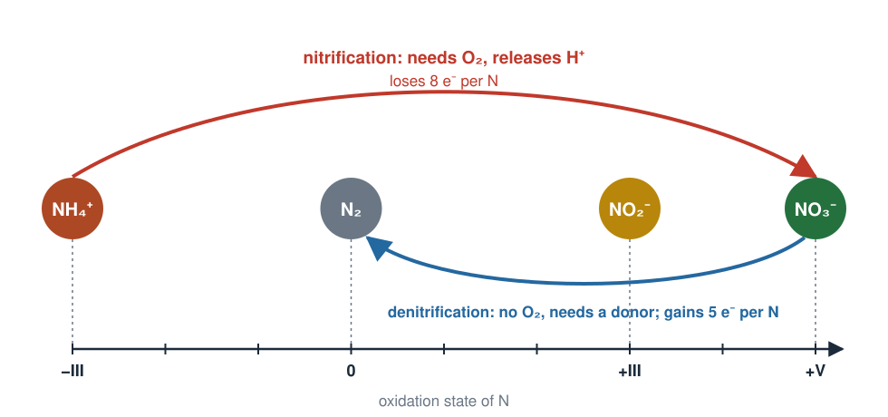{width="76%" fig-align="center"}

$$\mathrm{NH_4^++2O_2\rightarrow NO_3^-+2H^++H_2O}$$

Nitrification uses oxygen and **releases acid**. For 0.100 mmol/L NH₄⁺: 0.200 mmol/L O₂ (**6.40 mg/L**) and 0.200 mmol/L H⁺, so alkalinity falls by **0.200 meq/L**. Nitrogen changes form but **stays in the water**.

::: notes
Nitrogen spans eight units of oxidation state, from minus three in ammonium to plus five in nitrate. Nitrification, carried out by bacteria and archaea, oxidises ammonium to nitrate with oxygen. Check the balance with the class: eight electrons lost per nitrogen, and two O2 molecules accept eight electrons. The calculation is exercise 1. Two moles of oxygen per mole of ammonium is a large oxygen demand, about six and a half milligrams per litre for a modest ammonium concentration. The two protons consume alkalinity, as in the carbonate lecture. Most importantly, nitrification does not remove nitrogen from the water. Only the reverse direction, down the ladder to nitrogen gas, does that.
:::

## Balancing denitrification

:::: {.columns}
::: {.column width="52%"}
$$\mathrm{4NO_3^-+5CH_2O+4H^+\rightarrow2N_2+5CO_2+7H_2O}$$

1. N: +V → 0, gains **5 e⁻** each; 4 NO₃⁻ accept **20 e⁻**.
2. C: 0 → +IV, loses **4 e⁻** each; 5 CH₂O donate **20 e⁻**.
3. Atoms: 4 N, 5 C, 14 H, 17 O on each side. Charge: 0 = 0.

Donor ratio: **1.25 mol C per mol nitrate**. For 0.0800 mmol/L nitrate: 0.100 mmol/L C (**1.20 mg C/L**) and 0.0400 mmol/L N₂.
:::
::: {.column width="48%"}
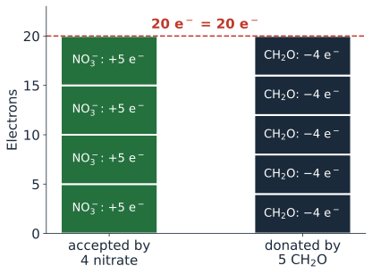{width="100%"}
:::
::::

::: notes
Balance by electrons first, then atoms, then charge. Each nitrogen falls from plus five to zero and gains five electrons. Each carbon rises from zero to plus four and loses four. The smallest whole numbers that make the electrons match are four nitrates and five CH2O, twenty electrons each way, which the bar chart shows. Then fill in protons and water to balance hydrogen and oxygen, and check the charge: minus four plus four on the left, zero on the right. The ratio of 1.25 carbon per nitrate is exercise 2. This net reaction ignores growth of new biomass and intermediates such as nitrite. Denitrification needs low oxygen, nitrate and an electron donor. It is how sediments, wetlands and treatment plants remove nitrogen as gas.
:::

## Check yourself

::: {.checkbox}
Use oxidation states and electron counting.

1. What is the oxidation state of S in SO₄²⁻, and of Fe in FeOOH?
2. How many electrons does one Fe(III) gain when FeOOH becomes Fe²⁺? How many does one sulfate gain when it becomes HS⁻?
3. Oxidise 0.050 mmol/L NH₄⁺ fully to nitrate. How much O₂ is used?
4. True or false: "Phosphate rose in anoxic bottom water, so phosphorus was reduced."
:::

::: notes
Answers. One: sulfur is plus six, because four oxygens give minus eight and the ion is minus two. Iron in FeOOH is plus three. Two: one electron for iron, from plus three to plus two. Eight for sulfur, from plus six to minus two. That is why sulfate reduction needs much more organic matter per sulfur than iron reduction does per iron. Three: two oxygen per ammonium, so 0.100 millimoles per litre, or 3.2 milligrams per litre. Four is false. Phosphorus stays at plus five. Its release must come from a change in something it was attached to. The next slides show what.
:::

## Iron: a solid that dissolves when reduced

:::: {.columns}
::: {.column width="50%"}
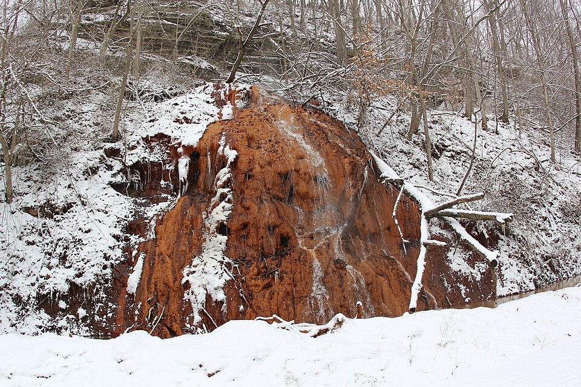{width="100%"}
[Iron-rich mine water emerging from underground coats a slope with orange iron(III) oxide, Great Allegheny Passage, Pennsylvania. Photo: daveynin, CC BY 2.0, Wikimedia Commons.]{.credit}
:::
::: {.column width="50%"}
$$\mathrm{FeOOH(s)+3H^++e^-\rightarrow Fe^{2+}+2H_2O}$$

Check: 1 Fe, 2 O, 4 H on each side; charge +2 = +2. Fe(III) gains **one electron**.

Fe(III) oxides are almost insoluble at natural pH. Fe²⁺ is soluble. So reduction turns a **solid into a solute**.

The reverse happens wherever Fe²⁺-rich water meets air: orange Fe(III) oxide precipitates.
:::
::::

::: notes
This is exercise 3. Verify the half-reaction with the class: iron, oxygen and hydrogen balance, and the charges are plus three minus one on the left and plus two on the right. What makes iron special in environmental chemistry is the solubility contrast between its two oxidation states. Iron(III) forms oxyhydroxides that are practically insoluble at the pH of most natural waters, as we saw in the metals and surfaces lectures. Iron(II) stays dissolved. So reducing iron dissolves the solid. The photo shows the opposite direction: groundwater rich in dissolved iron(II) reaches the surface, meets oxygen, and the iron is oxidised and precipitates as orange oxide. The same switch runs at the sea floor.
:::

## Phosphate rides on iron

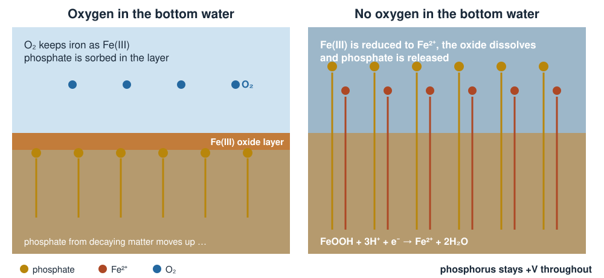{width="88%" fig-align="center"}

With oxygen, a thin **Fe(III) oxide layer** at the sediment surface sorbs phosphate moving up from decaying matter. Without oxygen, the iron is **reduced**, the layer dissolves, and Fe²⁺ and phosphate both escape. Phosphorus stays +V: its **carrier** changed oxidation state.

::: notes
This is the answer to the second puzzle. In the surfaces lecture we saw that iron oxides hold phosphate strongly by inner-sphere binding. While the bottom water has oxygen, the iron(III) layer at the sediment surface acts as a lid: phosphate released by decomposition deeper in the sediment is caught as it diffuses up. When the bottom water becomes anoxic, iron reduction reaches the surface, the oxide dissolves, and the phosphate held on it is released along with iron(II). Phosphorus never changes its oxidation state. This is why Fe and phosphate rise together in the time series. The release from sediments is called internal loading, as opposed to the external load from rivers and wastewater.
:::

## Sulfur: the bottom of the ladder

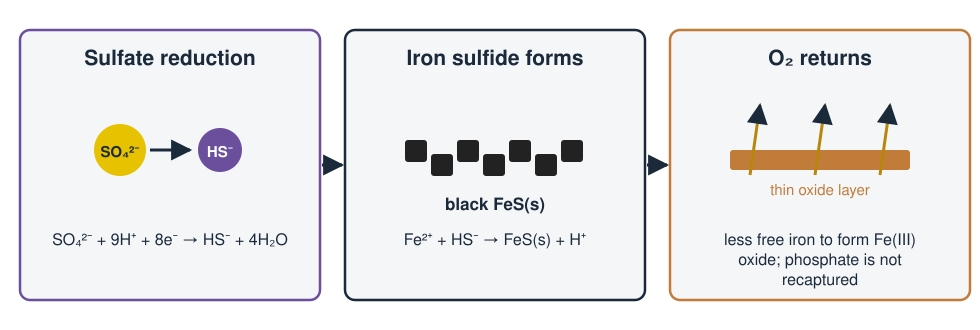{width="84%" fig-align="center"}

With oxygen, nitrate and iron oxides used up, microbes reduce **sulfate**, abundant in seawater. Toxic H₂S builds up in the deepest Baltic basins. Sulfide also binds iron as black **FeS**, so when oxygen returns, less iron is free to recapture phosphate.

::: notes
Seawater, even the brackish Baltic, contains much sulfate, so once the higher acceptors are exhausted, sulfate reduction becomes a major pathway. Check the half-reaction: sulfur goes from plus six to minus two, eight electrons. Hydrogen sulfide is toxic to animals, and in the deep basins of the central Baltic it has accumulated at times to form true dead zones. Sulfide also reacts with iron(II) to form insoluble iron sulfides, which make anoxic mud black. That has a long-lasting effect. Iron locked up as sulfide is no longer available to form a new oxide layer when oxygen returns, so the sediment's ability to trap phosphate is weakened. Reoxygenation does not simply reverse anoxia.
:::

## Reading redox evidence

:::: {.columns}
::: {.column width="55%"}
Observation: dissolved Fe and phosphate rise while O₂ declines above a sediment.

**Coupled explanation:** organic matter uses up O₂, then Fe(III) oxides are reduced, releasing Fe²⁺ and the phosphate they held.

**Why correlation is not proof:** mixing with another water mass, other minerals dissolving, or a new phosphate source could give the same pattern.

**Tests:** Fe(II) measured directly, solid-phase iron and phosphorus in the sediment, porewater profiles, and fluxes over time.
:::
::: {.column width="45%"}
{width="100%"}
:::
::::

::: notes
This is exercise 4, and the skill is reasoning from evidence. The coupled explanation is the one we built today, and it is often right. But a good scientist asks what else could produce the same pattern. A different, phosphate-rich water mass could have mixed in. Calcium phosphate minerals could dissolve. Fresh organic matter could release phosphate as it decomposes. To test the iron explanation, measure iron(II) itself, look for loss of iron(III) and of iron-bound phosphorus in the surface sediment, and use porewater profiles like this one to calculate fluxes across the sediment surface. A single electrode reading of redox potential is rarely enough to identify which processes are active in a natural sample.
:::

## Back to the Baltic: a self-reinforcing loop

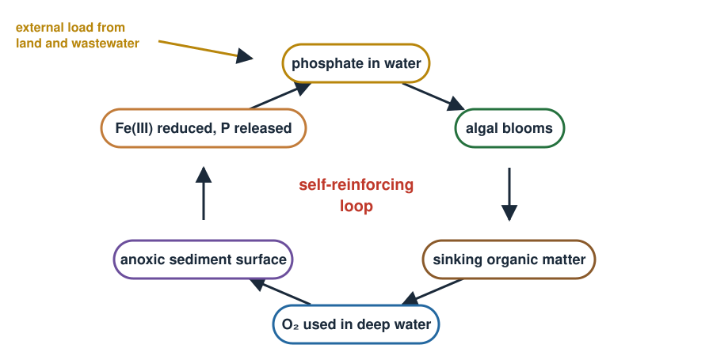{width="64%" fig-align="center"}

More phosphate feeds more blooms, more sinking organic matter, more oxygen loss, and more phosphate release. That is why **internal loading** can keep the Baltic eutrophic long after external loads are cut.

::: notes
Now put the pieces together into the loop that is often called the Baltic's vicious circle. Phosphate in the surface water feeds blooms, especially of nitrogen-fixing cyanobacteria, which need phosphorus but can take nitrogen from the air. The blooms sink and decompose below the halocline, using oxygen. Anoxic sediments release iron-bound phosphate. Some of that phosphate is mixed back up to the surface and fuels the next bloom. Each step is chemistry we have covered this week: speciation, surfaces, redox. The external load from land and wastewater sets the overall level, and reducing it is the only lasting solution, but the internal loop explains the long delay in the sea's response.
:::

## Can the loop be broken?

:::: {.columns}
::: {.column width="55%"}
**Inflows** of oxygen-rich North Sea water, like the large one in December 2014, can ventilate the deep basins for a while. Iron oxide re-forms and traps some phosphate. But the effect fades, and sulfide-bound iron is not fully restored.

**Cutting external loads** is the lasting solution. Since the 1980s, better wastewater treatment around the Baltic has removed much of the phosphorus that rivers and cities once delivered.

How treatment plants do that, and where the phosphorus ends up, is the next lecture.
:::
::: {.column width="45%"}
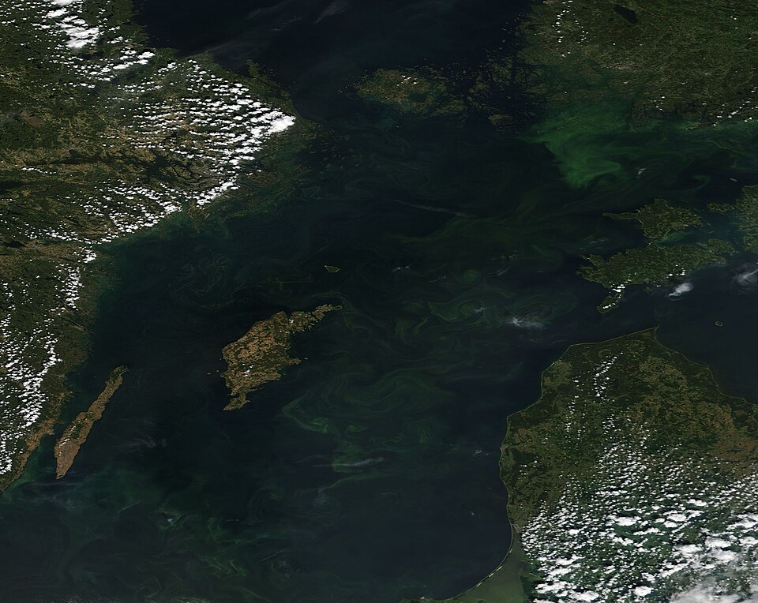{width="100%"}
[Summer bloom around Gotland in the central Baltic Sea, July 2018. Image: Jeff Schmaltz, NASA (MODIS), public domain, Wikimedia Commons.]{.credit}
:::
::::

::: notes
End the story with the management question. Major inflows are natural events. When salty, oxygen-rich water reaches the deep basins, the upper rungs of the ladder return, iron is re-oxidised and some phosphate is trapped again. Studies after the 2014 inflow showed that the improvement was partial and temporary. The deep water lost its oxygen again within a few years in many areas, and iron tied up as sulfide could not all return to the cycle. The more reliable lever is the external load. Phosphorus removal at wastewater treatment plants has been one of the main measures. The satellite image shows the scale of the problem: blooms covering much of the central Baltic around Gotland in a single summer.
:::

## Common mistakes to avoid

- **"Phosphate was released, so phosphorus was reduced."** P stays +V; its iron carrier was reduced.
- **"Nitrification removes nitrogen."** It changes NH₄⁺ to NO₃⁻; only denitrification sends N to the air.
- **"The redox ladder is a fixed timetable."** It is a guide; steps overlap.
- **"Balance atoms and you are done."** Check electrons and charge too.
- **"One redox-potential reading identifies the process."** Use several indicators.
- **"Adding oxygen reverses everything."** Sulfide-bound iron and slow reactions leave a legacy.

::: notes
These are the errors that appear most often in this unit. The first two are conceptual and come up every year in exams. Ask students to explain each in their own words with an example from the Baltic. The third and fifth are about evidence: the ladder makes predictions, but measurements decide. The fourth is procedural: a reaction can have balanced atoms and still violate the electron or charge balance, which signals an error. The last links to management. Reoxygenation helps, but it does not instantly restore the earlier state, because some changes, such as iron sulfide formation and burial, are slow to reverse.
:::

## Summary {.smaller}

:::: {.columns}
::: {.column width="70%"}
| Concept | Key fact |
| --- | --- |
| Redox | donor is oxidised, acceptor is reduced; electrons lost = gained |
| Balancing | electrons first, then atoms, then charge |
| Redox ladder | O₂ → NO₃⁻ → Mn(IV) → Fe(III) → SO₄²⁻ → CO₂; a guide, not a timetable |
| Sediments | the ladder in depth; O₂ often gone within millimetres |
| Nitrification | NH₄⁺ + 2O₂ → NO₃⁻ + 2H⁺ + H₂O; uses O₂, consumes alkalinity |
| Denitrification | 1.25 mol CH₂O-C per mol NO₃⁻; N leaves as N₂ |
| Iron | FeOOH + 3H⁺ + e⁻ → Fe²⁺ + 2H₂O; solid becomes solute |
| Phosphate | released with the iron carrier; P stays +V |
| Sulfur | SO₄²⁻ → HS⁻ (8 e⁻); FeS locks up iron |
| Baltic | stratification + blooms + internal loading form a loop |

**Next:** [Water pollution and treatment chemistry](../water-treatment/lec.qmd). How do we take nitrogen and phosphorus out of wastewater, and where do they go? Then the [exercises](exercise.qmd) and the [notes](notes.qmd).
:::
::: {.column width="30%"}
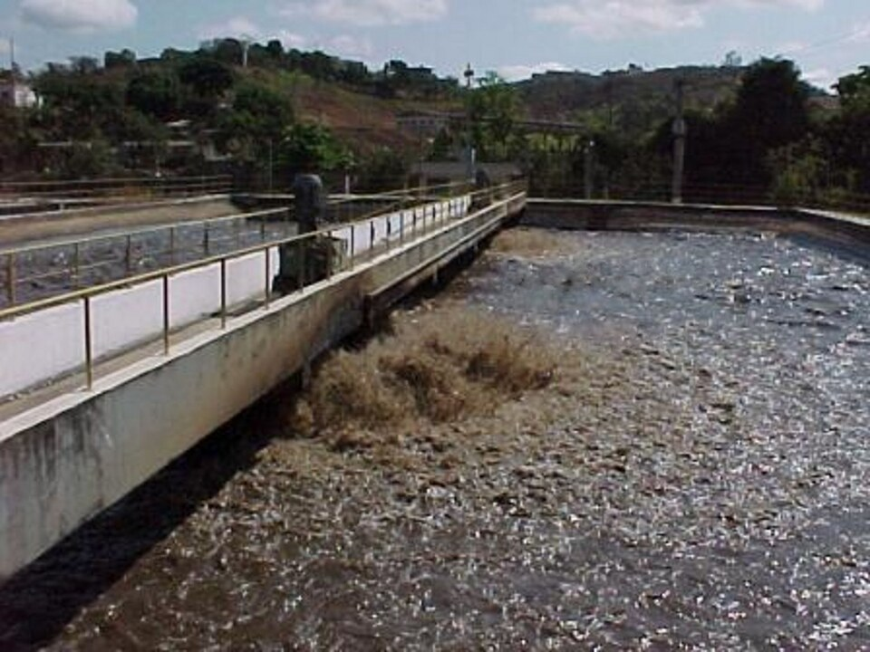{width="100%"}
[Surface aerator in the aeration tank of an activated sludge plant. Photo: Marcos von Sperling, CC BY-SA 4.0, Wikimedia Commons.]{.credit}
:::
::::

::: notes
The table is the revision sheet. Recite the chain: organic matter supplies electrons; acceptors are used roughly in order of energy yield; each step leaves evidence. Nitrogen can be converted to nitrate with oxygen, or removed as gas without it. Iron reduction dissolves iron oxides and releases the phosphate they held, which is the key to internal loading in the Baltic. Sulfate reduction produces sulfide, which is toxic and binds iron. The teaser photo shows an aeration tank in a wastewater treatment plant. There, engineers run the same reactions on purpose, switching oxygen on and off to make microbes nitrify and denitrify. That is the next lecture.
:::
