## About this lecture

:::: {.columns}
::: {.column width="56%"}
At **Hubbard Brook** in New Hampshire, scientists have measured rain and stream chemistry since the 1960s. Acid deposition fell sharply after the 1970s, yet the streams **recovered far more slowly than expected**. The reason was underground: decades of acid had stripped calcium from the soil.

Today you will learn that:

- soil holds cations on **negatively charged surfaces**, counted in **charge** (cmol~c~/kg);
- acid meets **finite inventories**: carbonate, exchangeable cations, then aluminium;
- equal **pH** does not mean equal **buffering**;
- **retention is not the same as transport**.

Last lecture, treatment moved substances from water onto solids. Soil does the same, without an operator.
:::
::: {.column width="44%"}
{width="100%"}
[Hubbard Brook Experimental Forest, New Hampshire, USA. Photo: Mariel Carr, CC BY-SA 3.0, Wikimedia Commons.]{.credit}
:::
::::

::: notes
Start with the story. Hubbard Brook is a forested research catchment where the chemistry of rain and streams has been recorded for about sixty years. It is one of the places where acid rain was first documented in North America. When sulfur emissions were cut, many expected the streams to recover quickly. They did not. Long-term soil measurements showed why: the acid had been neutralised partly by pulling calcium and magnesium off the soil's exchange sites, and that stock refills only slowly by weathering. Today we build the chemistry behind that observation. Connect to last week: in water treatment we deliberately transferred substances to solids. Soil solids do this continuously, and they can also give them back.
:::

## Two soils, same pH, different futures

:::: {.columns}
::: {.column width="50%"}
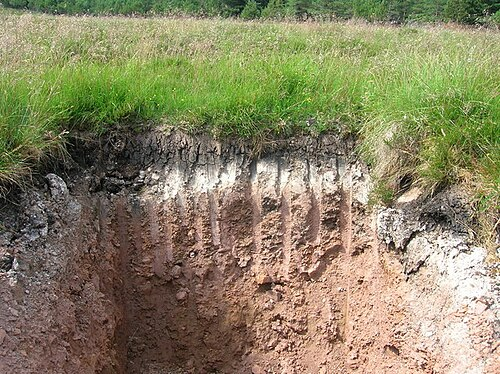{width="100%"}
[A podzol profile: the pale, leached layer lies just below the surface. Photo: Ailith Stewart, CC BY-SA 2.0, Wikimedia Commons.]{.credit}
:::
::: {.column width="50%"}
Imagine two forest soils, both measured at **pH 5.0**:

- **Soil A**, a sandy **podzol** like the one in the photo, typical of much of Sweden's forest land;
- **Soil B**, a **clay loam** rich in organic matter.

Both receive the same acid deposition for decades. One keeps feeding calcium to its stream; the other soon releases aluminium.

**Question for this lecture:** what does a soil contain that a pH reading cannot show?
:::
::::

::: notes
This is the puzzle we resolve by the end. A podzol forms in cool, wet climates on sandy parent material under conifers. Organic acids and water leach the upper mineral layer, leaving the bleached grey band you see in the photo, and deposit iron, aluminium and humus lower down. Such soils are common across Scandinavian forests. Ask students to predict which soil copes better with acid and why. Many will guess the clay soil, which is right, but ask them to say what exactly the clay contributes. The answer is an inventory of charged sites and the cations on them, plus sometimes minerals that neutralise acid. pH measures none of these directly. We will measure them by the end.
:::

## Soil is several reacting phases

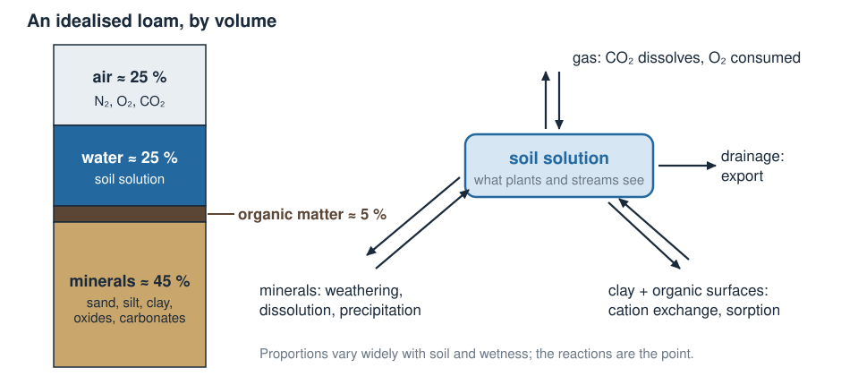{width="80%" fig-align="center"}

Soil water is the phase that plants take up and streams receive. Its composition is set by exchange with **minerals**, **organic matter** and **gas**. Soil pH describes the water's state under a stated method. It does not count what the solids can still deliver or absorb.

::: notes
Give the big picture once. By volume, a typical loam is roughly half solids and half pore space, the pores shared between water and air depending on wetness. The proportions vary widely; the point is the reactions between phases. The soil gas often contains much more carbon dioxide than the atmosphere, because roots and microbes respire, which links to last week's carbonate chemistry. Minerals weather and dissolve. Clay and organic surfaces exchange ions with the water. Water leaving the bottom of the profile carries the result to streams. The rest of the lecture focuses on one of these arrows, exchange with charged surfaces, and then asks what happens when acid arrives.
:::

## Where the negative charge comes from

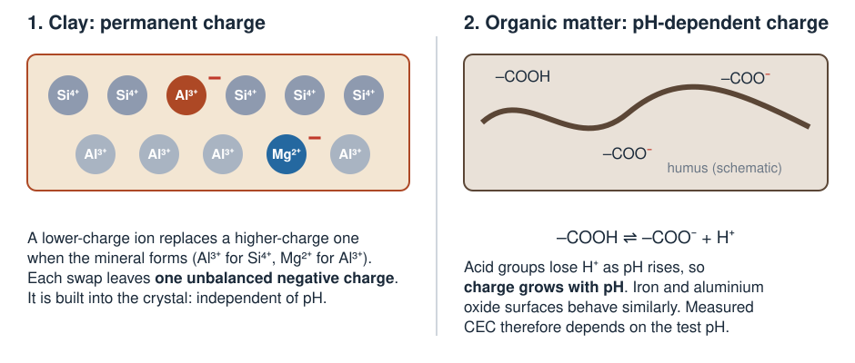{width="84%" fig-align="center"}

Clay minerals carry **permanent** negative charge from ion substitution inside the crystal. Organic matter carries **pH-dependent** charge from acid groups that lose H⁺ as pH rises. Both kinds of charge attract and hold cations from the soil water.

::: notes
Clay minerals are sheets of silicon, aluminium, oxygen and hydroxide. When a clay forms, an aluminium ion sometimes sits where a silicon ion should be, or magnesium replaces aluminium. Each such swap leaves the crystal one positive charge short, so the sheet carries a net negative charge that does not depend on pH. Organic matter is different. Humus contains many carboxyl and phenolic groups. These are weak acids, so at higher pH more of them have lost their proton and carry negative charge. That is why soil organic matter holds more cations in a neutral soil than in an acid one, and why a measured exchange capacity must state the pH of the test.
:::

## Cation exchange: ions trade places

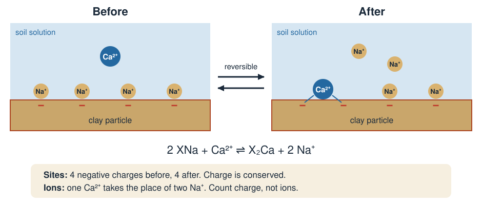{width="78%" fig-align="center"}

Exchange moves ions between sites and solution **without destroying any element**. X stands for one unit of negative site charge. A divalent ion occupies two units.

::: notes
Walk through the picture. On the left, four sodium ions sit on four negative sites, and one calcium ion is in solution. On the right, calcium has taken two sites and two sodium ions have moved into solution. Nothing has been created or destroyed, and the surface charge is still balanced. Write the reaction with X for one site charge, so calcium appears as X2Ca. The reaction is reversible and fast, typically minutes to hours. This explains a familiar observation: road salt can flush calcium and magnesium from roadside soils, because a large excess of sodium pushes the equilibrium the other way. Remember the key rule: count charge, not ions.
:::

## Which cation wins a site?

:::: {.columns}
::: {.column width="55%"}
Two things decide what sits on the exchanger:

1. **Selectivity.** Higher charge and a smaller hydrated ion are held more strongly. A rough order is Al³⁺ \> Ca²⁺ \> Mg²⁺ \> K⁺ \> Na⁺.
2. **Mass action.** A large excess of a weakly held ion can still push others off. Road salt (Na⁺) flushes Ca²⁺ and Mg²⁺ from roadside soils.

So **capacity** (how many sites) and **selectivity** (who gets them) are different quantities.
:::
::: {.column width="45%"}
::: {.checkbox}
**Consequence for acid soils.** Al³⁺ is held strongly. Once acid has released aluminium from minerals, Al³⁺ takes over sites that used to hold Ca²⁺ and Mg²⁺. The exchanger then stores acidity instead of nutrients.
:::
:::
::::

::: notes
Selectivity follows from electrostatics. A triply charged ion is held more strongly than a doubly charged one, and among ions of the same charge, the one with the smaller hydrated radius gets closer to the surface. The sequence on the slide is a common rough order. Real exchangers differ, and some clays hold potassium specifically. Mass action reminds us that exchange is an equilibrium. Even a weakly held ion wins sites when it is abundant enough. The box anticipates the acid story. In strongly acidified soils, aluminium dominates the exchanger. The soil has not lost its capacity, but its sites hold the wrong ions. That difference between capacity and occupancy is what we count next.
:::

## Counting exchange capacity

:::: {.columns}
::: {.column width="45%"}
**Cation exchange capacity (CEC)** is the total negative charge available for exchange, per kilogram of dry soil.

Unit: **cmol~c~/kg**, centimoles of charge.

$$1\ \mathrm{cmol_c/kg} = 0.01\ \mathrm{mol\ charge/kg}$$

Sand has almost none. Organic matter and swelling clays have a great deal. A few percent of humus can dominate a soil's CEC.
:::
::: {.column width="55%"}
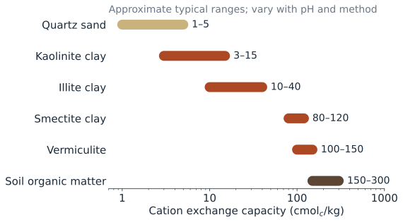{width="100%"}
:::
::::

::: notes
The unit causes most of the errors, so slow down. A centimole of charge is one hundredth of a mole of charge. Calcium carries two charges, so one centimole of calcium ions is two centimoles of charge. The ranges in the figure are approximate typical values from textbooks. They vary with pH and the measurement method, so treat them as orders of magnitude. Two things stand out. Quartz sand contributes almost nothing. Organic matter has the highest capacity per kilogram, which is why the thin dark humus layer of a sandy forest soil can hold more exchangeable cations than the much thicker mineral horizon beneath. Swelling clays such as smectite also hold a lot.
:::

## Worked example: from charge to moles

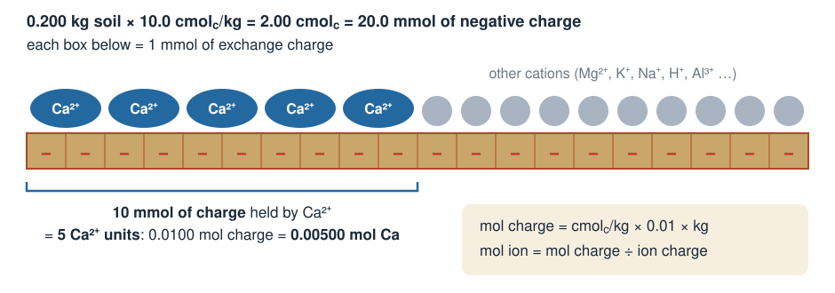{width="86%" fig-align="center"}

A 0.200 kg sample with CEC 10.0 cmol~c~/kg holds **0.0200 mol charge**. If Ca²⁺ occupies half, that is 0.0100 mol charge, but only **0.00500 mol Ca**, because each Ca²⁺ fills two sites.

::: notes
This is the calculation in the notes, drawn out. Multiply the CEC by 0.01 to convert to moles of charge per kilogram, then by the mass. That gives twenty millimoles of charge, drawn here as twenty boxes. Half the boxes are occupied by calcium. Each calcium ion covers two boxes, so there are only five calcium units, five millimoles. The common mistake is to report 0.0100 mol calcium. Ask students to redo the calculation for magnesium filling all sites in 0.100 kg of soil with CEC 20, which is exercise 1. Stress the last caution from the notes: this is a capacity inventory. It does not mean all this calcium will enter the soil water at once.
:::

## Base saturation: what fills the sites

:::: {.columns}
::: {.column width="50%"}
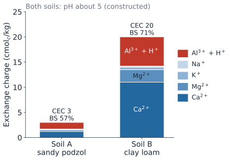{width="100%"}
:::
::: {.column width="50%"}
**Base saturation** is the share of CEC held by the base cations Ca²⁺, Mg²⁺, K⁺ and Na⁺. The rest is mostly Al³⁺ and H⁺.

$$\text{BS}=\frac{\text{base cations (cmol}_c\text{/kg)}}{\text{CEC (cmol}_c\text{/kg)}}$$

Example: 9.00 / 12.0 = **75.0 %**.

Our two soils have similar pH. Soil B holds about **8 times more** exchangeable base cations than Soil A.
:::
::::

::: notes
Base saturation answers who sits on the sites. The constructed soils in the figure both read about pH 5, yet Soil A holds 1.7 and Soil B about 14 centimoles of base-cation charge per kilogram. That is the hidden difference behind the opening puzzle. Exercise 2 asks for the base saturation of a soil with 9 out of 12 centimoles of charge occupied by base cations: 75 percent. Warn students about two misreadings. Base saturation is a property of the solid, not a statement that the soil water has the same ion ratio. And it does not set the pH uniquely: mineralogy, organic acids, selectivity and the measurement method all matter.
:::

## Check yourself

::: {.checkbox}
1. A 0.100 kg soil has CEC 20.0 cmol~c~/kg. If all sites hold Mg²⁺, how many moles of Mg is that?
2. Which holds more exchangeable charge: 1 kg of quartz sand or 0.1 kg of humus? Use the CEC ranges.
3. A soil has CEC 12.0 cmol~c~/kg and 3.0 cmol~c~/kg of Al³⁺ + H⁺ on the sites. What is its base saturation?
4. True or false: "This soil has pH 6, so its exchanger is full of calcium."
:::

::: notes
Answers. One: 20.0 times 0.01 times 0.100 gives 0.0200 mol charge, and magnesium carries two charges, so 0.0100 mol magnesium. Two: sand at about one to five centimoles per kilogram gives one to five centimoles in total; humus at 150 to 300 gives fifteen to thirty for the tenth of a kilogram, so the humus wins by a wide margin. Three: base cations hold 12 minus 3, so 9, and base saturation is 75 percent, the same as exercise 2. Four is false. pH does not report the exchanger's composition or size. A soil can read pH 6 with a small CEC and few base cations. Use this to move to acid inputs.
:::

## Acid arrives: three ways to consume it

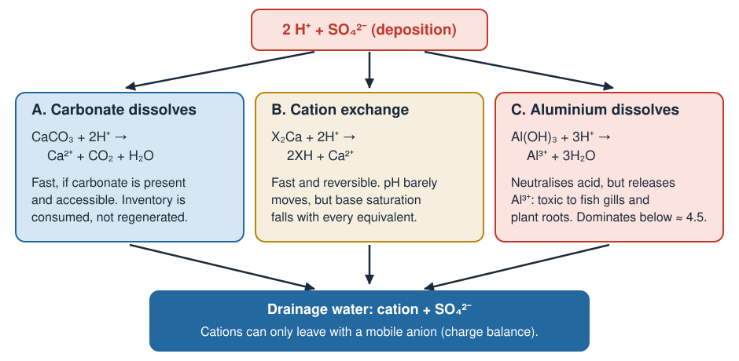{width="78%" fig-align="center"}

Every pathway uses up something finite. Look at the bottom box: a cation can only leave the soil **together with an anion**. Sulfate from deposition is the vehicle that carries calcium out to the stream.

::: notes
Acid deposition supplies hydrogen ions with sulfate and nitrate, as in the deposition unit. In the soil, the hydrogen ions are consumed in three main ways. Carbonate minerals dissolve if present. Hydrogen ions displace base cations from exchange sites. And in strongly acid soils, aluminium hydroxide minerals dissolve. Organic acid groups also take up protons, which we fold into exchange here. The bottom box is the key insight from catchment studies. Charge balance means that calcium cannot leave in drainage by itself. It needs an accompanying anion, and the sulfate from deposition is exactly that anion. Acid rain therefore drives calcium loss twice: by displacing it and by supplying its partner.
:::

## Which reaction dominates depends on pH

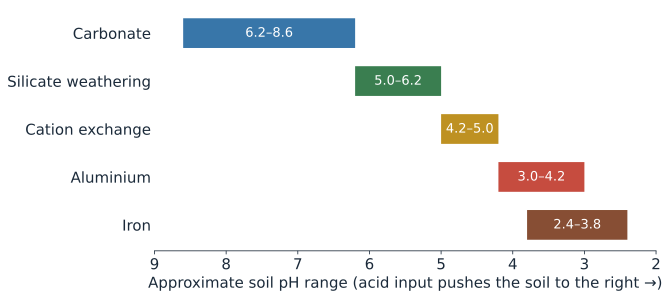{width="78%" fig-align="center"}

As acid accumulates, soils move from one buffer range to the next: **carbonate**, then slow **silicate weathering**, then **cation exchange**, then **aluminium**. Each range holds the pH roughly steady while its inventory lasts. The ranges are approximate and overlap.

::: notes
This classification of soil buffer ranges goes back to the German soil chemist Bernhard Ulrich in the 1980s. The pH limits are approximate, and different texts quote slightly different values, so do not memorise the decimals. The idea is what matters. While carbonate remains, pH stays near neutral. Without carbonate, silicate weathering supplies base cations slowly. When acid input outpaces weathering, the exchanger gives up its base cations, and the soil sits around pH 4 to 5. Below that, aluminium minerals dissolve, which neutralises acid but puts aluminium into the water. The arrow is a time arrow under continued acid load: a soil moves to the right when it exhausts each reserve.
:::

## Carbonate: fast but finite

:::: {.columns}
::: {.column width="55%"}
$$\mathrm{CaCO_3+2H^+\rightarrow Ca^{2+}+CO_2^*+H_2O}$$

As in the carbonate lecture, each mole of calcite neutralises **2 equivalents** of acid at this endpoint.

**Example:** 0.0100 mol accessible CaCO₃ can consume **0.0200 mol H⁺**.

But protection is not unlimited:

- the inventory is **used up**, not regenerated;
- grains coated with iron oxides or gypsum react slowly;
- calcite in a different layer from the flow path does nothing.
:::
::: {.column width="45%"}
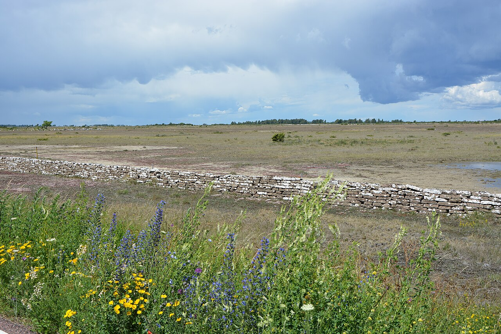{width="100%"}
[Stora Alvaret, Öland: thin soil on limestone bedrock. Photo: Bernt Fransson, CC BY-SA 4.0, Wikimedia Commons.]{.credit}
:::
::::

::: notes
Carbonate-bearing soils, such as those on limestone in Gotland, Öland or Skåne, are well protected against acid deposition. The stoichiometry is the same as the liming calculation in the carbonate lecture, and exercise 3 uses it directly. The cautions matter in practice. A stoichiometric inventory is an upper limit on what could react. Real protection depends on contact: calcite grains can be armoured with coatings, and calcite deep in the profile does not help the water that flows through the upper horizons. Once the carbonate is gone it does not come back on human time scales. That is why liming of acidified soils and lakes needs to be repeated.
:::

## Exchange buys time, not immunity

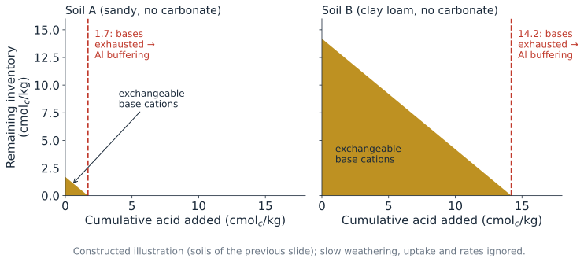{width="80%" fig-align="center"}

Without carbonate, each equivalent of acid removes one equivalent of base cations from the exchanger. Soil A runs out after **1.7 cmol~c~/kg**; Soil B after **14.2**. Until then their pH may look similar. Afterwards, aluminium takes over.

::: notes
This constructed figure uses the two soils from the base saturation slide. Each equivalent of acid that is neutralised by exchange removes one equivalent of base cations, so the inventory falls in a straight line. Soil A has very little to lose and reaches the aluminium range quickly. Soil B can absorb about eight times more acid before the same happens. The figure deliberately ignores weathering, which slowly resupplies base cations, and uptake by trees, which also removes them. Make the key point explicitly. A soil that has resisted acid so far may simply be spending its reserve. Resistance to one acid pulse, or even to decades of deposition, does not guarantee indefinite protection.
:::

## When the bases run out: aluminium

:::: {.columns}
::: {.column width="52%"}
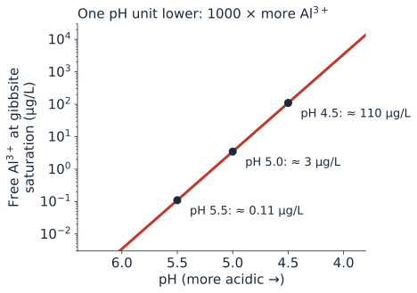{width="100%"}
:::
::: {.column width="48%"}
$$\mathrm{Al(OH)_3(s)+3H^+\rightleftharpoons Al^{3+}+3H_2O}$$

Three H⁺ per Al³⁺, so free Al³⁺ rises **1000-fold per pH unit** at mineral equilibrium.

Dissolved inorganic aluminium damages **fish gills** and **fine roots**. It was a main cause of fish loss in acidified Scandinavian lakes.

Model: gibbsite equilibrium, log K = 8.11 at 25 °C; free ion only.
:::
::::

::: notes
The aluminium buffer neutralises acid, but at a price. The equilibrium constant expression contains the hydrogen-ion concentration cubed, so each pH unit changes the free aluminium concentration a thousandfold. The curve uses the equilibrium constant for crystalline gibbsite from standard tables. Real soils contain less ordered aluminium phases and organic complexes, so measured concentrations differ, often being higher in total. The thousandfold slope is the robust message. Biologically, inorganic aluminium precipitates on fish gills and disrupts salt balance, and it damages fine roots. In many acidified Scandinavian lakes, aluminium washed in from soils was as important as low pH itself. The metals unit covers how ligands change this picture.
:::

## Back to Hubbard Brook

:::: {.columns}
::: {.column width="40%"}
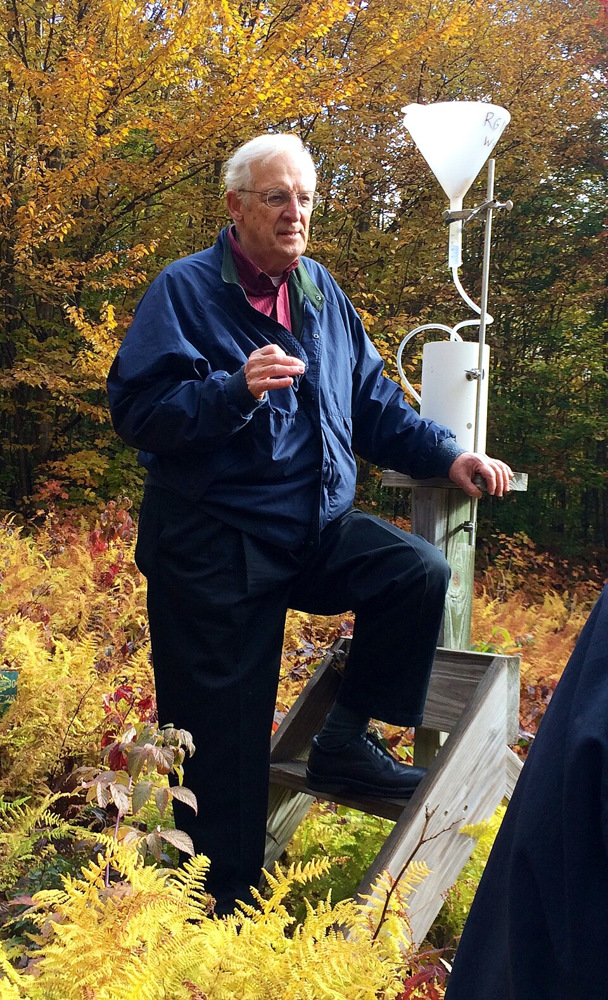{height="500px" fig-align="center"}
[Gene Likens, co-founder of the Hubbard Brook Ecosystem Study, beside a precipitation collector, 2015. Photo: Mariel Carr, CC BY-SA 3.0, Wikimedia Commons.]{.credit}
:::
::: {.column width="60%"}
Long-term records showed large losses of **exchangeable calcium** from the forest soil. Lower sulfate deposition slowed the loss, but the exchanger refills only as fast as minerals weather.

In 1999 researchers spread a **calcium silicate mineral** over one whole catchment by helicopter to test the idea.

**Constructed estimate:** raise base cations by 1.0 cmol~c~/kg in the top 10 cm of 1 ha (≈ 1.0 × 10⁶ kg soil):

10 000 mol charge = 5000 mol Ca ≈ **200 kg Ca**, or ≈ 500 kg CaCO₃.
:::
::::

::: notes
Return to the opening case. The slow stream recovery at Hubbard Brook was explained by soil chemistry: the exchanger had lost much of its calcium during decades of acid deposition, and weathering resupplies it slowly. The calcium addition experiment applied the mineral wollastonite, a calcium silicate, to a whole small catchment, so the response of soil, trees and stream could be followed. The estimate on the slide is our own constructed calculation, not the experiment's dose. Assume a soil density of one kilogram per litre. One hectare to ten centimetres is a thousand cubic metres, about a million kilograms. One centimole of charge per kilogram is ten thousand moles of charge, five thousand moles of calcium, about two hundred kilograms.
:::

## Retention is not the same as transport

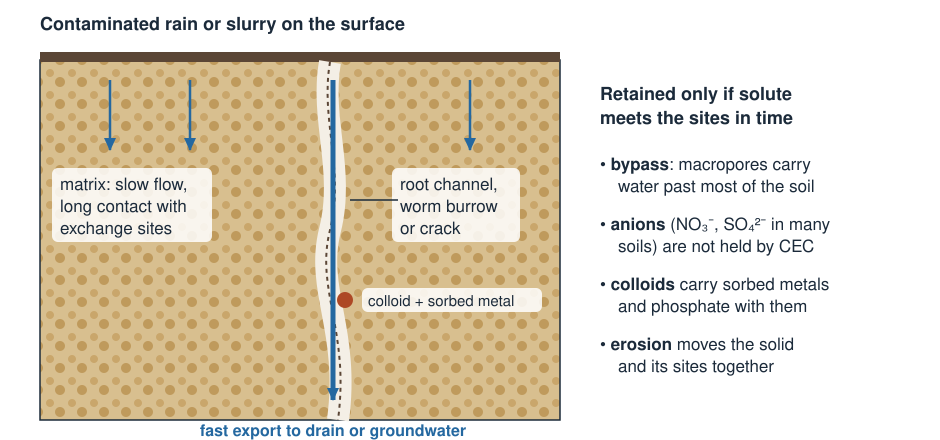{width="78%" fig-align="center"}

A high CEC protects groundwater only if the solute **meets the sites**. Water in macropores can bypass most of the soil, anions are not held by cation exchange, and colloids can carry sorbed metals with them.

::: notes
Students often treat CEC as a universal filter. It is not. First, exchange needs contact time: after heavy rain, water and anything dissolved in it can race down root channels, worm burrows and shrinkage cracks, reaching drains in hours. Second, CEC holds cations. Nitrate is hardly retained, and sulfate only by specific surfaces in some soils, which is why nitrate leaching is a classic problem. Third, small particles, colloids, can move through pores while carrying sorbed metals or phosphate. And erosion simply moves the solids, sites and all. To predict movement, combine chemical partitioning with water flow, residence time and particle transport. Redox changes in waterlogged soil add another layer, which we revisit in the synthesis.
:::

## Fast paths in a real soil

:::: {.columns}
::: {.column width="45%"}
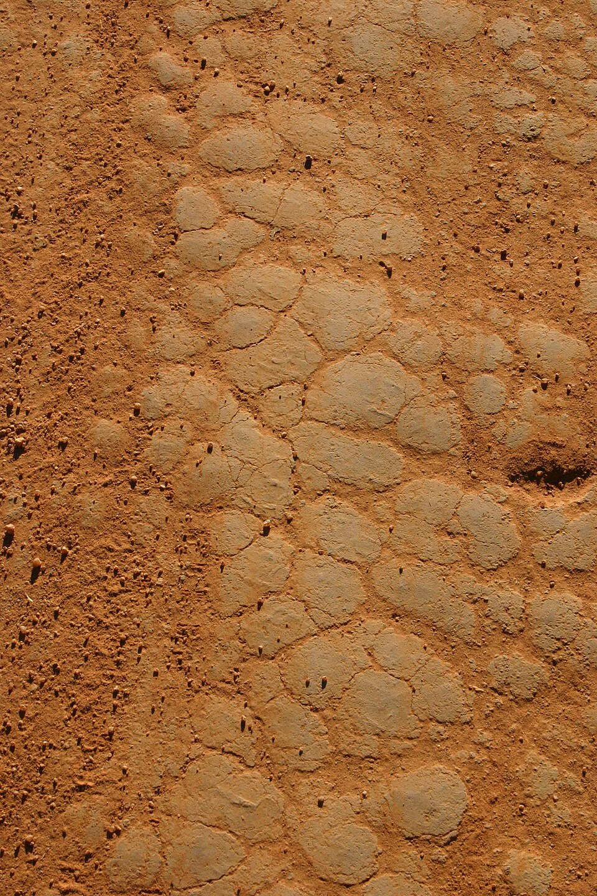{height="500px" fig-align="center"}
[Shrinkage cracks in drying clay, Gauteng, South Africa. Photo: Paul Venter, CC BY-SA 3.0, Wikimedia Commons.]{.credit}
:::
::: {.column width="55%"}
Clay soils with high CEC **shrink and crack** when they dry. The next heavy rain runs straight down the cracks.

This produces a paradox. The soil with the most exchange sites can deliver a pesticide or phosphate pulse to a field drain within hours, because the water hardly touched those sites.

Fair tests of retention therefore report **flow conditions**, not only CEC and pH.

The next lecture applies the same thinking to waste heaps: what is inside matters, but so does how water and oxygen get in.
:::
::::

::: notes
Use the photo to make the paradox concrete. Swelling clays, the same smectites with high exchange capacity, shrink when they dry and form crack networks. In agricultural clay soils, as in parts of southern and central Sweden, much of the water leaving the field after a heavy rain can pass through such cracks and through worm burrows to tile drains. Field studies of pesticides and phosphorus loss repeatedly show quick pulses after rain. The chemical capacity of the soil is real, but the water did not stay long enough to use it. This prepares the next lecture, where access of water and oxygen to a waste heap controls how fast its chemistry runs.
:::

## Back to the two soils: what to measure

:::: {.columns}
::: {.column width="62%"}
| Measure | Soil A (sandy podzol) | Soil B (clay loam) |
| --- | --- | --- |
| pH | ≈ 5 | ≈ 5 |
| CEC (cmol~c~/kg) | 3 | 20 |
| Base cations (cmol~c~/kg) | 1.7 | 14.2 |
| Carbonate | none | none |
| Organic matter, clay | little | much |
| Fast flow paths | some | cracks when dry |

**Same pH, different reserves.** Soil A acidifies its stream soon; Soil B can neutralise about eight times more acid first.
:::
::: {.column width="38%"}
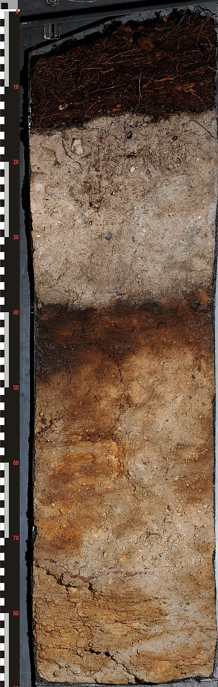{height="560px" fig-align="center"}
[Podzol profile from Sweden, ISRIC World Soil Reference Collection. Photo: D. Creutzberg, CC BY-SA 3.0, Wikimedia Commons.]{.credit}
:::
::::

::: notes
This answers exercise 4 and closes the opening puzzle. Before predicting how a soil responds to acid, measure its capacity under stated conditions, its base saturation, any carbonate or weatherable minerals, its organic matter, and how water moves through it. Equal pH is not evidence of equal buffering or equal retention. The values in the table are the constructed soils used throughout this lecture. The photo shows a real Swedish podzol profile kept as a reference in an international soil collection. Point out the bleached grey horizon that lost its iron and aluminium, and the darker layer below where they accumulated. These are exactly the soils where acidification caused the most damage.
:::

## Common mistakes to avoid

- **"Equal pH means equal buffering."** pH is a state; CEC, base saturation and carbonate are inventories.
- **"cmol~c~ of Ca equals cmol of Ca."** Divide charge by 2 for Ca²⁺ and Mg²⁺, by 3 for Al³⁺.
- **"Base saturation is the soil-water ion ratio."** It describes the solid's sites.
- **"Exchange destroys the acid."** It moves base cations out and stores acidity on the solid.
- **"High CEC retains everything."** Not anions, not water in macropores, not colloids.
- **"A soil that resisted acid is safe."** It may have been spending a finite reserve.

::: notes
Run through these as a quick self-test and ask students to explain each in their own words. The second is the most common calculation error in this unit, so ask for an example: 2.0 cmol of charge from aluminium corresponds to about 0.67 cmol of aluminium ions. The fourth is subtle. Exchange neutralises the water passing through, but the acidity has not disappeared. It now sits on the exchanger as hydrogen and aluminium ions, and the base cations have gone downstream with sulfate. The last one is the policy lesson from Hubbard Brook and from Swedish forest soils: a soil's apparent resistance can hide a declining reserve that recovers only slowly.
:::

## Summary {.smaller}

:::: {.columns}
::: {.column width="70%"}
| Concept | Key fact |
| --- | --- |
| Soil phases | minerals, organic matter, water, gas; soil water reflects exchange with all |
| Negative charge | permanent in clays (substitution); pH-dependent on organic matter |
| Cation exchange | 2XNa + Ca²⁺ ⇌ X₂Ca + 2Na⁺; charge conserved, reversible |
| CEC | cmol~c~/kg; 1 cmol~c~ = 0.01 mol charge; divide by ion charge for moles |
| Base saturation | base-cation charge / CEC; a solid property, does not fix pH |
| Acid response | carbonate → silicate weathering → exchange → aluminium |
| Carbonate | CaCO₃ consumes 2 eq H⁺ per mol; finite and access-limited |
| Aluminium | free Al³⁺ rises 1000× per pH unit; toxic to fish and roots |
| Leaching | cations leave with mobile anions such as SO₄²⁻ |
| Transport | macropores, anions and colloids escape exchange |

**Next:** [Waste materials and leachate chemistry](../waste-leachate/lec.qmd). Why does a mine waste heap keep producing acid for centuries? Then the [exercises](exercise.qmd) and the [notes](notes.qmd).
:::
::: {.column width="30%"}
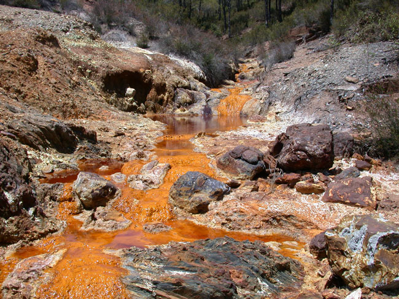{width="100%"}
[Río Tinto, Spain: iron-stained stream bed from acid mine drainage. Photo: Carol Stoker, NASA, public domain, Wikimedia Commons.]{.credit}
:::
::::

::: notes
Recite the chain once. Soil solids carry negative charge, which holds cations. We count the capacity in charge units and convert to moles by dividing by the ion's charge. Acid is consumed by finite inventories in turn: carbonate, weathering, exchange and then aluminium, with the released cation leaving together with sulfate. A soil's pH does not reveal how much of its reserve remains, which is why Hubbard Brook and many Swedish streams recovered slowly. Finally, retention needs contact, so flow paths matter. The photo teases the next lecture. In mining waste, the chemistry runs the other way: the solid itself generates acid when air and water reach it, and the river turns red.
:::
