## About this lecture

:::: {.columns}
::: {.column width="56%"}
In August 2015, a clean-up crew at the abandoned **Gold King Mine** in Colorado accidentally released about 3 million gallons (roughly 11 000 m³) of acidic, metal-rich mine water. The **Animas River turned orange** for many kilometres. Within days the colour had moved downstream and faded.

The water looked clean again. **But where had the metals gone?**

Today you will learn to:

- explain why mineral surfaces carry **pH-dependent charge**;
- close a **water–solid mass balance** with K~d~;
- recognise **finite capacity** and competition;
- ask whether particles **retain** a contaminant or **carry** it.

Last lecture: iron and aluminium hydrolyse and precipitate. Today: what their solids do.
:::
::: {.column width="44%"}
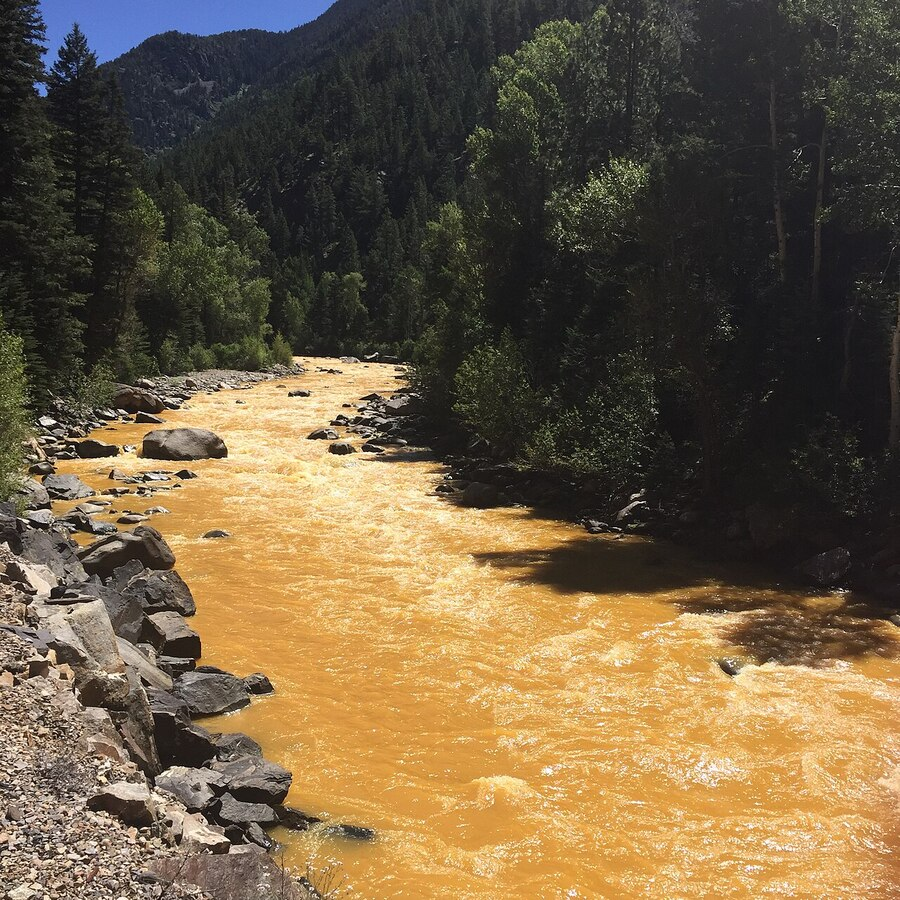{width="100%"}
[The Animas River between Silverton and Durango, within a day of the Gold King Mine release, August 2015. Photo: Riverhugger, CC BY-SA 4.0, Wikimedia Commons.]{.credit}
:::
::::

::: notes
Open with the image. The Gold King Mine release is one of the best-documented mine-water spills, because it happened during an EPA operation and was monitored intensively. The orange colour is iron(III) oxyhydroxide, the solid that forms when acidic iron-rich water is diluted and its pH rises, exactly the hydrolysis we discussed in the metals lecture. Within days the plume passed and the river looked normal. That is the puzzle for today. Metals do not disappear. If they are no longer in the water, they are somewhere else: on particles, in the river bed, or further downstream. To answer where, we need the chemistry of surfaces.
:::

## Removed, or only moved?

:::: {.columns}
::: {.column width="50%"}
After the plume passed, **dissolved** metal concentrations at Durango fell back towards earlier levels within days to weeks.

Much of the metal load had travelled **attached to iron oxyhydroxide particles**. Many of those particles settled on the river bed and in reservoirs downstream.

So a water sample can look clean while the system still holds the metal.

**Question for this lecture:** when a contaminant leaves the water, has it been removed, or has it only moved onto a surface that may move again?
:::
::: {.column width="50%"}
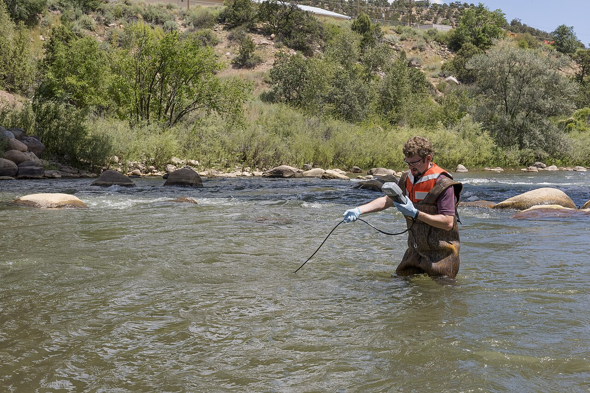{width="100%"}
[Water monitoring in the Animas River at Durango, Colorado, 14 August 2015. Photo: Eric Vance, US EPA, public domain, Wikimedia Commons.]{.credit}
:::
::::

::: notes
This slide states the main question. Monitoring after the spill showed that concentrations in the water fell quickly as the plume passed, while much of the metal had been carried on particles. Those particles settled along the river and in downstream reservoirs. Later reports discussed whether high spring flows could stir up those deposits again. We do not need the details of the monitoring programme. The chemical lesson is general. Sorption and settling transfer a contaminant from water to solid. The total in the system is unchanged. Whether that is good news depends on whether the solid stays put. Ask students what they would need to measure to tell the difference, and keep their answers for the end of the lecture.
:::

## From dissolved to particulate: a continuum

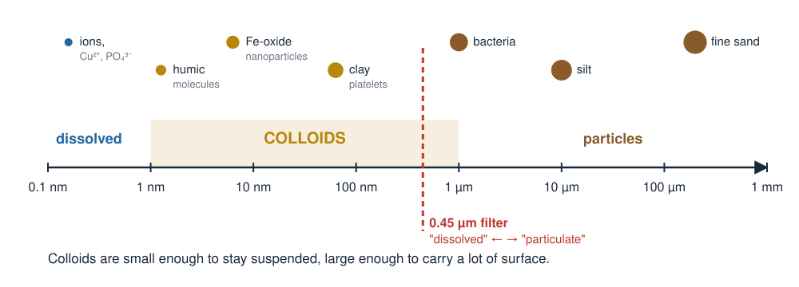{width="90%" fig-align="center"}

There is no sharp line between dissolved and particulate. **Colloids**, about 1 nm to 1 µm across, stay suspended for a long time. A 0.45 µm filter cuts through the colloid range, so "dissolved" includes some colloids and "particulate" includes others.

::: notes
Show the scale. Ions and small molecules are below a nanometre. Humic molecules, iron oxide nanoparticles and clay platelets fill the colloid range. Bacteria, silt and sand are larger. The filter used to define dissolved sits inside this continuum at 0.45 micrometres. That number is a convention, not a natural boundary. Colloids matter because they are small enough that gravity hardly settles them, but large enough to carry many binding sites. A metal on a colloid can pass a filter and be reported as dissolved, or be retained and reported as particulate, depending on the colloid's size. This is why a filtered result must always be read together with the method.
:::

## Small particles have enormous surfaces

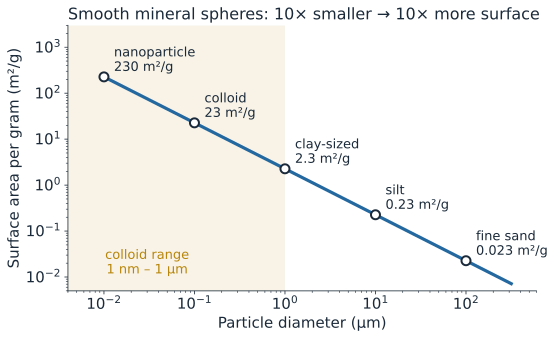{width="74%" fig-align="center"}

For a sphere, the surface per gram scales as **1/diameter**. A gram of 10 nm particles has about **10 000 times** the surface of a gram of fine sand. Fresh iron oxyhydroxides are made of such tiny crystals, so a few grams carry hundreds of square metres of reactive surface.

::: notes
This is geometry, not chemistry. The figure uses smooth spheres of mineral density 2.65 grams per cubic centimetre, so the numbers are idealised. Each factor of ten smaller in diameter gives ten times more surface per gram. Real clays and fresh iron oxyhydroxides have even more surface than spheres of the same size, because they are platy or porous; freshly precipitated ferrihydrite is commonly reported at a few hundred square metres per gram. The point for environmental chemistry: binding happens at surfaces, so the fine fraction of a sediment or soil does most of the binding even when it is a small fraction of the mass. The orange floc in the Animas was exactly this kind of high-surface material.
:::

## Oxide surfaces gain and lose protons

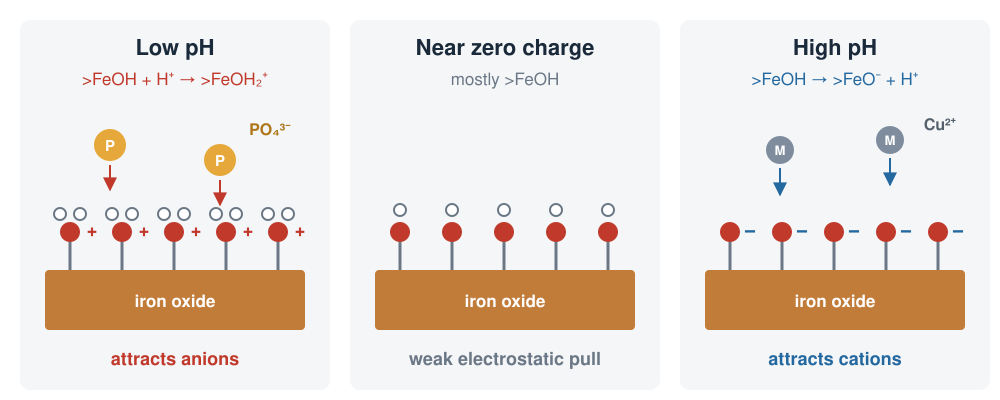{width="86%" fig-align="center"}

$$\mathrm{>SOH+H^+\rightleftharpoons>SOH_2^+}\qquad\mathrm{>SOH\rightleftharpoons>SO^-+H^+}$$

Here **>S** means a surface metal atom, such as Fe at the edge of an oxide. At low pH the surface is **positive**; at high pH it is **negative**.

::: notes
At the surface of an oxide, the metal atoms cannot complete their coordination with the solid, so they bind hydroxyl groups from water. These surface hydroxyls are amphoteric: they can take up a proton or give one away, just like the bound water of a hydrolysing metal ion in the last lecture. The notation with the greater-than sign means "attached to the solid surface". Be clear that S stands for a surface site, not for sulfur. At low pH most groups are protonated and the surface is positive. At high pH most have lost a proton and the surface is negative. In between, the positive and negative groups balance.
:::

## Surface charge depends on pH

:::: {.columns}
::: {.column width="56%"}
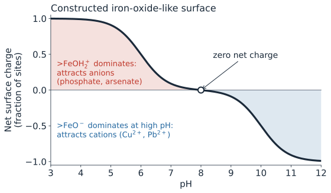{width="100%"}
:::
::: {.column width="44%"}
At one pH the positive and negative sites balance: the **point of zero charge**. For iron oxides it typically lies roughly between pH 7 and 9.

- Below it: positive surface, attracts **anions** such as phosphate and arsenate.
- Above it: negative surface, attracts **cations** such as Cu²⁺ and Pb²⁺.

Most natural waters sit near or below this pH, so iron oxides are good at holding **phosphate**.
:::
::::

::: notes
The curve is a constructed two-constant model with zero charge at pH 8, typical of iron oxides. Read it from left to right. Strongly positive at low pH, zero near 8, negative at high pH. The point of zero charge differs between minerals: silica is negative over almost the whole natural range, while iron and aluminium oxides are positive in many acidic and neutral waters. Use this to predict electrostatic attraction. Phosphate, an anion, is attracted to iron oxides in ordinary waters. Metal cations are attracted more strongly as pH rises. Keep in mind that charge is only part of the story; the next slides add specific bonding.
:::

## Sorption edges: cations and anions behave oppositely

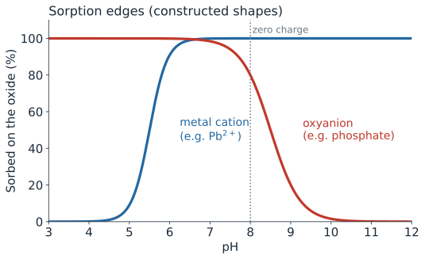{width="68%" fig-align="center"}

Metal cations bind more as pH **rises**; oxyanions bind more as pH **falls**. Each change happens over one or two pH units, a **sorption edge**. Acid can therefore release metals from oxides, while rising pH can release phosphate.

::: notes
These are constructed curves with the typical shapes seen in laboratory experiments with iron oxides. The fraction of a metal cation such as lead that is sorbed rises steeply over a narrow pH range. The fraction of an oxyanion such as phosphate or arsenate falls at high pH. This explains two field observations. First, acidification releases metals from particles, which was one of the mechanisms in the last lecture's exercise. Second, when the pH of lake water rises during intense photosynthesis, phosphate can be released from sediment particles. Note that the cation edge lies below the zero-charge pH: specific bonding lets cations bind even where the surface is not yet negative.
:::

## Clays: permanent charge and cation exchange

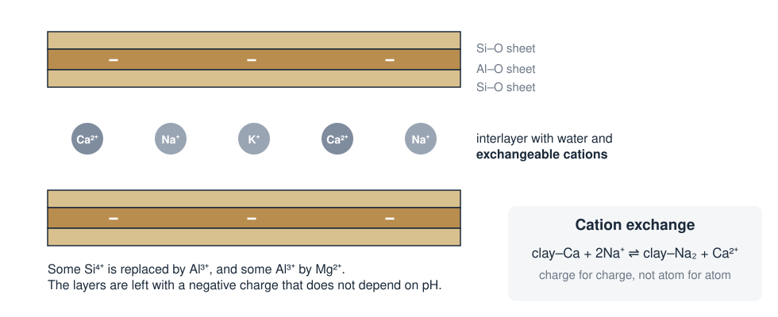{width="80%" fig-align="center"}

In clay minerals, some Si⁴⁺ and Al³⁺ in the crystal is replaced by ions of lower charge. The layers keep a **negative charge that does not depend on pH**. It is balanced by cations such as Ca²⁺, Na⁺ and K⁺, which can be **exchanged** for others.

::: notes
Clays add a second kind of surface charge. During formation, some silicon is replaced by aluminium and some aluminium by magnesium in the crystal lattice. Each replacement leaves one unit of negative charge in the layer. That charge is permanent: it does not depend on pH, unlike the oxide surfaces we just saw. Cations sit between the layers and on the outer surfaces to balance it, and they are held mainly electrostatically, so other cations can replace them. The exchange is charge for charge: one calcium replaces two sodium. This cation exchange capacity is central in soil chemistry, which we meet in week 4. It also explains why clay-rich sediments hold metal cations.
:::

## More than charge: inner-sphere binding

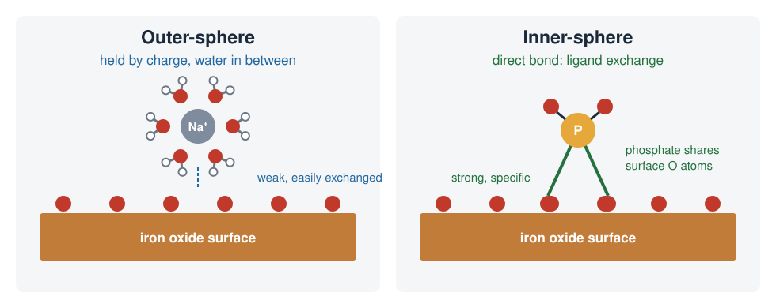{width="86%" fig-align="center"}

**Outer-sphere** ions keep their water shell and are held by charge alone; they exchange easily. **Inner-sphere** complexes form a direct bond with surface oxygen, by ligand exchange. They are much stronger and can form even on a surface of the same charge.

::: notes
Electrostatics is the first approximation. The second is chemistry. An outer-sphere ion, such as sodium, stays fully hydrated and sits near the surface because of opposite charge. Change the ionic strength and it leaves. An inner-sphere complex is a real coordination bond: the sorbing ion replaces a surface hydroxyl or water and bonds directly to the surface metal through oxygen. Phosphate on iron oxide is the classic case, often sharing two surface oxygens. Copper and lead also bind inner-sphere. This is why phosphate binds strongly, why it competes with arsenate for the same sites, and why sorption edges for cations appear below the zero-charge pH. Specific binding is the link between surface chemistry and coordination chemistry.
:::

## A number for sorption: the distribution coefficient

:::: {.columns}
::: {.column width="50%"}
For low concentrations, sorbed and dissolved amounts are often roughly proportional:

$$q=K_d\,C_w$$

- q: sorbed per dry solid (mg/kg)
- C~w~: in water (mg/L)
- K~d~: distribution coefficient (L/kg)

K~d~ belongs to **one system**: this solute, this solid, this water, this pH. It is not a molecular constant.
:::
::: {.column width="50%"}
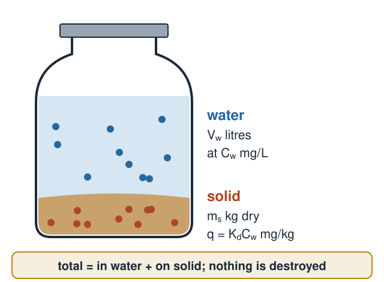{width="100%"}
:::
::::

::: notes
After the mechanisms we need a number we can calculate with. The distribution coefficient is the simplest one: the ratio of sorbed concentration to dissolved concentration at equilibrium. Check the units carefully: milligrams per kilogram divided by milligrams per litre gives litres per kilogram. A large Kd means the solute strongly prefers the solid. The warning is important. Kd measured for lead on one sediment at pH 7 tells you little about lead on another sediment at pH 5, because the edges we just saw move it by orders of magnitude. Use a Kd only for the conditions it was measured under, and only at low concentrations where the relationship is linear.
:::

## Close the two-phase balance

:::: {.columns}
::: {.column width="50%"}
In a closed bottle, all the solute is either in water or on solid:

$$M_T=C_wV_w+q\,m_s=C_w(V_w+K_dm_s)$$

$$C_w=\frac{M_T}{V_w+K_dm_s}$$

Both terms in the denominator are in **litres**. K~d~m~s~ acts like an extra volume the solute can spread into. The sorbed fraction is K~d~m~s~/(V~w~ + K~d~m~s~).
:::
::: {.column width="50%"}
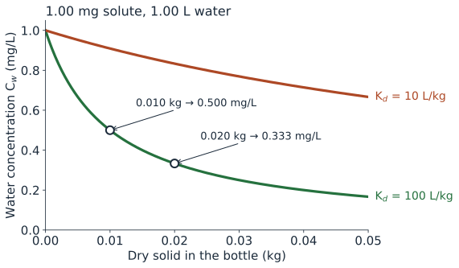{width="100%"}
:::
::::

::: notes
Derive the equation with the class. Total mass equals mass in water plus mass on solid. Substitute the Kd relation for q, factor out the water concentration, and divide. A useful picture: Kd times solid mass has units of litres, so the solid behaves like an extra, invisible volume of water. If that extra volume equals the real water volume, half the solute is sorbed. The curve shows how the water concentration falls as solid is added, for two Kd values. Note that it is not linear: doubling the solid does not halve the concentration. The model assumes equilibrium, a closed bottle, and no degradation or loss to the walls.
:::

## Worked example: one bottle, three cases

:::: {.columns}
::: {.column width="50%"}
1.00 mg solute, 1.00 L water, 0.0100 kg dry solid, K~d~ = 100 L/kg.

- K~d~m~s~ = **1.00 L**, so C~w~ = 1.00/2.00 = **0.500 mg/L**
- water 0.500 mg; solid 0.500 mg; q = 50.0 mg/kg

Double the solid: C~w~ = 1/3.00 = **0.333 mg/L**, solid 0.667 mg.

pH change lowers K~d~ to 10: C~w~ = 1/1.10 = **0.909 mg/L**. Desorption, with no new solute added.
:::
::: {.column width="50%"}
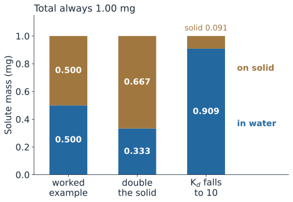{width="100%"}
:::
::::

::: notes
Work the first case slowly. Kd times solid mass is 100 times 0.01, so one litre. The denominator is two litres, giving half a milligram per litre in water. Multiply back to masses and check that they sum to one milligram. The sorbed concentration is 50 milligrams per kilogram. The other two bars are exercises 1 and 3. Doubling the solid does not halve the water concentration; it reduces it to one third. A tenfold drop in Kd, for example after a pH change, pushes 91 percent of the solute back into the water. The water concentration nearly doubled although nothing was added. That is how a contaminated sediment can become a source.
:::

## Check yourself

::: {.checkbox}
Use the two-phase balance and the surface-charge picture.

1. 2.00 mg solute, 1.00 L water, 0.0500 kg solid, K~d~ = 20 L/kg. What is C~w~, and what fraction is sorbed?
2. Is an iron oxide surface at pH 5 more likely to hold phosphate or Cu²⁺ by charge alone?
3. A sediment is acidified. Predict what happens to sorbed lead.
4. Why can't a K~d~ measured at pH 7 simply be used at pH 5?
:::

::: notes
Answers. One: Kd times solid mass is one litre, so Cw is 2.00 divided by 2.00, one milligram per litre, and half is sorbed. Two: phosphate. At pH 5 the iron oxide surface is positive, below its zero-charge point, so it attracts anions. Three: lead sorption falls as pH falls, across the cation edge, so lead is released to the water. Four: Kd is not a constant. It depends on pH through surface charge and the sorption edge, and could change by orders of magnitude between pH 7 and 5. Use question four to lead into the limits of the linear model.
:::

## Surfaces fill up

:::: {.columns}
::: {.column width="50%"}
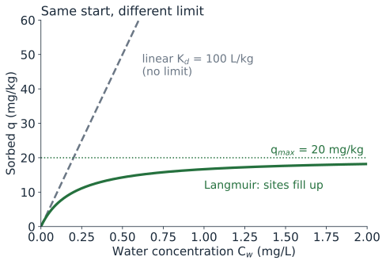{width="100%"}
:::
::: {.column width="50%"}
A linear K~d~ has no limit. Real surfaces have a **finite number of sites**. The Langmuir model levels off at a capacity q~max~:

$$q=\frac{q_{max}\,b\,C_w}{1+b\,C_w}$$

Example: q~max~ = 20.0 mg/kg on 0.0100 kg of solid gives at most **0.200 mg** sorbed. That solid cannot hold 1.00 mg, whatever K~d~ says.

Other solutes **compete** for the same sites: phosphate and arsenate, for example.
:::
::::

::: notes
This is exercise 2. The linear model was fine at low concentrations, but it predicts that a surface can hold unlimited amounts if the water concentration keeps rising. The Langmuir model adds a ceiling. At low concentration it behaves like Kd equal to qmax times b, here 100 litres per kilogram, the same start as the dashed line. At high concentration it approaches qmax. Multiply the capacity by the solid mass to get the most the solid can hold: 0.2 milligrams. Competition matters too. Phosphate and arsenate bind to the same iron oxide sites, so adding phosphate fertiliser can release arsenic. A Kd measured at low loading or without competitors can overestimate retention.
:::

## Particles move

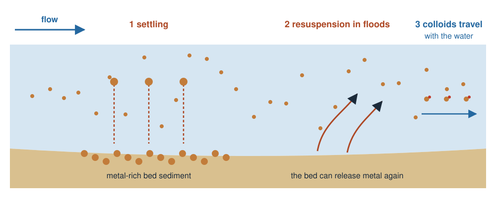{width="88%" fig-align="center"}

Sorption moves a contaminant from water to a solid. What happens next depends on the solid. Particles that **settle** can retain metal in the bed. **Floods** can stir the bed up again. **Colloids** stay suspended and can carry sorbed metal far downstream.

::: notes
Now connect the chemistry to transport. Sorption on a large, settling particle removes metal from the flowing water, but deposits it in the bed sediment, where it can stay for years. A flood or a dredging operation can resuspend the bed and return the particles to the water. Sorption on colloids does the opposite of retention: the colloid moves with the water, so the sorbed metal travels too, sometimes faster than a dissolved solute that interacts with the stationary bed. To claim removal, you must name the destination of the solid and say how long it stays there. A falling water concentration alone is not enough.
:::

## Back to the Animas

:::: {.columns}
::: {.column width="50%"}
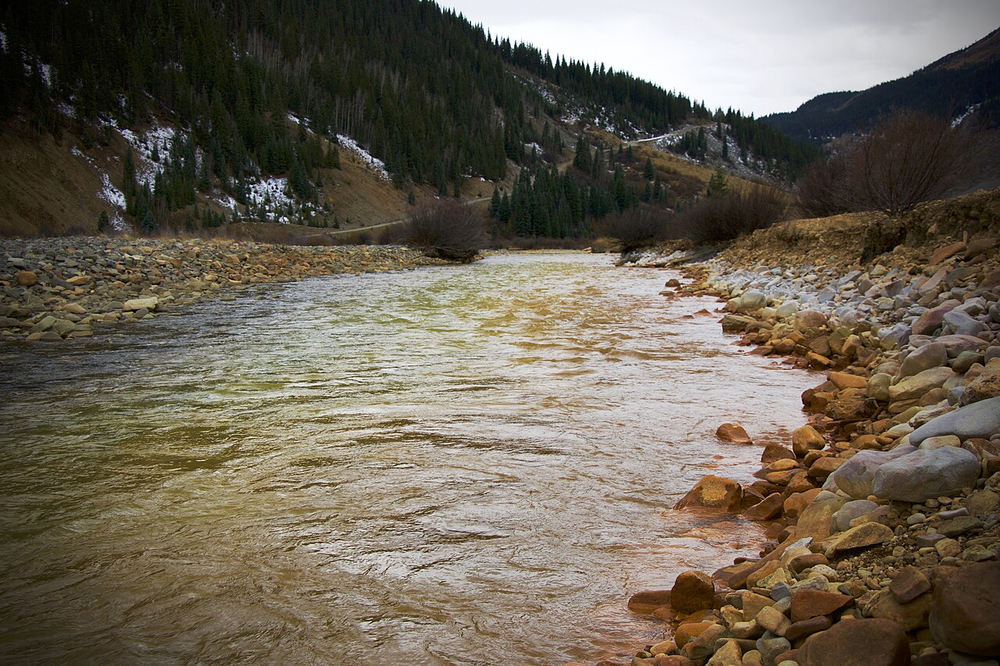{width="100%"}
[Where Cement Creek joins the Animas River, November 2015. The stones are coated with orange iron oxyhydroxide. Photo: US EPA, public domain, Wikimedia Commons.]{.credit}
:::
::: {.column width="50%"}
Now we can answer the opening question.

- As the acidic mine water mixed with river water, its pH rose and **iron precipitated** as fine oxyhydroxide.
- Those particles had large surfaces that **sorbed** other metals.
- Many particles **settled** along the bed and in reservoirs. The metals were moved, not destroyed.
- High flows can **resuspend** them.

This creek carried mine drainage long before 2015. The spill was a sudden pulse in a chronic problem.
:::
::::

::: notes
Close the loop. The release was acidic water rich in iron and other metals. Dilution raised the pH, iron hydrolysed and precipitated, and the fresh oxyhydroxide had the large, reactive surface that we calculated earlier. Other metals sorbed onto it, and much of the metal load then travelled and settled with those particles. That explains why the water cleared quickly while metal remained in the river system. The photo shows Cement Creek, which receives drainage from several old mines, including Gold King, and has been orange for decades. The spill drew attention, but the chronic inputs from many abandoned mines in the area are the larger, long-term load. Monitoring the bed and floods matters as much as monitoring the water.
:::

## A filtered sample loses metal

:::: {.columns}
::: {.column width="48%"}
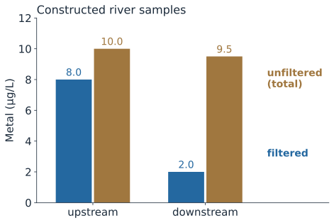{width="100%"}
:::
::: {.column width="52%"}
Constructed data: downstream, the **filtered** metal falls from 8.0 to 2.0 µg/L, but the **unfiltered** total hardly changes.

The metal did not vanish. It moved onto particles that the filter held back, while they still travel with the river.

To decide between **retention** and **transport**, measure:

- particle load and size fractions;
- flow, to turn concentrations into loads;
- metal in bed sediment over time.
:::
::::

::: notes
This is exercise 4. The pattern of a falling filtered concentration and a steady total concentration is a fingerprint of sorption onto suspended particles. In terms of the bottle model, the water-phase concentration dropped because more solid surface became available, perhaps from a tributary or from fresh precipitation. But unless the particles settle, the metal leaves the reach with the water just as before. The numbers here are constructed for teaching. Ask students what would change in the figure if the particles settled before the downstream station. The answer: the total bar would drop too, and the bed sediment would gain metal. Only measurements of the solids can show that.
:::

## Common mistakes to avoid

- **"Lower concentration in the water means removal."** Check where the solute went.
- **"Dissolved means below 0.45 µm, so it is truly dissolved."** Colloids pass filters too.
- **"K~d~ is a constant of the chemical."** It belongs to one solid, one water, one pH.
- **"Doubling the solid halves the concentration."** Use the full denominator, V~w~ + K~d~m~s~.
- **"Sorption is forever."** pH, competition and redox can release it.
- **"Surfaces only attract opposite charges."** Inner-sphere binding is chemical, not only electrostatic.

::: notes
Go through the list and ask students for a counterexample from today for each. The first is the central idea of the lecture. The second reminds them that filtration is a method, not a definition of chemistry. The third and fourth are the most common calculation errors in the exercises. The fifth points to the next lecture. When iron oxides are reduced in sediments without oxygen, the solid dissolves and everything sorbed on it is released, even though no pH change or competition occurred. That is how the Baltic Sea's sediments release phosphate, and it is our next topic. The last mistake explains why phosphate binds so firmly to iron oxides.
:::

## Explore: the two-phase bottle {#explore}

```{=html}
<link rel="stylesheet" href="../demos/demo.css">
<div data-demo="sorption" role="group" aria-label="Water–solid distribution in a closed bottle">
<p>Worked example: 1.00 mg, 1.00 L water, 0.0100 kg solid, K<sub>d</sub> = 100 L/kg gives 0.500 mg/L.</p>
</div>
<script src="../demos/core.js"></script>
<script src="../demos/sorption.js"></script>
```

[Double the solid, or let a pH change lower K~d~: where does the solute go?](exercise.qmd#explore)

::: notes
Start with the worked example and confirm the numbers from the "one bottle, three cases" slide. Before pressing Double the solid, ask the class to predict the new water concentration; many will say a quarter of a milligram per litre. The curve shows why it is a third: the water volume stays in the denominator. Then press the pH-change preset and point out that the solid gives solute back to the water although nothing was added. Drag the solid slider to zero to show that without a surface everything stays dissolved. Remind students that the model is linear and has no capacity limit. The exercise page has the hand check and the model conditions.
:::

## Summary {.smaller}

:::: {.columns}
::: {.column width="70%"}
| Concept | Key fact |
| --- | --- |
| Colloids | about 1 nm–1 µm; the 0.45 µm filter cuts through them |
| Surface area | per gram scales as 1/diameter; fine particles dominate binding |
| Oxide surfaces | >SOH gains or loses H⁺; positive at low pH, negative at high pH |
| Zero charge | iron oxides roughly pH 7–9; attract anions below, cations above |
| Sorption edges | cations bind more as pH rises; oxyanions as pH falls |
| Clays | permanent negative charge; exchangeable cations |
| Inner-sphere | direct bond by ligand exchange; strong and specific |
| Distribution coefficient | q = K~d~C~w~ (L/kg); valid for one system |
| Two-phase balance | C~w~ = M~T~/(V~w~ + K~d~m~s~); total conserved |
| Capacity | sites are finite: at most q~max~ × m~s~ |
| Transport | settling retains, floods resuspend, colloids carry |

**Next:** [Redox and environmental cycles](../redox-cycles/lec.qmd). What happens to iron oxides, and the phosphate they hold, when oxygen runs out? Then the [exercises](exercise.qmd) and the [notes](notes.qmd).
:::
::: {.column width="30%"}
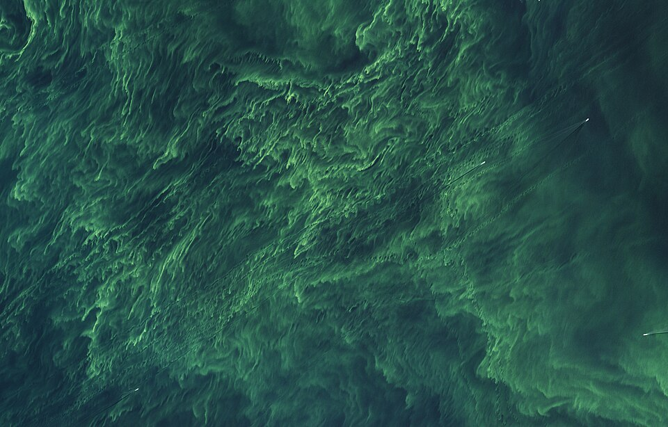{width="100%"}
[Phytoplankton bloom swirling in the Baltic Sea, July 2025, seen by a Landsat satellite. Image: NASA Earth Observatory (Michala Garrison), public domain, Wikimedia Commons.]{.credit}
:::
::::

::: notes
The table is the revision sheet. Run through the chain once more. Small particles have large surfaces. Surfaces carry charge that depends on pH, plus specific binding sites. A distribution coefficient summarises the result for one system, and a mass balance tells you how much is in the water and how much on the solid. Capacity and competition set limits. Finally, sorbed material is only as immobile as the particle that carries it. The teaser image shows cyanobacteria blooms in the Baltic Sea. Their fuel includes phosphate released from bottom sediments when iron oxides dissolve under low oxygen. That is redox chemistry, and it is the next lecture.
:::
