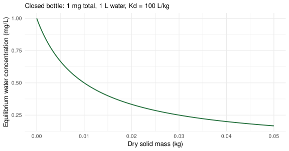

If a contaminant disappears from water, is it removed from the environmental system or transferred onto a mobile particle?

Read these notes with the [lecture](lec.qmd), then complete the
[exercises](exercise.qmd). Numerical examples are constructed teaching cases
unless explicitly described otherwise.

## Learning goals

- Explain pH-dependent surface charge and specific binding.
- Close a water–solid mass balance using a supplied Kd.
- Distinguish sorption equilibrium, finite capacity, and colloidal transport.

## A surface is chemically active

Oxide surfaces carry hydroxyl groups that can gain or lose protons. Schematically, $\mathrm{>SOH+H^+\rightleftharpoons >SOH_2^+}$ and $\mathrm{>SOH\rightleftharpoons >SO^-+H^+}$. Here >S denotes a surface site, not dissolved sulfur. Some clay charge arises from crystal substitutions and is less directly pH dependent. Surface charge influences electrostatic attraction, while specific ligand exchange can bind solutes beyond a simple opposite-charge picture.

## Define a distribution coefficient

In a linear equilibrium approximation, $q=K_dC_w$, where $q$ is sorbed mass per dry solid mass (mg/kg), $C_w$ is aqueous concentration (mg/L), and $K_d$ is L/kg. State the measurement conditions. The coefficient can change with pH, competing solutes, and concentration. It is not a universal molecular constant and should not be applied outside its range without evidence.

## Close the two-phase balance

For a closed bottle with water volume $V_w$ L, dry solid mass $m_s$ kg, and total solute mass $M_T$ mg,
$$M_T=C_wV_w+qm_s=C_w(V_w+K_dm_s).$$
Thus $C_w=M_T/(V_w+K_dm_s)$. The sorbed fraction is $K_dm_s/(V_w+K_dm_s)$. The denominator has litre units in both terms. The model excludes degradation, wall loss, and non-equilibrium transport.

## Capacity and competition

A linear model has no finite saturation plateau. A Langmuir teaching model, $q=q_{max}bC/(1+bC)$, approaches a limiting capacity $q_{max}$. Real surfaces can have several kinds of sites and hysteresis. Phosphate can bind to iron oxides, but competition, site occupation, mineral changes, and pH alter retention. A low-concentration Kd should not be extrapolated to unlimited loading.

## Particles may move

Sorption onto settling solids can retain a solute locally, but sorption onto mobile colloids can assist transport. Operational filtration does not perfectly separate a dissolved molecular pool from every particle size. Particle settling, aggregation, and resuspension change the boundary fluxes. To claim removal, identify the destination and whether it remains outside the receiving water over the relevant timescale.

## Worked example

Distribute 1.00 mg between 1.00 L water and 0.0100 kg dry solid, with $K_d=100$ L/kg. Then $K_dm_s=1.00$ L, $C_w=1.00/(1.00+1.00)=\mathbf{0.500}$ mg/L, and $q=50.0$ mg/kg. Water contains 0.500 mg and solid contains 0.500 mg. The total stays 1.00 mg. Half is sorbed; none has been destroyed.

## Reading focus and further explanation

Book: vanLoon and Duffy, fourth edition, chapter(s) 14. Focus on surface protonation, a transparent linear balance, finite capacity, and colloidal mobility. Defer fitting complex isotherms or surface-complexation software.

[USGS phosphate retention](https://pubs.usgs.gov/fs/2012/3004/): Mineral surfaces, finite adsorption, and phosphorus transport.

[EPA sorption coefficients](https://www3.epa.gov/ceampubl/learn2model/part-two/onsite/rsorb2_onsite.html): Definitions and conditions for distribution coefficients.
