## About this lecture

:::: {.columns}
::: {.column width="56%"}
Copper was mined at **Falun** in central Sweden for roughly a thousand years, until 1992. The mine is now a UNESCO World Heritage Site. Its waste heaps are still chemically active: water draining them carries **acid, sulfate and metals** toward the lakes downstream.

Why does old rock keep making acid long after mining stops?

Today you will learn to:

- balance **pyrite oxidation**: 4 H⁺ per FeS₂;
- separate **present pH** from **future acid-generating inventory**;
- close a **neutralisation budget** with a stated endpoint;
- tell **concentration** from **load**.

Last lecture, soils *consumed* acid from finite stocks. Today a solid *produces* it.
:::
::: {.column width="44%"}
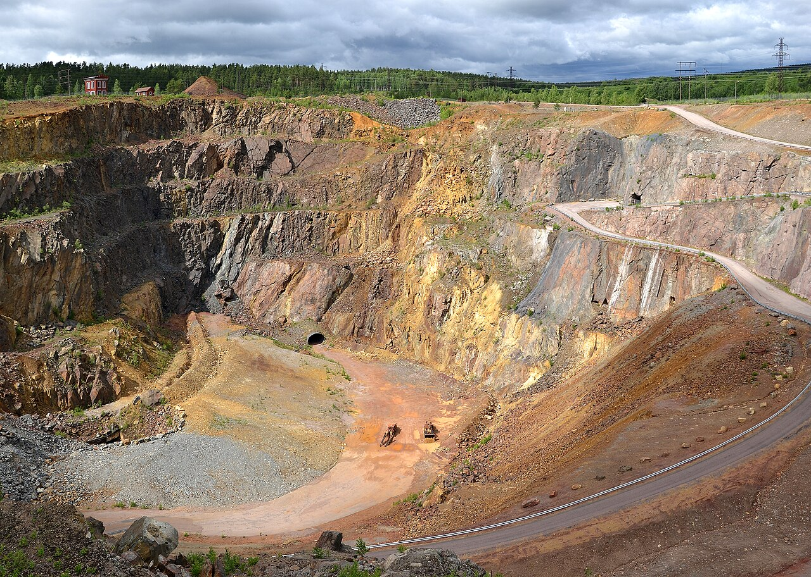{width="100%"}
[The Great Pit at Falun copper mine, Sweden. Photo: Pudelek, CC BY-SA 4.0, Wikimedia Commons.]{.credit}
:::
::::

::: notes
Open with Falun. The mine was one of Europe's most important copper sources for centuries, and the great open pit formed when old workings collapsed in 1687. The ore contained copper sulfides together with a great deal of pyrite, iron disulfide. Mining and roasting left large volumes of sulfide-rich waste around the town. That waste is the reason why water draining the area is still acidic and metal-rich today, decades after the mine closed. The striking point is the time scale: acid production does not stop when people leave. Contrast with last week's soil lecture, where acid arrived from the air and soil inventories consumed it. Here the solid itself is the acid source.
:::

## The colour of Swedish houses is mine chemistry

:::: {.columns}
::: {.column width="50%"}
{width="100%"}
[A Falu red cottage, Lysekil, Sweden. Photo: W.carter, CC0, Wikimedia Commons.]{.credit}
:::
::: {.column width="50%"}
The classic red paint, **Falu rödfärg**, is made from pigment recovered from the Falun mine's weathered waste.

The pigment is mainly **iron oxides**. They formed when iron sulfide in the waste reacted with **oxygen and water** over centuries.

So the reactions that gave Swedish cottages their colour are the same ones that produce acid in the mine drainage.

**Today's question:** what exactly happens when pyrite meets air and water, and how much acid does it make?
:::
::::

::: notes
This is a nice way to make the chemistry familiar. Falu red paint has been produced from the Falun mine's waste for centuries. The pigment consists largely of iron oxides formed by weathering of the iron sulfides in the waste. Ask students: if iron sulfide turns into iron oxide, where did the sulfur go, and what happened to the hydrogen balance? Some will guess sulfate, and that is right. The point of the lecture is to make that conversion quantitative. Two oxidations happen, sulfur and then iron, and both release hydrogen ions. Once the bookkeeping is clear, we can compare acid production with the neutralising minerals in the waste and see why the balance can shift over decades.
:::

## Pyrite: stable underground, reactive in air

:::: {.columns}
::: {.column width="48%"}
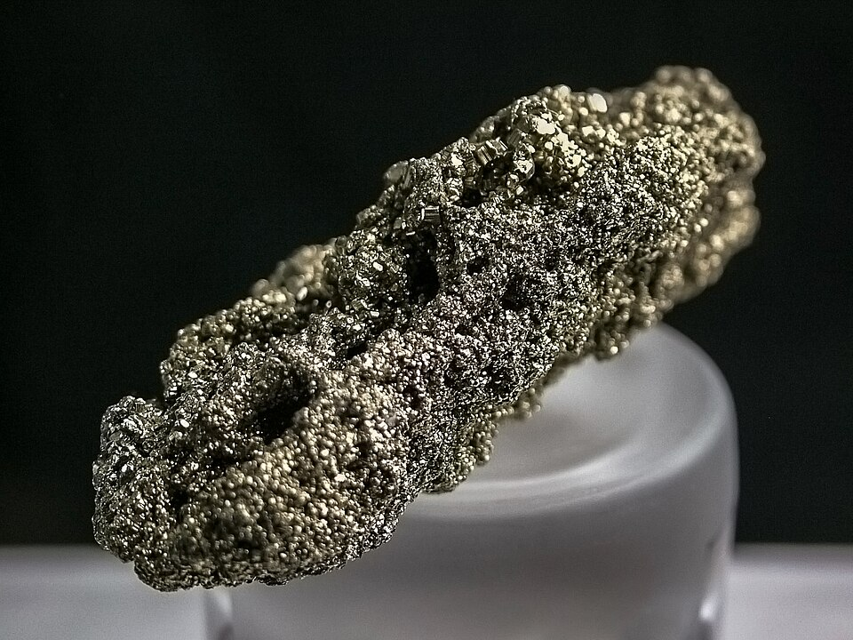{width="100%"}
[Pyrite (FeS₂) crystals on a glass, photographed in Visby, Gotland. Photo: W.carter, CC BY-SA 4.0, Wikimedia Commons.]{.credit}
:::
::: {.column width="52%"}
**Pyrite, FeS₂**, "fool's gold", is the most common sulfide mineral. Sulfur sits as the disulfide ion S₂²⁻, oxidation state **−1** per S.

Deep in bedrock or under water, there is almost **no oxygen**, so pyrite can persist for millions of years.

Mining, road cuts and drained wetlands crush the rock and **expose it to air and water**. Crushing also creates vast new surface area.

Pyrite is common in **ore waste**, in some black shales, and in drained coastal **acid sulfate soils** around the Baltic.
:::
::::

::: notes
Pyrite forms under reducing conditions, for example in marine sediments where sulfate reduction produces sulfide, the process you met in the redox unit. As long as it stays away from oxygen it is stable. The trouble starts when we move it. Crushing ore to recover copper and zinc leaves fine-grained waste with enormous surface area, piled in heaps exposed to air and rain. Mention that the same chemistry appears outside mining. Along the Swedish and Finnish Baltic coast, land uplift and drainage have exposed sulfide-bearing sediments, forming acid sulfate soils that release acid and metals to rivers. Road and tunnel construction through black shale can do the same. The chemistry is identical; only the setting changes.
:::

## Inside a waste heap

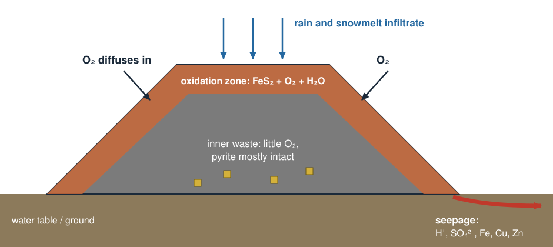{width="84%" fig-align="center"}

Pyrite oxidation needs **oxygen and water together**. Both enter from the surface, so most reaction happens in an outer **oxidation zone**. The products leave the heap as **seepage**.

::: notes
Walk through the cross-section. Oxygen enters the heap mainly by diffusion and air flow through the pores. Rain and snowmelt infiltrate from the top. Where the two meet pyrite, it oxidises. Deep inside, oxygen is used up before it gets there, so pyrite survives. This geometry is the reason for one of the main remediation strategies: cover the waste with a dense layer such as compacted till, or flood it under water, to keep oxygen out. Seepage collects at the base and carries hydrogen ions, sulfate, iron and other metals released as the sulfide minerals dissolve. Copper and zinc sulfides in ore waste are usually less abundant than pyrite, but their metals ride along in the acid water.
:::

## Two oxidations, four hydrogen ions

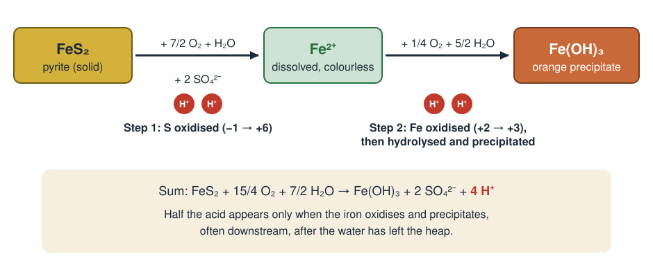{width="86%" fig-align="center"}

Each step is a **redox reaction** that also releases H⁺. Step 1 makes 2 H⁺ and dissolved Fe²⁺. Step 2 oxidises the iron and precipitates it, releasing **2 more**.

::: notes
Go slowly through the two steps. In step 1, the sulfur in pyrite is oxidised from minus one to plus six in sulfate. Oxygen is the electron acceptor, and two hydrogen ions are released per pyrite. Iron is still in the plus two state and dissolved. In step 2, iron(II) is oxidised to iron(III). Iron(III) is very insoluble at all but low pH, so it hydrolyses and precipitates. The hydrolysis is what releases the extra hydrogen ions: water molecules bound to iron(III) give up protons. Fe(OH)3 is a teaching formula; real precipitates are ferrihydrite, goethite or schwertmannite. The overall result, four hydrogen ions per pyrite, is the number to remember for acid budgets.
:::

## Check the balance: exercise 1

:::: {.columns}
::: {.column width="55%"}
$$\mathrm{FeS_2+\tfrac72O_2+H_2O\rightarrow Fe^{2+}+2SO_4^{2-}+2H^+}$$
$$\mathrm{Fe^{2+}+\tfrac14O_2+\tfrac52H_2O\rightarrow Fe(OH)_3+2H^+}$$

Add them and cancel Fe²⁺:

$$\mathrm{FeS_2+\tfrac{15}{4}O_2+\tfrac72H_2O\rightarrow Fe(OH)_3+2SO_4^{2-}+4H^+}$$
:::
::: {.column width="45%"}
| Check | Left | Right |
| --- | ---: | ---: |
| Fe | 1 | 1 |
| S | 2 | 2 |
| O | 7.5 + 3.5 = 11 | 3 + 8 = 11 |
| H | 7 | 3 + 4 = 7 |
| Charge | 0 | −4 + 4 = 0 |

Always check **all five** before using a reaction in a budget.
:::
::::

::: notes
This is exercise 1, done together. Adding the equations and cancelling iron(II) gives fifteen quarters of oxygen and seven halves of water. Then check each row. Oxygen is the one students usually get wrong: on the left, fifteen quarters of O2 is seven and a half oxygen atoms, plus three and a half from water, eleven in total. On the right, three oxygen atoms in the hydroxide plus eight in two sulfates. Hydrogen: seven on the left from water, three in the hydroxide and four free ions on the right. Charge: two sulfates carry minus four, four hydrogen ions plus four. Encourage students to do this check every time they write a budget reaction.
:::

## Iron(III) speeds it up

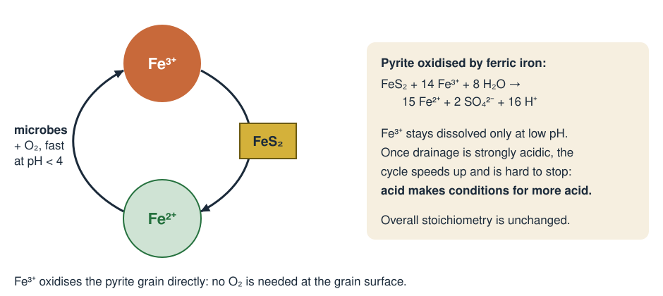{width="82%" fig-align="center"}

Once drainage is acidic, dissolved Fe³⁺ itself oxidises pyrite, and iron-oxidising microbes regenerate Fe³⁺ from Fe²⁺. Acid drainage can **accelerate itself**.

::: notes
The two-step equations give the stoichiometry, not the mechanism. At low pH, iron(III) remains dissolved and is a strong oxidant for pyrite. It reacts at the grain surface without oxygen being present there. The iron(II) produced is oxidised back to iron(III) by acid-loving microbes, such as Acidithiobacillus species, which gain energy from the reaction and need oxygen. Abiotic oxidation of iron(II) is slow at low pH, so the microbes greatly speed up the cycle. The net reaction is unchanged, so our four hydrogen ions per pyrite still holds. The practical lesson: it is much easier to prevent acid drainage from starting than to stop it once the waste has acidified.
:::

## What the end point looks like

:::: {.columns}
::: {.column width="55%"}
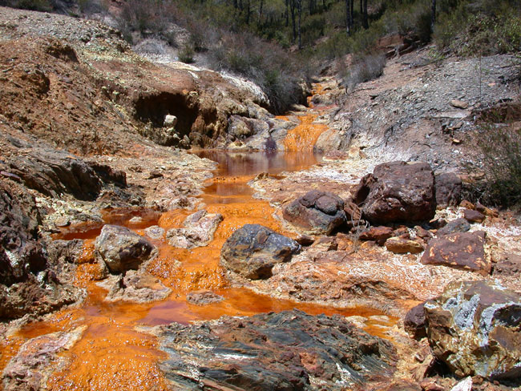{width="100%"}
[Iron-stained stream bed of the Río Tinto, Spain. Photo: Carol Stoker, NASA, public domain, Wikimedia Commons.]{.credit}
:::
::: {.column width="45%"}
The **Río Tinto** in southwest Spain drains a sulfide belt that has been mined for thousands of years.

Its water is strongly acidic, often around **pH 2**, and rich in dissolved iron(III), which colours it red.

Few organisms beyond specialised microbes live there. The river is studied as an analogue for **life in extreme environments**.

This is the iron cycle of the previous slide running at full speed.
:::
::::

::: notes
The Río Tinto is the textbook image of acid mine drainage. The Iberian Pyrite Belt has been mined since antiquity, and the river's acidity and iron load are a mixture of natural sulfide weathering and the effects of mining. At pH around 2, iron(III) stays in solution and gives the deep red colour. NASA scientists have studied the river's microbes because they live on iron and sulfur chemistry in conditions that resemble what might be found on other planets. Use the photo to emphasise that at this pH almost all neutralising capacity has gone, and the iron cycle runs freely. Falun's drainage is far less extreme, but the same chemistry is at work.
:::

## Orange streams: iron precipitates downstream

:::: {.columns}
::: {.column width="40%"}
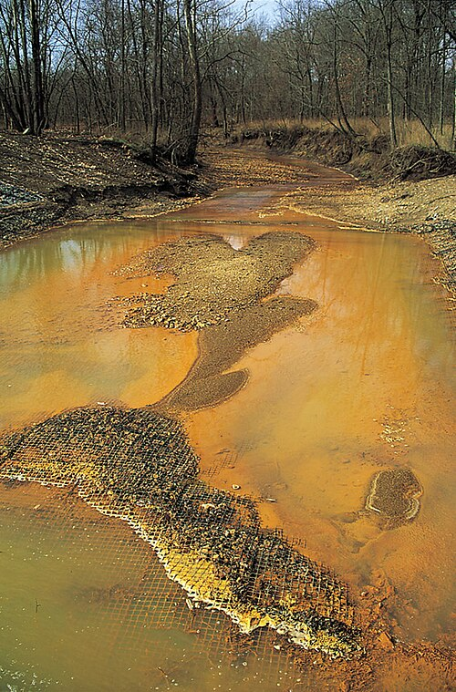{height="470px" fig-align="center"}
[Iron hydroxide precipitate in a stream receiving acid drainage, Missouri. Photo: D. Hardesty, USGS, public domain, Wikimedia Commons.]{.credit}
:::
::: {.column width="60%"}
Where acid drainage mixes with less acidic stream water, pH rises and **Fe³⁺ precipitates** as orange iron hydroxide ("yellow boy").

Two consequences:

- **Step 2 releases its acid here**, in the stream, not in the heap. A seep can leave the heap at moderate pH and still acidify the stream.
- The orange coating smothers the stream bed, and the fresh precipitate **binds metals** such as Cu, Zn and As.

Removing the orange solid does not remove the acid already released.
:::
::::

::: notes
This photo shows step 2 happening in the open. Water from a mine seep can contain plenty of dissolved iron(II) at modest pH. As it flows downstream, it picks up oxygen, iron oxidises and precipitates, and the stream becomes orange. Each mole of iron that precipitates releases two moles of hydrogen ions into the stream. This is why pH alone at the seep can mislead. The water's acidity includes the dissolved iron that has not yet precipitated, sometimes called mineral acidity. The precipitate is ecologically damaging because it coats gravel where invertebrates and fish eggs live. It also sorbs metals, which is useful but, as we will see, not necessarily permanent.
:::

## Present pH is a snapshot

:::: {.columns}
::: {.column width="50%"}
A leachate pH tells you about the water **now**. It says nothing about:

- the **pyrite still unreacted** in the waste (acid potential);
- the **calcite and other buffers** still present (neutralisation potential);
- how fast oxygen and water reach either.

Mine-waste assessment therefore compares two **inventories**, usually in kg CaCO₃ per tonne of waste: acid potential versus neutralisation potential.
:::
::: {.column width="50%"}
::: {.checkbox}
**Same pH, different futures.** Two heaps both drain at pH 7 today. Heap 1 contains abundant calcite and little pyrite. Heap 2 contains the reverse, and its calcite is being spent. Only an inventory, not a pH reading, tells them apart.
:::
:::
::::

::: notes
This is the core idea of the lecture and mirrors last week's soils. pH is a state. The acid potential and neutralisation potential are inventories. In practice, mining companies and regulators estimate them from total sulfur and from a titration of the waste with acid, a procedure called acid–base accounting. The unit, kilograms of calcium carbonate equivalent per tonne of waste, lets both sides be compared directly. A waste with neutralisation potential well above acid potential is unlikely to generate acid drainage; one with the reverse ratio probably will, eventually. The word eventually matters, and the next slide shows why a waste can look harmless for decades.
:::

## Neutral today, acid tomorrow

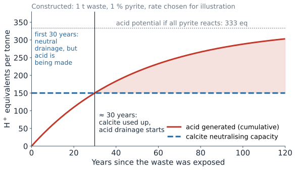{width="76%" fig-align="center"}

While calcite lasts, it neutralises the acid as fast as pyrite makes it, and drainage looks harmless. When calcite runs out, the **acid potential that was there all along** appears in the water.

::: notes
This is a constructed illustration, not a model of Falun. One tonne of waste with one percent pyrite has an acid potential of about 333 equivalents. We gave it 150 equivalents of calcite and chose a slow first-order oxidation rate purely for illustration. For the first thirty years the drainage is neutral, because calcite consumes the acid as fast as it forms. Then calcite is exhausted and acid drainage begins, with most of the pyrite still unreacted. In reality rates depend on grain size, oxygen supply and temperature, and calcite can be used up locally along flow paths long before it is gone overall. The general lesson is robust: a neutral leachate today is not proof of a stable waste.
:::

## Neutralisation depends on the endpoint

:::: {.columns}
::: {.column width="55%"}
For the **CO₂\* endpoint** (acidic final water, carbon leaves as CO₂):

$$\mathrm{CaCO_3+2H^+\rightarrow Ca^{2+}+CO_2^*+H_2O}$$

For a **near-neutral endpoint**, bicarbonate stays in the water:

$$\mathrm{CaCO_3+H^+\rightarrow Ca^{2+}+HCO_3^-}$$

The same calcite can neutralise **2 or 1** equivalents per mole. Mine-waste schemes differ in which they assume, so **always state the endpoint** before you use a coefficient.
:::
::: {.column width="45%"}
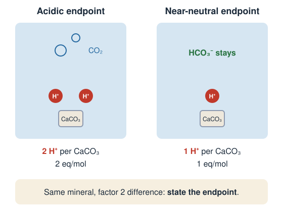{width="100%"}
:::
::::

::: notes
Students have seen the first reaction in the carbonate and soil lectures. The second one is new here and matters for mine waste. If the final water is near neutral, carbon remains as bicarbonate and each calcium carbonate takes up only one hydrogen ion. That is the same chemistry as the carbonate lecture's predominance diagram: at pH 7 most dissolved carbon is bicarbonate, not CO2-star. Assessment schemes differ in which endpoint they assume, and the answer can change by a factor of two, so always state it. Ask students which endpoint is more cautious for judging whether a waste is safe. The near-neutral one is, because it credits each mole of calcite with less neutralisation.
:::

## Calcite present is not calcite available

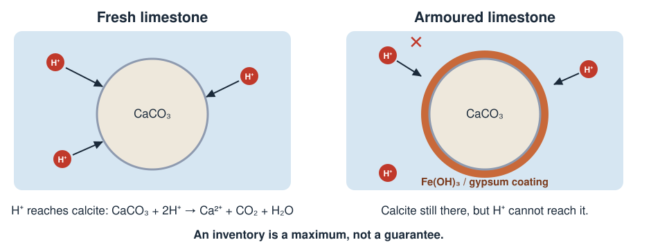{width="80%" fig-align="center"}

In acid, iron-rich water, limestone grains become **coated** with iron hydroxide or gypsum. The calcite is still there, but H⁺ cannot reach it. Calcite in a layer the water does not pass through is equally useless.

::: notes
This is a practical limit on any neutralisation inventory. When acid, iron-rich drainage meets limestone, the calcite dissolves at first, raising the pH. That pH rise makes iron(III) precipitate, and it precipitates on the nearest surface: the limestone itself. Sulfate-rich water can also deposit gypsum. The coating, called armouring, slows further dissolution dramatically. Passive treatment systems therefore try to keep oxygen out of limestone drains so that iron stays as dissolved iron(II) until the water has left the limestone. The same logic applies inside a heap: calcite away from the flow paths, or coated, is counted in an inventory but contributes little in practice. An inventory is a maximum, not a guarantee.
:::

## Worked example: closing the budget

:::: {.columns}
::: {.column width="44%"}
0.0100 mol FeS₂ oxidises completely:

- acid: 4 × 0.0100 = **0.0400 mol H⁺ eq**
- sulfate: 2 × 0.0100 = **0.0200 mol**
- CaCO₃ needed (CO₂\* endpoint): 0.0400 / 2 = 0.0200 mol = **2.00 g**

**Exercise 2:** only 0.0150 mol CaCO₃ is accessible. It neutralises 0.0300 eq, leaving **0.0100 mol eq** of acid.
:::
::: {.column width="56%"}
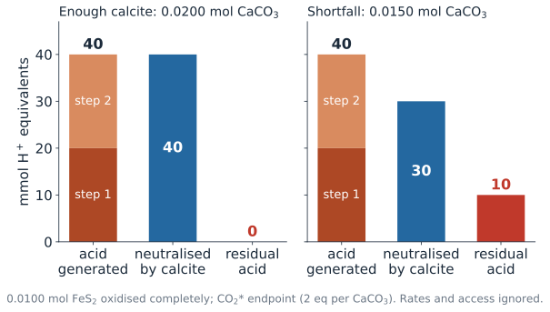{width="100%"}
:::
::::

::: notes
This is the worked example from the notes, followed by exercise 2. Walk through the left panel: forty millimoles of acid, half from each step, fully neutralised by twenty millimoles of calcite. With a molar mass of 100 grams per mole, that is two grams of calcium carbonate. The right panel is the shortfall: fifteen millimoles of calcite neutralise thirty millimoles of acid, and ten millimoles remain. Two cautions from the exercise. First, the residual is an amount, not a pH; to get a pH you need the water volume and the remaining acid–base equilibria. Second, this is a stoichiometric comparison, not a design dose. Real treatment adds a safety margin because rates, access and mixing are imperfect.
:::

## Check yourself

::: {.checkbox}
1. How many moles of H⁺ equivalents can 0.0050 mol FeS₂ generate, oxidised completely to Fe(OH)₃ and sulfate?
2. A seep leaves a heap at pH 6 with 20 mg/L dissolved Fe²⁺. Will the stream downstream necessarily stay at pH 6? Why?
3. A waste contains enough calcite to neutralise its acid potential at the CO₂\* endpoint. Is it safe if the final water will be near neutral?
4. Name two reasons why calcite present in a heap might not neutralise the acid produced there.
:::

::: notes
Answers. One: four times 0.0050, so 0.020 mol of hydrogen ion equivalents. Two: no. The iron(II) will oxidise and precipitate downstream, releasing two hydrogen ions per iron. Twenty milligrams per litre of iron is about 0.36 millimoles per litre, so up to about 0.7 millimoles per litre of acid can appear in the stream, depending on its alkalinity. Three: not necessarily. At a near-neutral endpoint each calcite neutralises only one equivalent, so the same inventory covers only half the acid potential. Four: armouring by coatings, and calcite located away from the flow paths where acid is produced. Slow dissolution relative to flow is a third acceptable answer.
:::

## Concentration is not load

:::: {.columns}
::: {.column width="55%"}
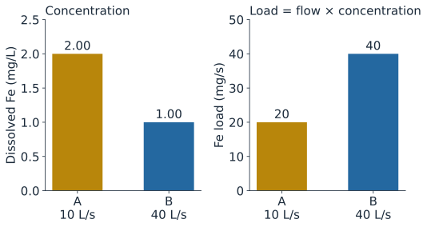{width="100%"}
:::
::: {.column width="45%"}
**Load** = flow × concentration.

- Discharge A: 10.0 L/s × 2.00 mg/L = **20.0 mg/s** Fe
- Discharge B: 40.0 L/s × 1.00 mg/L = **40.0 mg/s** Fe

B looks cleaner but exports **twice as much** iron, about 1.3 tonnes a year.

During **snowmelt**, concentrations often fall while loads rise. Judge a waste by its load to the receiving lake.
:::
::::

::: notes
This is exercise 3, and it repeats the very first unit of the course: concentration and load answer different questions. A regulator who samples only concentration might judge discharge B as the smaller problem, yet it delivers twice the iron to the lake. Forty milligrams per second over a year is about 1.3 tonnes. Seasonal flow matters in Sweden. Snowmelt flushes the heaps, diluting the water, but the larger volume can carry out salts and metals that accumulated during the winter, so the annual load is often dominated by a few high-flow weeks. Remind students that these are dissolved loads. Iron leaving as suspended precipitate is a separate term that needs its own measurement.
:::

## Immobilised is not destroyed

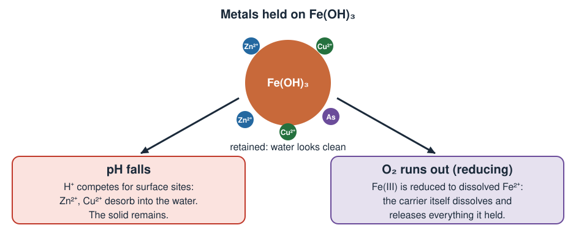{width="80%" fig-align="center"}

Treatment often moves metals **from water onto solids**. The solid then needs conditions that keep it stable: enough **alkalinity** to keep pH up, and enough **oxygen** to keep iron oxidised.

::: notes
Return to the water-treatment unit: precipitation and sorption transfer contaminants to solids, which become residuals. Here we ask how stable those residuals are. Iron hydroxide surfaces bind copper, zinc, lead and also anions such as arsenate and phosphate. If pH falls, hydrogen ions compete for surface sites and cationic metals desorb. If the solid becomes waterlogged and oxygen runs out, microbes reduce iron(III) to dissolved iron(II), and the carrier itself dissolves, releasing everything it held. This links ahead to the redox processes in the synthesis lecture. Any claim that a waste or sludge is safely immobilised must state the chemical conditions that keep it so, and how long those conditions will last.
:::

## Back to Falun: a worked estimate

:::: {.columns}
::: {.column width="50%"}
**Constructed:** one tonne of waste rock with **1 % pyrite** by mass.

- FeS₂: 10 kg / 120 g/mol ≈ **83 mol**
- acid potential: 4 × 83 ≈ **333 mol H⁺ eq**
- sulfate: 2 × 83 ≈ 167 mol
- CaCO₃ to neutralise: **≈ 17 kg** (CO₂\* endpoint) or **≈ 33 kg** (near-neutral endpoint)

Multiply by the millions of tonnes of waste at an old mining district, and the century-long drainage makes sense.
:::
::: {.column width="50%"}
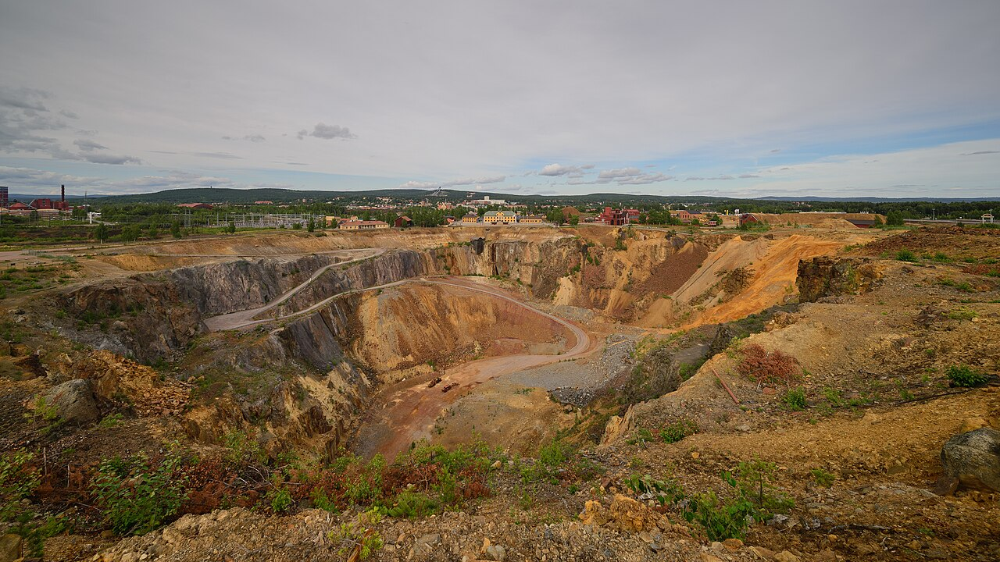{width="100%"}
[The Great Pit at Falun with its weathered, iron-stained rock and the town beyond. Photo: Arild Vågen, CC BY-SA 4.0, Wikimedia Commons.]{.credit}
:::
::::

::: notes
Bring the numbers back to the opening case. The calculation is constructed, with round numbers, but it shows the scale. Ten kilograms of pyrite in a tonne of rock generates about 333 moles of hydrogen ion equivalents, which would need about seventeen kilograms of limestone at the carbon dioxide endpoint, or twice that if the water is to end near neutral. At Falun, centuries of mining left very large waste volumes. Oxygen reaches the pyrite slowly, from the surface inward, so the inventory is used up over centuries rather than years. That is the honest answer to the opening question: the acid comes from an inventory that is still far from exhausted, released at a rate set by access to oxygen and water.
:::

## Beyond mines: other leachates

:::: {.columns}
::: {.column width="50%"}
The same reasoning, **inventory + access + reaction**, applies to other wastes:

- **Landfills:** organic waste consumes oxygen. Leachate becomes **reducing**, rich in ammonium, dissolved organic carbon, Fe²⁺ and Mn²⁺.
- **Ash and slag:** often strongly **alkaline**, with metals such as lead or chromium whose solubility depends on pH.
- **Acid sulfate soils:** drained sulfide sediments behave like mine waste.

In every case, ask what is still in the solid, and what controls its release.
:::
::: {.column width="50%"}
::: {.checkbox}
**A useful template for any leachate**

1. Which reactive solids are present, and how much?
2. What lets them react: O₂, water, low pH, microbes?
3. What neutralises or retains the products?
4. What flow carries the products out, and when?
5. What could change in 10 or 100 years?
:::
:::
::::

::: notes
Broaden the view so students see a method, not just a mine. Municipal landfills contain degradable organic matter. Microbes consume the oxygen, and leachate becomes strongly reducing, so iron and manganese dissolve and ammonium accumulates. Old landfills are therefore a reducing, not an acid, problem. Incineration ash is often very alkaline because of lime and oxides, and some metals, such as lead, are amphoteric and can dissolve at high pH as well as at low pH. Acid sulfate soils along the Baltic coast are a natural version of mine waste. The five-step template on the right works for all of them. It is also a good structure for the exam questions on leachate.
:::

## Common mistakes to avoid

- **"Pyrite gives 2 H⁺."** Only step 1. Iron oxidation and precipitation add 2 more: **4 H⁺ per FeS₂**.
- **"Neutral leachate means a safe waste."** Calcite may simply not be exhausted yet.
- **"CaCO₃ always neutralises 2 H⁺."** That depends on the endpoint: 1 at near-neutral pH.
- **"Calcite present = calcite available."** Armouring and flow paths limit access.
- **"Lower concentration = smaller problem."** Compare loads.
- **"Metals on iron hydroxide are gone."** Low pH or reducing conditions can release them.

::: notes
Go through these as a self-test, and ask students to justify each correction with a reaction or a number from today. The first mistake is the most common in budget calculations, often because students stop at the first equation in a textbook. The second and the last are the most important for environmental decisions: both treat a present state as if it were permanent. Mention that the same structure of mistakes reappears in the next lecture on organic contaminants. There, disappearance of a compound from water is often mistaken for destruction, when it may simply have moved to another phase. Keeping track of inventories in all phases is the shared habit.
:::

## Summary {.smaller}

:::: {.columns}
::: {.column width="70%"}
| Concept | Key fact |
| --- | --- |
| Pyrite | FeS₂, S at −1; stable without O₂, reacts when exposed to air and water |
| Step 1 | FeS₂ + 7/2 O₂ + H₂O → Fe²⁺ + 2SO₄²⁻ + 2H⁺ |
| Step 2 | Fe²⁺ + 1/4 O₂ + 5/2 H₂O → Fe(OH)₃ + 2H⁺, often downstream |
| Total | **4 H⁺ and 2 SO₄²⁻ per FeS₂** |
| Fe³⁺ cycle | at low pH Fe³⁺ oxidises pyrite; microbes regenerate Fe³⁺ |
| Inventories | acid potential vs neutralisation potential; pH is a snapshot |
| Lag | drainage can stay neutral for decades, then acidify |
| Endpoint | CaCO₃ neutralises 2 eq (CO₂\*) or 1 eq (HCO₃⁻) |
| Load | flow × concentration; dilution can hide a large export |
| Immobilisation | sorbed metals return if pH falls or Fe(III) is reduced |

**Next:** [Organic contaminants and environmental fate](../organic-contaminants/lec.qmd). Where does a molecule go, and is "gone from the water" the same as "destroyed"? Then the [exercises](exercise.qmd) and the [notes](notes.qmd).
:::
::: {.column width="30%"}
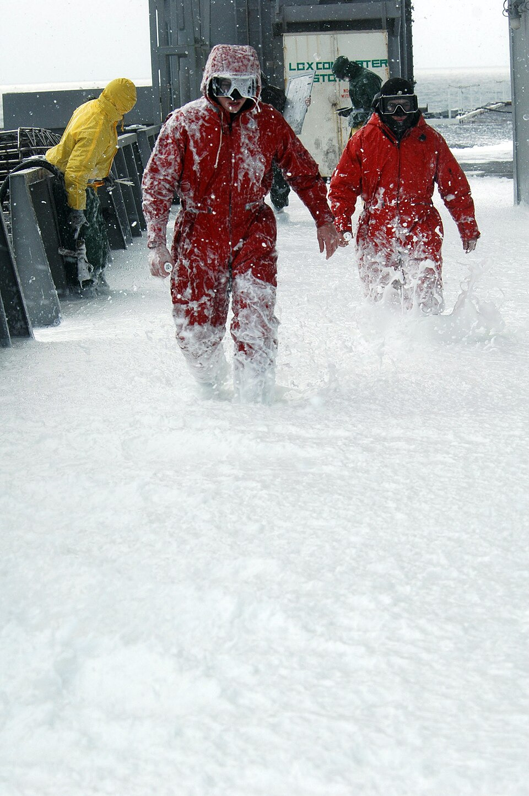{width="100%"}
[Sailors in firefighting foam (AFFF) during a sprinkler test, 2006. Photo: US Navy, public domain, Wikimedia Commons.]{.credit}
:::
::::

::: notes
Recite the chain once. Exposing pyrite to oxygen and water oxidises sulfur and then iron, giving four hydrogen ions and two sulfates per pyrite. At low pH, dissolved iron(III) and microbes accelerate the process. Whether drainage turns acidic depends on comparing two inventories, acid potential and neutralisation potential, and on access to them. A neutral leachate can hide a declining neutralising reserve. State the endpoint when you use calcite in a budget, judge discharges by load, and treat immobilised metals as conditionally stored. The photo previews the next lecture: firefighting foam contained PFAS compounds, which contaminated drinking water in Ronneby, Sweden. There the question is not acid but where an organic molecule goes.
:::
