## About this lecture

:::: {.columns}
::: {.column width="56%"}
Last lecture ended in the Baltic Sea: phosphate from land feeds blooms, blooms use up oxygen, and anoxic sediments release more phosphate. The lasting way to break that loop is to **cut what flows in**.

Since the 1970s, Swedish towns have built **wastewater treatment plants** that remove most of the phosphorus and, at large plants, much of the nitrogen before the water reaches the sea.

Today you will learn to:

- **match a pollutant's form** to a treatment mechanism;
- tell **transfer** from **transformation**;
- calculate **sequential stages**, which multiply;
- track the **side effects**: oxygen, alkalinity and by-products.

Your tools: precipitation (metals), surfaces, and redox from this week.
:::
::: {.column width="44%"}
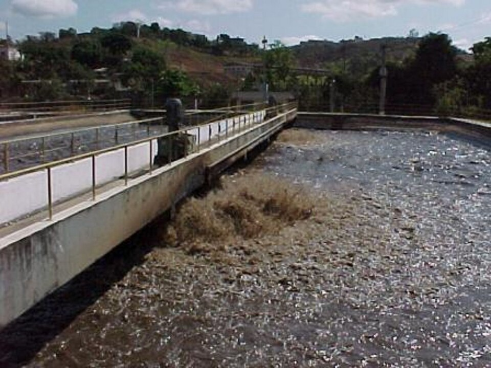{width="100%"}
[Surface aerator in the aeration tank of an activated sludge plant. Photo: Marcos von Sperling, CC BY-SA 4.0, Wikimedia Commons.]{.credit}
:::
::::

::: notes
Pick up the thread from the redox lecture. Internal loading explains why the Baltic responds slowly, but the external load sets the level, and municipal wastewater was once one of the largest point sources of phosphorus. Sweden introduced chemical phosphorus removal at most municipal plants in the 1970s, and large coastal plants later added nitrogen removal. The photo shows an aeration tank, the heart of biological treatment. Today's lecture is not about plant engineering or dosing. It is about the chemistry behind treatment, using the tools from this week: hydrolysis and precipitation from the metals lecture, sorption from surfaces, and electron transfer from redox. The guiding question is always: where does the pollutant go?
:::

## Removed from the water, but where?

:::: {.columns}
::: {.column width="50%"}
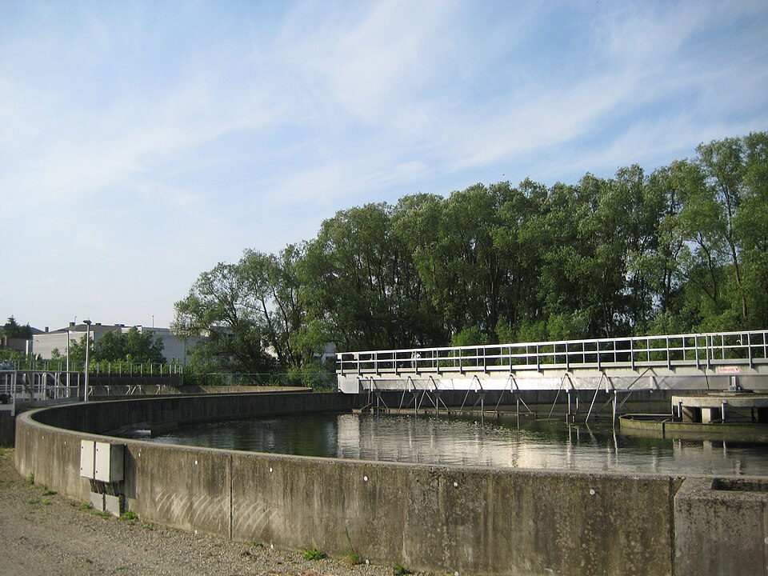{width="100%"}
[Secondary clarifier at a wastewater treatment plant, Harelbeke, Belgium. Photo: Annabel, CC BY-SA 3.0, Wikimedia Commons.]{.credit}
:::
::: {.column width="50%"}
Each person sends roughly **2 g of phosphorus** a day to the sewer. For a city of a million people, that is several hundred tonnes a year.

A modern plant removes **well over 90 %** of it from the water. But phosphorus is an element. It cannot be destroyed.

**Question for this lecture:** for each pollutant, which process changes its chemical form, and which only moves it into another stream, such as sludge or gas, that still has to be managed?
:::
::::

::: notes
Make the scale concrete. The per-person figure is a rough round number from human excretion and household products; plants use their own measured loads. Multiplied by a large city and a year, it becomes hundreds of tonnes of an element that cannot be destroyed, only moved. The photo shows a clarifier, a settling tank where the biological sludge separates from the treated water. The clear water flows over the edge; the solids settle and are pumped away. That separation is where much of the phosphorus, and many metals, leave the water. Pose the lecture question and ask students to keep a mental ledger for every process: what goes in, what comes out, and in which stream.
:::

## Start with the form of the pollutant

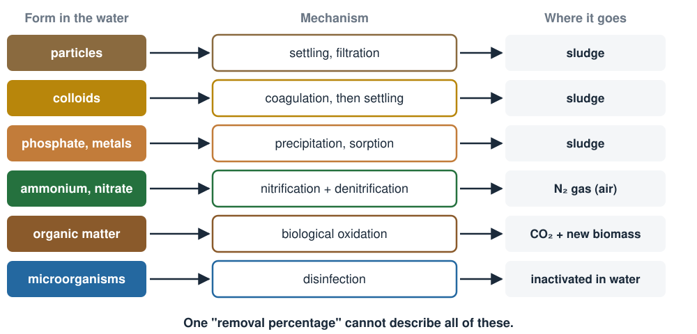{width="80%" fig-align="center"}

A treatment process works on a **form**, not on an element. Particles can be settled or filtered; dissolved ions need reaction or sorption; nitrogen needs microbes; microorganisms need disinfection. Every row ends in a **destination**.

::: notes
This table is the organising idea of the lecture. Before choosing a process, identify the form of the target. Particles respond to gravity and filters. Colloids are too small to settle on their own and first need coagulation. Dissolved phosphate and metals must be converted to a solid or bound to one. Ammonium and nitrate need biological transformation. Organic matter is oxidised by microbes. Microorganisms are inactivated by disinfection. Notice the right-hand column: every mechanism has a destination. Three of the rows end in sludge. That is why one overall removal percentage can never describe a plant: the percentage depends on the form, and it hides where the material went.
:::

## A wastewater treatment train

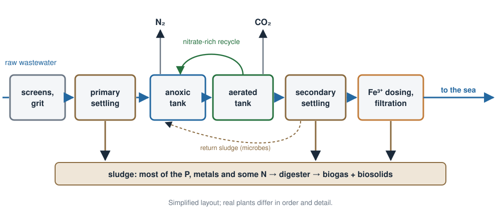{width="90%" fig-align="center"}

Water passes a series of stages. Each stage sends something **out of the water line**: grit and sludge to the sludge line, N₂ and CO₂ to the air. The sludge is digested to biogas and stabilised solids.

::: notes
Walk through the simplified layout from left to right. Screens and grit chambers remove large objects and sand. Primary settling removes settleable particles. The biological stage has an anoxic tank and an aerated tank, with nitrate-rich water recycled from the aerated tank back to the anoxic one. Secondary settling separates the microbes, most of which are returned to keep the biology going. Iron salts are dosed to precipitate phosphate, often with final filtration. The two outputs that are easy to overlook are the gases, nitrogen and carbon dioxide, and the sludge line, which collects most of the phosphorus and metals. Real plants differ, for example in where the iron is dosed, but the logic of streams is the same.
:::

## Transfer or transformation?

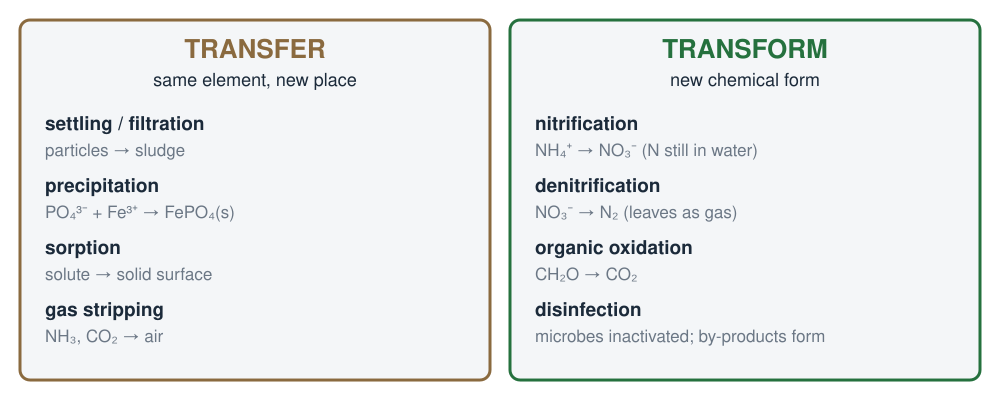{width="84%" fig-align="center"}

**Transfer** keeps the element and changes its place: water to sludge, water to air. **Transformation** changes the chemical form. Only a transformation to a harmless form, or a transfer to a safe, managed stream, counts as treatment.

::: notes
This is the main distinction of the lecture, and it maps directly onto the question we asked. On the left, settling, precipitation, sorption and stripping move an element from the water to a solid or to air. The element still exists and must be managed in its new stream. On the right, nitrification, denitrification, organic oxidation and disinfection change chemical form. Some transformations solve the problem: nitrate to nitrogen gas, which is most of the air. Others do not: ammonium to nitrate leaves the nitrogen in the water. Disinfection inactivates microbes but can create by-products, a new problem. Ask students to classify each process in the treatment train on the previous slide.
:::

## Coagulation: making colloids settle

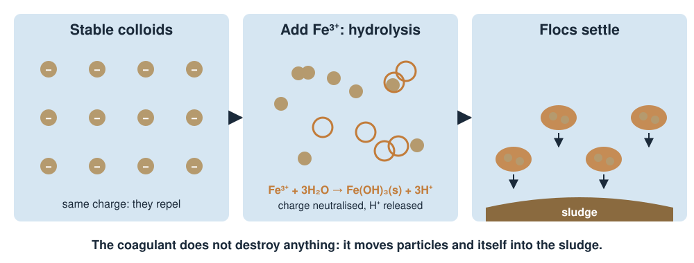{width="84%" fig-align="center"}

Colloids in water are usually **negatively charged** and repel each other, so they stay suspended. Adding Fe³⁺ or Al³⁺ produces **hydroxide flocs** that neutralise the charge and sweep particles together. The flocs settle as sludge.

::: notes
This brings together the metals and surfaces lectures. Natural colloids, clays and organic matter, mostly carry negative surface charge at the pH of natural water, so they repel each other and stay dispersed. Adding iron(III) or aluminium salts does two things. The positively charged hydrolysis species neutralise the colloid charge, so particles can stick together. And iron or aluminium hydroxide precipitates as a fluffy, high-surface floc that traps particles as it forms, called sweep flocculation. The same flocs sorb phosphate and some dissolved organic matter. Remember the hydrolysis reaction from the metals lecture: every iron(III) that becomes hydroxide releases three protons. That is the next slide.
:::

## Coagulants consume alkalinity

:::: {.columns}
::: {.column width="55%"}
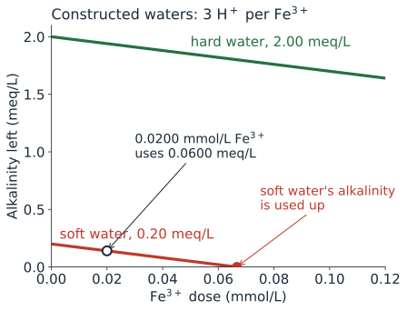{width="100%"}
:::
::: {.column width="45%"}
$$\mathrm{Fe^{3+}+3H_2O\rightarrow Fe(OH)_3(s)+3H^+}$$

Each Fe³⁺ releases **3 H⁺**. A dose of 0.0200 mmol/L Fe³⁺ gives 0.0600 mmol/L H⁺: alkalinity falls by **0.0600 meq/L**.

A hard water hardly notices. A **soft water** with 0.20 meq/L loses all its alkalinity at about 0.067 mmol/L Fe (3.7 mg/L), and its pH collapses.

Real dosing needs the actual water, but the bookkeeping is the carbonate lecture's.
:::
::::

::: notes
This is exercise 2. The reaction is a simplified representation: the real precipitate and the real net reaction depend on pH and on the other ions present. But the proton bookkeeping holds. Three protons per iron means three equivalents of alkalinity consumed per mole of iron. Link to the carbonate lecture. Strong acid lowers alkalinity one for one, and the pH response depends on how much alkalinity there was. In hard water the dose is a small fraction of the reserve. In soft water, common in much of Sweden, a realistic coagulant dose can consume all of it, so plants add lime or another base to keep the pH in the range where the hydroxide precipitates. The two waters are constructed for illustration.
:::

## Phosphate leaves as a solid

:::: {.columns}
::: {.column width="50%"}
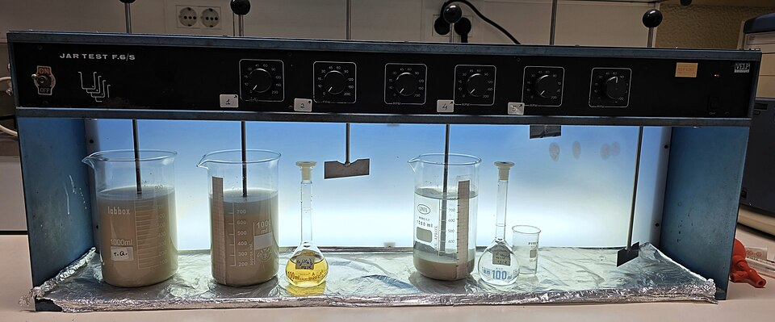{width="100%"}
[Jar-test stirrer with beakers of sample water, used to compare coagulant doses. Photo: Organic sweet, CC BY-SA 4.0, Wikimedia Commons.]{.credit}
:::
::: {.column width="50%"}
Simplified:

$$\mathrm{Fe^{3+}+PO_4^{3-}\rightarrow FePO_4(s)}$$

In practice phosphate is caught in a **mixed iron hydroxide–phosphate solid**, partly by precipitation and partly by **sorption** on the fresh hydroxide surface. Plants usually need more than one Fe per P.

Either way, the phosphorus is **transferred to sludge**. A jar test finds the dose that works for a particular water.
:::
::::

::: notes
Chemical phosphorus removal combines two mechanisms from this week. Some phosphate precipitates with iron directly. Much of it sorbs to the freshly formed iron hydroxide, the same inner-sphere binding we saw in the surfaces lecture. That is why the iron dose is usually larger than the simple one-to-one formula suggests: part of the iron forms hydroxide, which provides the surface. The photo shows a jar test, the standard laboratory method for choosing a coagulant dose. Identical jars of the water receive different doses, are stirred, and are left to settle; you compare clarity and residual phosphate. Note the connection to the Baltic: this iron-bound phosphate is stable only while the sludge stays oxic.
:::

## Sequential stages multiply

:::: {.columns}
::: {.column width="50%"}
Each stage acts on what **enters it**, not on the original amount.

$$M_{water}=M_0(1-f_1)(1-f_2)$$

**Worked example:** 10.0 mg of an element. Stage 1 transfers 60.0 %: 6.00 mg to sludge, 4.00 mg left. Stage 2 transfers 50.0 % of that: 2.00 mg more to sludge, **2.00 mg in the effluent**.

Overall: **80.0 %**, not 60 + 50 = 110 %. Check: 8.00 + 2.00 = 10.0 mg.
:::
::: {.column width="50%"}
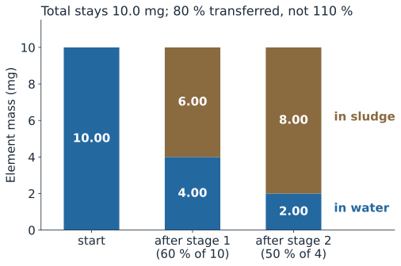{width="100%"}
:::
::::

::: notes
This is the worked example from the notes. The common error is to add the percentages, which can give more than one hundred percent and hides where the material goes. Multiply the fractions that remain instead: 0.4 times 0.5 is 0.2, so 20 percent stays in the water and 80 percent was transferred. Then close the balance by streams: sludge plus effluent equals what came in. Exercise 1 asks the same with two stages of 30 percent each, starting from 100 milligrams: 0.7 times 0.7 is 0.49, so 49 milligrams remain and 51 percent was removed. The example assumes no gas or chemical-product stream, which is true for phosphorus and metals but not for nitrogen.
:::

## Check yourself

::: {.checkbox}
Classify, then calculate.

1. Three stages each remove 50 % of what enters. What fraction of the original remains in the water?
2. A plant turns all its NH₄⁺ into NO₃⁻. Has it removed nitrogen?
3. Is chemical phosphorus removal a transfer or a transformation? Where does the P go?
4. How much alkalinity does 0.0500 mmol/L Fe³⁺ consume, if it all forms Fe(OH)₃?
:::

::: notes
Answers. One: one half cubed, so one eighth, 12.5 percent, remains; 87.5 percent was transferred, not 150 percent. Two: no. Every nitrogen atom is still in the water, now as nitrate. That is exercise 3, and it leads into the next slides. Three: a transfer. Phosphorus stays at oxidation state plus five and moves into the sludge as an iron-bound solid. Four: three times 0.05, so 0.150 milliequivalents per litre. Ask students which of the four answers needed a mass balance and which needed stoichiometry. Most real treatment questions need both.
:::

## Biological treatment burns organic matter

:::: {.columns}
::: {.column width="50%"}
In the aerated tank, microbes oxidise dissolved organic matter:

$$\mathrm{CH_2O+O_2\rightarrow CO_2+H_2O}$$

This is the respiration of the redox lecture, run on purpose. Air is blown in to supply the oxygen; that is a large part of a plant's energy use.

Part of the carbon leaves as **CO₂** (transformation). Part becomes **new microbial biomass**, which settles as sludge (transfer).
:::
::: {.column width="50%"}
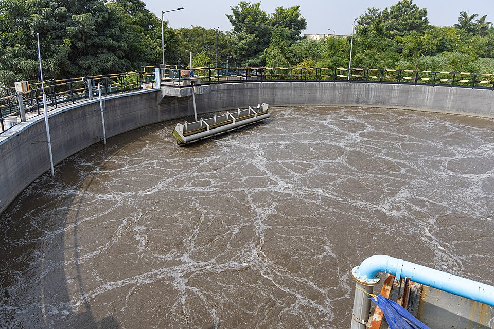{width="100%"}
[Aeration tank of a sewage treatment plant in Bengaluru, India. Photo: Vraj Acharya, WELL Labs, CC BY-SA 4.0, Wikimedia Commons.]{.credit}
:::
::::

::: notes
The activated sludge process uses a dense, recycled population of microbes to oxidise the organic matter in sewage. Chemically it is aerobic respiration, organic carbon donating electrons to oxygen, exactly as in the redox lecture, except that engineers supply the oxygen by blowing air through the tank. If the organic matter reached a lake untreated, the same reaction would consume the lake's oxygen. Here it happens in a tank where oxygen is supplied. The carbon has two fates. Some is oxidised to carbon dioxide and leaves as gas. Some is built into new cells; the excess is wasted as sludge. So even biological treatment produces a solid stream to manage.
:::

## Nitrogen: changing form is not removal

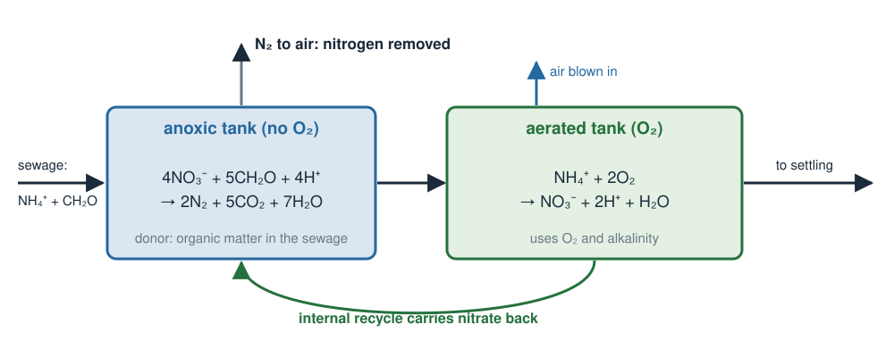{width="84%" fig-align="center"}

**Nitrification** (aerated tank) turns NH₄⁺ into NO₃⁻ using 2 O₂ per N; 1.00 mmol/L NH₄⁺ gives **1.00 mmol/L NO₃⁻**, still in the water. **Denitrification** (anoxic tank) turns nitrate into N₂ gas, using organic matter from the sewage as the electron donor.

::: notes
This is exercise 3 in practice. Nitrification alone converts ammonium, which is toxic to fish and consumes oxygen in rivers, into nitrate. That is useful, but the nitrogen count in the water is unchanged. To remove nitrogen, the plant must also denitrify. The common layout puts the anoxic tank first, where it receives the raw sewage with its organic carbon, and recycles nitrate-rich water back from the aerated tank. In the anoxic tank, microbes use nitrate instead of oxygen to oxidise the organic matter, exactly the denitrification reaction we balanced last lecture, with 1.25 moles of carbon per mole of nitrate. The nitrogen leaves as N2 gas, harmless in air.
:::

## Disinfection has a different target

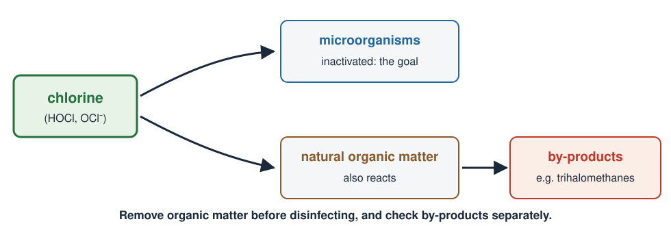{width="80%" fig-align="center"}

Disinfection **inactivates microorganisms**; it does not remove dissolved chemicals. Chlorine also reacts with natural organic matter, forming **by-products** such as trihalomethanes. The target and the side products must be judged separately.

::: notes
Disinfection is mainly a drinking-water topic, though some wastewater is also disinfected. The point for chemistry is that disinfection has a different target from everything else in the lecture. It kills or inactivates pathogens, which is essential for public health, but it does not remove nitrate, metals or most organic contaminants. Chlorine is a strong oxidant and reacts with natural organic matter, the brown humic material from week 2, forming chlorinated by-products. Trihalomethanes are the best known and are regulated in drinking water. That is why drinking-water plants try to remove organic matter by coagulation before chlorinating. Other disinfectants, such as UV light and ozone, have their own trade-offs.
:::

## Treatment changes chemistry beyond its target

:::: {.columns}
::: {.column width="45%"}
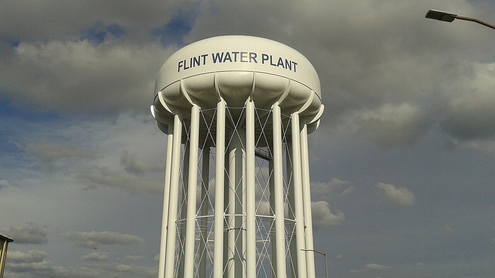{width="100%"}
[Water tower at the Flint water treatment plant, Michigan. Photo: US EPA, public domain, Wikimedia Commons.]{.credit}
:::
::: {.column width="55%"}
In 2014, **Flint, Michigan**, switched its drinking-water source to the Flint River and treated it at the city's own plant, **without adding a corrosion inhibitor**.

The new water was more corrosive. In homes with **lead service pipes**, the protective scale inside the pipes was destabilised, and **lead levels in tap water rose**.

The treatment met its targets for microbes and particles. It failed on the chemistry it did not track.
:::
::::

::: notes
Flint is a well-documented, sobering example of treatment chemistry with unintended consequences. Keep to the chemistry. In April 2014 the city switched from water purchased from Detroit to the Flint River, treated locally. The treated water was more corrosive to pipes, and no orthophosphate corrosion inhibitor was added. Lead service lines, which connect older homes to the main, had a mineral scale that had kept lead mostly out of the water. Under the new chemistry the scale dissolved and broke away, and lead concentrations at the tap rose in many homes. The city returned to Detroit water in October 2015. There were serious public-health consequences and legal proceedings, which are beyond this course.
:::

## Why the lead came out

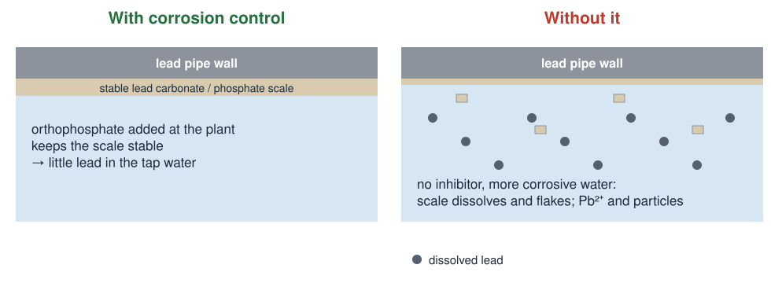{width="78%" fig-align="center"}

Lead pipes are protected by a thin scale of **lead carbonate and phosphate** minerals. Its stability depends on **pH, alkalinity, chloride and orthophosphate**, all set by treatment. Change the water and the scale can **dissolve** (free Pb²⁺) or **flake off** (lead particles). This is the metals lecture: the solubility of a solid, controlled by water chemistry.

::: notes
Connect Flint to this week's chemistry. The scale inside an old lead pipe is a set of sparingly soluble lead minerals, mainly carbonates and, where phosphate is dosed, phosphates. Their solubility depends on the pH, the alkalinity and the ligands in the water, exactly the free-ion and saturation reasoning from the metals lecture. Orthophosphate dosing helps form lead phosphate solids of very low solubility. A change in source water without matching corrosion control shifted that equilibrium. Lead then reached the tap both as dissolved ions and as particles that broke away from the pipe wall, which is why sampling must catch both. The lesson for treatment: every chemical change at the plant reaches every pipe downstream.
:::

## Back to the phosphorus

:::: {.columns}
::: {.column width="58%"}
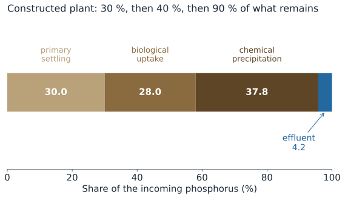{width="100%"}
:::
::: {.column width="42%"}
A **constructed** plant with three stages acting on what is left:

- primary settling: 30 % → 70 % left
- biological uptake: 40 % → 42 % left
- iron precipitation: 90 % → **4.2 % left**

Overall **95.8 %** transferred, and **95.8 %** of the phosphorus is now in **sludge**. The balance closes: 30.0 + 28.0 + 37.8 + 4.2 = 100.
:::
::::

::: notes
Return to the opening question with the tools of the lecture. The stage percentages are round constructed numbers, chosen to be in a plausible range, not data from a real plant. Multiply what remains: 0.7 times 0.6 times 0.1 is 0.042. So 4.2 percent of the incoming phosphorus reaches the sea, and the other 95.8 percent is in three sludge streams. Close the balance by adding all four parts. This is the answer to "where did it go": treatment did not destroy any phosphorus; it moved almost all of it from water heading to the Baltic into a solid stream that the plant must manage. That leads to the last chemical question of the lecture.
:::

## Sludge: problem and resource

:::: {.columns}
::: {.column width="55%"}
Sludge collects what the water lost: **phosphorus and nitrogen**, organic matter, and also **metals** and some persistent organic contaminants that sorb to solids.

- As a **resource**: phosphorus is a limited fertiliser raw material. Sludge can return it to farmland, or P can be recovered from it.
- As a **risk**: metals such as cadmium and sorbing organic pollutants travel with it.

Whether sludge is spread, burned or deposited, the mass balance continues.
:::
::: {.column width="45%"}
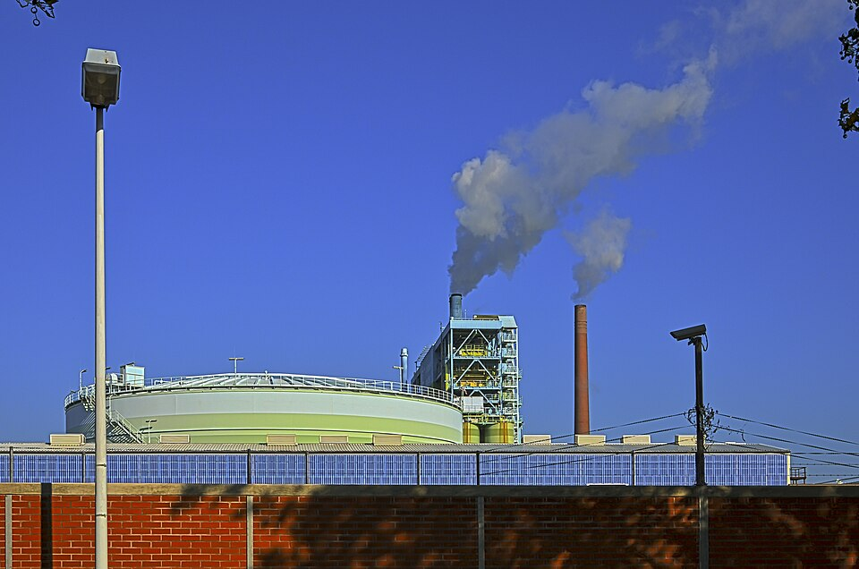{width="100%"}
[A plant that burns sewage sludge for energy, Industriepark Höchst, Frankfurt, Germany. Photo: Norbert Nagel, CC BY-SA 3.0, Wikimedia Commons.]{.credit}
:::
::::

::: notes
Finish the mass-balance story. Because so many processes transfer material into solids, sludge concentrates both valuable and harmful substances. Phosphorus is mined from a limited number of phosphate rock deposits, so recycling it from sludge has become a policy goal in Sweden and the EU. At the same time, cadmium, other metals and sorbing organic contaminants such as some PFAS are also concentrated in sludge, which is why spreading on farmland is regulated and debated. Incineration destroys organic contaminants but leaves the metals and phosphorus in the ash. The point is not to decide the policy, but to see that every option is another step in the same mass balance, which continues into soils, the topic of week 4.
:::

## Common mistakes to avoid

- **"Removal means destruction."** Most removal is transfer to sludge or gas.
- **"Add the stage percentages."** Multiply the fractions remaining.
- **"Nitrification removes nitrogen."** It changes NH₄⁺ to NO₃⁻; denitrification removes N as N₂.
- **"Filtration treats everything."** Dissolved nitrate and neutral organic molecules pass a filter.
- **"Disinfection cleans the water chemically."** It targets microbes and can form by-products.
- **"A coagulant only affects particles."** It consumes alkalinity and changes pH.

::: notes
Go through the list and ask students to give the counterexample from today for each. The fourth is exercise 4. A water with suspended clay, dissolved nitrate and a neutral organic contaminant needs at least three mechanisms: filtration or coagulation for the clay, biological or other treatment for nitrate, and contaminant-specific sorption or destruction for the organic compound, each with its own residual stream. The last mistake is the Flint lesson in small form: any chemical added at a plant changes the water's whole chemistry, not just the target. This course gives you the balances and mechanisms; real treatment design and dosing need the actual system and its operating data.
:::

## Summary {.smaller}

| Concept | Key fact |
| --- | --- |
| Start with the form | particles, colloids, ions, molecules and microbes need different mechanisms |
| Transfer vs transform | transfer moves an element to sludge or gas; transformation changes its form |
| Coagulation | Fe³⁺/Al³⁺ hydroxide flocs neutralise and sweep colloids into sludge |
| Coagulant acidity | Fe³⁺ + 3H₂O → Fe(OH)₃(s) + 3H⁺: 3 meq alkalinity per mmol Fe |
| Phosphorus | precipitated and sorbed with iron; moved to sludge, not destroyed |
| Sequential stages | remaining = M₀(1 − f₁)(1 − f₂) …; never add percentages |
| Biological oxidation | CH₂O + O₂ → CO₂ + H₂O; part of the carbon becomes sludge |
| Nitrogen | nitrification changes form; denitrification sends N to the air as N₂ |
| Disinfection | targets microbes; chlorine + organic matter → by-products |
| Side effects | pH, alkalinity and corrosion control decide whether pipes release lead |

**Next:** [Soil chemistry and retention](../soil-chemistry/lec.qmd). What happens to the phosphorus, metals and organic matter when they reach soil? Then the [exercises](exercise.qmd) and the [notes](notes.qmd).

::: notes
The table is the revision sheet for treatment chemistry. The chain to remember: identify the form; choose a mechanism; name the destination; close the balance. Most treatment is transfer, and transfers multiply through a series of stages. Biological treatment transforms carbon and nitrogen, using the same electron bookkeeping as the redox lecture. Coagulants and disinfectants have side effects that must be tracked: alkalinity and pH, by-products, and corrosion. This also closes week 3. Metals, surfaces, redox and treatment are one story about where elements go and in what form. Next week takes the same questions into soils, where sludge, deposition and weathering meet, and where sorption, exchange and redox control what stays and what leaches.
:::
